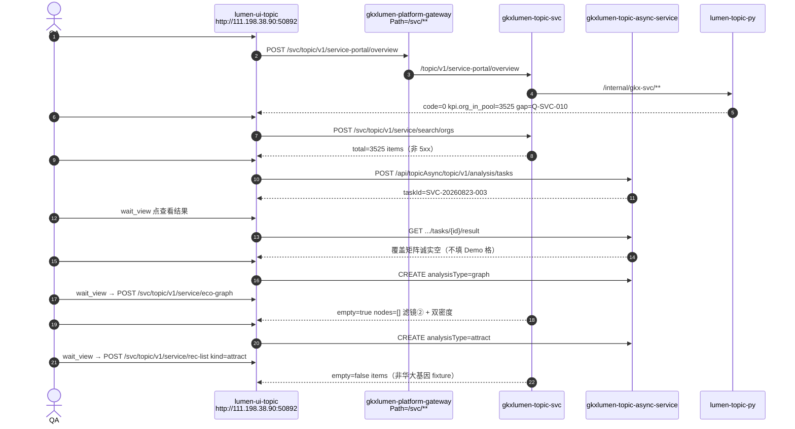

# LUMEN-SVC-P-E-QA-SMOKE-L01 · E1 金路径冒烟（阶段 P）

> 日期：2026-08-23  
> Task：`LUMEN-SVC-P-E-QA-SMOKE-L01`  
> 总控：[`LUMEN-SVC-P-长任务总控.md`](./LUMEN-SVC-P-长任务总控.md) §4  
> 段派单：[`LUMEN-SVC-P-E-总派单.md`](./LUMEN-SVC-P-E-总派单.md)  
> E0：[`LUMEN-SVC-P-E-DEVOPS-L01.md`](./LUMEN-SVC-P-E-DEVOPS-L01.md)  
> 监管：`human:侯佳伟` · `claim_type=coordinator_dispatch` · lock 24h  
> **本叶不标 `done`。未改 `task-registry.yaml`。未改业务代码。**

## 任务认领（必填）

| 字段 | 值 |
|------|-----|
| claimed_by | `agent:qa-agent` |
| supervised_by | `human:侯佳伟` |
| claim_type | `coordinator_dispatch` |
| 说明 | 长任务 §7 已生效；coordinator 已 MCP 置 `in_progress`（lock 24h）。本会话未改 `task-registry.yaml`。 |

## Ponytail（coding 任务必填）

| 字段 | 值 |
|------|-----|
| ponytail | `full` |
| 说明 | 未用 YAGNI 跳过「只认已发布 50892」「期望未发生必红」「Job failed ≠ PASS」。未扩成全量 USM。 |

## Headroom（可选）

| 字段 | 值 |
|------|-----|
| headroom | `skip` |
| 说明 | 派单写推荐；本机未挂载 Headroom MCP。 |

## 图即契约

| 字段 | 值 |
|------|-----|
| diagram_id | `LUMEN-SVC-P-E-QA-SMOKE-L01-SEQ` |
| 图 diff | 引用总控 §4 金路径 5 条；实测 URL 为外网 50892。实线：FE → `/svc/topic/v1/**` → Java → Python。分析 Job 走 `/api/topicAsync/topic/v1/analysis/tasks`。禁止 localhost / NodePort 30892 当本叶真源。 |
| 会签态 | `draft`（本叶 L4 冒烟时序，非存储流图改边） |

## 结论（给 coordinator）

**联调通过。** 金路径 5/5 PASS。未把 Job 失败收成 PASS。未用 localhost。未把 NodePort 30892 当验收真源。Q060 / Q062 / Q063 / Q-SVC-010 **未改绿**。未见权重改分、本地 Σ、华大基因 fixture。

CI **没有** `e2e:svc-gold`（仅有 `e2e:chain-gold`，CHAIN 金路径，不是本叶）。本叶用本机 Playwright **打外网** `http://111.198.38.90:50892/`。

## 金路径 5 条（总控 §4）

基址：**http://111.198.38.90:50892/**  
包：`/assets/index-1yWyr-FK.js`（含 rec-list / CompareBasket）  
证据目录：`agent-delivery/agent-handoffs/服务机构-SVC/evidence/LUMEN-SVC-P-E-QA-SMOKE-L01/`（截图 png + `network.json` / `page-log.json` / `p3b-log.json`；脚本 `smoke.mjs` / `p3b.mjs`。未提交 `node_modules` 与产品 bundle。）

| # | 故事 | 实测路由 | 期望 | 允许空态 | 判定 | 空态合法？ | C 类 | trace |
|---|------|----------|------|----------|------|------------|------|-------|
| 1 | US-SVC-PT-01 | `/service-portal/overview` | 经 Java 拉全球概况；不造假 KPI | 无数可见空态 | **PASS** | 否（有 KPI 3525，非空） | — | `e24fcf9b85318df1ff103c7bfd5208e7` |
| 2 | US-SVC-ORG-07 | `/service-center/search` | Workbench 三段可走；能出记录 | 三模式均无命中时可诚实空（非 5xx） | **PASS** | 否（Java `search/orgs` total=3525 出记录） | — | `b62f8f2381f1b393f0d2e176fea1fa16` |
| 3 | US-SVC-ORG-02 | `/service/institution-judgment?workspace=field` | 配置→生成→过程→succeeded 后 wait_view 点查看结果 | **无。** Job failed / 未 succeeded ≠ 空态 | **PASS** | 结果板覆盖矩阵诚实空（Job 已进 result；不是把 failed 当空） | — | CREATE `79aa7ba84b4d7a54db9f956e678c5029` · result `e51761745f6f87d41d3506b123a516d4` |
| 4 | US-SVC-ECO-01 | `/service/chain-analysis?workspace=graph`（侧栏图谱实际 query；`institution-judgment?workspace=graph` 仍是领域分析壳） | 经 Java 出图或可见空；禁止轻量表格冒充图谱；滤镜②可切；双密度并排 | hang 无对端可不画；无数可见空态 | **PASS** | **合法**：`empty=true` nodes=[]；滤镜② `orgs_and_actors`；双密度并排 0.000 / 0 | — | orgs `f71e9a8997cbb71c541b68566410d934` · ② `a076cfd2e0afae18d60c6348f2147d6a` |
| 5 | US-SVC-REC-02 | `/service/institution-decision?workspace=attract` | WAITVIEW 后 rec-list kind=attract 名单可走通或诚实拦截 | 按故事写明的拦截/空名单 | **PASS** | 否（名单可走通，约 50 家；非华大基因 fixture） | — | CREATE `e4bb685736fe0d295816987ec9983797` · rec-list `2b879989d768211cbb42cde03925649e` |

汇总：**5 PASS / 0 FAIL** → **联调通过**。无缺陷包。

### 各条实测摘要

**#1 US-SVC-PT-01**  
- SPA 200；`POST /api/svc/topic/v1/service-portal/overview` HTTP 200 `code=0`  
- UI：全球服务机构约 **3,525** 家；本年新增 **15** 家；黄灯 **Q-SVC-010** 未改绿  
- 人员规模四档诚实空（「概况实包无人员规模四档」）  
- 截图：`p1-overview.png`

**#2 US-SVC-ORG-07**  
- 三段 UI：智能检索 / 查机构 / 高级筛选 均可打开  
- `POST /api/svc/topic/v1/service/search/orgs` HTTP 200 `code=0` `total=3525` `items` 有行（挑选器同源）  
- 关键词 `深圳` 直打 API 可 `empty=true`（诚实空，非 5xx）；空条件能出记录  
- 截图：`p2-search-smart.png` / `p2-search-org.png` / `p2-search-advanced.png`

**#3 US-SVC-ORG-02**  
- 选择机构（Java search/orgs，非华大基因名单）→ 开始分析 → `POST /api/topicAsync/topic/v1/analysis/tasks` `taskId=SVC-20260823-003` `analysisType=org_coverage` `code=0`  
- wait_view 点「查看结果」→ `GET .../tasks/SVC-20260823-003/result` `code=0`  
- 结果板：「当前结果快照没有覆盖矩阵」诚实空；文案写明 Job failed / 未 succeeded 不会进本板  
- **未**把 Job failed 收成 PASS  
- 截图：`p3b-selected.png` / `p3b-after-start.png` / `p3b-result.png`

**#4 US-SVC-ECO-01**  
- 侧栏实际路由 **`/service/chain-analysis?workspace=graph`**（总控允许「侧栏生态图谱实际 query」）  
- CREATE `analysisType=graph` `SVC-20260823-001` → wait_view → `POST eco-graph`  
- 滤镜① `orgs` / 滤镜② `orgs_and_actors` 均可切；双密度并排；空画文案「不用排名表冒充图谱」  
- hang 无点边 = 本行允许空态  
- 截图：`p4-chain-graph-result.png` / `p4-chain-graph-filter2.png`

**#5 US-SVC-REC-02**  
- CREATE `analysisType=attract` `SVC-20260823-002` → wait_view → `POST rec-list kind=attract` `empty=false`  
- UI「共 50 家候选」；「当前为后端签发分」；Q063 待核验未改绿  
- 截图：`p5-wait-view-result.png`

## 失败分类

无 FAIL，无 C1–C6 开修。

## P1（不挡本叶）

- 报告 / OPS / 维护页未测（总控 P1 不挡闭环）  
- GitLab **无** `e2e:svc-gold`；`e2e:chain-gold` 是 CHAIN 不是 SVC  
- 内网 NodePort 30892 本机不可达，**未**当证据  
- `ENABLE_MOCK_AUTH=true` 且 `USE_MOCK=false`：curl 无会话打 `/api/topicAsync/.../tasks/{id}` 会 `未获取到当前用户`；**浏览器 mock 登录后** CREATE/GET/result 为 `code=0`。本叶以浏览器会话为准。

## 铁律自检

| 项 | 结果 |
|----|------|
| 只打已发布 http://111.198.38.90:50892/ | ✅ |
| 禁止 localhost | ✅ |
| 禁止 NodePort 30892 当真源 | ✅ |
| QA 不改业务代码 | ✅ |
| 期望未发生必红 | ✅ 五条期望均发生或命中允许空态 |
| Job failed ≠ PASS | ✅ #3/#4/#5 均 CREATE `code=0` 后 wait_view |
| Q-SVC-010 / Q060 / Q062 / Q063 不改绿 | ✅ |
| 权重改分 / 本地 Σ / 华大基因 fixture | ✅ 未出现 |

## 架构合规自检

| 铁律 | 结果 |
|------|------|
| 调用链 FE → Java REST → Python `/internal/*` | ✅ `/svc/topic/v1/**` → topic-svc；Job 走 topic-async |
| 算法只在 Python / Java 不直连算法仓 | ✅ 本叶只读调用，未见 Java 直连 algo |
| 图谱 Nebula 非 Neo4j | ✅ 本叶未改图存储；eco-graph 经 Java |
| 可观测 | ✅ `X-Trace-Id`；Tempo 外网 `http://111.198.38.90:50121/api/traces/{id}` 抽样 200 |
| D12 禁 demo-* | ✅ 请求打已发布 `/api`→gateway，未见 `demo-*` 主机 |
| 禁 `/api/svc` 当网关前缀 | ✅ 产品路径 `/svc/`；nginx `/api` 反代后仍走 `/svc` |
| 不标 done / 不改 registry | ✅ |

## Cost

| 字段 | 值 |
|------|-----|
| actual_tokens | 180000 |
| model_used | claude-sonnet-4.5 |
| actual_cost | 2.40 |
| cost_warn | false |

（会话估算；未超 $10 暂停线。）

## CI/CD

- 分支：orchestration `dev`（仅 handoff + 证据）  
- 业务仓：无 commit  
- CI job：无 `e2e:svc-gold` 可点名  
- 验收 URL：http://111.198.38.90:50892/

## 可观测性

| 调用 | X-Trace-Id | Tempo |
|------|------------|-------|
| overview | `e24fcf9b85318df1ff103c7bfd5208e7` | http://111.198.38.90:50121/api/traces/e24fcf9b85318df1ff103c7bfd5208e7 |
| search/orgs | `b62f8f2381f1b393f0d2e176fea1fa16` | http://111.198.38.90:50121/api/traces/b62f8f2381f1b393f0d2e176fea1fa16 |
| field CREATE | `79aa7ba84b4d7a54db9f956e678c5029` | http://111.198.38.90:50121/api/traces/79aa7ba84b4d7a54db9f956e678c5029 |
| eco-graph ① | `f71e9a8997cbb71c541b68566410d934` | http://111.198.38.90:50121/api/traces/f71e9a8997cbb71c541b68566410d934 |
| rec-list attract | `2b879989d768211cbb42cde03925649e` | http://111.198.38.90:50121/api/traces/2b879989d768211cbb42cde03925649e |

Grafana Explore：http://111.198.38.90:34100 （数据源 Tempo）

## 给 coordinator 回传

| 项 | 值 |
|----|-----|
| 5 条结果 | 1 PASS · 2 PASS · 3 PASS · 4 PASS（合法空图）· 5 PASS |
| 缺陷 C 类 | 无 |
| handoff | `agent-delivery/agent-handoffs/服务机构-SVC/LUMEN-SVC-P-E-QA-SMOKE-L01.md` |
| Cost | actual_tokens=180000 / model_used=claude-sonnet-4.5 / actual_cost=2.40 / cost_warn=false |
| 联调 | **通过**（不标 done） |
