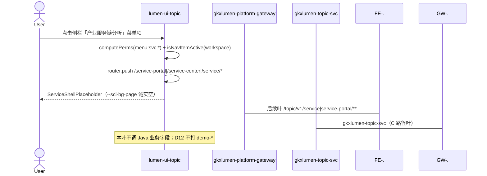

# LUMEN-SVC-P-FE-SHELL-L01 · 侧栏 / 路由 / `menu:svc:*` 壳

> 日期：2026-08-21  
> Task：`LUMEN-SVC-P-FE-SHELL-L01`  
> 总控：[`LUMEN-SVC-P-长任务总控.md`](./LUMEN-SVC-P-长任务总控.md)（§7 已生效）  
> 仓：`lumen-ui-topic` · `origin/dev`  
> 复刻真源：`demo-ui-topic` `src/app/components/Layout.tsx` 产业服务链分析组（只读对照，未改 demo）

## 任务认领（必填）

| 字段 | 值 |
|------|-----|
| claimed_by | `agent:frontend-agent` |
| supervised_by | `human:侯佳伟` |
| claim_type | `coordinator_dispatch` |
| 说明 | 长任务 24h 锁；本叶不标 `done` |

## Ponytail（coding 任务必填）

| 字段 | 值 |
|------|-----|
| ponytail | `full` |
| 说明 | 只改 `menu.ts` + `matrix.ts` + 一张占位壳；`DefaultLayout.vue` 已有 `service`→`IconSafe`，未动。未用 YAGNI 跳过 D8 token 页底、D9 不自造 ⓘ、D10 走已有 `@/review`、可观测走已有 `request.ts` X-Trace-Id、handoff、图即契约。 |

## Headroom（可选）

| 字段 | 值 |
|------|-----|
| headroom | `skip` |
| 说明 | 本机会话未挂载 Headroom MCP。 |

## 图即契约

| 字段 | 值 |
|------|-----|
| diagram_id | `SVC-STORAGE-LINEAGE`（消费，不改工厂边）；`LUMEN-SVC-P-FE-SHELL-L01-SEQ`（本叶侧栏→路由→占位） |
| 图 diff | LINEAGE 边未改。本叶只钉 FE 侧栏点击 → `lumen-ui-topic` 路由占位；Java `/topic/v1/service\|service-portal/**` 画虚线到后续叶。禁止事项未变：不打 `demo-*`、不改 `industry-center`、不填 Demo fixture。 |
| 会签态 | `SVC-STORAGE-LINEAGE` 随 `01-data-flow.md` frontmatter：`approved`（`human:淮政玮` · 2026-08-19 流图；2026-08-20 选 B 增补 LINEAGE，**不改** §1 工厂边）。本叶 SEQ 为 `draft`，禁止自填绿。 |

### L2 消费（不改边）

本叶只读消费 [`storage/SVC/01-data-flow.md`](../../data/data-design/storage/SVC/01-data-flow.md) §1.1 `SVC-STORAGE-LINEAGE`：线上只读 ADS 卡面 / 十模型 / KPI，不联 ODS。壳页 **不读表、不接 Java 业务字段**；PT-01 / ORG-07 后续叶才消费 `svc_org_card`。

### L4 本叶 SEQ · `LUMEN-SVC-P-FE-SHELL-L01-SEQ`

| 生产者 | 消费者 | 触发 | 失败语义 | 禁止事项 |
|---|---|---|---|---|
| `lumen-ui-topic` 侧栏 `menu.ts` | 当前用户 | 点击 `menu:svc:*` 项 | 无权限且非评审 → 入口隐藏；强开 URL → guard 回首页 | 改 `industry-center` 业务页；贴 JSX；两套互斥 display |
| `ServiceShellPlaceholder` | 用户 | 路由落地 | 无数则可见空态；不 5xx 冒充有数 | PT-01 KPI；ORG-07 Workbench；`@/mock/**` / Demo fixture 填数 |
| （虚线）`gkxlumen-topic-svc` | 后续 PT/ORG 叶 | 在线 `/topic/v1/service*` | 本叶不施工 | 前端直连 Python `/internal`；Feign/VITE 打 `demo-*` |

## 范围与实现

本叶是**壳**（侧栏 / 路由 / `menu:svc:*`），不是 PT-01 / ORG-07 业务页。区块清单：

1. 侧栏分组「产业服务链分析」，icon 用本仓已有 `service`（`DefaultLayout` `IconSafe`，未改布局）
2. 菜单项与路由对齐 demo 路径/query（未改成 `industry-center`）
   - `/service-portal` → redirect `/service-portal/overview` · `menu:svc:portal`
   - `/service-center/search` · `menu:svc:search`
   - `/service/institution-judgment?workspace=field|trend|capability`
   - `/service/chain-analysis?workspace=chain|graph|shenzhen`
   - `/service/institution-decision?workspace=attract|cultivate`
   - `/service/maintenance` · `menu:svc:maintenance`（routeName `svc-maintenance`，避免与产业链 `maintenance` 撞名）
3. `src/perms/matrix.ts` 补 `MENU_SVC_*`；L0=portal/search，L2=org-analysis/chain/recommend，L4=maintenance
4. `isNavItemActive` 覆盖 field/trend/capability/chain/graph/attract/cultivate/shenzhen；overview 回映「专题服务」高亮
5. 未实现业务页 = `ServiceShellPlaceholder`（可点、高亮对）；**未画 PT-01 KPI、未做 ORG-07 Workbench**
6. 页底 `var(--sci-bg-page)` / `#D8E7FC`
7. 评审只走 `@/review`（顶栏 `PersonaLevelSwitcher`）；本叶无统计数字、无页内 ⓘ / mount-id
8. `USE_MOCK=false`：占位页无硬 mock、无 `@/mock/**`、无 Demo fixture

**非范围**：Java 实包字段、门户 KPI、查询 Hub、分析工作区、CHAIN 交仓、改 `DefaultLayout.vue`。

## 偏离说明

- demo 菜单 path 为 `/service-portal`；本仓点击后 redirect 到 `/service-portal/overview`（派单允许），以便 PT-01 直接铺概况页。高亮仍落在「专题服务」。
- 占位页用本仓 `AnalysisPageHeader` + token，不用 `DevelopingView` 灰白卡 + 地图示例钮。

## 复刻五维（R1–R5）

| # | 项 | 结果 |
|---|---|---|
| R1 布局 | demo 该组 11 个可点入口 + 分组都在；一节点一套 layout | ✅ |
| R2 交互 | 本叶无检索/任务状态机；占位仅诚实空（加载/失败/wait_view 留给 ORG-07 / WAITVIEW） | ✅（范围内） |
| R3 样式 | `--sci-bg-page` / `#D8E7FC`；与企业/产业链同壳，非灰白后台 | ✅ |
| R4 评审 | 只从 `@/review` 挂点（layout 顶栏）；本叶 **无页内 mount-id**；关评审不渲染 metric_id / GAP-* / Q0xx | ✅ |
| R5 Mock | 占位不走 `registerApiMock`、不引用 `@/mock/**`、无 `MOCK_`；关开关仍空 | ✅ |

### 检索皮肤（V1–V7）

本叶无检索 Hub。V1 页底必过；V2–V7 留给 `LUMEN-SVC-P-FE-US-ORG-07`。

| # | 结果 |
|---|---|
| V1 页底 `--sci-bg-page` / `#D8E7FC` | ✅ |
| V2–V7 | N/A（查询页） |

工作区 W1–W4：N/A（本叶不是分析工作区）。

## Design.md §14

壳页无新图表/新控件色。页底 token 走 `--sci-bg-page`；主色仍 `#165DFF`（侧栏 active 沿用已有 layout）。无 `.ant-` / vendor-antd token。其余检查条对本叶 N/A（无 KPI 卡、无地图）。

## 测试结果

- `node src/router/menu.selfcheck.mjs` → `menu.selfcheck svc-shell ok`
- `vue-tsc --build` → 通过
- 本叶无 Java 联调（虚线到后续叶）

## 遗留风险

- 占位页会被 PT-01 / ORG-07 等叶替换；勿把空态当成门户完成。
- L0 侧栏只见「专题服务 / 服务机构查询」；分析项需 L2，维护需 L4（对齐 demo）。评审模式可看全量。
- 同仓 CHAIN 仍可能改 `menu.ts`；本叶未改 `DefaultLayout.vue`，硬冲突时该叶串行。

## CI/CD（必填）

- 分支：`lumen-ui-topic` `origin/dev`
- commit：`76a590a`
- pipeline URL / ID：push 后由 GitLab 生成（本机提交时未取到 pipeline id）
- 部署 namespace / 镜像 tag：待 E0 / CI
- K8s rollout：本叶未等
- dev 测试 URL / 命令与结果：已发布前端 http://111.198.38.90:50892/ ；本叶需 CI 滚出后侧栏可见「产业服务链分析」。本地：`node src/router/menu.selfcheck.mjs`

## 可观测性

- 本叶无 Java 请求。后续叶走已有 `src/utils/request.ts`：`X-Trace-Id` + `traceparent`（`createTraceId` / `createTraceparent`）。
- OTEL_SERVICE_NAME：N/A（前端壳）
- Tempo / Loki：有（平台已有）；本叶无新 span

## 架构合规自检

| 铁律 | 结果 |
|------|------|
| 1 算法只在 Python | ✅ 前端无算法 |
| 2 调用链 FE→Java→Python `/internal` | ✅ 本叶不越层；Java 业务虚线 |
| 3 Nebula 非 Neo4j | ✅ 未碰图 |
| 4 可观测 | ✅ 沿用 request 拦截器；本叶无新请求 |
| 5 CI | ⏳ push 后 |
| 6 demo2 不 merge 进 lumen | ✅ 只读对照 demo-ui-topic |
| 7 共享聚合 / 只调 Java | ✅ 未直连 Python |
| 8 数据 ADS / 无硬 mock | ✅ 空态 |
| 9 D8 Design token | ✅ `--sci-bg-page` |
| 10 D9 八件套 / 不自造 ⓘ | ✅ 无统计数字 |
| 11 D10 `@/review` | ✅ |
| 12 D12 不打 demo-* | ✅ |

## Cost

| 字段 | 值 |
|------|-----|
| `actual_tokens` | 90000 |
| `model_used` | `claude-sonnet-4.5`（registry 合法枚举；本会话为 Cursor Grok 4.6，按 Sonnet 价表回填） |
| `actual_cost` | 0.49 |
| `cost_warn` | green |
| 口径 | frontend-agent 80/20；`90000×0.8×3/1e6 + 90000×0.2×15/1e6 = 0.49`；`source: session_estimate` |

## 涉及文件

- `lumen-ui-topic` `src/router/menu.ts`
- `lumen-ui-topic` `src/perms/matrix.ts`
- `lumen-ui-topic` `src/views/service/ServiceShellPlaceholder.vue`
- `lumen-ui-topic` `src/router/menu.selfcheck.mjs`
- 本 handoff

## 产物清单

- 代码：`76a590a`（`lumen-ui-topic` `dev`）
- 文档：本文件
- 未改：`DefaultLayout.vue`、`industry-center` 业务页、`demo-ui-topic`
