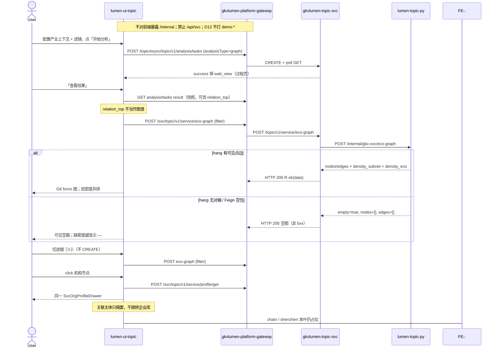

# LUMEN-SVC-P-FE-US-ECO-01 · US-SVC-ECO-01 生态图谱（非六阶段卡）

> 日期：2026-08-21  
> Task：`LUMEN-SVC-P-FE-US-ECO-01`  
> 总控：[`LUMEN-SVC-P-长任务总控.md`](./LUMEN-SVC-P-长任务总控.md)（§7 已生效；切法 A / 公式冻结）  
> 仓：`lumen-ui-topic` · `origin/dev`  
> 复刻真源：`demo-ui-topic` `ServiceChainEcosystemPage.tsx` + `EcosystemGraphView.tsx`（只读对照，未贴 JSX、未改 demo；图谱用本仓 G6 而非 Demo ECharts）  
> 本仓前置：WAITVIEW `7f83a82` · SHELL · Java `LUMEN-SVC-P-JAVA-API-ECO-GRAPH-L01`

## 任务认领（必填）

| 字段 | 值 |
|------|-----|
| claimed_by | `agent:frontend-agent` |
| supervised_by | `human:侯佳伟` |
| claim_type | `coordinator_dispatch` |
| 说明 | 长任务 24h 锁；本叶不标 `done` |

## Ponytail（coding 任务必填）

| 字段 | 值 |
|------|-----|
| ponytail | `full` |
| 说明 | 复用 WAITVIEW 过程壳、`IndustryCatalogSelect`、`SvcOrgProfileDrawer`、`@/review`、已有 G6（`IndustryPanoramaGraph` 同类）、`request.ts`。未用 YAGNI 跳过 D8 页底 token、D9 ⓘ/角标、D10 评审自闸、可观测 X-Trace-Id、handoff、图即契约、五维复刻。未落地 ECO-02 / US-06。 |

## Headroom（可选）

| 字段 | 值 |
|------|-----|
| headroom | `skip` |
| 说明 | 本机会话未挂载 Headroom MCP。 |

## 图即契约

| 字段 | 值 |
|------|-----|
| diagram_id | `SVC-STORAGE-LINEAGE`（消费，不改工厂边）；`LUMEN-SVC-P-FE-US-ECO-01-SEQ`（本叶） |
| 图 diff | LINEAGE 边未改。本叶把图谱结果从 SHELL 占位改成实线：`workspace=graph` 经 WAITVIEW 后 POST Java `eco-graph`，G6 画 `nodes/edges` 或可见空画。`workspace=chain` / `shenzhen` 仍虚线占位。禁止事项未变：不打 `demo-*`、不用 `relation_top` 冒充图谱、不造对端点。 |
| 会签态 | `SVC-STORAGE-LINEAGE` 随 `storage/SVC/01-data-flow.md` frontmatter：`approved`（`human:淮政玮` · 2026-08-19 流图；2026-08-20 选 B 增补 LINEAGE，**不改** §1 工厂边）。本叶 SEQ 为 `draft`，禁止自填绿。 |

### L2 消费（不改边）

本叶只读消费 [`storage/SVC/01-data-flow.md`](../../data/data-design/storage/SVC/01-data-flow.md) §1.1 `SVC-STORAGE-LINEAGE`：关系链 hang `demo_gkx_chain`，ADS=`svc_relation_chain`。前端不扫表、不直连 nGQL、不改工厂边。无 hang 对端 → 可见空画，不拿 Demo 内置企业名 / GraphView 22 点填图。

### L4 本叶 SEQ · `LUMEN-SVC-P-FE-US-ECO-01-SEQ`

| 生产者 | 消费者 | 触发 | 失败语义 | 禁止事项 |
|---|---|---|---|---|
| Java `POST /topic/v1/service/eco-graph` | G6 结果板 | 「查看结果」后；结果页切滤镜 | HTTP 200 空图 / FE catch → 可见空画，不报 5xx；缺密度键「—」 | `/api/svc`；直连 `/internal`；`relation_top` 当图；Demo 内置企业名填点；表格冒充图谱 |
| Java `POST\|GET /topicAsync/.../tasks*` | WAITVIEW 过程壳 | 「开始分析」/「重新分析」 | 失败红 alert ≠ 空画 | 切 workspace/滤镜自动 CREATE；指纹带滤镜 |
| Java `POST /topic/v1/service/profile/get` | 机构 Drawer | 机构节点 click / `?org=` | 沿用 ORG-03 无卡 Empty | 关联主体跳企业库 |
| `M_SVC_RELATION_DENSITY` | 双密度 ⓘ | 结果板两列 | Q062 待核验，不改绿 | 用生态密度覆盖子网列名；D1 改 aligned |

## 范围与实现

落地金路径 #4 `US-SVC-ECO-01` 生态图谱（不是六阶段卡）：

1. 路由 `/service/chain-analysis?workspace=graph`：`ServiceChainAnalysisWorkspace` 接管同 path 三入口；`graph` 全流程，`chain` / `shenzhen` 仍占位空态。
2. 配置区：`IndustryCatalogSelect` + 双滤镜（①仅机构 / ②机构+关联主体）+「开始分析」。滤镜只进 URL `eco_filter` 与 eco-graph body，**不进** `analysis_fp`（`svc|graph|{industry|*}`）。
3. WAITVIEW：点开始才 CREATE `analysisType=graph`；success 停过程页；须点「查看结果」才 POST `eco-graph`。切产业/滤镜/workspace 不自动 create。
4. 结果板：本仓 G6 force（`d3-force`）画 Java `nodes/edges`。`empty` / 无 hang 对端 / 仅有 `relation_top` → **可见空画**，不造点。边类型只认 `belongs_to` / `participates` / `supplies` / `depends_on`（`cooperation` 映射 `participates`）。
5. 双密度并排：`density_subnet|subnet_density` 与 `density_eco|eco_density` 两列；N&lt;2 显示 0；缺键显示 —，不发明 0。Q062 / `M_SVC_RELATION_DENSITY` 走 `@/review`，D1 draft，不改绿。
6. 机构节点 click → `?org=` + 已有 `SvcOrgProfileDrawer`。关联主体只页内摘要，不跳企业库。
7. Mock 开：`registerApiMock('svcEcoGraph')`，点用 `org-live-1/2` + 通用 `actor-hang-1`。关：页面不引 `@/mock/**`。
8. `serviceEcoAnalysis.selfcheck.mjs` + `vue-tsc --build` 通过。

**非范围**：US-SVC-ECO-02 短板；US-06 深圳现状（本叶占位）；六阶段卡；改 `DefaultLayout` / `industry-center` 业务页；改 Java/Python；宣称 K8s 绿。

## 偏离说明

- Demo 图谱用 ECharts graph。本仓已有 G6（`IndustryPanoramaGraph`），按 `/goal` 用 G6，不抄 Demo JSX、不用表格/ECharts 冒充关系图。
- Demo 密度 metric 名 `M_SVC_GRAPH_DENSITY`。正式矩阵 id 为 `M_SVC_RELATION_DENSITY`（Q062）。本叶用正式 id。
- Demo 开始分析要求已选产业。Java eco-graph 不按产业切片 hang，本叶允许未选产业（指纹 `svc|graph|*`），产业仅作上下文。
- 模板 W4「当天已成功直接打开结果」：沿用 WAITVIEW，restore 到过程页再点「查看结果」。
- Java 测例键名 `subnet_density` / `eco_density`，Python 键名 `density_subnet` / `density_eco`。前端两套都认，列名不互盖。

## 复刻五维（R1–R5）

| # | 项 | 结果 |
|---|---|---|
| R1 布局 | 配置 / 过程壳 / G6 结果 / 双密度两列 / 记录 Tab；chain/shenzhen 独立占位；`v-if` 一节点一套 layout | ✅ |
| R2 交互 | 「开始分析」才 CREATE；切滤镜只重打 eco-graph；机构 Drawer；主体摘要；wait_view 未改 | ✅ |
| R3 样式 | `--sci-bg-page` / `#D8E7FC`；节点色 Design §4.4 服务机构 `#F779B6` / 企业 `#16C7C7` / 科研 `#4DD164`；主色 `#165DFF` | ✅ |
| R4 评审 | 只从 `@/review`（`SVC-ECO-01-*`）；关评审不泄漏 metric_id / GAP-* / Q062 | ✅ |
| R5 Mock | 开：`registerApiMock`。关：页面不引 `@/mock/**`、无页内 `MOCK_`、无内置企业名填点 | ✅ |

### 检索皮肤（V1–V7）

本叶是分析工作区，不是检索 Hub。V1 页底必过；V2–V7 N/A。

| # | 结果 |
|---|---|
| V1 页底 `--sci-bg-page` / `#D8E7FC` | ✅ |
| V2–V7 | N/A（查询页） |

### 工作区（W1 / W2 / W4）

| # | 项 | 结果 |
|---|---|---|
| W1 | 配置区 / 过程壳 / 图谱结果 / 记录 Tab | ✅ |
| W2 | 关系图 | ✅ G6 force；非表格冒充 |
| W3 | 报告阅读器 | N/A |
| W4 | 切条件不自动 create；「开始分析」；同指纹一条在跑；当天成功可恢复；「重新分析」可 force | ✅（WAITVIEW：当天成功恢复过程页） |

## 附录 E（I2-12）

| # | 项 | 结果 |
|---|---|---|
| E.1 页清单 | `/service/chain-analysis?workspace=graph`（本叶）；chain/shenzhen 占位 | ✅ |
| E.2 CTA | 配置区「开始分析」 | ✅ |
| E.3 禁自动 create | 无 `watch → create`；切滤镜只 `eco-graph` | ✅ |
| E.4 单飞 | `decideAnalysisTaskGate` + `svc\|graph\|{industry\|\*}`；滤镜不进指纹 | ✅ |
| E.5 当天复用 | `forceCreate=false` restore 过程页；`重新分析` `force=true` | ✅ |
| failed | 过程壳红 alert ≠ hang 空画 | ✅ |

## Design.md §14

页底 token `--sci-bg-page`；主色 `#165DFF`；节点色走 §4.4。无 `.ant-` / vendor-antd token。无新地图。密度数字旁走 `@/review`，不自造 ⓘ / emoji 角标。

## 测试结果

- `node src/views/service/serviceEcoAnalysis.selfcheck.mjs` → `serviceEcoAnalysis.selfcheck eco-graph ok`
- `node src/router/menu.selfcheck.mjs` → `menu.selfcheck svc-shell ok`
- `vue-tsc --build` → 通过（exit 0）
- 本叶未等 K8s rollout

## 遗留风险

- 现网 hang 若无对端，50892 上会看到可见空画 + 密度 0/—，这是诚实空，不是前端 fixture。
- Java Feign 失败回 200 空图；前端网络失败同样空画 + 警告，不报 5xx。
- 金路径 #4 仍须 E0 滚出后在 50892 点过一遍（开始分析 → 查看结果 → 切滤镜② → 机构 click）。
- G6 `d3-force` 若运行时不可用，render 失败时销毁实例，画布侧仍走空态分支以外的容器（需看现场）；未改用第二套图库。

## CI/CD（必填）

- 分支：`lumen-ui-topic` `origin/dev`（push `12c5391..ebad391`，未 force）
- commit：`ebad391` `feat(svc): add US-SVC-ECO-01 ecological graph workspace [agent:frontend-agent]`
- pipeline URL / ID：GitLab 对 `ebad391` 自动建管线（本叶未等绿、未宣称 K8s 已滚出）
- 部署 namespace / 镜像 tag：待 E0 / CI
- K8s rollout：本叶未等
- dev 测试 URL：http://111.198.38.90:50892/service/chain-analysis?workspace=graph （需 CI 滚出后可见本叶）
- 本地：`node src/views/service/serviceEcoAnalysis.selfcheck.mjs`

## 可观测性

- `svcEcoGraph` / CREATE / GET / RESULT / `profile/get` 均走 `src/utils/request.ts`：`X-Trace-Id` + `traceparent`
- 图谱失败展示 `traceId`
- OTEL_SERVICE_NAME：N/A（前端）
- Tempo / Loki：有（平台已有）；本叶无新 span 名

## 架构合规自检

| 铁律 | 结果 |
|------|------|
| 1 算法只在 Python | ✅ 前端无密度算法；只展示 Java 返回值 |
| 2 调用链 FE→Java→Python `/internal` | ✅ 只调 `/svc/topic/v1/service/eco-graph` + tasks + profile/get |
| 3 Nebula 非 Neo4j | ✅ 未直连图库；G6 只渲染 Java 点边 |
| 4 可观测 | ✅ request 拦截器 X-Trace-Id |
| 5 CI | ⏳ push 后 |
| 6 demo2 不 merge 进 lumen | ✅ 只读对照 demo-ui-topic |
| 7 共享聚合 / 只调 Java | ✅ 未直连 Python |
| 8 数据 ADS / 无硬 mock | ✅ `USE_MOCK=false` 不填 fixture |
| 9 D8 Design token | ✅ `--sci-bg-page`；节点 §4.4 |
| 10 D9 八件套 / 不自造 ⓘ | ✅ `M_SVC_RELATION_DENSITY` 走 `@/review`；Q062 不改绿 |
| 11 D10 `@/review` | ✅ |
| 12 D12 不打 demo-* | ✅ |

## Cost

| 字段 | 值 |
|------|-----|
| `actual_tokens` | 240000 |
| `model_used` | `claude-sonnet-4.5`（registry 合法枚举；本会话为 Cursor Grok 4.6，按 Sonnet 价表回填） |
| `actual_cost` | 1.30 |
| `cost_warn` | green |
| 口径 | frontend-agent 80/20；`240000×0.8×3/1e6 + 240000×0.2×15/1e6 = 1.296` 取 `1.30`；`source: session_estimate` |

## 涉及文件

- `lumen-ui-topic` `src/views/service/ServiceChainAnalysisWorkspace.vue`
- `lumen-ui-topic` `src/views/service/SvcEcoRelationGraph.vue`
- `lumen-ui-topic` `src/views/service/svcEcoGraphModel.ts`
- `lumen-ui-topic` `src/views/service/svcEcoAnalysisWorkspace.ts`
- `lumen-ui-topic` `src/views/service/serviceEcoAnalysis.css`
- `lumen-ui-topic` `src/views/service/serviceEcoAnalysis.selfcheck.mjs`
- `lumen-ui-topic` `src/views/service/ServiceReviewMount.vue`
- `lumen-ui-topic` `src/api/service/{index,paths,types}.ts`
- `lumen-ui-topic` `src/composables/useSvcAnalysisJob.ts`（CREATE params 增 industry）
- `lumen-ui-topic` `src/router/menu.ts` + `menu.selfcheck.mjs`
- `lumen-ui-topic` `src/mock/service/ecoGraphMock.ts` + `register.ts`
- `lumen-ui-topic` `src/mock/service/svcMetricSeed.ts` / `svcReadinessSeed.ts` / `svcGapCatalog.ts`
- 本 handoff

## 产物清单

- 代码：`ebad391`（`lumen-ui-topic` `dev`）
- 文档：本文件
- 未改：`DefaultLayout.vue`、`industry-center` 业务页、`demo-ui-topic`、Java / Python、WAITVIEW 指纹规则（仅 CREATE 多带 industry 字段）

## 联调确认

联调通过（代码侧）：`workspace=graph` 经 WAITVIEW 后只调 Java `eco-graph` 出 G6 或可见空画；双滤镜不换 hang、不进指纹；双密度并排且两套键都认；`relation_top` 不当图；Q062 不改绿；chain/shenzhen 仍占位。请 coordinator AV-0，**本叶不自行标 done**。

## Registry（MCP）

`task-update-fields` 写 evidence / note / cost 四字段；`status` 仍为 `in_progress`（未改 done）。禁止手改 `task-registry.yaml`。
