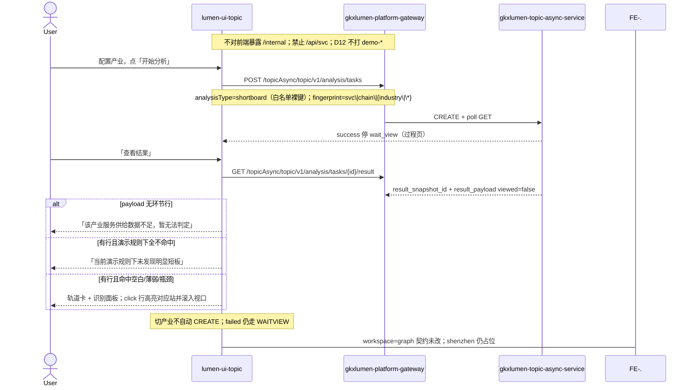

# LUMEN-SVC-P-FE-US-ECO-02 · US-SVC-ECO-02 瓶颈堵点 / 短板识别

> 日期：2026-08-22  
> Task：`LUMEN-SVC-P-FE-US-ECO-02`  
> 总控：[`LUMEN-SVC-P-长任务总控.md`](./LUMEN-SVC-P-长任务总控.md)（§7 已生效；切法 A / 公式冻结）  
> 仓：`lumen-ui-topic` · `origin/dev`  
> 复刻真源：`demo-ui-topic` `ChainLinkView.tsx`（只读对照，未贴 JSX、未改 demo、未搬 `computeStageStats`）  
> 本仓前置：WAITVIEW · ECO-01 `workspace=graph`（本叶不改其滤镜/双密度契约）

## 任务认领（必填）

| 字段 | 值 |
|------|-----|
| claimed_by | `agent:frontend-agent` |
| supervised_by | `human:侯佳伟` |
| claim_type | `coordinator_dispatch` |
| 说明 | 长任务 24h 锁；本叶不标 `done`。coordinator 已 MCP `in_progress`。本会话未挂载 task-registry MCP，未手改 yaml。 |

## Ponytail（coding 任务必填）

| 字段 | 值 |
|------|-----|
| ponytail | `full` |
| 说明 | 复用 WAITVIEW 过程壳、`IndustryCatalogSelect`、`@/review`、已有 `useSvcAnalysisJob`。未搬 Demo 统计函数、未补六卡 0。未用 YAGNI 跳过 D8 页底 token、D9 GAP 红问号、D10 评审自闸、可观测 X-Trace-Id、handoff、图即契约、五维复刻、附录 E。未落地 US-06 深圳。 |

## Headroom（可选）

| 字段 | 值 |
|------|-----|
| headroom | `skip` |
| 说明 | 本机会话未挂载 Headroom MCP。 |

## 图即契约

| 字段 | 值 |
|------|-----|
| diagram_id | `SVC-STORAGE-LINEAGE`（消费，不改工厂边）；`LUMEN-SVC-P-FE-US-ECO-02-SEQ`（本叶） |
| 图 diff | LINEAGE 边未改。本叶把 `workspace=chain` 从 ECO-01 占位改成实线：WAITVIEW CREATE `shortboard` → GET result → 只认 `models/gap` 环节行画轨道+识别面板。`workspace=graph` 仍走 eco-graph；`shenzhen` 仍虚线占位。禁止事项未变：不打 `demo-*`、不搬 Demo 统计、不补六卡 0、不新 Java 路径。 |
| 会签态 | `SVC-STORAGE-LINEAGE` 随 `storage/SVC/01-data-flow.md` frontmatter：`approved`（`human:淮政玮` · 2026-08-19 流图；2026-08-20 选 B 增补 LINEAGE，**不改** §1 工厂边）。本叶 SEQ 为 `draft`，禁止自填绿。 |

### L2 消费（不改边）

本叶只读消费 [`storage/SVC/01-data-flow.md`](../../data/data-design/storage/SVC/01-data-flow.md) §1.1 `SVC-STORAGE-LINEAGE`：分析任务经 Java Job 读 CREATE 已签发的 snapshot。前端不扫表、不直连 nGQL、不改工厂边。就近读面 `models/gap`。无环节行 → 诚实空；不拿门户 PT-02 `industry-distribution` / G6 `relation_top` 冒充地铁图。

### L4 本叶 SEQ · `LUMEN-SVC-P-FE-US-ECO-02-SEQ`

| 生产者 | 消费者 | 触发 | 失败语义 | 禁止事项 |
|---|---|---|---|---|
| Java GET result `result_payload` | 短板轨道 + 识别面板 | 仅用户点「查看结果」 | 无环节行 / 无命中 → 文案空；failed ≠ 短板空态 | Demo `computeStageStats`；六卡补 0；门户 PT-02 当本页数据；G6/`relation_top` 冒充地铁图 |
| `IndustryCatalogSelect` | `analysis_fp=svc\|chain\|{industry\|\*}` | 配置区点开始 / 重新分析 | 切产业只改指纹与 gate，不自动 CREATE | 产业不进指纹；graph 滤镜进短板指纹 |
| 切法 A 展示规则 | 空白/薄弱/瓶颈 Tag | payload 无 `problem`/`type` 时 | 不发明数字；均深缺则不做瓶颈 | 把企业/高校/资本计入；Q-SVCCHAIN-03 改绿 |

## 范围与实现

落地 `US-SVC-ECO-02` 瓶颈堵点 / 短板识别，替换 ECO-01 对 `workspace=chain` 的占位：

1. 路由 `/service/chain-analysis?workspace=chain`：配置区 / 过程壳 / 记录 Tab 复用本页 WAITVIEW。CREATE 白名单裸键 `shortboard`。指纹 `svc|chain|{industry||*}`。切产业不自动 CREATE。
2. 结果只经 `GET /topicAsync/topic/v1/analysis/tasks/{id}/result`。只认 payload 环节行（`stages` / `gap`：环节名 + count + 可选 avg_depth）。
3. 无环节行 → 「该产业服务供给数据不足，暂无法判定」。有行全不命中 → 「当前演示规则下未发现明显短板」。不硬造问题。
4. 数字只认 payload。标签优先 payload `problem`/`type`；否则切法 A：0 家=空白；≤1 家=薄弱；均深&lt;55=瓶颈。对象=服务机构。依据行引用当前 payload 数值。
5. 布局对照 Demo 轨道 + 识别面板。click 判定行高亮对应站并滚入视口。不用 G6/`relation_top` 冒充地铁图。
6. 评审：仓内无 `M_SVC_CHAIN_BOTTLENECK` / `M_SVC_CHAIN_SEGMENT_*` 种子，未自造写进 seed，未挪用 `industry-center` `M_CHAIN_BOTTLENECK_*`。D1 missing 走 `@/review` 红问号 / `GAP-SVC-CHAIN-*` / `Q-SVCCHAIN-03`。关评审零泄漏；业务态保留「演示规则判定」。
7. 附录 E：切条件不自动 CREATE；「开始分析」；同指纹一条在跑；当天成功 restore 过程页再点「查看结果」；「重新分析」forceCreate。failed ≠ 短板空态。
8. Mock 开：GET result 给 4 条短环节行（含真实 count，不编六卡 0）。关：页面不引 `@/mock/**`。

**非范围**：`workspace=graph` 滤镜/双密度；`workspace=shenzhen`；改 ORG-02 覆盖矩阵；改 `DefaultLayout` / `industry-center`；改 Java/Python；宣称 K8s 绿。

## 偏离说明

- 未搬 Demo `computeStageStats` / `serviceEcosystemData` / 固定六张卡补 `count=0`。只渲染 payload 已有环节行。
- 展示规则 0 / ≤1 / 均深&lt;55 只贴标签，不发明数字。Q-SVCCHAIN-03 待核验不改绿。
- 仓内无 `M_SVC_CHAIN_*` 种子 → GAP-* 红问号，不显伪 8 件套。
- 模板 W4「当天已成功直接打开结果」：沿用 WAITVIEW，restore 到过程页再点「查看结果」。
- 未改 graph workspace 契约（仍 `analysisType=graph`、`svc|graph|{industry|*}`、滤镜不进指纹、G6 + 双密度）。

## 复刻五维（R1–R5）

| # | 项 | 结果 |
|---|---|---|
| R1 布局 | 配置 / 过程壳 / 轨道+识别面板 / 记录 Tab；shenzhen 独立占位；graph 结果板仍独立；一节点一套 layout | ✅ |
| R2 交互 | 「开始分析」才 CREATE；click 行高亮滚入；空/无命中文案；wait_view 未改 | ✅ |
| R3 样式 | `--sci-bg-page` / `#D8E7FC`；空白/薄弱/瓶颈用警示 Tag，不把红绿当好坏得分画在图上 | ✅ |
| R4 评审 | 只从 `@/review`（`SVC-ECO-02-*`）；关评审不泄漏 metric_id / GAP-* / Q-SVCCHAIN-03 | ✅ |
| R5 Mock | 开：`analysisTaskStore` shortboard 短环节行。关：页面不引 `@/mock/**`、无页内 `MOCK_` | ✅ |

### 检索皮肤（V1–V7）

本叶是分析工作区，不是检索 Hub。V1 页底必过；V2–V7 N/A。

| # | 结果 |
|---|---|
| V1 页底 `--sci-bg-page` / `#D8E7FC` | ✅ |
| V2–V7 | N/A（查询页） |

### 工作区（W1 / W4）

| # | 项 | 结果 |
|---|---|---|
| W1 | 配置区 / 过程壳 / 短板结果 / 记录 Tab | ✅ |
| W2 | 关系图 | N/A（本叶不是图谱；graph 仍 G6，本叶未改） |
| W3 | 报告阅读器 | N/A |
| W4 | 切条件不自动 create；「开始分析」；同指纹一条在跑；当天成功可恢复；「重新分析」可 force | ✅（WAITVIEW：当天成功恢复过程页） |

## 附录 E（I2-12）

| # | 项 | 结果 |
|---|---|---|
| E.1 页清单 | `/service/chain-analysis?workspace=chain`（本叶）；graph 仍 ECO-01；shenzhen 占位 | ✅ |
| E.2 CTA | 配置区「开始分析」 | ✅ |
| E.3 禁自动 create | 无 `watch → create`；切产业只 refreshGate | ✅ |
| E.4 单飞 | `decideAnalysisTaskGate` + `svc\|chain\|{industry\|\*}` | ✅ |
| E.5 当天复用 | `forceCreate=false` restore 过程页；`重新分析` `force=true` | ✅ |
| failed | 过程壳红 alert ≠ 短板空态 | ✅ |

## Design.md §14

页底 token `--sci-bg-page`；主色 `#165DFF`。空白/薄弱/瓶颈用 Arco Tag 警示色，不把红绿当得分。无 `.ant-` / vendor-antd token。无新地图。D1 missing 走 `@/review` 红问号，不自造 ⓘ / emoji 角标。

## 测试结果

- `node src/views/service/serviceEcoShortboard.selfcheck.mjs` → `serviceEcoShortboard.selfcheck chain ok`
- `node src/views/service/serviceEcoAnalysis.selfcheck.mjs` → `serviceEcoAnalysis.selfcheck eco-graph ok`（graph 契约未被本叶改坏）
- `node src/router/menu.selfcheck.mjs` → `menu.selfcheck svc-shell ok`
- `npx vue-tsc --build` → 通过（exit 0）
- 本叶未等 K8s rollout

## 遗留风险

- 现网 `shortboard` 若就近读面仍无环节行，50892 上会看到「该产业服务供给数据不足，暂无法判定」，这是诚实空，不是前端 fixture。
- Mock 开时给 4 条短环节行（0 / 1 / 均深 48 / 健康），不是六卡补 0。
- 金路径之外的 ECO-02 须 E0 滚出后在 50892 点过一遍（开始分析 → 查看结果 → click 判定行）。
- 本会话未挂载 task-registry MCP，cost / evidence 请 coordinator 代填；**不标 done**。

## CI/CD（必填）

- 分支：`lumen-ui-topic` `origin/dev`（push `5997ca5..30813b2`，未 force）
- commit：`30813b2` `feat(svc): add US-SVC-ECO-02 shortboard workspace [agent:frontend-agent]`
- pipeline URL / ID：GitLab 对 `30813b2` 自动建管线（本叶未等绿、未宣称 K8s 已滚出）
- 部署 namespace / 镜像 tag：待 E0 / CI
- K8s rollout：本叶未等
- dev 测试 URL：http://111.198.38.90:50892/service/chain-analysis?workspace=chain （需 CI 滚出后可见本叶）
- 本地：`node src/views/service/serviceEcoShortboard.selfcheck.mjs`

## 可观测性

- CREATE / GET / RESULT 均走 `src/utils/request.ts`：`X-Trace-Id` + `traceparent`
- 本叶无新 Java 路径、无新 span 名
- OTEL_SERVICE_NAME：N/A（前端）
- Tempo / Loki：有（平台已有）

## 架构合规自检

| 铁律 | 结果 |
|------|------|
| 1 算法只在 Python | ✅ 前端无短板统计函数；数字只展示 payload；标签为展示规则或 payload 自带 |
| 2 调用链 FE→Java→Python `/internal` | ✅ 只调已有 analysis tasks CREATE/GET/RESULT |
| 3 Nebula 非 Neo4j | ✅ 未直连图库 |
| 4 可观测 | ✅ request 拦截器 X-Trace-Id |
| 5 CI | ⏳ push 后 |
| 6 demo2 不 merge 进 lumen | ✅ 只读对照 demo-ui-topic；未改 demo |
| 7 共享聚合 / 只调 Java | ✅ 未直连 Python |
| 8 数据 ADS / 无硬 mock | ✅ `USE_MOCK=false` 不填 fixture |
| 9 D8 Design token | ✅ `--sci-bg-page`；警示 Tag 非得分色 |
| 10 D9 八件套 / 不自造 ⓘ | ✅ GAP-* 红问号；未写 `M_SVC_CHAIN_*` 进 seed；Q-SVCCHAIN-03 不改绿 |
| 11 D10 `@/review` | ✅ |
| 12 D12 不打 demo-* | ✅ |

## Cost

| 字段 | 值 |
|------|-----|
| `actual_tokens` | 250000 |
| `model_used` | `claude-sonnet-4.5`（registry 合法枚举；本会话为 Cursor Grok 4.6，按 Sonnet 价表回填） |
| `actual_cost` | 1.35 |
| `cost_warn` | green |
| 口径 | frontend-agent 80/20；`250000×0.8×3/1e6 + 250000×0.2×15/1e6 = 1.35`；`source: session_estimate` |

## 涉及文件

- `lumen-ui-topic` `src/views/service/ServiceChainAnalysisWorkspace.vue`
- `lumen-ui-topic` `src/views/service/SvcChainShortboardBoard.vue`
- `lumen-ui-topic` `src/views/service/svcShortboardModel.ts`
- `lumen-ui-topic` `src/views/service/svcEcoAnalysisWorkspace.ts`
- `lumen-ui-topic` `src/views/service/serviceEcoAnalysis.css`
- `lumen-ui-topic` `src/views/service/serviceEcoShortboard.selfcheck.mjs`
- `lumen-ui-topic` `src/views/service/serviceEcoAnalysis.selfcheck.mjs`
- `lumen-ui-topic` `src/views/service/ServiceReviewMount.vue`
- `lumen-ui-topic` `src/mock/enterprise/analysisTaskStore.ts`
- `lumen-ui-topic` `src/mock/service/svcGapCatalog.ts`
- 本 handoff

## 产物清单

- 代码：`30813b2`（`lumen-ui-topic` `dev`）
- 文档：本文件
- 未改：`DefaultLayout.vue`、`industry-center`、`demo-ui-topic`、Java / Python、ECO-01 图谱滤镜/双密度、ORG-02 覆盖矩阵契约

## 联调确认

联调通过（代码侧）：`workspace=chain` 经 WAITVIEW 后只读 GET result 环节行出轨道/识别面板或诚实空；不搬 Demo 统计、不补六卡 0；展示规则 0/≤1/&lt;55；graph 契约未改；shenzhen 仍占位。请 coordinator AV-0，**本叶不自行标 done**。

## Registry（MCP）

本会话未挂载 task-registry MCP。请 coordinator `task-update-fields` 写 evidence / note / cost 四字段；`status` 仍为 `in_progress`（未改 done）。禁止手改 `task-registry.yaml`。
