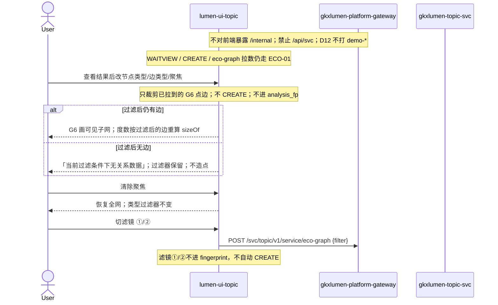

# LUMEN-SVC-P-FE-US-ECO-03 · US-SVC-ECO-03 关系网络过滤/聚焦

> 日期：2026-08-22  
> Task：`LUMEN-SVC-P-FE-US-ECO-03`  
> 总控：[`LUMEN-SVC-P-长任务总控.md`](./LUMEN-SVC-P-长任务总控.md)（§7 已生效；切法 A / 公式冻结）  
> 仓：`lumen-ui-topic` · `origin/dev`  
> 复刻真源：`demo-ui-topic` `EcosystemGraphView.tsx` 过滤器交互（只读对照，未贴 JSX、未改 demo；**未**把 Demo 投资/合作/竞争/人才流动当 hang 边）  
> 本仓前置：ECO-01 `workspace=graph` 结果板（G6 + WAITVIEW + eco-graph）；本叶挂在该板上做二次裁剪

## 任务认领（必填）

| 字段 | 值 |
|------|-----|
| claimed_by | `agent:frontend-agent` |
| supervised_by | `human:侯佳伟` |
| claim_type | `coordinator_dispatch` |
| 说明 | 长任务 24h 锁；本叶不标 `done`。coordinator 已 MCP `in_progress`。本会话未挂载 task-registry MCP，未手改 yaml。 |

## Ponytail（coding 任务必填）

| 字段 | 值 |
|------|-----|
| ponytail | `full` |
| 说明 | 只在 ECO-01 结果板加图例/类型过滤/1 度聚焦。复用 G6、`sizeOf`、WAITVIEW、`@/review`、已有 `POST eco-graph`。未用 YAGNI 跳过 D8 页底 token、D9 双密度 ⓘ、D10 评审自闸、可观测 X-Trace-Id、handoff、图即契约、五维复刻、附录 E。未落地 ECO-04 统计面板 / US-06 深圳。 |

## Headroom（可选）

| 字段 | 值 |
|------|-----|
| headroom | `skip` |
| 说明 | 本机会话未挂载 Headroom MCP。 |

## 图即契约

| 字段 | 值 |
|------|-----|
| diagram_id | `SVC-STORAGE-LINEAGE`（消费，不改工厂边）；`LUMEN-SVC-P-FE-US-ECO-03-SEQ`（本叶） |
| 图 diff | LINEAGE 边未改。本叶在 ECO-01 实线之后加前端二次裁剪：按当前 Java `nodes/edges` 实际出现的 kind / hang 边类型过滤，聚焦 1 度邻域。不重打 eco-graph、不 CREATE。禁止事项未变：不造四类新边、不用 GraphView 22 点 / 迈瑞华为 fixture、`relation_top` 不当图。 |
| 会签态 | `SVC-STORAGE-LINEAGE` 随 `storage/SVC/01-data-flow.md` frontmatter：`approved`（`human:淮政玮` · 2026-08-19 流图；2026-08-20 选 B 增补 LINEAGE，**不改** §1 工厂边）。本叶 SEQ 为 `draft`，禁止自填绿。 |

### L2 消费（不改边）

本叶只读消费 [`storage/SVC/01-data-flow.md`](../../data/data-design/storage/SVC/01-data-flow.md) §1.1 `SVC-STORAGE-LINEAGE` 与 [`formula-freeze-cut-a.md`](../../data/data-design/storage/SVC/formula-freeze-cut-a.md) §1：边类型只认 hang 已有 `belongs_to` / `participates` / `supplies` / `depends_on`。前端不扫表、不直连 nGQL、不改工厂边、不派 Java/Python 新建 Edge 类型。`cooperation`→`participates` 沿用 ECO-01 映射，不当新边。

### L4 本叶 SEQ · `LUMEN-SVC-P-FE-US-ECO-03-SEQ`

| 生产者 | 消费者 | 触发 | 失败语义 | 禁止事项 |
|---|---|---|---|---|
| 已拉 Java `nodes/edges` | 结果板二次裁剪 | 改 `eco_nk` / `eco_et` / `eco_focus` | 无边 → 本叶文案；hang 空画仍走 ECO-01 | 为过滤再 CREATE；Demo 四类新边；22 点 fixture |
| Java `POST eco-graph` | G6 底图 | 「查看结果」或切滤镜 ①/② | HTTP 200 空图 / FE catch → hang 空画 | `/api/svc`；直连 `/internal`；`relation_top` 当图 |
| Java `POST\|GET tasks*` | WAITVIEW | 「开始分析」/「重新分析」 | failed ≠ 空画 | 切类型过滤自动 CREATE |

## 范围与实现

落地 `US-SVC-ECO-03` 关系网络过滤/聚焦，挂在 `/service/chain-analysis?workspace=graph` 的 ECO-01 结果板上：

1. 图例：节点类型 + 边类型带文字（色点/色线 + 中文标签）。选项只来自当前 Java `nodes/edges` 实际出现的 kind / hang 边类型。
2. 过滤：节点类型多选、边类型多选，立即裁剪已拉图。选择写入 URL `eco_nk` / `eco_et`（可再写 `gkx.svc.eco.clip.v1` localStorage）；刷新保留。「重置过滤」恢复全选并清除聚焦。过滤后无边 → 「当前过滤条件下无关系数据」，过滤器保留，不造点。
3. 聚焦：`eco_focus` 选定机构后只显示其 1 度邻域（仅与焦点相连的边）。清除聚焦恢复全网且类型过滤器不变。二度展开不做。
4. 节点大小按可见子网度数映射（沿用 ECO-01 `sizeOf`，度数跟过滤后的边重算）。
5. 切法 A：边只认 `belongs_to` / `participates` / `supplies` / `depends_on`。禁止 Demo 投资/合作/竞争/人才流动四类新边。禁止 GraphView 22 点 / 迈瑞华为 fixture。
6. 滤镜 ①/② 仍走 ECO-01：只改 `eco_filter` 重打 eco-graph，**不进** `analysis_fp`，不自动 CREATE。本叶类型过滤是结果板上的二次裁剪。
7. 附录 E / WAITVIEW / 双密度 / 机构 Drawer / 主体摘要：不改契约。failed ≠ 空画。
8. Mock 关：页面不引 `@/mock/**`。开：沿用 ECO-01 mock 点（`org-live-1/2` + `actor-hang-1`），未为四类边编新边类型。

**非范围**：CREATE / WAITVIEW / eco-graph 拉数 / 双密度两列重做；ECO-04 统计面板；ECO-02 短板；`workspace=shenzhen`；改 `industry-center`；改 Java/Python；宣称 K8s 绿。

## 偏离说明

- 不造四类新边：Demo 过滤器标签是投资/合作/竞争/人才流动。正式 hang 只认切法 A 四类；`cooperation` 等输入仍映射 `participates`（ECO-01），UI 选项不出现 Demo 四类。
- 类型过滤是前端裁剪已拉图，不必为过滤再 CREATE / 再打 eco-graph。
- 不改双密度：子网/生态密度仍用 Java 返回值并排；规模「节点数/关系边数」跟当前可见子网。未做 ECO-04 度中心性 TOP5 / 影响力评分。
- 图例选项随当前 hang 实包变化，不写死 5 类节点 / 4 类边。
- 模板 W4「当天已成功直接打开结果」：沿用 WAITVIEW，restore 到过程页再点「查看结果」。

## 复刻五维（R1–R5）

| # | 项 | 结果 |
|---|---|---|
| R1 布局 | 配置 / 过程壳 / G6 结果 / 图例+类型过滤+聚焦 / 双密度两列 / 记录 Tab；chain/shenzhen 独立；一节点一套 layout | ✅ |
| R2 交互 | 类型过滤立即生效；重置全选；聚焦 1 度；hang 空画 vs 二次过滤无边分文案；WAITVIEW 未改 | ✅ |
| R3 样式 | `--sci-bg-page` / `#D8E7FC`；节点色 Design §4.4；边色 + 文字标签；筛选控件 ≤400px | ✅ |
| R4 评审 | 只从 `@/review`（`SVC-ECO-03-FILTER`）；关评审不泄漏 metric_id / GAP-* / Q062 | ✅ |
| R5 Mock | 开：沿用 ECO-01 `registerApiMock`。关：页面不引 `@/mock/**`、无页内 `MOCK_`、无 22 点 fixture | ✅ |

### 检索皮肤（V1–V7）

本叶是分析工作区，不是检索 Hub。V1 页底必过；V2–V7 N/A。

| # | 结果 |
|---|---|
| V1 页底 `--sci-bg-page` / `#D8E7FC` | ✅ |
| V2–V7 | N/A（查询页） |

### 工作区（W1 / W2 / W4）

| # | 项 | 结果 |
|---|---|---|
| W1 | 配置区 / 过程壳 / 图谱结果 / 记录 Tab | ✅ |
| W2 | 关系图 | ✅ G6 force + 带文字图例；非表格冒充 |
| W3 | 报告阅读器 | N/A |
| W4 | 切条件不自动 create；「开始分析」；同指纹一条在跑；当天成功可恢复；「重新分析」可 force | ✅ 类型过滤不 CREATE |

## 附录 E（I2-12）

| # | 项 | 结果 |
|---|---|---|
| E.1 页清单 | `/service/chain-analysis?workspace=graph`（本叶横切结果板） | ✅ |
| E.2 CTA | 配置区「开始分析」 | ✅ 未改 |
| E.3 禁自动 create | 无 `watch → create`；类型过滤只裁剪；切滤镜 ①/② 只 `eco-graph` | ✅ |
| E.4 单飞 | `svc\|graph\|{industry\|\*}`；滤镜与 `eco_nk/et/focus` 不进指纹 | ✅ |
| E.5 当天复用 | `forceCreate=false` restore 过程页；`重新分析` `force=true` | ✅ |
| failed | 过程壳红 alert ≠ hang 空画 ≠ 二次过滤无边 | ✅ |

## Design.md §14

页底 token `--sci-bg-page`；主色 `#165DFF`；节点色走 §4.4。筛选 Select 宽 220px、`max-width: var(--sci-filter-control-max, 400px)`；gap 12px。无 `.ant-` / vendor-antd token。无新地图。图谱仍 G6，Arco 只做过滤器外围。关评审零泄漏。双密度数字旁仍走 `@/review`，不自造 ⓘ / emoji 角标。

## 测试结果

- `node src/views/service/serviceEcoFilter.selfcheck.mjs` → `serviceEcoFilter.selfcheck ok`
- `node src/views/service/serviceEcoAnalysis.selfcheck.mjs` → `serviceEcoAnalysis.selfcheck eco-graph ok`
- `node src/views/service/serviceEcoShortboard.selfcheck.mjs` → `serviceEcoShortboard.selfcheck chain ok`
- `node src/router/menu.selfcheck.mjs` → `menu.selfcheck svc-shell ok`
- `npx vue-tsc --build` → 通过（exit 0）
- 本叶未等 K8s rollout

## 遗留风险

- 现网 hang 若无对端，50892 仍是 ECO-01 可见空画，不是本叶「当前过滤条件下无关系数据」。
- 二次过滤无边时过滤器仍在，需点「重置过滤」或放宽类型；不会造点。
- 金路径 #4 须 E0 滚出后在 50892 点过一遍（查看结果 → 改节点/边类型 → 聚焦 1 度 → 重置；切滤镜 ①/② 仍只重打 eco-graph）。
- 本会话未挂载 task-registry MCP，cost / evidence 请 coordinator 代填；**不标 done**。

## CI/CD（必填）

- 分支：`lumen-ui-topic` `origin/dev`（push `30813b2..d58bce1`，未 force）
- commit：`d58bce1` `feat(svc): add US-SVC-ECO-03 relation graph filter [agent:frontend-agent]`
- pipeline URL / ID：GitLab 对 `d58bce1` 自动建管线（本叶未等绿、未宣称 K8s 已滚出）
- 部署 namespace / 镜像 tag：待 E0 / CI
- K8s rollout：本叶未等
- dev 测试 URL：http://111.198.38.90:50892/service/chain-analysis?workspace=graph （需 CI 滚出后可见本叶）
- 本地：`node src/views/service/serviceEcoFilter.selfcheck.mjs`

## 可观测性

- `svcEcoGraph` / CREATE / GET / RESULT / `profile/get` 均走 `src/utils/request.ts`：`X-Trace-Id` + `traceparent`
- 本叶无新 Java 路径、无新 span 名；类型过滤为前端裁剪
- OTEL_SERVICE_NAME：N/A（前端）
- Tempo / Loki：有（平台已有）

## 架构合规自检

| 铁律 | 结果 |
|------|------|
| 1 算法只在 Python | ✅ 前端无密度算法；二次裁剪只做点边可见性 |
| 2 调用链 FE→Java→Python `/internal` | ✅ 只调已有 `/svc/topic/v1/service/eco-graph` + tasks + profile/get |
| 3 Nebula 非 Neo4j | ✅ 未直连图库；G6 只渲染 Java 点边 |
| 4 可观测 | ✅ request 拦截器 X-Trace-Id |
| 5 CI | ⏳ push 后 |
| 6 demo2 不 merge 进 lumen | ✅ 只读对照 demo-ui-topic；未改 demo |
| 7 共享聚合 / 只调 Java | ✅ 未直连 Python |
| 8 数据 ADS / 无硬 mock | ✅ `USE_MOCK=false` 不填 fixture |
| 9 D8 Design token | ✅ `--sci-bg-page`；节点 §4.4；边类型带文字 |
| 10 D9 八件套 / 不自造 ⓘ | ✅ 双密度仍 `M_SVC_RELATION_DENSITY` 走 `@/review`；Q062 不改绿 |
| 11 D10 `@/review` | ✅ `SVC-ECO-03-FILTER` |
| 12 D12 不打 demo-* | ✅ |

## Cost

| 字段 | 值 |
|------|-----|
| `actual_tokens` | 230000 |
| `model_used` | `claude-sonnet-4.5`（registry 合法枚举；本会话为 Cursor Grok 4.6，按 Sonnet 价表回填） |
| `actual_cost` | 1.24 |
| `cost_warn` | green |
| 口径 | frontend-agent 80/20；`230000×0.8×3/1e6 + 230000×0.2×15/1e6 = 1.242` 取 `1.24`；`source: session_estimate` |

## 涉及文件

- `lumen-ui-topic` `src/views/service/ServiceChainAnalysisWorkspace.vue`
- `lumen-ui-topic` `src/views/service/SvcEcoRelationGraph.vue`
- `lumen-ui-topic` `src/views/service/svcEcoGraphModel.ts`
- `lumen-ui-topic` `src/views/service/svcEcoAnalysisWorkspace.ts`
- `lumen-ui-topic` `src/views/service/serviceEcoAnalysis.css`
- `lumen-ui-topic` `src/views/service/serviceEcoFilter.selfcheck.mjs`
- `lumen-ui-topic` `src/views/service/serviceEcoAnalysis.selfcheck.mjs`
- `lumen-ui-topic` `src/views/service/ServiceReviewMount.vue`
- 本 handoff

## 产物清单

- 代码：`d58bce1`（`lumen-ui-topic` `dev`）
- 文档：本文件
- 未改：`DefaultLayout.vue`、`industry-center`、`demo-ui-topic`、Java / Python、WAITVIEW 指纹、双密度契约、ECO-02 短板、shenzhen 占位

## 联调确认

联调通过（代码侧）：`workspace=graph` 结果板可按 hang 实际 kind / 边类型过滤并聚焦 1 度邻域；过滤后无边走本叶文案且不造点；hang 空画仍走 ECO-01；类型过滤不 CREATE、不进指纹；未造四类新边；双密度未改。请 coordinator AV-0，**本叶不自行标 done**。

## Registry（MCP）

`task-update-fields` 写 evidence / note / cost 四字段；`status` 仍为 `in_progress`（未改 done）。禁止手改 `task-registry.yaml`。本会话 MCP 未挂载，请 coordinator 代填。
