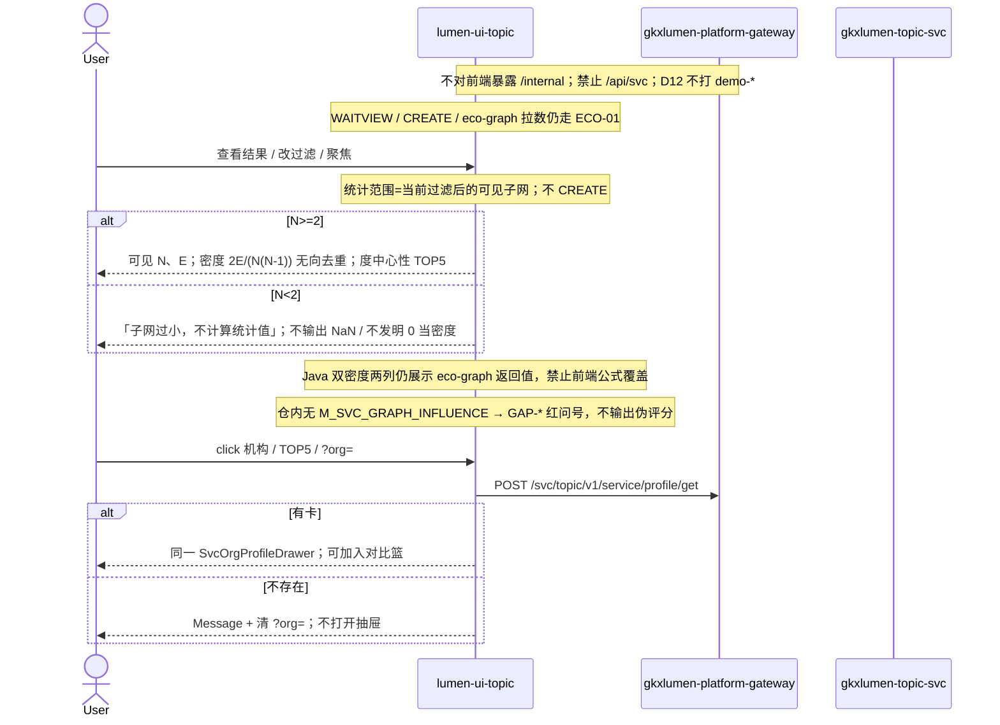

# LUMEN-SVC-P-FE-US-ECO-04 · US-SVC-ECO-04 图谱探索与统计

> 日期：2026-08-22  
> Task：`LUMEN-SVC-P-FE-US-ECO-04`  
> 总控：[`LUMEN-SVC-P-长任务总控.md`](./LUMEN-SVC-P-长任务总控.md)（§7 已生效；切法 A / 公式冻结）  
> 仓：`lumen-ui-topic` · `origin/dev`  
> 复刻真源：`demo-ui-topic` `EcosystemGraphView.tsx` 网络统计面板（只读对照，未贴 JSX、未改 demo）  
> 本仓前置：ECO-01 结果板（G6 + WAITVIEW + Java 双密度）· ECO-03 过滤/聚焦。本叶只加统计面板，不重做下钻/双密度/WAITVIEW/过滤。

## 任务认领（必填）

| 字段 | 值 |
|------|-----|
| claimed_by | `agent:frontend-agent` |
| supervised_by | `human:侯佳伟` |
| claim_type | `coordinator_dispatch` |
| 说明 | 长任务 24h 锁；本叶不标 `done`。coordinator 已 MCP `in_progress`。本会话未挂载 task-registry MCP，未手改 yaml。 |

## Ponytail（coding 任务必填）

| 字段 | 值 |
|------|-----|
| ponytail | `full` |
| 说明 | 只在 ECO-01/03 结果板加可见子网统计。复用 `clipEcoGraph`、Java 双密度两列、`M_SVC_RELATION_DENSITY`、`SvcOrgProfileDrawer`、`@/review`。未用 YAGNI 跳过 D8 页底 token、D9 ⓘ/红问号、D10 评审自闸、可观测 X-Trace-Id、handoff、图即契约、五维复刻。未落地 ECO-05/06 / shenzhen。 |

## Headroom（可选）

| 字段 | 值 |
|------|-----|
| headroom | `skip` |
| 说明 | 本机会话未挂载 Headroom MCP。 |

## 图即契约

| 字段 | 值 |
|------|-----|
| diagram_id | `SVC-STORAGE-LINEAGE`（消费，不改工厂边）；`LUMEN-SVC-P-FE-US-ECO-04-SEQ`（本叶） |
| 图 diff | LINEAGE 边未改。本叶在 ECO-03 可见子网之后加前端统计：N/E、无向去重密度、度中心性 TOP5、影响力诚实空。点边仍只来自已有 eco-graph。禁止事项未变：不覆盖 Java 双密度两列、不自造 `M_SVC_GRAPH_*` seed、不发明影响力分。 |
| 会签态 | `SVC-STORAGE-LINEAGE` 随 `storage/SVC/01-data-flow.md` frontmatter：`approved`（`human:淮政玮` · 2026-08-19 流图；2026-08-20 选 B 增补 LINEAGE，**不改** §1 工厂边）。本叶 SEQ 为 `draft`，禁止自填绿。 |

### L2 消费（不改边）

本叶只读消费 [`storage/SVC/01-data-flow.md`](../../data/data-design/storage/SVC/01-data-flow.md) §1.1 `SVC-STORAGE-LINEAGE` 与 [`formula-freeze-cut-a.md`](../../data/data-design/storage/SVC/formula-freeze-cut-a.md) §2：Java 双密度两列仍用 eco-graph 返回的 `density_subnet|subnet_density` 与 `density_eco|eco_density`。前端 `2E/(N(N-1))` 只算可见子网密度第三块。前端不扫表、不直连 nGQL、不改工厂边。

### L4 本叶 SEQ · `LUMEN-SVC-P-FE-US-ECO-04-SEQ`

| 生产者 | 消费者 | 触发 | 失败语义 | 禁止事项 |
|---|---|---|---|---|
| 已裁剪可见子网 | 统计面板 | 过滤/聚焦变化 | N&lt;2 → 子网过小；hang 空画 / 过滤无边分文案 | 用前端密度覆盖 Java 两列；发明影响力分 |
| Java `POST eco-graph` | G6 底图 + Java 双密度两列 | 「查看结果」或切滤镜 ①/② | HTTP 200 空图 / FE catch → hang 空画 | `/api/svc`；直连 `/internal`；`relation_top` 当图 |
| Java `POST profile/get` | 同一 Drawer | 机构节点 / TOP5 / `?org=` | 无卡 Message + 清参数，不打开抽屉 | 第二套画像；关联主体跳企业库 |
| `M_SVC_RELATION_DENSITY` | Java 双密度 + 可见子网密度 ⓘ | 结果板 | Q062 待核验，不改绿 | 自造 `M_SVC_GRAPH_DENSITY` 进 seed |
| `GAP-SVC-GRAPH-INFLUENCE` | 影响力红问号 | 统计面板第三卡 | 只显治理引用，不显伪 8 件套 / 伪评分 | 写 `M_SVC_GRAPH_INFLUENCE` 进 seed；挪用 `M_CHAIN_*` |

## 范围与实现

落地 `US-SVC-ECO-04` 图谱探索与统计，挂在 `/service/chain-analysis?workspace=graph` 结果板：

1. 统计面板（统计范围 = 当前过滤/聚焦后的可见子网）：可见 N、E；网络密度 `2E/(N(N-1))` 无向去重；hover 展示 N、E。N&lt;2 → 「子网过小，不计算统计值」，不输出 NaN、不发明 0 当密度。
2. 度中心性 TOP5：按可见子网度数排序的服务机构；名称与度数与当前图一致；有 `org_id` 才下钻已有 Drawer。
3. 生态影响力：仓内无 `M_SVC_GRAPH_INFLUENCE` 种子 → D1 missing 红问号 / `GAP-SVC-GRAPH-INFLUENCE` / `Q-SVCCHAIN-03`，不输出伪评分。未写入 metric/readiness seed，未挪用 `industry-center` `M_CHAIN_*`。
4. Java 双密度两列保持 ECO-01：仍展示 `density_subnet|subnet_density` 与 `density_eco|eco_density`。禁止用前端公式覆盖这两列。可见子网密度是统计面板第三块，ⓘ 挂已有 `M_SVC_RELATION_DENSITY`。Q062 不改绿。
5. 下钻仍走同一 `SvcOrgProfileDrawer`。本叶补「加入对比篮」。关联主体只摘要。不存在的 org → Message + 清参数，不打开抽屉。
6. 过滤/聚焦变化后统计同步重算。空态三套文案分开：hang 空画 / 过滤无边 / 子网过小。
7. 不做介数/接近中心性、社区发现、Demo 22 点、ECO-05/06、shenzhen。附录 E / CREATE / eco-graph 拉数不改。Mock 关：页面不引 `@/mock/**`。

**非范围**：改 Java/Python；改 `industry-center`；改 `demo-ui-topic`；宣称 K8s 绿。

## 偏离说明

- **可见子网密度 vs Java 双密度两列**：Java 两列仍只渲染 eco-graph 返回值（N&lt;2 显示 0 / 缺键 —）。前端 `2E/(N(N-1))` 只出现在统计面板「可见子网密度」，不覆盖 `density-subnet` / `density-eco`。
- **不自造 GRAPH metric**：可见密度 ⓘ 复用 `M_SVC_RELATION_DENSITY`。未向 `svcMetricSeed` / `svcReadinessSeed` 写入 `M_SVC_GRAPH_DENSITY` / `M_SVC_GRAPH_CENTRALITY` / `M_SVC_GRAPH_INFLUENCE`。
- **影响力诚实空**：只挂 `GAP-SVC-GRAPH-INFLUENCE`（gap catalog 缺口文案）+ `Q-SVCCHAIN-03`。业务文案不泄漏 metric_id / GAP-* / Q 项；关评审零泄漏。
- Demo 密度 metric 名 `M_SVC_GRAPH_DENSITY`。正式 id 仍为 `M_SVC_RELATION_DENSITY`（Q062）。
- 模板 W4「当天已成功直接打开结果」：沿用 WAITVIEW，restore 到过程页再点「查看结果」。

## 复刻五维（R1–R5）

| # | 项 | 结果 |
|---|---|---|
| R1 布局 | 配置 / 过程壳 / G6 / 过滤聚焦 / Java 双密度两列 / 网络统计三块 / 记录 Tab；chain/shenzhen 独立；一节点一套 layout | ✅ |
| R2 交互 | 过滤/聚焦后统计重算；N&lt;2 子网过小；TOP5 下钻；无卡不打开抽屉；WAITVIEW 未改 | ✅ |
| R3 样式 | `--sci-bg-page` / `#D8E7FC`；统计卡与兄弟页同皮肤；主色 `#165DFF` | ✅ |
| R4 评审 | 只从 `@/review`（`SVC-ECO-04-*`）；关评审不泄漏 metric_id / GAP-* / Q062 / Q-SVCCHAIN-03 | ✅ |
| R5 Mock | 开：沿用 ECO-01 `registerApiMock`。关：页面不引 `@/mock/**`、无页内 `MOCK_`、无 22 点 fixture | ✅ |

### 检索皮肤（V1–V7）

本叶是分析工作区，不是检索 Hub。V1 页底必过；V2–V7 N/A。

| # | 结果 |
|---|---|
| V1 页底 `--sci-bg-page` / `#D8E7FC` | ✅ |
| V2–V7 | N/A（查询页） |

### 工作区（W1 / W2 / W4）

| # | 项 | 结果 |
|---|---|---|
| W1 | 配置区 / 过程壳 / 图谱结果 / 记录 Tab | ✅ 本叶加统计面板 |
| W2 | 关系图 | ✅ 仍 G6 force；非表格冒充 |
| W3 | 报告阅读器 | N/A |
| W4 | 切条件不自动 create；「开始分析」；同指纹一条在跑；当天成功可恢复；「重新分析」可 force | ✅ 统计重算不 CREATE |

## 附录 E（I2-12）

| # | 项 | 结果 |
|---|---|---|
| E.1 页清单 | `/service/chain-analysis?workspace=graph`（本叶横切结果板） | ✅ |
| E.2 CTA | 配置区「开始分析」 | ✅ 未改 |
| E.3 禁自动 create | 无 `watch → create`；过滤/聚焦/统计不 CREATE | ✅ |
| E.4 单飞 | `svc\|graph\|{industry\|\*}`；滤镜与 clip 不进指纹 | ✅ |
| E.5 当天复用 | `forceCreate=false` restore 过程页；`重新分析` `force=true` | ✅ |
| failed | 过程壳红 alert ≠ hang 空画 ≠ 二次过滤无边 ≠ 子网过小 | ✅ |

## Design.md §14

页底 token `--sci-bg-page`；主色 `#165DFF`。统计卡圆角 8px、gap 12px，无 20px 间距。无 `.ant-` / vendor-antd token。无新地图。图谱仍 G6，Arco 只做统计外围 / Tooltip / Drawer。关评审零泄漏。Java 双密度与可见子网密度数字旁走 `@/review`，影响力 D1 missing 红问号，不自造 emoji 角标。

## 测试结果

- `node src/views/service/serviceEcoStats.selfcheck.mjs` → `serviceEcoStats.selfcheck ok`
- `node src/views/service/serviceEcoFilter.selfcheck.mjs` → `serviceEcoFilter.selfcheck ok`
- `node src/views/service/serviceEcoAnalysis.selfcheck.mjs` → `serviceEcoAnalysis.selfcheck eco-graph ok`
- `node src/views/service/serviceEcoShortboard.selfcheck.mjs` → `serviceEcoShortboard.selfcheck chain ok`
- `node src/router/menu.selfcheck.mjs` → `menu.selfcheck svc-shell ok`
- `npx vue-tsc --build` → 通过（exit 0）
- 本叶未等 K8s rollout

## 遗留风险

- 现网 hang 若无对端，50892 仍是 ECO-01 可见空画；统计面板 N=0 走「子网过小」，不是过滤无边文案。
- Java 双密度两列在 hang 空图时仍可能显示 0/—（ECO-01 契约），与可见子网密度「子网过小」并存，这是刻意分列。
- 金路径须 E0 滚出后在 50892 点过一遍（查看结果 → 过滤/聚焦看统计重算 → TOP5 下钻 → 假 org Message 清参）。
- 本会话未挂载 task-registry MCP，cost / evidence 请 coordinator 代填；**不标 done**。

## CI/CD（必填）

- 分支：`lumen-ui-topic` `origin/dev`（push `d58bce1..8bdd181`，未 force）
- commit：`8bdd181` `feat(svc): add US-SVC-ECO-04 graph stats panel [agent:frontend-agent]`
- pipeline URL / ID：GitLab 对 `8bdd181` 自动建管线（本叶未等绿、未宣称 K8s 已滚出）
- 部署 namespace / 镜像 tag：待 E0 / CI
- K8s rollout：本叶未等
- dev 测试 URL：http://111.198.38.90:50892/service/chain-analysis?workspace=graph （需 CI 滚出后可见本叶）
- 本地：`node src/views/service/serviceEcoStats.selfcheck.mjs`

## 可观测性

- `svcEcoGraph` / CREATE / GET / RESULT / `profile/get` 均走 `src/utils/request.ts`：`X-Trace-Id` + `traceparent`
- 本叶无新 Java 路径、无新 span 名；统计为前端按可见子网重算
- OTEL_SERVICE_NAME：N/A（前端）
- Tempo / Loki：有（平台已有）

## 架构合规自检

| 铁律 | 结果 |
|------|------|
| 1 算法只在 Python | ✅ 前端不算影响力分；可见密度只服务统计面板，不覆盖 Java 两列 |
| 2 调用链 FE→Java→Python `/internal` | ✅ 只调已有 `/svc/topic/v1/service/eco-graph` + tasks + profile/get |
| 3 Nebula 非 Neo4j | ✅ 未直连图库；G6 只渲染 Java 点边 |
| 4 可观测 | ✅ request 拦截器 X-Trace-Id |
| 5 CI | ⏳ push 后 |
| 6 demo2 不 merge 进 lumen | ✅ 只读对照 demo-ui-topic；未改 demo |
| 7 共享聚合 / 只调 Java | ✅ 未直连 Python |
| 8 数据 ADS / 无硬 mock | ✅ `USE_MOCK=false` 不填 fixture |
| 9 D8 Design token | ✅ `--sci-bg-page`；统计卡 token |
| 10 D9 八件套 / 不自造 ⓘ | ✅ 可见密度挂 `M_SVC_RELATION_DENSITY`；影响力 GAP-* 红问号；Q062 不改绿 |
| 11 D10 `@/review` | ✅ `SVC-ECO-04-*` |
| 12 D12 不打 demo-* | ✅ |

## Cost

| 字段 | 值 |
|------|-----|
| `actual_tokens` | 260000 |
| `model_used` | `claude-sonnet-4.5`（registry 合法枚举；本会话为 Cursor Grok 4.6，按 Sonnet 价表回填） |
| `actual_cost` | 1.40 |
| `cost_warn` | green |
| 口径 | frontend-agent 80/20；`260000×0.8×3/1e6 + 260000×0.2×15/1e6 = 1.404` 取 `1.40`；`source: session_estimate` |

## 涉及文件

- `lumen-ui-topic` `src/views/service/ServiceChainAnalysisWorkspace.vue`
- `lumen-ui-topic` `src/views/service/svcEcoGraphModel.ts`
- `lumen-ui-topic` `src/views/service/serviceEcoAnalysis.css`
- `lumen-ui-topic` `src/views/service/serviceEcoStats.selfcheck.mjs`
- `lumen-ui-topic` `src/views/service/serviceEcoFilter.selfcheck.mjs`
- `lumen-ui-topic` `src/views/service/ServiceReviewMount.vue`
- `lumen-ui-topic` `src/views/service/SvcOrgProfileDrawer.vue`
- `lumen-ui-topic` `src/mock/service/svcGapCatalog.ts`（只加 `GAP-SVC-GRAPH-INFLUENCE` 缺口文案，未写 GRAPH metric seed）
- 本 handoff

## 产物清单

- 代码：`8bdd181`（`lumen-ui-topic` `dev`）
- 文档：本文件
- 未改：`DefaultLayout.vue`、`industry-center`、`demo-ui-topic`、Java / Python、WAITVIEW 指纹、ECO-03 过滤契约、ECO-02 短板、shenzhen 占位、`svcMetricSeed` / `svcReadinessSeed`

## 联调确认

联调通过（代码侧）：`workspace=graph` 结果板统计范围=当前过滤后的可见子网；N&lt;2 不发明密度 0；Java 双密度两列未被前端公式覆盖；影响力诚实空；TOP5 下钻同一 Drawer；无卡清参数。请 coordinator AV-0，**本叶不自行标 done**。

## Registry（MCP）

`task-update-fields` 写 evidence / note / cost 四字段；`status` 仍为 `in_progress`（未改 done）。禁止手改 `task-registry.yaml`。本会话 MCP 未挂载，请 coordinator 代填。
