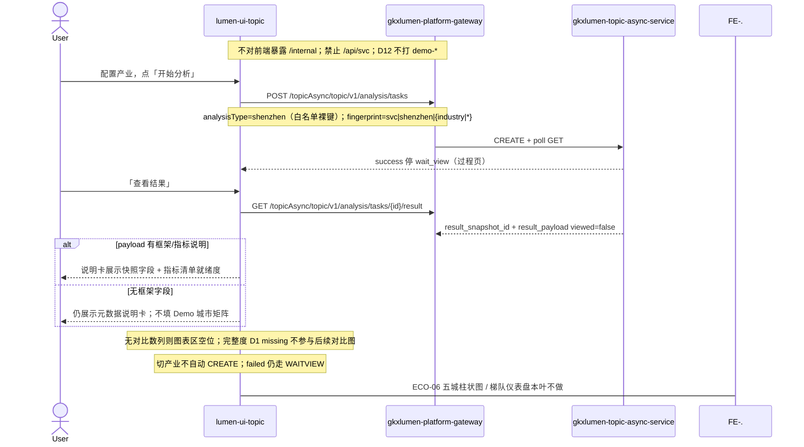

# LUMEN-SVC-P-FE-US-ECO-05 · US-SVC-ECO-05 统一评价框架

> 日期：2026-08-22  
> Task：`LUMEN-SVC-P-FE-US-ECO-05`  
> 总控：[`LUMEN-SVC-P-长任务总控.md`](./LUMEN-SVC-P-长任务总控.md)（§7 已生效；切法 A / 公式冻结）  
> 仓：`lumen-ui-topic` · `origin/dev`  
> 复刻真源：`demo-ui-topic` `ShenzhenCompareView.tsx` 框架说明卡（只读对照，未贴 JSX、未改 demo、未搬 `computeSzCompare` / `SZ_COMPARE_METRICS`）  
> 本仓前置：WAITVIEW · ECO-01/02/04。本叶替换 ECO-01 对 `workspace=shenzhen` 的占位。

## 任务认领（必填）

| 字段 | 值 |
|------|-----|
| claimed_by | `agent:frontend-agent` |
| supervised_by | `human:侯佳伟` |
| claim_type | `coordinator_dispatch` |
| 说明 | 长任务 24h 锁；本叶不标 `done`。coordinator 已 MCP `in_progress`。本会话未挂载 task-registry MCP，未手改 yaml。 |

## Ponytail（coding 任务必填）

| 字段 | 值 |
|------|-----|
| ponytail | `full` |
| 说明 | 复用 WAITVIEW 过程壳、`IndustryCatalogSelect`、`@/review`、已有 `useSvcAnalysisJob`、已有 `M_SVC_SZ_SCALE` / `M_SVC_ORG_TECH_SCORE` / `M_SVC_RELATION_DENSITY` 种子。未用 YAGNI 跳过 D8 页底 token、D9 ⓘ/红问号、D10 评审自闸、可观测 X-Trace-Id、handoff、图即契约、五维复刻、附录 E。未落地 ECO-06 五城柱状图 / 梯队仪表盘。 |

## Headroom（可选）

| 字段 | 值 |
|------|-----|
| headroom | `skip` |
| 说明 | 本机会话未挂载 Headroom MCP。 |

## 图即契约

| 字段 | 值 |
|------|-----|
| diagram_id | `SVC-STORAGE-LINEAGE`（消费，不改工厂边）；`LUMEN-SVC-P-FE-US-ECO-05-SEQ`（本叶） |
| 图 diff | LINEAGE 边未改。本叶把 `workspace=shenzhen` 从 ECO-01 占位改成实线：WAITVIEW CREATE 裸键 `shenzhen` → GET result → 统一评价框架说明卡。对比图仍虚线留给 ECO-06。禁止事项未变：不打 `demo-*`、不搬 Demo 对比函数、不自造 completeness metric seed、不新 Java 路径。 |
| 会签态 | `SVC-STORAGE-LINEAGE` 随 `storage/SVC/01-data-flow.md` frontmatter：`approved`（`human:淮政玮` · 2026-08-19 流图；2026-08-20 选 B 增补 LINEAGE，**不改** §1 工厂边）。本叶 SEQ 为 `draft`，禁止自填绿。 |

### L2 消费（不改边）

本叶只读消费 [`storage/SVC/01-data-flow.md`](../../data/data-design/storage/SVC/01-data-flow.md) §1.1 `SVC-STORAGE-LINEAGE`：分析任务经 Java Job 读 CREATE 已签发的 snapshot。前端不扫表、不直连 nGQL、不改工厂边。无框架字段仍展示元数据卡；无对比数列图表区空位留给 ECO-06。禁止用门户 PT-05 `service-portal/shenzhen` 数字冒充本页分析框架。

### L4 本叶 SEQ · `LUMEN-SVC-P-FE-US-ECO-05-SEQ`

| 生产者 | 消费者 | 触发 | 失败语义 | 禁止事项 |
|---|---|---|---|---|
| Java GET result `result_payload` | 框架说明卡 | 仅用户点「查看结果」 | 无框架字段 → 元数据卡；无对比数列 → ECO-06 空位；failed ≠ 框架空态 | `computeSzCompare`；`SZ_COMPARE_METRICS`；门户 PT-05 `sz_total`；北上广/全国平均 fixture |
| `IndustryCatalogSelect` | `analysis_fp=svc\|shenzhen\|{industry\|\*}` | 配置区点开始 / 重新分析 | 切产业只改指纹与 gate，不自动 CREATE | 产业不进指纹；graph 滤镜进深圳指纹 |
| `M_SVC_SZ_SCALE` / `M_SVC_ORG_TECH_SCORE` / `M_SVC_RELATION_DENSITY` | 指标清单 ⓘ | 结果板框架卡 | 只读 seed，不改绿 | 手写 aligned |
| `GAP-SVC-SZ-CHAIN-COMPLETENESS` | 完整度红问号 | 指标清单末项 | D1 missing 只显 GAP-* / Q-SVCCHAIN-04，不显伪 8 件套 | 自造 `M_SVC_*_COMPLETENESS` 进 seed |

## 范围与实现

落地 `US-SVC-ECO-05` 统一评价框架，挂在 `/service/chain-analysis?workspace=shenzhen`：

1. 配置区 / 过程壳 / 记录 Tab 复用本页 WAITVIEW。CREATE 白名单裸键 `shenzhen`。指纹 `svc|shenzhen|{industry\|\*}`。切产业不自动 CREATE。附录 E 全守。Job failed 走 WAITVIEW。
2. 结果板顶部「统一评价框架」说明卡：框架名称、口径一致性（同一产业、同一统计周期、同一指标口径）、业务态「框架口径待甲方确认」。评审态 ⚠️ `Q-SVCCHAIN-04`，不改绿。
3. 指标清单只读消费 `@/review` / 仓内 seed：服务机构数量 `M_SVC_SZ_SCALE`；平均技术力 `M_SVC_ORG_TECH_SCORE`（draft / Q060 / Q-SVCCHAIN-01）；服务网络密度 `M_SVC_RELATION_DENSITY`（draft / Q062）。服务链完整度仓内无种子 → D1 missing 红问号 / `GAP-SVC-SZ-CHAIN-COMPLETENESS` / `Q-SVCCHAIN-04`，标明「不参与后续对比图」。
4. GET result 有框架/指标说明则展示；没有也不用 Demo 城市矩阵填数。无对比数列时图表区保持空位，留给 ECO-06。
5. 禁止门户 PT-05 数字冒充本页分析框架。禁止北上广/全国平均 fixture。关评审零泄漏。页底 `--sci-bg-page`。
6. Mock 开：GET result 只给框架元数据，不编五城对比矩阵。关：页面不引 `@/mock/**`。

**非范围**：ECO-06 五城柱状图 / 梯队仪表盘 / `computeSzCompare`；改 graph / chain 契约；改 Java/Python；改 `industry-center`；改 `demo-ui-topic`；宣称 K8s 绿。

## 偏离说明

- **本叶不做五城图**：对比图 / 梯队仪表盘 / 指标多选持久化留给 ECO-06。本叶图表区诚实空位。
- **完整度 D1 missing**：未向 `svcMetricSeed` / `svcReadinessSeed` 写入 `M_SVC_*_COMPLETENESS`。只加 gap catalog `GAP-SVC-SZ-CHAIN-COMPLETENESS`。
- **不搬 Demo 对比函数**：未引用 `computeSzCompare` / `SZ_COMPARE_METRICS` / `COMPARE_CITIES`，未贴 JSX。
- **`M_SVC_SZ_SCALE` 未改绿**：USM 写 aligned，仓内 seed 仍为 draft / Q-SVC-010，本叶只读消费。
- 模板 W4「当天已成功直接打开结果」：沿用 WAITVIEW，restore 到过程页再点「查看结果」。

## 复刻五维（R1–R5）

| # | 项 | 结果 |
|---|---|---|
| R1 布局 | 配置 / 过程壳 / 框架卡 / 对比空位 / 记录 Tab；graph/chain 契约未改；一节点一套 layout | ✅ |
| R2 交互 | 「开始分析」才 CREATE；切产业不 CREATE；failed 走 WAITVIEW；无框架字段仍出说明卡 | ✅ |
| R3 样式 | `--sci-bg-page` / `#D8E7FC`；与本仓兄弟分析页同皮肤；主色 `#165DFF` | ✅ |
| R4 评审 | 只从 `@/review`（`SVC-ECO-05-*`）；关评审不泄漏 metric_id / GAP-* / Q-SVCCHAIN-04 | ✅ |
| R5 Mock | 开：`analysisTaskStore` shenzhen 叶只回框架元数据。关：页面不引 `@/mock/**`、无页内 `MOCK_` | ✅ |

### 检索皮肤（V1–V7）

本叶是分析工作区，不是检索 Hub。V1 页底必过；V2–V7 N/A。

| # | 结果 |
|---|---|
| V1 页底 `--sci-bg-page` / `#D8E7FC` | ✅ |
| V2–V7 | N/A（查询页） |

### 工作区（W1 / W4）

| # | 项 | 结果 |
|---|---|---|
| W1 | 配置区 / 过程壳 / 框架结果 / 记录 Tab | ✅ |
| W2 | 关系图 | N/A（本叶无图谱；graph 仍 G6） |
| W3 | 报告阅读器 | N/A |
| W4 | 切条件不自动 create；「开始分析」；同指纹一条在跑；当天成功可恢复；「重新分析」可 force | ✅ |

## 附录 E（I2-12）

| # | 项 | 结果 |
|---|---|---|
| E.1 页清单 | `/service/chain-analysis?workspace=shenzhen` | ✅ |
| E.2 CTA | 配置区「开始分析」 | ✅ |
| E.3 禁自动 create | 无 `watch → create`；切产业只改指纹 | ✅ |
| E.4 单飞 | `decideAnalysisTaskGate` + `svc\|shenzhen\|{industry\|\*}` | ✅ |
| E.5 当天复用 | `forceCreate=false` restore 过程页；`重新分析` `force=true` | ✅ |
| failed | 过程壳红 alert ≠ 框架元数据卡 | ✅ |

## Design.md §14

页底 token `--sci-bg-page`；主色 `#165DFF`。框架卡 gap 8/12/16，无 20px 间距。无 `.ant-` / vendor-antd token。无新地图。数字旁走 `@/review`，完整度 D1 missing 红问号，不自造 emoji 角标。关评审零泄漏。

## 测试结果

- `node src/views/service/serviceEcoFramework.selfcheck.mjs` → `serviceEcoFramework.selfcheck ok`
- `node src/views/service/serviceEcoAnalysis.selfcheck.mjs` → `serviceEcoAnalysis.selfcheck eco-graph ok`
- `node src/views/service/serviceEcoShortboard.selfcheck.mjs` → `serviceEcoShortboard.selfcheck chain ok`
- `node src/views/service/serviceEcoFilter.selfcheck.mjs` → `serviceEcoFilter.selfcheck ok`
- `node src/views/service/serviceEcoStats.selfcheck.mjs` → `serviceEcoStats.selfcheck ok`
- `node src/router/menu.selfcheck.mjs` → `menu.selfcheck svc-shell ok`
- `npx vue-tsc --build` → 通过（exit 0）
- 本叶未等 K8s rollout

## 遗留风险

- 现网 GET result 若无框架字段，50892 仍展示元数据说明卡 + 对比空位，这是诚实空，不是前端 fixture。
- 完整度保持 D1 missing，ECO-06 必须继续诚实排除，不得用本叶 GAP 冒充可比指标。
- 金路径须 E0 滚出后在 50892 点过一遍（`?workspace=shenzhen` → 开始分析 → 查看结果 → 切产业不 CREATE → 关评审零泄漏）。
- 本会话未挂载 task-registry MCP，cost / evidence 请 coordinator 代填；**不标 done**。

## CI/CD（必填）

- 分支：`lumen-ui-topic` `origin/dev`（push `8bdd181..3f9ff4e`，未 force）
- commit：`3f9ff4e` `feat(svc): add US-SVC-ECO-05 evaluation framework [agent:frontend-agent]`
- pipeline URL / ID：GitLab 对 `3f9ff4e` 自动建管线（本叶未等绿、未宣称 K8s 已滚出）
- 部署 namespace / 镜像 tag：待 E0 / CI
- K8s rollout：本叶未等
- dev 测试 URL：http://111.198.38.90:50892/service/chain-analysis?workspace=shenzhen （需 CI 滚出后可见本叶）
- 本地：`node src/views/service/serviceEcoFramework.selfcheck.mjs`

## 可观测性

- CREATE / GET / RESULT 均走 `src/utils/request.ts`：`X-Trace-Id` + `traceparent`
- 本叶无新 Java 路径、无新 span 名
- OTEL_SERVICE_NAME：N/A（前端）
- Tempo / Loki：有（平台已有）

## 架构合规自检

| 铁律 | 结果 |
|------|------|
| 1 算法只在 Python | ✅ 前端不算城市对比分、不造完整度公式 |
| 2 调用链 FE→Java→Python `/internal` | ✅ 只调已有 analysis tasks CREATE/GET/RESULT；无新 Java 路径 |
| 3 Nebula 非 Neo4j | ✅ 未直连图库 |
| 4 可观测 | ✅ request 拦截器 X-Trace-Id |
| 5 CI | ⏳ push 后 |
| 6 demo2 不 merge 进 lumen | ✅ 只读对照 demo-ui-topic；未改 demo |
| 7 共享聚合 / 只调 Java | ✅ 未直连 Python |
| 8 数据 ADS / 无硬 mock | ✅ `USE_MOCK=false` 不填 fixture |
| 9 D8 Design token | ✅ `--sci-bg-page`；主色 `#165DFF` |
| 10 D9 八件套 / 不自造 ⓘ | ✅ 三指标走已有 seed；完整度 GAP-* 红问号；Q-SVCCHAIN-04 不改绿 |
| 11 D10 `@/review` | ✅ `SVC-ECO-05-*` |
| 12 D12 不打 demo-* | ✅ |

## Cost

| 字段 | 值 |
|------|-----|
| `actual_tokens` | 240000 |
| `model_used` | `claude-sonnet-4.5`（registry 合法枚举；本会话为 Cursor Grok 4.6，按 Sonnet 价表回填） |
| `actual_cost` | 1.30 |
| `cost_warn` | green |
| 口径 | frontend-agent 80/20；`240000×0.8×3/1e6 + 240000×0.2×15/1e6 = 1.296` 取 `1.30`；`source: session_estimate` |

## 涉及文件

- `lumen-ui-topic` `src/views/service/ServiceChainAnalysisWorkspace.vue`
- `lumen-ui-topic` `src/views/service/SvcSzFrameworkCard.vue`
- `lumen-ui-topic` `src/views/service/svcSzFrameworkModel.ts`
- `lumen-ui-topic` `src/views/service/svcEcoAnalysisWorkspace.ts`
- `lumen-ui-topic` `src/views/service/serviceEcoAnalysis.css`
- `lumen-ui-topic` `src/views/service/serviceEcoFramework.selfcheck.mjs`
- `lumen-ui-topic` `src/views/service/ServiceReviewMount.vue`
- `lumen-ui-topic` `src/mock/service/svcGapCatalog.ts`（只加 `GAP-SVC-SZ-CHAIN-COMPLETENESS`，未写 completeness metric seed）
- `lumen-ui-topic` `src/mock/enterprise/analysisTaskStore.ts`（shenzhen 叶只回框架元数据）
- 本 handoff

## 产物清单

- 代码：`3f9ff4e`（`lumen-ui-topic` `dev`）
- 文档：本文件
- 未改：`DefaultLayout.vue`、`industry-center`、`demo-ui-topic`、Java / Python、graph/chain 契约、`svcMetricSeed` / `svcReadinessSeed`

## 联调确认

联调通过（代码侧）：`workspace=shenzhen` 经 WAITVIEW 后出统一评价框架说明卡；无 payload 框架字段仍展示元数据；完整度 D1 missing 不参与对比图；未搬 Demo 对比函数；graph/shortboard/filter/stats/menu 自检仍绿。请 coordinator AV-0，**本叶不自行标 done**。

## Registry（MCP）

`task-update-fields` 写 evidence / note / cost 四字段；`status` 仍为 `in_progress`（未改 done）。禁止手改 `task-registry.yaml`。本会话 MCP 未挂载，请 coordinator 代填。
