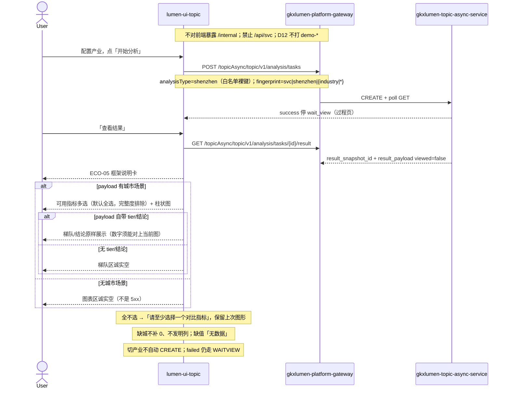

# LUMEN-SVC-P-FE-US-ECO-06 · US-SVC-ECO-06 横向对比分析

> 日期：2026-08-22  
> Task：`LUMEN-SVC-P-FE-US-ECO-06`  
> 总控：[`LUMEN-SVC-P-长任务总控.md`](./LUMEN-SVC-P-长任务总控.md)（§7 已生效；切法 A / 公式冻结）  
> 仓：`lumen-ui-topic` · `origin/dev`  
> 复刻真源：`demo-ui-topic` `ShenzhenCompareView.tsx` 图表段（只读对照，未贴 JSX、未改 demo、未搬 `computeSzCompare` / `computeSzTier` / `SZ_COMPARE_METRICS` / `COMPARE_CITIES`）  
> 本仓前置：WAITVIEW · ECO-01/02/04/05。本叶替换 ECO-05 框架卡下方对比空位。

## 任务认领（必填）

| 字段 | 值 |
|------|-----|
| claimed_by | `agent:frontend-agent` |
| supervised_by | `human:侯佳伟` |
| claim_type | `coordinator_dispatch` |
| 说明 | 长任务 24h 锁；本叶不标 `done`。coordinator 已 MCP `in_progress`。本会话未挂载 task-registry MCP，未手改 yaml。 |

## Ponytail（coding 任务必填）

| 字段 | 值 |
|------|-----|
| ponytail | `full` |
| 说明 | 复用 ECO-05 框架卡、WAITVIEW、`@/review`、已有 `M_SVC_SZ_SCALE` / `M_SVC_ORG_TECH_SCORE` / `M_SVC_RELATION_DENSITY` 种子。未用 YAGNI 跳过 D8 页底 token、D9 ⓘ、D10 评审自闸、可观测 X-Trace-Id、handoff、图即契约、五维复刻、附录 E。未搬 Demo 城市矩阵，未自造 `M_SVC_SZ_COMPARE_METRIC` / `M_SVC_SZ_TIER` 进 seed。 |

## Headroom（可选）

| 字段 | 值 |
|------|-----|
| headroom | `skip` |
| 说明 | 本机会话未挂载 Headroom MCP。 |

## 图即契约

| 字段 | 值 |
|------|-----|
| diagram_id | `SVC-STORAGE-LINEAGE`（消费，不改工厂边）；`LUMEN-SVC-P-FE-US-ECO-06-SEQ`（本叶） |
| 图 diff | LINEAGE 边未改。本叶把 ECO-05 对比空位改成实线：GET result 城市场景 → 指标多选 + 柱状图 + 仅 payload 梯队/结论。禁止事项未变：不打 `demo-*`、不搬 Demo 对比函数、不自造 completeness / compare / tier metric seed、不新 Java 路径、不改 graph/chain。 |
| 会签态 | `SVC-STORAGE-LINEAGE` 随 `storage/SVC/01-data-flow.md` frontmatter：`approved`（`human:淮政玮` · 2026-08-19 流图；2026-08-20 选 B 增补 LINEAGE，**不改** §1 工厂边）。本叶 SEQ 为 `draft`，禁止自填绿。 |

### L2 消费（不改边）

本叶只读消费 [`storage/SVC/01-data-flow.md`](../../data/data-design/storage/SVC/01-data-flow.md) §1.1 `SVC-STORAGE-LINEAGE`：分析任务经 Java Job 读 CREATE 已签发的 snapshot。前端不扫表、不直连 nGQL、不改工厂边。对比柱值只认 GET result 城市场景（深圳 / 全国平均 / 北京 / 上海 / 广州）；无城市场景图表区诚实空。禁止用门户 PT-05 `service-portal/shenzhen` `sz_total` 冒充深圳列再编北上广。

### L4 本叶 SEQ · `LUMEN-SVC-P-FE-US-ECO-06-SEQ`

| 生产者 | 消费者 | 触发 | 失败语义 | 禁止事项 |
|---|---|---|---|---|
| Java GET result `result_payload` 城市场景 | 对比柱状图 | 仅用户点「查看结果」 | 无城市场景 → 图表区空；某城某指标无值 →「无数据」；failed ≠ 对比空态 | `computeSzCompare`；`computeSzTier`；`SZ_COMPARE_METRICS`；`COMPARE_CITIES`；门户 `sz_total` 编北上广；缺城补 0 |
| URL `sz_metrics` | 对比指标多选 | 勾选变化 / 刷新 | 全不选提示并保留上次图；缺 key 默认全选可用指标 | 完整度进可选列表 |
| payload `tier` / 结论字段 | 梯队仪表盘 / 结论区 | 有城市场景且当前图可核对 | 无字段 → 诚实空 | 前端按「前二占比」合成第一梯队；图外编数字 |
| `M_SVC_SZ_SCALE` / `M_SVC_ORG_TECH_SCORE` / `M_SVC_RELATION_DENSITY` | 对比数字旁 ⓘ | 结果板对比区 | 只读 seed，不改绿 | 自造 `M_SVC_SZ_COMPARE_METRIC` / `M_SVC_SZ_TIER` 进 seed |
| `GAP-SVC-SZ-CHAIN-COMPLETENESS` | 完整度排除 | 框架卡已说明 | D1 missing 不进可选/图/结论 | 用 GAP 冒充可比指标 |

## 范围与实现

落地 `US-SVC-ECO-06` 横向对比，挂在 `/service/chain-analysis?workspace=shenzhen` 已有 ECO-05 框架卡**下方**（替换对比空位）：

1. 对比指标多选：默认全选框架卡已列且非完整度的可用指标（规模 / 平均技术力 / 网络密度）。完整度 D1 missing 不出现在可选列表、不进图、不进结论。全不选 →「请至少选择一个对比指标」，保留上次图形不渲染空轴。选择写入 URL `sz_metrics`，刷新保留。
2. 柱状图只认 GET result 城市场景（深圳 / 全国平均 / 北京 / 上海 / 广州）。城市列仅当 payload 有对应城；缺城不补 0、不发明列。某城某指标无值 →「无数据」。无任何城市场景 → 图表区诚实空。深圳列主色高亮，其它列降透明度。不用红绿 Tag 当排名好坏。
3. 梯队 / 结论只认 payload 自带 `tier` / 结论字段；没有则诚实空。禁止前端按「前二占比」合成第一梯队。结论数字必须能在当前图上对上。
4. 评审：不自造 `M_SVC_SZ_COMPARE_METRIC` / `M_SVC_SZ_TIER` 进 seed。数字旁 ⓘ 挂已有可比指标。Q-SVCCHAIN-04 不改绿。关评审零泄漏。业务态保留「演示口径」可读声明。
5. 附录 E / 指纹 / 切产业不自动 CREATE：不改。Job failed 仍走 WAITVIEW，failed ≠ 对比空态。
6. Mock 开：shenzhen 叶仍只回框架元数据，不编五城矩阵。关：页面不引 `@/mock/**`。

**非范围**：改 WAITVIEW / CREATE `shenzhen` / 框架卡契约；改 graph/chain；改 Java/Python；改 `industry-center`；改 `demo-ui-topic`；宣称 K8s 绿。

## 偏离说明

- **不搬城市矩阵**：未引用 `computeSzCompare` / `computeSzTier` / `SZ_COMPARE_METRICS` / `COMPARE_CITIES`，未贴 JSX。现网无城市场景时图表区诚实空，不是前端 fixture。
- **无数列诚实空**：缺城不补列、缺值不填 0。明确 `0` 仍按 payload 真值展示。
- **梯队只认 payload**：无 `tier` / 结论字段则空；有 `gauge_value` 才画蓝色仪表盘，不用 Demo 红橙绿分段，不把「第一梯队」映射成 90。
- **完整度排除**：可选列表只来自 `SVC_SZ_COMPAREABLE_ITEMS`（`inCompare=true`）。未向 seed 写入 `M_SVC_SZ_COMPARE_METRIC` / `M_SVC_SZ_TIER` / completeness。
- **USM AC-03 指标名**：USM 写 `M_SVC_SZ_COMPARE_METRIC`，仓内无种子 → 按 `/goal` 挂已有可比指标 ⓘ，不自造 seed。
- 模板 W4「当天已成功直接打开结果」：沿用 WAITVIEW，restore 到过程页再点「查看结果」。

## 复刻五维（R1–R5）

| # | 项 | 结果 |
|---|---|---|
| R1 布局 | 配置 / 过程壳 / 框架卡 / 对比多选+柱图+梯队 / 记录 Tab；graph/chain 契约未改；一节点一套 layout | ✅ |
| R2 交互 | 「开始分析」才 CREATE；切产业不 CREATE；failed 走 WAITVIEW；无城市场景诚实空；全不选保留上次图 | ✅ |
| R3 样式 | `--sci-bg-page` / `#D8E7FC`；柱蓝系 `#165DFF` / `#94BFFF`；无红绿排名 Tag | ✅ |
| R4 评审 | 只从 `@/review`（`SVC-ECO-06-*`）；关评审不泄漏 metric_id / GAP-* / Q-SVCCHAIN-04 | ✅ |
| R5 Mock | 开：`analysisTaskStore` shenzhen 叶仍只回框架元数据。关：页面不引 `@/mock/**`、无页内 `MOCK_` | ✅ |

### 检索皮肤（V1–V7）

本叶是分析工作区，不是检索 Hub。V1 页底必过；V2–V7 N/A。

| # | 结果 |
|---|---|
| V1 页底 `--sci-bg-page` / `#D8E7FC` | ✅ |
| V2–V7 | N/A（查询页） |

### 工作区（W1 / W4）

| # | 项 | 结果 |
|---|---|---|
| W1 | 配置区 / 过程壳 / 框架+对比结果 / 记录 Tab | ✅ |
| W2 | 关系图 | N/A（本叶无图谱；graph 仍 G6） |
| W3 | 报告阅读器 | N/A |
| W4 | 切条件不自动 create；「开始分析」；同指纹一条在跑；当天成功可恢复；「重新分析」可 force | ✅ |

## 附录 E（I2-12）

| # | 项 | 结果 |
|---|---|---|
| E.1 页清单 | `/service/chain-analysis?workspace=shenzhen` | ✅ |
| E.2 CTA | 配置区「开始分析」 | ✅ |
| E.3 禁自动 create | 无 `watch → create`；切产业只改指纹 | ✅ |
| E.4 单飞 | `decideAnalysisTaskGate` + `svc\|shenzhen\|{industry\|\*}` | ✅ |
| E.5 当天复用 | `forceCreate=false` restore 过程页；`重新分析` `force=true` | ✅ |
| failed | 过程壳红 alert ≠ 对比空态 | ✅ |

## Design.md §14

页底 token `--sci-bg-page`；主色 `#165DFF`。对比区 gap 8/12/16，无 20px 间距。柱用蓝系，深圳列高亮、其它列降透明度；仪表盘单色蓝，不用 Demo 红橙绿分段当好坏。无 `.ant-` / vendor-antd token。无新地图。数字旁走 `@/review`。关评审零泄漏。Arco 只做外围，柱/仪表盘走 ECharts。

## 测试结果

- `node src/views/service/serviceEcoCompare.selfcheck.mjs` → `serviceEcoCompare.selfcheck ok`
- `node src/views/service/serviceEcoFramework.selfcheck.mjs` → `serviceEcoFramework.selfcheck ok`
- `node src/views/service/serviceEcoAnalysis.selfcheck.mjs` → `serviceEcoAnalysis.selfcheck eco-graph ok`
- `node src/views/service/serviceEcoShortboard.selfcheck.mjs` → `serviceEcoShortboard.selfcheck chain ok`
- `node src/views/service/serviceEcoFilter.selfcheck.mjs` → `serviceEcoFilter.selfcheck ok`
- `node src/views/service/serviceEcoStats.selfcheck.mjs` → `serviceEcoStats.selfcheck ok`
- `node src/router/menu.selfcheck.mjs` → `menu.selfcheck svc-shell ok`
- `npx vue-tsc --build` → 通过（exit 0）
- 本叶未等 K8s rollout

## 遗留风险

- 现网 GET result 若无城市场景，50892 对比区诚实空（选择器仍在），这是诚实空，不是前端 fixture。
- 现网若尚未签发 `tier` / 结论字段，梯队区空；不要把空当成 5xx。
- 金路径须 E0 滚出后在 50892 点过一遍（`?workspace=shenzhen` → 开始分析 → 查看结果 → 勾选指标进 URL → 关评审零泄漏 → 切产业不 CREATE）。
- 本会话未挂载 task-registry MCP，cost / evidence 请 coordinator 代填；**不标 done**。

## CI/CD（必填）

- 分支：`lumen-ui-topic` `origin/dev`（push `3f9ff4e..68cac91`，未 force）
- commit：`68cac91` `feat(svc): add US-SVC-ECO-06 city compare board [agent:frontend-agent]`
- pipeline URL / ID：GitLab 对 `68cac91` 自动建管线（本叶未等绿、未宣称 K8s 已滚出）
- 部署 namespace / 镜像 tag：待 E0 / CI
- K8s rollout：本叶未等
- dev 测试 URL：http://111.198.38.90:50892/service/chain-analysis?workspace=shenzhen （需 CI 滚出后可见本叶）
- 本地：`node src/views/service/serviceEcoCompare.selfcheck.mjs`

## 可观测性

- CREATE / GET / RESULT 均走 `src/utils/request.ts`：`X-Trace-Id` + `traceparent`
- 本叶无新 Java 路径、无新 span 名
- OTEL_SERVICE_NAME：N/A（前端）
- Tempo / Loki：有（平台已有）

## 架构合规自检

| 铁律 | 结果 |
|------|------|
| 1 算法只在 Python | ✅ 前端不算城市对比分、不合成梯队、不造完整度 |
| 2 调用链 FE→Java→Python `/internal` | ✅ 只调已有 analysis tasks CREATE/GET/RESULT；无新 Java 路径 |
| 3 Nebula 非 Neo4j | ✅ 未直连图库 |
| 4 可观测 | ✅ request 拦截器 X-Trace-Id |
| 5 CI | ⏳ push 后 |
| 6 demo2 不 merge 进 lumen | ✅ 只读对照 demo-ui-topic；未改 demo |
| 7 共享聚合 / 只调 Java | ✅ 未直连 Python |
| 8 数据 ADS / 无硬 mock | ✅ `USE_MOCK=false` 不填五城 fixture |
| 9 D8 Design token | ✅ `--sci-bg-page`；柱蓝系；无红绿排名色 |
| 10 D9 八件套 / 不自造 ⓘ | ✅ 三指标走已有 seed；完整度排除；Q-SVCCHAIN-04 不改绿 |
| 11 D10 `@/review` | ✅ `SVC-ECO-06-*` |
| 12 D12 不打 demo-* | ✅ |

## Cost

| 字段 | 值 |
|------|-----|
| `actual_tokens` | 260000 |
| `model_used` | `claude-sonnet-4.5`（registry 合法枚举；本会话为 Cursor Grok 4.6，按 Sonnet 价表回填） |
| `actual_cost` | 1.40 |
| `cost_warn` | green |
| 口径 | frontend-agent 80/20；`260000×0.8×3/1e6 + 260000×0.2×15/1e6 = 1.404` 取 `1.40`；`source: session_estimate` |

## 涉及文件

- `lumen-ui-topic` `src/views/service/SvcSzCompareBoard.vue`
- `lumen-ui-topic` `src/views/service/svcSzCompareModel.ts`
- `lumen-ui-topic` `src/views/service/SvcSzFrameworkCard.vue`
- `lumen-ui-topic` `src/views/service/svcSzFrameworkModel.ts`
- `lumen-ui-topic` `src/views/service/svcEcoAnalysisWorkspace.ts`
- `lumen-ui-topic` `src/views/service/ServiceChainAnalysisWorkspace.vue`
- `lumen-ui-topic` `src/views/service/serviceEcoAnalysis.css`
- `lumen-ui-topic` `src/views/service/ServiceReviewMount.vue`
- `lumen-ui-topic` `src/views/service/serviceEcoCompare.selfcheck.mjs`
- `lumen-ui-topic` `src/config/echarts.ts`（注册已有 echarts `GaugeChart`）
- 本 handoff

## 产物清单

- 代码：`68cac91`（`lumen-ui-topic` `dev`）
- 文档：本文件
- 未改：`DefaultLayout.vue`、`industry-center`、`demo-ui-topic`、Java / Python、graph/chain 契约、`svcMetricSeed` / `svcReadinessSeed`、`analysisTaskStore` shenzhen 叶（仍无五城矩阵）

## 联调确认

联调通过（代码侧）：`workspace=shenzhen` 经 WAITVIEW 后框架卡下方出横向对比板；无城市场景诚实空；完整度不进可选/图/结论；未搬 Demo 城市矩阵；缺城不补 0；梯队只认 payload；graph/shortboard/filter/stats/menu 自检仍绿。请 coordinator AV-0，**本叶不自行标 done**。

## Registry（MCP）

`task-update-fields` 写 evidence / note / cost 四字段；`status` 仍为 `in_progress`（未改 done）。禁止手改 `task-registry.yaml`。本会话 MCP 未挂载，请 coordinator 代填。
