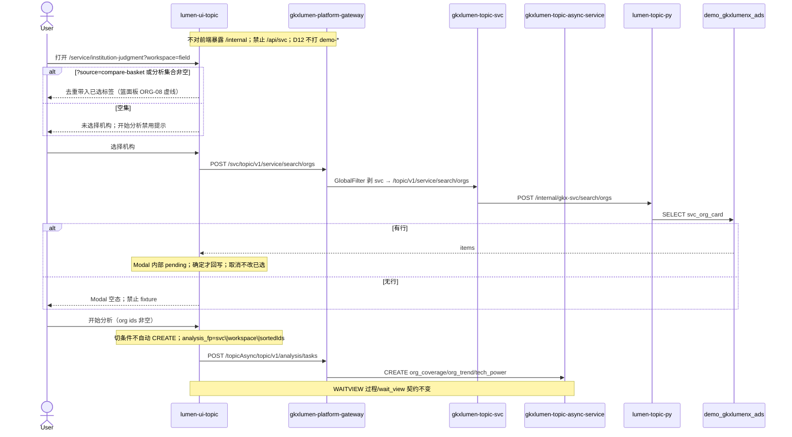

# LUMEN-SVC-P-FE-US-ORG-01 · US-SVC-ORG-01 组装分析对象集

> 日期：2026-08-21  
> Task：`LUMEN-SVC-P-FE-US-ORG-01`  
> 总控：[`LUMEN-SVC-P-长任务总控.md`](./LUMEN-SVC-P-长任务总控.md)（§7 已生效）  
> 仓：`lumen-ui-topic` · `origin/dev`  
> 复刻真源：`demo-ui-topic` `OrgPickerModal.tsx` + `ServiceOrgAnalysisPage.tsx` 对象集段（只读对照，未贴 JSX、未改 demo）  
> 本仓前置：WAITVIEW `7f83a82` · ORG-07 `6fff279`

## 任务认领（必填）

| 字段 | 值 |
|------|-----|
| claimed_by | `agent:frontend-agent` |
| supervised_by | `human:侯佳伟` |
| claim_type | `coordinator_dispatch` |
| 说明 | 长任务 24h 锁；本叶不标 `done` |

## Ponytail（coding 任务必填）

| 字段 | 值 |
|------|-----|
| ponytail | `full` |
| 说明 | 复用 `svcSearchOrgs` / `analysisTaskGate` / `useSvcAnalysisJob` / `@/review` / ORG-07 `readOrgWorkbench`。未用 YAGNI 跳过 D8 页底 token、D9 不自造 ⓘ、D10 评审自闸、可观测 `request.ts` X-Trace-Id、handoff、图即契约、五维复刻、附录 E。 |

## Headroom（可选）

| 字段 | 值 |
|------|-----|
| headroom | `skip` |
| 说明 | 本机会话未挂载 Headroom MCP。 |

## 图即契约

| 字段 | 值 |
|------|-----|
| diagram_id | `SVC-STORAGE-LINEAGE`（消费，不改工厂边）；`LUMEN-SVC-P-FE-US-ORG-01-SEQ`（本叶） |
| 图 diff | LINEAGE 边未改。本叶把 WAITVIEW 配置区占位指纹 `svc\|{workspace}\|placeholder` 改成实线对象集：50892 FE 名单 `POST /svc/topic/v1/service/search/orgs`，CREATE `analysis_fp` 纳入排序后真实 org ids。ORG-02 业务图 / ORG-08 篮面板仍虚线。禁止事项未变：不打 `demo-*`、不填 Demo 机构名单、切条件不自动 create。 |
| 会签态 | `SVC-STORAGE-LINEAGE` 随 `storage/SVC/01-data-flow.md` frontmatter：`approved`（`human:淮政玮` · 2026-08-19 流图；2026-08-20 选 B 增补 LINEAGE，**不改** §1 工厂边）。本叶 SEQ 为 `draft`，禁止自填绿。 |

### L2 消费（不改边）

本叶只读消费 [`storage/SVC/01-data-flow.md`](../../data/data-design/storage/SVC/01-data-flow.md) §1.1 `SVC-STORAGE-LINEAGE`：候选名单读 ADS `svc_org_card`（经 Java search/orgs），不联 ODS。前端不扫表、不直连 nGQL、不改工厂边。

### L4 本叶 SEQ · `LUMEN-SVC-P-FE-US-ORG-01-SEQ`

| 生产者 | 消费者 | 触发 | 失败语义 | 禁止事项 |
|---|---|---|---|---|
| Java `POST /topic/v1/service/search/orgs` | 本叶 Modal | 打开选择器 / 搜索名称或类型 | 无行 → Modal 空态；接口失败可见空 + 不填 Demo 名单 | `SERVICE_ORGS` / 华大基因 fixture；直连 Python `/internal` |
| 已选标签 | `analysis_fp` / CREATE params.org_ids | 确定 Modal / 单删 / 清空 / URL `org_ids[]` | 空集 → Message「请先选择分析机构」，不 CREATE | 占位指纹 `placeholder`；空集仍开始分析 |
| ORG-07 `gkx-service-org-workbench:v1` / `?source=compare-basket&org_ids[]=` | 配置区对象集 | 首次进入或点「带入分析集合」 | 去重合并；无集合则提示空 | 本叶做篮面板（ORG-08） |
| 配置区「开始分析」 | async-service CREATE | 用户点击 CTA 且对象集非空 | 未知 type / 创建失败 → 页内 error + traceId | 切条件自动 create；改 CHAIN type |

## 范围与实现

替换 WAITVIEW 配置区「待 ORG-01 组装」占位，落地 `US-SVC-ORG-01`：

1. 配置区已选机构标签（可单删 / 清空）+「选择机构」
2. Modal：内部 pending，**确定才回写**；取消不改已选。搜索名称/类型；按服务类型组全选；底部已选计数
3. 候选名单 = Java `POST /svc/topic/v1/service/search/orgs`（复用 ORG-07 API）。无行 → Modal 空态
4. 可从 ORG-07 分析集合 / `?source=compare-basket&org_ids[]=` 带入（去重）；篮面板留给 ORG-08
5. `analysis_fp` = `svc|{workspace}|{sortedOrgIds}`；空集禁止「开始分析」（Message）
6. 不改 WAITVIEW 过程/wait_view：切条件仍不自动 create；附录 E 仍成立
7. 页底 `--sci-bg-page`；评审只走 `@/review`
8. `USE_MOCK=false` 不填 Demo 机构名单

**非范围**：ORG-02 CoverageView、ORG-03 画像全文、ORG-08 篮面板、PT-02…06、改 `industry-center`、改 `DefaultLayout.vue`。

## 偏离说明

- Demo 分析页对象集主要走对比篮；本叶按 `/goal` 落地 `OrgPickerModal` 确定提交，篮只作 URL/`source=compare-basket` 带入，不画篮面板。
- Demo 按高校/科研院所/企业分组。Java 卡面是六类 `service_type_*`，本叶按 `service_type_label` 分组。
- 模板 W4「当天已成功直接打开结果」：本叶沿用 WAITVIEW 偏离，restore 到过程页再点「查看结果」。
- 未接产业领域 `IndustrySelect`（不在本叶区块清单；留给后续覆盖/趋势叶）。

## 复刻五维（R1–R5）

| # | 项 | 结果 |
|---|---|---|
| R1 布局 | 配置区已选标签 + 选择器 Modal + 过程壳/结果占位/记录 Tab 都有结构；`v-if`/`v-else-if` 一节点一套 layout | ✅ |
| R2 交互 | Modal pending/确定/取消；空集 Message；加载/失败空态；wait_view；条件不脏不自动 create | ✅ |
| R3 样式 | `--sci-bg-page` / `#D8E7FC`；面板走 `--sci-surface-main`；选择器两列卡与 Demo 同结构 | ✅ |
| R4 评审 | 只从 `@/review` 挂点（`SVC-ORG-WAIT-*`）；关评审不渲染 metric_id / GAP-* / Q0xx | ✅ |
| R5 Mock | 开：既有 `registerApiMock('svcSearchOrgs')` 形状=Java 实包。关：页面不引 `@/mock/**`、无页内 `MOCK_`、无华大基因 fixture | ✅ |

### 检索皮肤（V1–V7）

本叶是分析工作区，不是检索 Hub。V1 页底必过；V2–V7 N/A。

| # | 结果 |
|---|---|
| V1 页底 `--sci-bg-page` / `#D8E7FC` | ✅ |
| V2–V7 | N/A（查询页） |

### 工作区（W1 / W4）

| # | 项 | 结果 |
|---|---|---|
| W1 | 配置区对象集 / 过程壳 / 结果板占位 / 记录 Tab | ✅（结果板仍为 snapshot 证明；业务图留给 ORG-02） |
| W2 | 关系图 | N/A（本叶禁止画 ECO/覆盖图） |
| W3 | 报告阅读器 | N/A |
| W4 | 切条件不自动 create；「开始分析」；同指纹一条在跑；当天成功可恢复；「重新分析」可 force | ✅（恢复目标=过程页 wait_view，见偏离） |

## 附录 E（I2-12）

| # | 项 | 结果 |
|---|---|---|
| E.1 页清单 | `/service/institution-judgment?workspace=field\|trend\|capability` | ✅ |
| E.2 CTA | 配置区「开始分析」 | ✅ |
| E.3 禁自动 create | 无 `watch(workspace → create)`；改对象集只 `refreshGate` | ✅ |
| E.4 单飞 | `decideAnalysisTaskGate` + 真实 org ids 指纹 | ✅ |
| E.5 当天复用 | `forceCreate=false` restore 过程页；`重新分析` `force=true` | ✅ |
| failed | 红 alert + 返回配置；≠ 空态 | ✅ |
| 空对象集 | Message「请先选择分析机构」；不 CREATE | ✅ |

## Design.md §14

工作区无新图表色。页底 token `--sci-bg-page`；主色仍 `#165DFF`（Arco primary）。无 `.ant-` / vendor-antd token。无 KPI 卡、无地图（本叶 N/A）。无自造 ⓘ；评审走 `@/review`。

## 测试结果

- `node src/views/service/serviceOrgAnalysis.selfcheck.mjs` → `serviceOrgAnalysis.selfcheck org-set ok`
- `node src/views/service/serviceOrgSearch.selfcheck.mjs` → `serviceOrgSearch.selfcheck ok`
- `npx vue-tsc --build` → 通过（exit 0）
- 本叶未等 K8s rollout

## 遗留风险

- Java 检索分页 size=100：圈定池更大时 Modal 不是全库；关键词走服务端搜索补齐，不是 fixture。
- URL `org_ids[]` 仅有 id、检索未命中时标签可能显示 id，直到分析集合/对比篮提供名称。
- 金路径 #3 仍须 E0 滚出后在 50892 点过一遍（先选机构再开始分析）。
- 旧 WAITVIEW 占位指纹任务不会与新 `svc|{workspace}|{ids}` 复用（预期）。

## CI/CD（必填）

- 分支：`lumen-ui-topic` `origin/dev`
- commit：`a1b994d` `feat(svc): assemble US-SVC-ORG-01 org object set [agent:frontend-agent]`
- pipeline URL / ID：push 后由 GitLab 生成
- 部署 namespace / 镜像 tag：待 E0 / CI
- K8s rollout：本叶未等
- dev 测试 URL：http://111.198.38.90:50892/service/institution-judgment?workspace=field （需 CI 滚出后可见本叶）
- 本地：`node src/views/service/serviceOrgAnalysis.selfcheck.mjs`

## 可观测性

- 检索与 CREATE/GET/RESULT 均走 `src/utils/request.ts`：`X-Trace-Id` + `traceparent`
- 失败态展示 `errorTraceId`
- OTEL_SERVICE_NAME：N/A（前端）
- Tempo / Loki：有（平台已有）；本叶无新 span 名

## 架构合规自检

| 铁律 | 结果 |
|------|------|
| 1 算法只在 Python | ✅ 前端无算法 |
| 2 调用链 FE→Java→Python `/internal` | ✅ 名单 `POST /svc/topic/v1/service/search/orgs`；任务 `/topicAsync/topic/v1/analysis/tasks*` |
| 3 Nebula 非 Neo4j | ✅ 未碰图 |
| 4 可观测 | ✅ request 拦截器 X-Trace-Id |
| 5 CI | ⏳ push 后 |
| 6 demo2 不 merge 进 lumen | ✅ 只读对照 demo-ui-topic |
| 7 共享聚合 / 只调 Java | ✅ 未直连 Python |
| 8 数据 ADS / 无硬 mock | ✅ `USE_MOCK=false` 不填 fixture |
| 9 D8 Design token | ✅ `--sci-bg-page` |
| 10 D9 八件套 / 不自造 ⓘ | ✅ 无统计数字；评审走 `@/review` |
| 11 D10 `@/review` | ✅ |
| 12 D12 不打 demo-* | ✅ |

## Cost

| 字段 | 值 |
|------|-----|
| `actual_tokens` | 175000 |
| `model_used` | `claude-sonnet-4.5`（registry 合法枚举；本会话为 Cursor Grok 4.6，按 Sonnet 价表回填） |
| `actual_cost` | 0.95 |
| `cost_warn` | green |
| 口径 | frontend-agent 80/20；`175000×0.8×3/1e6 + 175000×0.2×15/1e6 = 0.945` 取 `0.95`；`source: session_estimate` |

## 涉及文件

- `lumen-ui-topic` `src/views/service/ServiceOrgAnalysisWorkspace.vue`
- `lumen-ui-topic` `src/views/service/SvcOrgPickerModal.vue`
- `lumen-ui-topic` `src/views/service/svcAnalysisWorkspace.ts`
- `lumen-ui-topic` `src/views/service/serviceOrgSearchModel.ts`
- `lumen-ui-topic` `src/views/service/serviceOrgAnalysis.css`
- `lumen-ui-topic` `src/views/service/serviceOrgAnalysis.selfcheck.mjs`
- `lumen-ui-topic` `src/views/service/ServiceAnalysisProcessShell.vue`
- `lumen-ui-topic` `src/views/service/ServiceReviewMount.vue`
- `lumen-ui-topic` `src/composables/useSvcAnalysisJob.ts`
- 本 handoff

## 产物清单

- 代码：`a1b994d`（`lumen-ui-topic` `dev`）
- 文档：本文件
- 未改：`DefaultLayout.vue`、`industry-center` 业务页、`demo-ui-topic`、ORG-02/ORG-08、CHAIN `analysisType`

## 联调确认

联调通过（代码侧）：配置区可组装对象集；Modal 确定才提交；`analysis_fp` 含真实 org ids；空集禁止开始分析；名单只调 Java search/orgs；WAITVIEW 附录 E 未改。请 coordinator AV-0，**本叶不自行标 done**。

## Registry（MCP）

`task-update-fields` 写 evidence / note / cost 四字段；`status` 仍为 `in_progress`（未改 done）。禁止手改 `task-registry.yaml`。
