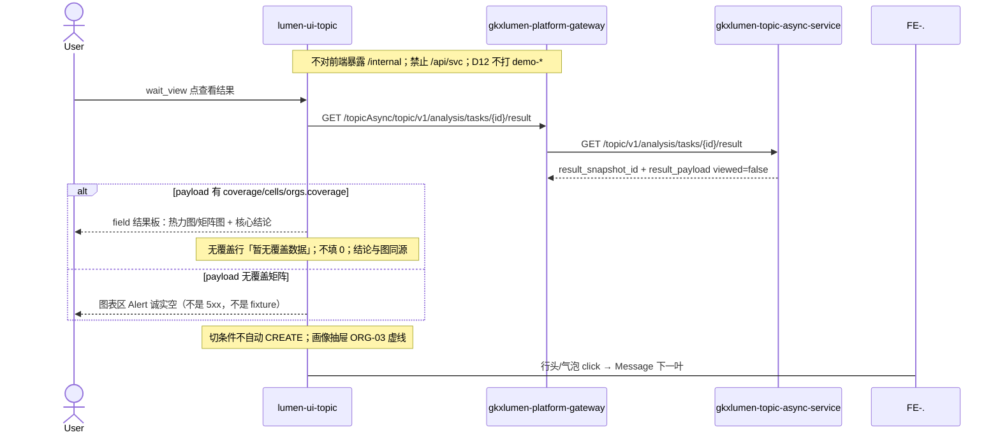

# LUMEN-SVC-P-FE-US-ORG-02 · US-SVC-ORG-02 领域覆盖业务图

> 日期：2026-08-21  
> Task：`LUMEN-SVC-P-FE-US-ORG-02`  
> 总控：[`LUMEN-SVC-P-长任务总控.md`](./LUMEN-SVC-P-长任务总控.md)（§7 已生效；金路径 #3）  
> 仓：`lumen-ui-topic` · `origin/dev`  
> 复刻真源：`demo-ui-topic` `CoverageView.tsx` + `ServiceOrgAnalysisPage.tsx` 覆盖 Tab（只读对照，未贴 JSX、未改 demo）  
> 本仓前置：WAITVIEW `7f83a82` · ORG-01 `a1b994d`

## 任务认领（必填）

| 字段 | 值 |
|------|-----|
| claimed_by | `agent:frontend-agent` |
| supervised_by | `human:侯佳伟` |
| claim_type | `coordinator_dispatch` |
| 说明 | 长任务 24h 锁；本叶不标 `done` |

## Ponytail（coding 任务必填）

| 字段 | 值 |
|------|-----|
| ponytail | `full` |
| 说明 | 复用 WAITVIEW 过程壳、ORG-01 对象集、`VChart`、`IndustryCatalogSelect`、`@/review`。未用 YAGNI 跳过 D8 页底 token、D9 ⓘ/角标、D10 评审自闸、可观测 `request.ts` X-Trace-Id、handoff、图即契约、五维复刻、附录 E。 |

## Headroom（可选）

| 字段 | 值 |
|------|-----|
| headroom | `skip` |
| 说明 | 本机会话未挂载 Headroom MCP。 |

## 图即契约

| 字段 | 值 |
|------|-----|
| diagram_id | `SVC-STORAGE-LINEAGE`（消费，不改工厂边）；`LUMEN-SVC-P-FE-US-ORG-02-SEQ`（本叶） |
| 图 diff | LINEAGE 边未改。本叶把 WAITVIEW 结果板短摘要占位改成实线：用户点「查看结果」后 GET result，`workspace=field` 把 `result_payload` 画成热力/矩阵。无覆盖矩阵诚实空。ORG-03 抽屉 / ORG-04/05/06 仍虚线。禁止事项未变：不打 `demo-*`、不填 Demo 格子、不改 wait_view/对象集。 |
| 会签态 | `SVC-STORAGE-LINEAGE` 随 `storage/SVC/01-data-flow.md` frontmatter：`approved`（`human:淮政玮` · 2026-08-19 流图；2026-08-20 选 B 增补 LINEAGE，**不改** §1 工厂边）。本叶 SEQ 为 `draft`，禁止自填绿。 |

### L2 消费（不改边）

本叶只读消费 [`storage/SVC/01-data-flow.md`](../../data/data-design/storage/SVC/01-data-flow.md) §1.1 `SVC-STORAGE-LINEAGE`：分析任务经 Java Job 读 CREATE 已签发的 snapshot。前端不扫表、不直连 nGQL、不改工厂边。就近读面 `models/gap` **不是**机构×领域矩阵；缺矩阵字段则图表区 Alert，不拿短板 `avg_depth` 冒充覆盖格子。

### L4 本叶 SEQ · `LUMEN-SVC-P-FE-US-ORG-02-SEQ`

| 生产者 | 消费者 | 触发 | 失败语义 | 禁止事项 |
|---|---|---|---|---|
| Java GET result `result_payload` | field 覆盖板 | 仅用户点「查看结果」 | 无矩阵 → Alert 诚实空；failed / 未 succeeded 仍走 WAITVIEW 失败态 | Demo `SERVICE_ORGS`/`SERVICE_FIELDS` 填格子；gap 短板当覆盖矩阵；Job failed 冒充空态 |
| 配置区对象集（ORG-01） | 热力行 / 结论排名 | 已选机构 ∩ payload 覆盖 | 无覆盖机构不填 0、不进 TOP | 改 `analysis_fp`；空集 CREATE |
| `IndustryCatalogSelect` | 本页列筛选 | 改 `?industry=` | 无匹配列则仍展示 payload 全量矩阵 | 把产业纳入 `svc\|{workspace}\|{ids}` 指纹 |
| Radio 热力/矩阵 | 同一 VChart | `?coverage_chart=` | 切换不丢机构集合 | G6 冒充热力；两套互斥 display 叠同一节点 |

## 范围与实现

替换 WAITVIEW field 结果板「snapshot 短摘要占位」，落地 `US-SVC-ORG-02`：

1. `workspace=field` 出领域覆盖业务图（热力 + 矩阵 + 核心结论）。trend/capability 结果板仍占位，未画 TrendView/CapabilityView
2. 热力图：行=已选机构中有覆盖者、列=payload 产业领域；色阶五档对齐 Demo visualMap pieces。数据只经 `parseSvcSnapshot` → `parseSvcCoverageBoard`
3. 矩阵图：X=覆盖领域数（整数）、Y=平均深度 0-100、四象限文本；气泡可点但不打开画像抽屉
4. Radio 切换走 `?coverage_chart=`，刷新保留；不丢 `org_ids[]`
5. hover：机构、领域、深度；无覆盖显示「暂无覆盖数据」，不用 0 填色，不参与 TOP
6. 核心结论：广度 TOP3、深度 TOP 领域、合作建议；数值与当前图同源；评审挂点带演示口径
7. `@/review`：`M_SVC_ORG_COVERAGE_DEPTH`（D1 draft + Q-SVCCHAIN-02 待核验）、`M_SVC_ORG_COVERAGE_BREADTH`。未改绿
8. 产业领域复用 `components/form/IndustryCatalogSelect.vue`；**未改** `views/industry-center/*`。筛选只改 `?industry=`，**不改** ORG-01 `analysis_fp=svc|{workspace}|{sortedOrgIds}`
9. payload 无覆盖矩阵 → Alert 诚实空。Job failed / 未 succeeded 仍走 WAITVIEW 失败态
10. 页底 `--sci-bg-page` / `#D8E7FC`；图表用已有 `VChart` + Heatmap/Scatter，无新依赖
11. 附录 E 保持：切条件不自动 create；「开始分析」；同指纹一条在跑；当天成功 restore 过程页再点查看结果
12. `serviceOrgAnalysis.selfcheck.mjs` 扩覆盖图切换 / 无覆盖不填 0 / 结论同源 / 空 payload；`vue-tsc --build` 通过

**非范围**：ORG-03 画像抽屉、ORG-04/05/06 趋势/热度/技术力图、ORG-08 篮面板、PT-*、ECO/REC、改 `DefaultLayout`、改 Java/Python、宣称 K8s/50892 已滚出。

## 偏离说明

- 产业领域 **未**纳入 CREATE 指纹。ORG-01 仍是 `svc|{workspace}|{sortedOrgIds}`。本页用 payload 全量矩阵 + `?industry=` 筛选；无匹配列则回落全量矩阵。
- 当前 Java/Python `org_coverage` 就近读面是 `models/gap`（短板环节），**没有**机构×领域矩阵。本叶按实包解析；无矩阵字段则诚实空，不把 `gap[].avg_depth` 画成热力格子。
- 模板 W4「当天已成功直接打开结果」：沿用 WAITVIEW，restore 到过程页再点「查看结果」。
- 行头/气泡 click 只 Message「画像下钻下一叶」，不接 Drawer。
- Mock 开：仍走 `registerApiMock` 任务实体；不在页面引用 `@/mock/**`，不填华大基因 / Demo 区级点。

## 复刻五维（R1–R5）

| # | 项 | 结果 |
|---|---|---|
| R1 布局 | field 结果板有热力/矩阵/结论结构；配置区/过程壳/记录 Tab 仍在；`v-if`/`v-else-if` 一节点一套 layout | ✅ |
| R2 交互 | Radio 切换、hover、无覆盖 Alert、wait_view、failed ≠ 空态、切条件不自动 create | ✅ |
| R3 样式 | `--sci-bg-page` / `#D8E7FC`；结论三列网格与 Demo `svc-conclusion-*` 同结构；主色 `#165DFF` | ✅ |
| R4 评审 | 只从 `@/review` 挂点（`SVC-ORG-F02-*` + WAIT 挂点）；关评审不渲染 metric_id / GAP-* / Q0xx | ✅ |
| R5 Mock | 开：既有 `registerApiMock`。关：页面/覆盖板不引 `@/mock/**`、无页内 `MOCK_`、无华大基因 / Demo 领域字典填格子 | ✅ |

### 检索皮肤（V1–V7）

本叶是分析工作区，不是检索 Hub。V1 页底必过；V2–V7 N/A。

| # | 结果 |
|---|---|
| V1 页底 `--sci-bg-page` / `#D8E7FC` | ✅ |
| V2–V7 | N/A（查询页） |

### 工作区（W1 / W2 / W4）

| # | 项 | 结果 |
|---|---|---|
| W1 | 配置区对象集 / 过程壳 / field 覆盖结果板 / 记录 Tab | ✅ |
| W2 | 覆盖图用已有 ECharts 热力 + 散点矩阵，不用 G6 冒充热力 | ✅ |
| W3 | 报告阅读器 | N/A |
| W4 | 切条件不自动 create；「开始分析」；同指纹一条在跑；当天成功可恢复；「重新分析」可 force | ✅（恢复目标=过程页 wait_view） |

## 附录 E（I2-12）

| # | 项 | 结果 |
|---|---|---|
| E.1 页清单 | `/service/institution-judgment?workspace=field\|trend\|capability` | ✅ |
| E.2 CTA | 配置区「开始分析」 | ✅ |
| E.3 禁自动 create | 无 `watch(workspace → create)`；改产业筛选只改 query | ✅ |
| E.4 单飞 | `decideAnalysisTaskGate` + `svc|{workspace}|{ids}` | ✅ |
| E.5 当天复用 | `forceCreate=false` restore 过程页；`重新分析` `force=true` | ✅ |
| failed | 红 alert + 过程壳失败态；≠ 覆盖空态 | ✅ |

## Design.md §14

工作区覆盖图用蓝系五档连续量（`#bedaff`→`#165dff`），无红绿方向色。页底 token `--sci-bg-page`；主色 `#165DFF`。无 `.ant-` / vendor-antd token。无新地图。统计数字旁走 `@/review`，不自造 ⓘ / emoji 角标。

## 测试结果

- `node src/views/service/serviceOrgAnalysis.selfcheck.mjs` → `serviceOrgAnalysis.selfcheck coverage ok`
- `npx vue-tsc --build` → 通过（exit 0）
- 本叶未等 K8s rollout

## 遗留风险

- 现网 `org_coverage` payload 若仍是 gap 短板包，50892 上覆盖图会诚实空，直到 Java/Python 签发机构×领域矩阵。这是实包诚实，不是前端 fixture。
- 产业筛选不进指纹：同机构集合改产业会复用当天任务。若产品要按产业重跑，需另叶改 `analysis_fp`。
- 金路径 #3 仍须 E0 滚出后在 50892 点过一遍（选机构 → 开始分析 → wait_view → 查看结果）。

## CI/CD（必填）

- 分支：`lumen-ui-topic` `origin/dev`（已 push，`a1b994d..36e7e78`，未 force）
- commit：`36e7e78` `feat(svc): add US-SVC-ORG-02 field coverage board [agent:frontend-agent]`
- pipeline URL / ID：GitLab 对 `36e7e78` 自动建管线（本叶未等绿、未宣称 K8s 已滚出）
- 部署 namespace / 镜像 tag：待 E0 / CI
- K8s rollout：本叶未等
- dev 测试 URL：http://111.198.38.90:50892/service/institution-judgment?workspace=field （需 CI 滚出后可见本叶）
- 本地：`node src/views/service/serviceOrgAnalysis.selfcheck.mjs`

## 可观测性

- CREATE/GET/RESULT 仍走 `src/utils/request.ts`：`X-Trace-Id` + `traceparent`
- 失败态展示 `errorTraceId`
- OTEL_SERVICE_NAME：N/A（前端）
- Tempo / Loki：有（平台已有）；本叶无新 span 名

## 架构合规自检

| 铁律 | 结果 |
|------|------|
| 1 算法只在 Python | ✅ 前端无算法；结论为演示口径规则，标待核验 |
| 2 调用链 FE→Java→Python `/internal` | ✅ 只调已有 search/orgs 与 `/topicAsync/topic/v1/analysis/tasks*` |
| 3 Nebula 非 Neo4j | ✅ 未碰图 |
| 4 可观测 | ✅ request 拦截器 X-Trace-Id |
| 5 CI | ⏳ push 后 |
| 6 demo2 不 merge 进 lumen | ✅ 只读对照 demo-ui-topic |
| 7 共享聚合 / 只调 Java | ✅ 未直连 Python |
| 8 数据 ADS / 无硬 mock | ✅ `USE_MOCK=false` 不填 fixture |
| 9 D8 Design token | ✅ `--sci-bg-page`；蓝系五档 |
| 10 D9 八件套 / 不自造 ⓘ | ✅ 两个 metric_id 走 `@/review` |
| 11 D10 `@/review` | ✅ |
| 12 D12 不打 demo-* | ✅ |

## Cost

| 字段 | 值 |
|------|-----|
| `actual_tokens` | 210000 |
| `model_used` | `claude-sonnet-4.5`（registry 合法枚举；本会话为 Cursor Grok 4.6，按 Sonnet 价表回填） |
| `actual_cost` | 1.13 |
| `cost_warn` | green |
| 口径 | frontend-agent 80/20；`210000×0.8×3/1e6 + 210000×0.2×15/1e6 = 1.134` 取 `1.13`；`source: session_estimate` |

## 涉及文件

- `lumen-ui-topic` `src/views/service/SvcOrgCoverageBoard.vue`
- `lumen-ui-topic` `src/views/service/svcCoverageModel.ts`
- `lumen-ui-topic` `src/views/service/ServiceOrgAnalysisWorkspace.vue`
- `lumen-ui-topic` `src/views/service/serviceOrgAnalysis.css`
- `lumen-ui-topic` `src/views/service/serviceOrgAnalysis.selfcheck.mjs`
- `lumen-ui-topic` `src/views/service/ServiceReviewMount.vue`
- `lumen-ui-topic` `src/config/echarts.ts`（注册 Scatter / Graphic / MarkLine，无新 npm）
- `lumen-ui-topic` `src/mock/service/svcMetricSeed.ts` / `svcReadinessSeed.ts` / `svcGapCatalog.ts`（只读镜像，不改绿）
- `lumen-ui-topic` `src/mock/enterprise/analysisTaskStore.ts`（Mock 摘要文案，无 Demo 格子）
- 本 handoff

## 产物清单

- 代码：`36e7e78`（`lumen-ui-topic` `dev`）
- 文档：本文件
- 未改：`DefaultLayout.vue`、`industry-center` 业务页、`demo-ui-topic`、Java / Python、ORG-03 抽屉

## 联调确认

联调通过（代码侧）：field 结果板热力/矩阵/结论只读 GET result payload；无覆盖不填 0；无矩阵诚实空；failed ≠ 覆盖空态；指纹未改；附录 E 仍成立。请 coordinator AV-0，**本叶不自行标 done**。

## Registry（MCP）

`task-update-fields` 写 evidence / note / cost 四字段；`status` 仍为 `in_progress`（未改 done）。禁止手改 `task-registry.yaml`。
