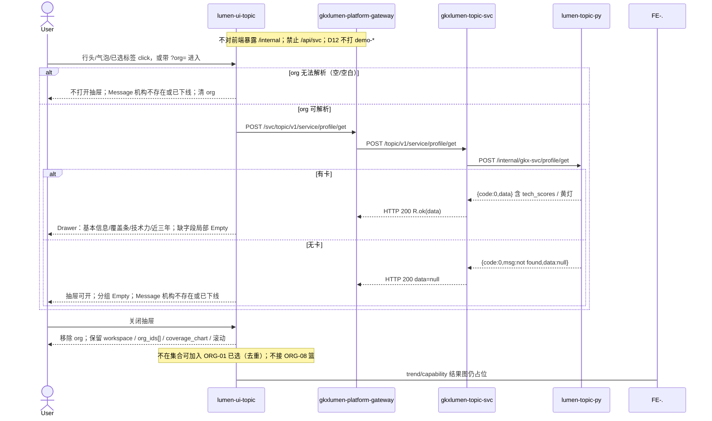

# LUMEN-SVC-P-FE-US-ORG-03 · US-SVC-ORG-03 画像下钻抽屉

> 日期：2026-08-21  
> Task：`LUMEN-SVC-P-FE-US-ORG-03`  
> 总控：[`LUMEN-SVC-P-长任务总控.md`](./LUMEN-SVC-P-长任务总控.md)（§7 已生效）  
> 仓：`lumen-ui-topic` · `origin/dev`  
> 复刻真源：`demo-ui-topic` `OrgProfileDrawer.tsx` + `ServiceOrgAnalysisPage.tsx` URL `org` 驱动（只读对照，未贴 JSX、未改 demo）  
> 本仓前置：WAITVIEW `7f83a82` · ORG-01 `a1b994d` · ORG-02 `36e7e78` · Java PROFILE-GET `59c658a`

## 任务认领（必填）

| 字段 | 值 |
|------|-----|
| claimed_by | `agent:frontend-agent` |
| supervised_by | `human:侯佳伟` |
| claim_type | `coordinator_dispatch` |
| 说明 | 长任务 24h 锁；本叶不标 `done` |

## Ponytail（coding 任务必填）

| 字段 | 值 |
|------|-----|
| ponytail | `full` |
| 说明 | 复用 WAITVIEW 过程壳、ORG-01 对象集、ORG-02 覆盖图 click、`@/review`、已有 `request.ts`。未用 YAGNI 跳过 D8 页底 token、D9 ⓘ/角标、D10 评审自闸、可观测 X-Trace-Id、handoff、图即契约、五维复刻。未落地 ORG-08 篮。 |

## Headroom（可选）

| 字段 | 值 |
|------|-----|
| headroom | `skip` |
| 说明 | 本机会话未挂载 Headroom MCP。 |

## 图即契约

| 字段 | 值 |
|------|-----|
| diagram_id | `SVC-STORAGE-LINEAGE`（消费，不改工厂边）；`LUMEN-SVC-P-FE-US-ORG-03-SEQ`（本叶） |
| 图 diff | LINEAGE 边未改。本叶把 ORG-02 行头/气泡 Message 虚线改成实线：`?org=` / 覆盖图 / 配置区标签打开同一 Drawer，POST Java `profile/get`。ORG-04/05/06 结果图、ORG-08 篮仍虚线。禁止事项未变：不打 `demo-*`、不填 Demo 画像、不改 wait_view/覆盖图解析。 |
| 会签态 | `SVC-STORAGE-LINEAGE` 随 `storage/SVC/01-data-flow.md` frontmatter：`approved`（`human:淮政玮` · 2026-08-19 流图；2026-08-20 选 B 增补 LINEAGE，**不改** §1 工厂边）。本叶 SEQ 为 `draft`，禁止自填绿。 |

### L2 消费（不改边）

本叶只读消费 [`storage/SVC/01-data-flow.md`](../../data/data-design/storage/SVC/01-data-flow.md) §1.1 `SVC-STORAGE-LINEAGE`：画像读 `svc_org_card` + 最新批 `svc_tech_power_score`。前端不扫表、不直连 nGQL、不改工厂边。无卡 `data=null` 分组 Empty，不拿 Demo 华大基因 / `SERVICE_ORGS` 填抽屉。

### L4 本叶 SEQ · `LUMEN-SVC-P-FE-US-ORG-03-SEQ`

| 生产者 | 消费者 | 触发 | 失败语义 | 禁止事项 |
|---|---|---|---|---|
| Java `POST /topic/v1/service/profile/get` | 画像 Drawer | `?org=` / 行头 / 气泡 / 已选标签 | 无卡 `data=null` → 抽屉可开、分组 Empty、Message；无法解析则不开抽屉并清 `org` | `/api/svc`；直连 `/internal`；Demo `SERVICE_ORGS` / 华大基因填抽屉；页内自造 ⓘ |
| ORG-01 已选 `org_ids[]` | 加入集合 / inSelection | 抽屉内「加入集合」 | 已在集合不显示按钮；写入去重 | 改 `analysis_fp`；ORG-08 篮按钮 |
| ORG-02 覆盖图 click | 同一 Drawer | 行头 / 气泡 / 结论机构名 | 空 id 不打开 | 第二套详情；改覆盖图 payload 解析 |

## 范围与实现

落地 `US-SVC-ORG-03` 画像下钻：

1. 同一 `SvcOrgProfileDrawer`：覆盖热力行头 / 矩阵气泡 / 结论机构名 click 打开；配置区已选标签也可打开。trend/capability 结果板仍占位，配置区标签走同一 Drawer。
2. URL `?org=` 驱动：带参进入自动打开；关闭抽屉 `patchQuery` 移除 `org`，不重载页，保留 workspace / `org_ids[]` / `coverage_chart`。
3. 抽屉内容只来自 `POST /svc/topic/v1/service/profile/get`：基本信息有则显、无则局部 Empty；`coverage` 才画细分条；`tech_scores` 作技术力；近三年字段没有就 Empty，不编造时间线。
4. 无卡 `data=null` / `found=false`：抽屉可开，分组 Empty + Message「机构不存在或已下线」。`org` 无法解析（空/空白）则不开抽屉、Message 并清参数。
5. 机构不在当前已选：Alert「该机构不在当前分析集合」+「加入集合」（写入 ORG-01 已选，去重）。未做 ORG-08 `ServiceOrgBasketButton`。
6. 技术力数字旁走 `@/review`：`M_SVC_ORG_TECH_SCORE`（D1 draft ⚠️，Q060 不改绿）。覆盖细分挂已有 `M_SVC_ORG_COVERAGE_DEPTH`。禁止页内自造 ⓘ。
7. 页底 `--sci-bg-page`；Drawer 用 Arco；未改 WAITVIEW 过程/wait_view/CREATE 指纹；未改覆盖图数据解析。
8. `serviceOrgAnalysis.selfcheck.mjs` 扩 `?org=` / 无卡 Empty / 加入集合；`vue-tsc --build` 通过。

**非范围**：ORG-04/05/06 结果图；ORG-08 篮；PT-*；ECO/REC；改 `DefaultLayout` / `industry-center`；改 Java/Python；宣称 K8s 绿。

## 偏离说明

- Demo 抽屉用 `SERVICE_ORGS` 本地对象（含成立年/环节/coverage/capability 五维/近三年）。本叶类型真源是 Java 实包：卡面通常无成立年/环节/coverage/recent_records，对应分组诚实 Empty，不填华大基因。
- Demo `OrgProfileDrawer` 未接线 `onJoinSelection`。本叶按 USM AC-04 落地「加入集合」。
- 技术力展示 `tech_scores`（`model_id` / `score`，有 `dimension_scores` 才铺维度），不用 Demo `patents/rdInvestment/...` 字典。
- 模板 W4 当天已成功直接打开结果：沿用 WAITVIEW，restore 到过程页再点「查看结果」。本叶不改。
- Mock 开：`registerApiMock('svcProfileGet')` 形状=Java 实包（`org-live-1/2`）。关：页面不引 `@/mock/**`。

## 复刻五维（R1–R5）

| # | 项 | 结果 |
|---|---|---|
| R1 布局 | Drawer 四段（基本信息 / 覆盖条 / 技术力 / 近三年）+ 不在集合 Alert；配置区/覆盖图/过程壳仍在；`v-if`/`v-else-if` 一节点一套 layout | ✅ |
| R2 交互 | `?org=` 开关、无卡 Empty、加入集合、关闭不重载、wait_view 未改、切条件不自动 create | ✅ |
| R3 样式 | `--sci-bg-page` / `#D8E7FC`；`svc-drawer-section` / `svc-depth-bar` 对齐 Demo；主色 `#165DFF` | ✅ |
| R4 评审 | 只从 `@/review` 挂点（`SVC-ORG-F05-TECH` / `SVC-ORG-F05-DEPTH`）；关评审不渲染 metric_id / GAP-* / Q0xx | ✅ |
| R5 Mock | 开：`registerApiMock`。关：页面/抽屉不引 `@/mock/**`、无页内 `MOCK_`、无华大基因填抽屉 | ✅ |

### 检索皮肤（V1–V7）

本叶是分析工作区，不是检索 Hub。V1 页底必过；V2–V7 N/A。

| # | 结果 |
|---|---|
| V1 页底 `--sci-bg-page` / `#D8E7FC` | ✅ |
| V2–V7 | N/A（查询页） |

### 工作区（W1 / W2 / W4）

| # | 项 | 结果 |
|---|---|---|
| W1 | 配置区对象集 / 过程壳 / field 覆盖结果板 / 画像 Drawer / 记录 Tab | ✅ |
| W2 | 关系图 | N/A（本叶不画 G6/热力；覆盖图沿用 ORG-02 ECharts） |
| W3 | 报告阅读器 | N/A |
| W4 | 切条件不自动 create；「开始分析」；同指纹一条在跑；当天成功可恢复；「重新分析」可 force | ✅（沿用 WAITVIEW，本叶不改） |

## 附录 E（I2-12）

| # | 项 | 结果 |
|---|---|---|
| E.1 页清单 | `/service/institution-judgment?workspace=field\|trend\|capability` | ✅ |
| E.2 CTA | 配置区「开始分析」 | ✅（未改） |
| E.3 禁自动 create | 无 `watch(workspace → create)`；开抽屉只改 `org` | ✅ |
| E.4 单飞 | `decideAnalysisTaskGate` + `svc|{workspace}|{ids}` | ✅（未改指纹） |
| E.5 当天复用 | `forceCreate=false` restore 过程页；`重新分析` `force=true` | ✅ |
| failed | 红 alert + 过程壳失败态；≠ 画像无卡 Empty | ✅ |

## Design.md §14

页底 token `--sci-bg-page`；主色 `#165DFF`；Drawer 蓝条覆盖用 `var(--sci-primary)`。无 `.ant-` / vendor-antd token。无新地图。统计数字旁走 `@/review`，不自造 ⓘ / emoji 角标。

## 测试结果

- `node src/views/service/serviceOrgAnalysis.selfcheck.mjs` → `serviceOrgAnalysis.selfcheck coverage+profile ok`
- `npx vue-tsc --build` → 通过（exit 0）
- 本叶未等 K8s rollout

## 遗留风险

- 现网画像卡若无 `coverage` / 成立年 / 近三年，50892 上对应分组会诚实 Empty，直到 ADS/ext 有字段。这是实包诚实，不是前端 fixture。
- 无卡 `data=null` 时抽屉仍开着（USM 与 `/goal` 点 4）；无法解析才清 `org`。
- 金路径 #3 仍须 E0 滚出后在 50892 点过一遍（覆盖图 click → 抽屉 → 关抽屉 URL 无 org）。

## CI/CD（必填）

- 分支：`lumen-ui-topic` `origin/dev`（已 push，`36e7e78..12c5391`，未 force）
- commit：`12c5391` `feat(svc): add US-SVC-ORG-03 org profile drawer [agent:frontend-agent]`
- pipeline URL / ID：GitLab 对 `12c5391` 自动建管线（本叶未等绿、未宣称 K8s 已滚出）
- 部署 namespace / 镜像 tag：待 E0 / CI
- K8s rollout：本叶未等
- dev 测试 URL：http://111.198.38.90:50892/service/institution-judgment?workspace=field （需 CI 滚出后可见本叶）
- 本地：`node src/views/service/serviceOrgAnalysis.selfcheck.mjs`

## 可观测性

- 画像 `svcProfileGet` 走 `src/utils/request.ts`：`X-Trace-Id` + `traceparent`
- CREATE/GET/RESULT 仍走同一拦截器
- OTEL_SERVICE_NAME：N/A（前端）
- Tempo / Loki：有（平台已有）；本叶无新 span 名

## 架构合规自检

| 铁律 | 结果 |
|------|------|
| 1 算法只在 Python | ✅ 前端无算法；技术力原样展示 tech_scores |
| 2 调用链 FE→Java→Python `/internal` | ✅ 只调 `/svc/topic/v1/service/profile/get` + 已有 search/orgs 与 analysis tasks |
| 3 Nebula 非 Neo4j | ✅ 未碰图 |
| 4 可观测 | ✅ request 拦截器 X-Trace-Id |
| 5 CI | ⏳ push 后 |
| 6 demo2 不 merge 进 lumen | ✅ 只读对照 demo-ui-topic |
| 7 共享聚合 / 只调 Java | ✅ 未直连 Python |
| 8 数据 ADS / 无硬 mock | ✅ `USE_MOCK=false` 不填 fixture |
| 9 D8 Design token | ✅ `--sci-bg-page`；Drawer `--sci-primary` |
| 10 D9 八件套 / 不自造 ⓘ | ✅ `M_SVC_ORG_TECH_SCORE` 走 `@/review`；Q060 不改绿 |
| 11 D10 `@/review` | ✅ |
| 12 D12 不打 demo-* | ✅ |

## Cost

| 字段 | 值 |
|------|-----|
| `actual_tokens` | 190000 |
| `model_used` | `claude-sonnet-4.5`（registry 合法枚举；本会话为 Cursor Grok 4.6，按 Sonnet 价表回填） |
| `actual_cost` | 1.03 |
| `cost_warn` | green |
| 口径 | frontend-agent 80/20；`190000×0.8×3/1e6 + 190000×0.2×15/1e6 = 1.026` 取 `1.03`；`source: session_estimate` |

## 涉及文件

- `lumen-ui-topic` `src/views/service/SvcOrgProfileDrawer.vue`
- `lumen-ui-topic` `src/views/service/svcProfileModel.ts`
- `lumen-ui-topic` `src/views/service/ServiceOrgAnalysisWorkspace.vue`
- `lumen-ui-topic` `src/views/service/SvcOrgCoverageBoard.vue`
- `lumen-ui-topic` `src/views/service/serviceOrgAnalysis.css`
- `lumen-ui-topic` `src/views/service/serviceOrgAnalysis.selfcheck.mjs`
- `lumen-ui-topic` `src/views/service/ServiceReviewMount.vue`
- `lumen-ui-topic` `src/api/service/{index,paths,types}.ts`
- `lumen-ui-topic` `src/mock/service/profileGetMock.ts` + `register.ts`
- `lumen-ui-topic` `src/mock/service/svcMetricSeed.ts` / `svcReadinessSeed.ts` / `svcGapCatalog.ts`（只读镜像，不改绿）
- 本 handoff

## 产物清单

- 代码：`12c5391`（`lumen-ui-topic` `dev`）
- 文档：本文件
- 未改：`DefaultLayout.vue`、`industry-center` 业务页、`demo-ui-topic`、Java / Python、WAITVIEW 指纹、覆盖图解析、ORG-08 篮

## 联调确认

联调通过（代码侧）：同一 Drawer 由覆盖图 / 已选标签 / `?org=` 打开；关抽屉清 `org` 不重载；画像只调 Java `profile/get`；无卡 `data=null` 局部 Empty；不在集合可加入；`M_SVC_ORG_TECH_SCORE` 走 `@/review`；Q060 不改绿。请 coordinator AV-0，**本叶不自行标 done**。

## Registry（MCP）

`task-update-fields` 写 evidence / note / cost 四字段；`status` 仍为 `in_progress`（未改 done）。禁止手改 `task-registry.yaml`。
