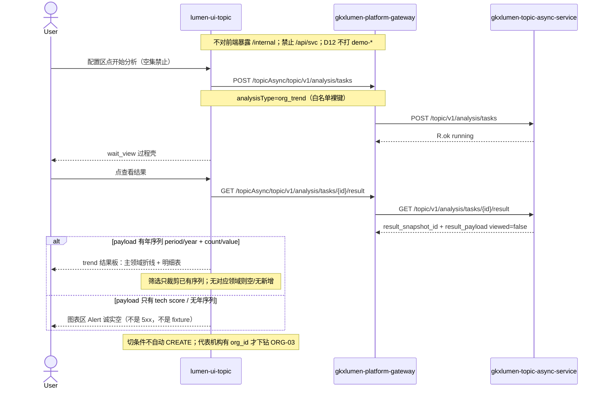

# LUMEN-SVC-P-FE-US-ORG-04 · US-SVC-ORG-04 新增趋势

> 日期：2026-08-22  
> Task：`LUMEN-SVC-P-FE-US-ORG-04`  
> 总控：[`LUMEN-SVC-P-长任务总控.md`](./LUMEN-SVC-P-长任务总控.md)（§7 已生效）  
> 仓：`lumen-ui-topic` · `origin/dev`  
> 复刻真源：`demo-ui-topic` `TrendView.tsx`（只读对照，未贴 JSX、未改 demo）  
> 本仓前置：WAITVIEW · ORG-01 对象集 · ORG-02 覆盖板（本叶不改其契约）· ORG-03 抽屉

## 任务认领（必填）

| 字段 | 值 |
|------|-----|
| claimed_by | `agent:frontend-agent` |
| supervised_by | `human:侯佳伟` |
| claim_type | `coordinator_dispatch` |
| 说明 | 长任务 24h 锁；本叶不标 `done`。coordinator 已 MCP `in_progress`。本会话未挂载 task-registry MCP，未手改 yaml。 |

## Ponytail（coding 任务必填）

| 字段 | 值 |
|------|-----|
| ponytail | `full` |
| 说明 | 复用 WAITVIEW 过程壳、ORG-01 指纹、ORG-03 Drawer、`VChart`、`@/review`、仓内已有 `M_SVC_NEW_CNT`。未用 YAGNI 跳过 D8 页底 token、D9 ⓘ/角标、D10 评审自闸、可观测 `request.ts` X-Trace-Id、handoff、图即契约、五维复刻、附录 E。 |

## Headroom（可选）

| 字段 | 值 |
|------|-----|
| headroom | `skip` |
| 说明 | 本机会话未挂载 Headroom MCP。 |

## 图即契约

| 字段 | 值 |
|------|-----|
| diagram_id | `SVC-STORAGE-LINEAGE`（消费，不改工厂边）；`LUMEN-SVC-P-FE-US-ORG-04-SEQ`（本叶） |
| 图 diff | LINEAGE 边未改。本叶把 WAITVIEW trend 结果板短摘要占位改成实线：用户点「查看结果」后 GET result，`workspace=trend` 只认年序列画折线。payload 仅技术力 score / 无年序列 → Alert 诚实空。ORG-05 热度仍虚线。禁止事项未变：不打 `demo-*`、不填 Demo 趋势、不改 wait_view/对象集/覆盖矩阵、不派 Python 改 org_trend 映射。 |
| 会签态 | `SVC-STORAGE-LINEAGE` 随 `storage/SVC/01-data-flow.md` frontmatter：`approved`（`human:淮政玮` · 2026-08-19 流图；2026-08-20 选 B 增补 LINEAGE，**不改** §1 工厂边）。本叶 SEQ 为 `draft`，禁止自填绿。 |

### L2 消费（不改边）

本叶只读消费 [`storage/SVC/01-data-flow.md`](../../data/data-design/storage/SVC/01-data-flow.md) §1.1 `SVC-STORAGE-LINEAGE`：分析任务经 Java Job 读 CREATE 已签发的 snapshot。前端不扫表、不直连 nGQL、不改工厂边。就近读面 `models/tech` **不是**年序列；缺 `period`/`year` + `count`/`value`（或明确 series 数组）则图表区 Alert，不拿 tech `score` 冒充折线。

### L4 本叶 SEQ · `LUMEN-SVC-P-FE-US-ORG-04-SEQ`

| 生产者 | 消费者 | 触发 | 失败语义 | 禁止事项 |
|---|---|---|---|---|
| Java GET result `result_payload` | trend 结果板 | 仅用户点「查看结果」 | 无年序列 → Alert 诚实空；failed / 未 succeeded 仍走 WAITVIEW 失败态 | Demo `getTrendSeries` / `FIELD_TREND_REPRESENTATIVES` / `judgeHeat`；门户 `new_org_series` 冒充本页；tech score 画折线 |
| 配置区对象集（ORG-01） | CREATE 指纹 | 已选机构 | 空集禁止开始分析 | 为 USM「趋势不依赖集合」放宽空集；产业进 `analysis_fp` |
| `IndustryCatalogSelect` + 对比领域 | 本页序列筛选 | 改 `?industry=` / `trend_compare` / `trend_window` | 无匹配领域序列则空/「无新增」 | 前端缩放伪造；改 `svc\|{workspace}\|{ids}` |
| 明细表 org_id | ORG-03 Drawer | 仅 payload 含 org_id | 无代表机构列诚实空 | Demo 代表机构名单 |

## 范围与实现

只替换 WAITVIEW **trend** 结果板 snapshot 短摘要占位，落地 `US-SVC-ORG-04`：

1. 配置区 / 过程壳 / 记录 Tab 复用 WAITVIEW。附录 E：切条件不自动 CREATE；「开始分析」；同用户同指纹一条在跑；当天成功 restore **过程页**再点「查看结果」；「重新分析」`forceCreate`
2. 指纹沿用 ORG-01 `analysis_fp=svc|{workspace}|{sortedOrgIds}`；产业不进指纹；空集禁止开始分析
3. CREATE 已接线 `analysisType=org_trend`。结果只经 `GET /topicAsync/topic/v1/analysis/tasks/{id}/result`
4. 结果板只认年序列；无年序列 Alert 诚实空。未用门户 overview `new_org_series`
5. 布局对照 Demo：主领域 + 最多 2 个对比领域（≤3 条）；时间窗 3/5/8；`VChart` 折线；自建图例最后一条不可关。筛选只裁剪已有 Java 序列
6. 明细表：主领域每年新增数；有 org_id 才下钻 ORG-03 Drawer；无代表机构列诚实空
7. ORG-05 热度研判本叶不做（无 `judgeHeat` 星级面板）
8. `@/review` 挂仓内已有 `M_SVC_NEW_CNT` + `Q-SVC-010`。未自造 `M_SVC_ORG_NEW_COUNT`
9. mount-id：`SVC-ORG-F04-TRACE` / `SVC-ORG-F04-NEW` / `SVC-ORG-F04-TABLE-NEW`。关评审零泄漏
10. Mock：`USE_MOCK=true` 时 `registerApiMock` 的 GET result 对 `org_trend` 给短年序列；`org_coverage` / `tech_power` 仍无矩阵/无年序列。`USE_MOCK=false` 页面不引 fixture

**非范围**：field 覆盖矩阵契约、capability 占位、门户 PT-*、ORG-05 热度、改 Java/Python `org_trend→tech` 映射、改 `DefaultLayout`、宣称 K8s/50892 已滚出。

## 偏离说明

- 现网中间层 `_LEAF_SVCAN_PATH["org_trend"] = /internal/v1/svcan/models/tech`，与 `tech_power` 同路径。本叶按实包解析；无年序列则诚实空，不把 `score` 画成折线，不派 Python 改映射。
- 模板 W4「当天已成功直接打开结果」：沿用 WAITVIEW，restore 到过程页再点「查看结果」。
- 产业 / 对比领域 / 时间窗 **未**纳入 CREATE 指纹。同机构集合改筛选会复用当天任务。
- Mock 开：`org_trend` 短年序列走既有 `analysisTaskResult` mock，不在页面引用 `@/mock/**`。关开关不填 Demo 趋势。

## 复刻五维（R1–R5）

| # | 项 | 结果 |
|---|---|---|
| R1 布局 | trend 结果板有折线/图例/时间窗/对比领域/明细表；配置区/过程壳/记录 Tab 仍在；`v-if`/`v-else-if` 一节点一套 layout | ✅ |
| R2 交互 | 时间窗、对比领域、图例最后一条不可关、无年序列 Alert、wait_view、failed ≠ 空态、切条件不自动 create | ✅ |
| R3 样式 | `--sci-bg-page` / `#D8E7FC`；折线主色 `#165DFF`；与覆盖板同壳 | ✅ |
| R4 评审 | 只从 `@/review` 挂点（`SVC-ORG-F04-*` + WAIT 挂点）；关评审不渲染 metric_id / GAP-* / Q0xx | ✅ |
| R5 Mock | 开：既有 `registerApiMock`，`org_trend` 形状=GET result 年序列。关：页面/趋势板不引 `@/mock/**`、无页内 `MOCK_`、无 `getTrendSeries` | ✅ |

### 检索皮肤（V1–V7）

本叶是分析工作区，不是检索 Hub。V1 页底必过；V2–V7 N/A。

| # | 结果 |
|---|---|
| V1 页底 `--sci-bg-page` / `#D8E7FC` | ✅ |
| V2–V7 | N/A（查询页） |

### 工作区（W1 / W4）

| # | 项 | 结果 |
|---|---|---|
| W1 | 配置区对象集 / 过程壳 / trend 年序列结果板 / 记录 Tab | ✅ |
| W2 | 关系图 | N/A（折线用已有 VChart Line，不用 G6） |
| W3 | 报告阅读器 | N/A |
| W4 | 切条件不自动 create；「开始分析」；同指纹一条在跑；当天成功可恢复；「重新分析」可 force | ✅（恢复目标=过程页 wait_view） |

## 附录 E（I2-12）

| # | 项 | 结果 |
|---|---|---|
| E.1 页清单 | `/service/institution-judgment?workspace=field\|trend\|capability` | ✅ |
| E.2 CTA | 配置区「开始分析」 | ✅ |
| E.3 禁自动 create | 无 `watch(workspace → create)`；改产业/时间窗/对比只改 query | ✅ |
| E.4 单飞 | `decideAnalysisTaskGate` + `svc|{workspace}|{ids}` | ✅ |
| E.5 当天复用 | `forceCreate=false` restore 过程页；`重新分析` `force=true` | ✅ |
| failed | 红 alert + 过程壳失败态；≠ 趋势空态 | ✅ |

## Design.md §14

工作区折线用蓝/青/橙三色（`#165dff` / `#0fc6c2` / `#ff7d00`），无红绿方向色。页底 token `--sci-bg-page`；主色 `#165DFF`。无 `.ant-` / vendor-antd token。无新地图。统计数字旁走 `@/review` `M_SVC_NEW_CNT`，不自造 ⓘ / emoji 角标。时间窗 Radio 与 ORG-02 覆盖图切换同为 `a-radio-group type="button"`。

## 测试结果

- `node src/views/service/serviceOrgTrend.selfcheck.mjs` → `serviceOrgTrend.selfcheck ok`（无年序列不画线；禁 getTrendSeries / judgeHeat；门户 `new_org_series` 不冒充本页）
- `node src/views/service/serviceOrgAnalysis.selfcheck.mjs` → `serviceOrgAnalysis.selfcheck coverage+profile ok`（ORG-02 覆盖契约仍绿）
- `node src/router/menu.selfcheck.mjs` → `menu.selfcheck svc-shell ok`
- `npx vue-tsc --build` → 通过（exit 0）
- 本叶未等 K8s rollout

## 遗留风险

- 现网 `org_trend` payload 若仍是 `models/tech` 的 `score` 列表，50892 上趋势图会诚实空，直到 Java/Python 签发年序列。这是实包诚实，不是前端 fixture。本叶不派 Python 改映射。
- 产业/对比/时间窗不进指纹：同机构集合改筛选会复用当天任务。
- 金路径仍须 E0 滚出后在 50892 点过一遍（选机构 → 开始分析 → wait_view → 查看结果）。

## CI/CD（必填）

- 分支：`lumen-ui-topic` `origin/dev`（push 后由 GitLab 建管线）
- commit：`63f02c6` `feat(svc): add US-SVC-ORG-04 trend result board [agent:frontend-agent]`
- pipeline URL / ID：GitLab 对 `63f02c6` 自动建管线（本叶未等绿、未宣称 K8s 已滚出）
- 部署 namespace / 镜像 tag：待 E0 / CI
- K8s rollout：本叶未等
- dev 测试 URL：http://111.198.38.90:50892/service/institution-judgment?workspace=trend （需 CI 滚出后可见本叶）
- 本地：`node src/views/service/serviceOrgTrend.selfcheck.mjs`

## 可观测性

- CREATE/GET/RESULT 仍走 `src/utils/request.ts`：`X-Trace-Id` + `traceparent`
- 失败态展示 `errorTraceId`
- OTEL_SERVICE_NAME：N/A（前端）
- Tempo / Loki：有（平台已有）；本叶无新 span 名

## 架构合规自检

| 铁律 | 结果 |
|------|------|
| 1 算法只在 Python | ✅ 前端无算法；不把 score 当趋势 |
| 2 调用链 FE→Java→Python `/internal` | ✅ 只调已有 `/topicAsync/topic/v1/analysis/tasks*` |
| 3 Nebula 非 Neo4j | ✅ 未碰图 |
| 4 可观测 | ✅ request 拦截器 X-Trace-Id |
| 5 CI | ⏳ push 后 |
| 6 demo2 不 merge 进 lumen | ✅ 只读对照 demo-ui-topic |
| 7 共享聚合 / 只调 Java | ✅ 未直连 Python |
| 8 数据 ADS / 无硬 mock | ✅ `USE_MOCK=false` 不填 fixture |
| 9 D8 Design token | ✅ `--sci-bg-page`；折线蓝系 |
| 10 D9 八件套 / 不自造 ⓘ | ✅ `M_SVC_NEW_CNT` 走 `@/review`；未写 `M_SVC_ORG_NEW_COUNT` |
| 11 D10 `@/review` | ✅ |
| 12 D12 不打 demo-* | ✅ |

## Cost

| 字段 | 值 |
|------|-----|
| `actual_tokens` | 230000 |
| `model_used` | `claude-sonnet-4.5`（registry 合法枚举；本会话为 Cursor Grok 4.6，按 Sonnet 价表回填） |
| `actual_cost` | 1.24 |
| `cost_warn` | green |
| 口径 | frontend-agent 80/20；`230000×0.8×3/1e6 + 230000×0.2×15/1e6 = 1.242` 取 `1.24`；`source: session_estimate` |

## 涉及文件

- `lumen-ui-topic` `src/views/service/SvcOrgTrendBoard.vue`
- `lumen-ui-topic` `src/views/service/svcTrendModel.ts`
- `lumen-ui-topic` `src/views/service/ServiceOrgAnalysisWorkspace.vue`
- `lumen-ui-topic` `src/views/service/serviceOrgAnalysis.css`
- `lumen-ui-topic` `src/views/service/serviceOrgTrend.selfcheck.mjs`
- `lumen-ui-topic` `src/views/service/ServiceReviewMount.vue`
- `lumen-ui-topic` `src/mock/enterprise/analysisTaskStore.ts`（仅 `org_trend` GET result 短年序列）
- 本 handoff

## 产物清单

- 代码：`63f02c6`（`lumen-ui-topic` `dev`）
- 文档：本文件
- 未改：`DefaultLayout.vue`、`industry-center` 业务页、`demo-ui-topic`、Java / Python、ORG-02 覆盖矩阵、PT-05/06、capability 占位

## 联调确认

联调通过（代码侧）：trend 结果板只读 GET result 年序列画折线；无年序列 / 仅 tech score 诚实空；failed ≠ 空态；指纹未改；空集禁止开始；附录 E 仍成立。请 coordinator AV-0，**本叶不自行标 done**。

## Registry（MCP）

本会话无 task-registry MCP。请 coordinator `task-update-fields` 写 evidence / note / cost 四字段；`status` 保持 `in_progress`（未改 done）。禁止手改 `task-registry.yaml`。
