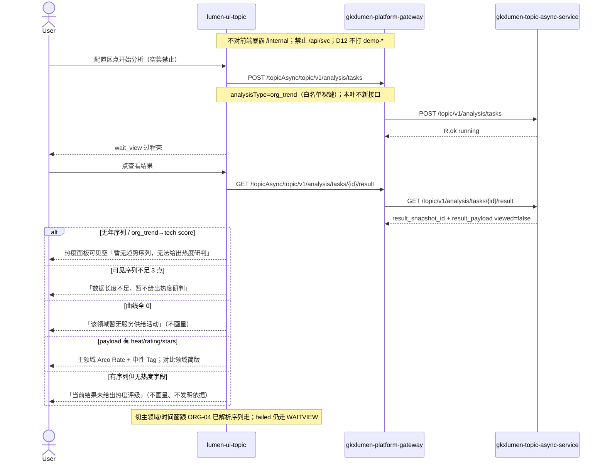

# LUMEN-SVC-P-FE-US-ORG-05 · US-SVC-ORG-05 市场热度

> 日期：2026-08-22  
> Task：`LUMEN-SVC-P-FE-US-ORG-05`  
> 总控：[`LUMEN-SVC-P-长任务总控.md`](./LUMEN-SVC-P-长任务总控.md)（§7 已生效）  
> 仓：`lumen-ui-topic` · `origin/dev`  
> 复刻真源：`demo-ui-topic` `TrendView.tsx` 热度段（只读对照，未贴 JSX、未改 demo、未搬斜率评级）  
> 本仓前置：WAITVIEW · ORG-01 对象集 · ORG-02 覆盖板（本叶不改其契约）· ORG-03 抽屉 · ORG-04 趋势结果板

## 任务认领（必填）

| 字段 | 值 |
|------|-----|
| claimed_by | `agent:frontend-agent` |
| supervised_by | `human:侯佳伟` |
| claim_type | `coordinator_dispatch` |
| 说明 | 长任务 24h 锁；本叶不标 `done`。coordinator 已 MCP `in_progress`。本会话未挂载 task-registry MCP，未手改 yaml。 |

## Ponytail（coding 任务必填）

| 字段 | 值 |
|------|-----|
| ponytail | `full` |
| 说明 | 在已有 `SvcOrgTrendBoard` / `svcTrendModel` 加研判区，复用 WAITVIEW、ORG-04 年序列解析、`@/review`、Arco Rate/Tag。未搬 Demo 斜率评级。未用 YAGNI 跳过 D8 页底 token、D9 D1 missing 红问号、D10 评审自闸、可观测 `request.ts` X-Trace-Id、handoff、图即契约、五维复刻、附录 E。 |

## Headroom（可选）

| 字段 | 值 |
|------|-----|
| headroom | `skip` |
| 说明 | 本机会话未挂载 Headroom MCP。 |

## 图即契约

| 字段 | 值 |
|------|-----|
| diagram_id | `SVC-STORAGE-LINEAGE`（消费，不改工厂边）；`LUMEN-SVC-P-FE-US-ORG-05-SEQ`（本叶） |
| 图 diff | LINEAGE 边未改。本叶把 ORG-04 trend 结果板下方的热度研判从虚线改成实线消费：同一 GET result；有 heat/rating/stars 才画 Arco Rate；无年序列 / 不足 3 点 / 全 0 / 无热度字段 → 文案空，不伪评级。ORG-06 能力评估仍虚线。禁止事项未变：不打 `demo-*`、不搬斜率评级、不改 wait_view/对象集/覆盖矩阵、不派 Python 改 org_trend 映射、不新接口。 |
| 会签态 | `SVC-STORAGE-LINEAGE` 随 `storage/SVC/01-data-flow.md` frontmatter：`approved`（`human:淮政玮` · 2026-08-19 流图；2026-08-20 选 B 增补 LINEAGE，**不改** §1 工厂边）。本叶 SEQ 为 `draft`，禁止自填绿。 |

### L2 消费（不改边）

本叶只读消费 [`storage/SVC/01-data-flow.md`](../../data/data-design/storage/SVC/01-data-flow.md) §1.1 `SVC-STORAGE-LINEAGE`：分析任务经 Java Job 读 CREATE 已签发的 snapshot。前端不扫表、不直连 nGQL、不改工厂边。热度不是前端对折线求导；只展示 payload 已有 heat/rating/stars。现网 `org_trend→tech` 无年序列时热度面板可见空。

### L4 本叶 SEQ · `LUMEN-SVC-P-FE-US-ORG-05-SEQ`

| 生产者 | 消费者 | 触发 | 失败语义 | 禁止事项 |
|---|---|---|---|---|
| Java GET result `result_payload` | trend 结果板热度区 | 仅用户点「查看结果」 | 无序列/不足 3 点/全 0/无 heat 字段 → 文案空；failed ≠ 热度空态 | Demo 斜率评级；emoji 星；红绿方向色；前端发明依据；tech score 当热度 |
| ORG-04 已解析可见序列 | 热度空态门控 | 切 `?industry=` / `trend_compare` / `trend_window` | 无对应序列则空，不残留上一领域结论 | 图例隐藏线冒充研判对象；改指纹 |
| Python 签发的 heat/rating/stars | Arco Rate / 文字 Tag | payload 自带字段 | 无字段不画星 | 为 Mock 编 heat 字段 |

## 范围与实现

挂在已有 `/service/institution-judgment?workspace=trend` 的 ORG-04 趋势结果板下方，不新路由：

1. 「市场热度与趋势研判」：主领域一行 + 对比领域简版 + 演示口径声明
2. 星级只认 GET result 的 heat/rating/stars；没有这些字段不输出星级
3. 无年序列 → 「暂无趋势序列，无法给出热度研判」；序列 <3 点 → 「数据长度不足，暂不给出热度研判」；全 0 → 「该领域暂无服务供给活动」
4. 「依据」仅当 payload 自带 basis/依据 时原样展示
5. `M_SVC_ORG_MARKET_HEAT` 未写入 seed。D1 missing 走 `@/review` `GAP-SVC-ORG-HEAT` 红问号 + `Q-SVCCHAIN-02`，不显伪 8 件套。关评审零泄漏
6. 有 rating 才用 Arco Rate；热度 Tag `arcoblue`。禁 emoji 星、禁红绿方向色
7. 切主领域/时间窗：研判跟 ORG-04 已解析序列走
8. 附录 E / WAITVIEW / 指纹 / 空集禁止：不改。ORG-06 本叶不做
9. mount-id：`SVC-ORG-F05-HEAT-TRACE` / `SVC-ORG-F05-HEAT`
10. Mock：沿用 ORG-04 短年序列，不编 heat 字段。关：页面不引 `@/mock/**`

**非范围**：改 PT-* / ORG-02 覆盖矩阵、宣称 K8s 绿、派 Python 改 org_trend 映射、第二张 Java/Python 单、改 `demo-ui-topic`。

## 偏离说明

- 不搬 Demo 斜率评级 / 不把折线增长写成可核对依据。现网无 heat 字段时诚实空，即使 Mock 年序列 ≥3 点也不画星。
- 仓内没有 `M_SVC_ORG_MARKET_HEAT` 种子，本叶不自造写进 seed / readiness / gap catalog。评审挂 `GAP-SVC-ORG-HEAT` + `Q-SVCCHAIN-02`。
- 模板 W4「当天已成功直接打开结果」：沿用 WAITVIEW，restore 到过程页再点「查看结果」。
- Mock 开：不新增 heat 字段。关开关不填 Demo 热度。

## 复刻五维（R1–R5）

| # | 项 | 结果 |
|---|---|---|
| R1 布局 | 热度面板在折线与明细表之间；主领域 + 对比简版 + 演示口径；`v-if`/`v-else` 一节点一套 layout | ✅ |
| R2 交互 | 无序列/不足 3 点/全 0/无 heat 字段空态；切领域与时间窗跟已解析序列；failed ≠ 热度空 | ✅ |
| R3 样式 | `--sci-bg-page` / `#D8E7FC`；Tag 主色 `arcoblue`；与趋势板同壳 | ✅ |
| R4 评审 | 只从 `@/review` 挂点（`SVC-ORG-F05-HEAT*`）；关评审不渲染 metric_id / GAP-* / Q0xx | ✅ |
| R5 Mock | 开：既有 GET result 年序列，不编 heat。关：页面/热度区不引 `@/mock/**`、无页内 `MOCK_` | ✅ |

### 检索皮肤（V1–V7）

本叶是分析工作区，不是检索 Hub。V1 页底必过；V2–V7 N/A。

| # | 结果 |
|---|---|
| V1 页底 `--sci-bg-page` / `#D8E7FC` | ✅ |
| V2–V7 | N/A（查询页） |

### 工作区（W1 / W4）

| # | 项 | 结果 |
|---|---|---|
| W1 | 配置区 / 过程壳 / trend 折线 + 热度研判 / 记录 Tab | ✅ |
| W2 | 关系图 | N/A |
| W3 | 报告阅读器 | N/A |
| W4 | 切条件不自动 create；「开始分析」；同指纹一条在跑；当天成功可恢复；「重新分析」可 force | ✅（恢复目标=过程页 wait_view；本叶未改） |

## 附录 E（I2-12）

| # | 项 | 结果 |
|---|---|---|
| E.1 页清单 | `/service/institution-judgment?workspace=field\|trend\|capability` | ✅ 未改 |
| E.2 CTA | 配置区「开始分析」 | ✅ 未改 |
| E.3 禁自动 create | 无 `watch(workspace → create)` | ✅ 未改 |
| E.4 单飞 | `decideAnalysisTaskGate` + `svc\|{workspace}\|{ids}` | ✅ 未改 |
| E.5 当天复用 | `forceCreate=false` restore 过程页；`重新分析` `force=true` | ✅ 未改 |
| failed | 红 alert + 过程壳失败态；≠ 热度空态 | ✅ |

## Design.md §14

工作区页底 token `--sci-bg-page`；主色 `#165DFF`。热度 Tag 用 `arcoblue`，无红绿方向色。星级用 Arco Rate，无 emoji 星。无 `.ant-` / vendor-antd token。无新地图。D1 missing 走 `@/review` 红问号，不自造 8 件套。时间窗 Radio 仍为 ORG-04 的 `a-radio-group type="button"`。

## 测试结果

- `node src/views/service/serviceOrgTrend.selfcheck.mjs` → `serviceOrgTrend.selfcheck ok`（禁斜率评级函数名；无 heat 字段不画星；无年序列不发明评级；Mock org_trend 不编 stars/heat）
- `node src/views/service/serviceOrgAnalysis.selfcheck.mjs` → `serviceOrgAnalysis.selfcheck coverage+profile ok`（ORG-02 覆盖契约仍绿）
- `node src/router/menu.selfcheck.mjs` → `menu.selfcheck svc-shell ok`
- `npx vue-tsc --build` → 通过（exit 0）
- 本叶未等 K8s rollout，未宣称 50892 已滚出

## 遗留风险

- 现网 `org_trend` 若仍是 `models/tech` 的 `score` 列表，50892 热度面板会显示「暂无趋势序列，无法给出热度研判」。即使以后有年序列，没有 heat/rating/stars 也不画星。这是实包诚实，不是前端 fixture。本叶不派 Python 改映射。
- `Q-SVCCHAIN-02` 保持待核验黄灯，未改绿。
- 金路径仍须 E0 滚出后在 50892 点过一遍（选机构 → 开始分析 → wait_view → 查看结果 → 热度区）。

## CI/CD（必填）

- 分支：`lumen-ui-topic` `origin/dev`（push 后由 GitLab 建管线）
- commit：`51bdd8a` `feat(svc): add US-SVC-ORG-05 market heat panel [agent:frontend-agent]`
- pipeline URL / ID：GitLab 对 `51bdd8a` 自动建管线（本叶未等绿、未宣称 K8s 已滚出）
- 部署 namespace / 镜像 tag：待 E0 / CI
- K8s rollout：本叶未等
- dev 测试 URL：http://111.198.38.90:50892/service/institution-judgment?workspace=trend （需 CI 滚出后可见本叶）
- 本地：`node src/views/service/serviceOrgTrend.selfcheck.mjs`

## 可观测性

- CREATE/GET/RESULT 仍走 `src/utils/request.ts`：`X-Trace-Id` + `traceparent`
- 失败态展示 `errorTraceId`
- OTEL_SERVICE_NAME：N/A（前端）
- Tempo / Loki：有（平台已有）；本叶无新 span 名

## 架构合规自检

| 铁律 | 结果 |
|------|------|
| 1 算法只在 Python | ✅ 前端不按折线计算星级；只认 payload heat/rating/stars |
| 2 调用链 FE→Java→Python `/internal` | ✅ 只调已有 `/topicAsync/topic/v1/analysis/tasks*`；本叶不新接口 |
| 3 Nebula 非 Neo4j | ✅ 未碰图 |
| 4 可观测 | ✅ request 拦截器 X-Trace-Id |
| 5 CI | ⏳ push 后 |
| 6 demo2 不 merge 进 lumen | ✅ 只读对照 demo-ui-topic |
| 7 共享聚合 / 只调 Java | ✅ 未直连 Python |
| 8 数据 ADS / 无硬 mock | ✅ `USE_MOCK=false` 不填 fixture；Mock 不编 heat |
| 9 D8 Design token | ✅ `--sci-bg-page`；Tag 主色；Arco Rate |
| 10 D9 八件套 / 不自造 ⓘ | ✅ 未写 `M_SVC_ORG_MARKET_HEAT` 进 seed；D1 missing 走 GAP 红问号 |
| 11 D10 `@/review` | ✅ `SVC-ORG-F05-HEAT*` 自闸 |
| 12 D12 不打 demo-* | ✅ |

## Cost

| 字段 | 值 |
|------|-----|
| `actual_tokens` | 240000 |
| `model_used` | `claude-sonnet-4.5`（registry 合法枚举；本会话为 Cursor Grok 4.6，按 Sonnet 价表回填） |
| `actual_cost` | 1.30 |
| `cost_warn` | green |
| 口径 | frontend-agent 80/20；`240000×0.8×3/1e6 + 240000×0.2×15/1e6 = 1.296` 取 `1.30`；`source: session_estimate` |

## 涉及文件

- `lumen-ui-topic` `src/views/service/SvcOrgTrendBoard.vue`
- `lumen-ui-topic` `src/views/service/svcTrendModel.ts`
- `lumen-ui-topic` `src/views/service/serviceOrgAnalysis.css`
- `lumen-ui-topic` `src/views/service/ServiceReviewMount.vue`
- `lumen-ui-topic` `src/views/service/serviceOrgTrend.selfcheck.mjs`
- 本 handoff

## 产物清单

- 代码：`51bdd8a`（`lumen-ui-topic` `dev`）
- 文档：本文件
- 未改：`DefaultLayout.vue`、`demo-ui-topic`、Java / Python、ORG-02 覆盖矩阵、PT-*、capability 占位、WAITVIEW 指纹、`svcMetricSeed.ts`

## 联调确认

联调通过（代码侧）：热度面板挂在 ORG-04 趋势结果板下方；只认 GET result heat/rating/stars；无序列/不足 3 点/全 0/无 heat 字段诚实空；不搬斜率评级；failed ≠ 热度空态；指纹未改；空集禁止开始；附录 E 仍成立。请 coordinator AV-0，**本叶不自行标 done**。

## Registry（MCP）

本会话无 task-registry MCP。请 coordinator `task-update-fields` 写 evidence / note / cost 四字段；`status` 保持 `in_progress`（未改 done）。禁止手改 `task-registry.yaml`。
