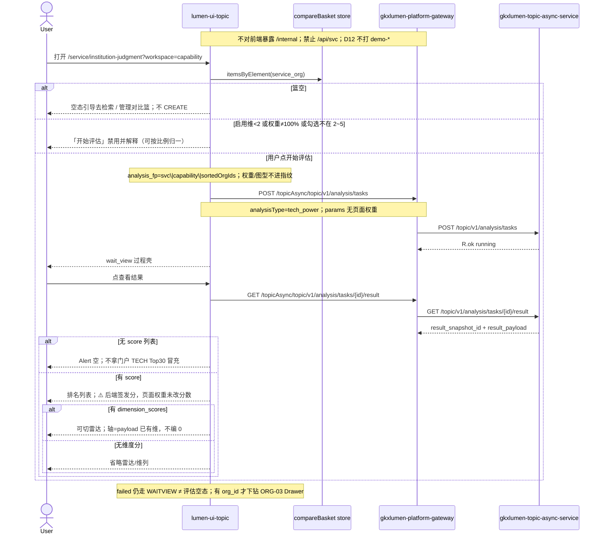

# LUMEN-SVC-P-FE-US-ORG-06 · US-SVC-ORG-06 技术力评估

> 日期：2026-08-22  
> Task：`LUMEN-SVC-P-FE-US-ORG-06`  
> 总控：[`LUMEN-SVC-P-长任务总控.md`](./LUMEN-SVC-P-长任务总控.md)（§7 已生效）  
> 仓：`lumen-ui-topic` · `origin/dev`  
> 复刻真源：`demo-ui-topic` `CapabilityView.tsx`（只读对照，未贴 JSX、未改 demo、未搬 `computeEvaluation`）  
> 本仓前置：WAITVIEW · ORG-01 对象集 · ORG-02 覆盖板（本叶不改其契约）· ORG-03 抽屉 · ORG-04/05 趋势结果板（本叶不改）

## 任务认领（必填）

| 字段 | 值 |
|------|-----|
| claimed_by | `agent:frontend-agent` |
| supervised_by | `human:侯佳伟` |
| claim_type | `coordinator_dispatch` |
| 说明 | 长任务 24h 锁；本叶不标 `done`。coordinator 已 MCP `in_progress`。本会话未挂载 task-registry MCP，未手改 yaml。 |

## Ponytail（coding 任务必填）

| 字段 | 值 |
|------|-----|
| ponytail | `full` |
| 说明 | 新 `SvcOrgCapabilityBoard` + 薄 `svcCapabilityModel`，接线 `workspace=capability` 占位。复用 WAITVIEW、对比篮 store、`@/review`、仓内 VChart Radar。未搬 Demo 评估函数 / 五维字典。未用 YAGNI 跳过 D8 页底 token、D9 `M_SVC_ORG_TECH_SCORE`、D10 评审自闸、可观测 `request.ts` X-Trace-Id、handoff、图即契约、五维复刻、附录 E。 |

## Headroom（可选）

| 字段 | 值 |
|------|-----|
| headroom | `skip` |
| 说明 | 本机会话未挂载 Headroom MCP。 |

## 图即契约

| 字段 | 值 |
|------|-----|
| diagram_id | `SVC-STORAGE-LINEAGE`（消费，不改工厂边）；`LUMEN-SVC-P-FE-US-ORG-06-SEQ`（本叶） |
| 图 diff | LINEAGE 边未改。本叶把 WAITVIEW `workspace=capability` 的 snapshot 短摘要从虚线改成实线消费：50892 配置区 UI 门控 → CREATE `analysisType=tech_power`（权重/图型不进指纹、未写入 Java params）→ 过程壳 → GET result 只渲染 payload `score` / `dimension_scores`。ORG-08 篮面板仍虚线。禁止事项未变：不打 `demo-*`、不搬评估函数、不新 Java/Python 路径、不改 PT-04 / ORG-02/04/05。 |
| 会签态 | `SVC-STORAGE-LINEAGE` 随 `storage/SVC/01-data-flow.md` frontmatter：`approved`（`human:淮政玮` · 2026-08-19 流图；2026-08-20 选 B 增补 LINEAGE，**不改** §1 工厂边）。本叶 SEQ 为 `draft`，禁止自填绿。 |

### L2 消费（不改边）

本叶只读消费 [`storage/SVC/01-data-flow.md`](../../data/data-design/storage/SVC/01-data-flow.md) §1.1 `SVC-STORAGE-LINEAGE`：分析任务经 Java Job 读 CREATE 已签发的 snapshot。前端不扫表、不直连 nGQL、不改工厂边。技术力分不是前端「维度归一化 × 权重」；只展示 payload 已有 `score` / `dimension_scores`。对比对象只来自 `useCompareBasketStore` + `SVC_ORG_ELEMENT_KEY`。

### L4 本叶 SEQ · `LUMEN-SVC-P-FE-US-ORG-06-SEQ`

| 生产者 | 消费者 | 触发 | 失败语义 | 禁止事项 |
|---|---|---|---|---|
| 对比篮 `service_org` | 配置区勾选 2~5 | 「从对比篮带入」/ 勾选标签 | 篮空 → 空引导，不 CREATE | 第二套检索/集合勾选；ORG-08 整页篮 |
| 配置区 UI 门控 | 「开始评估」按钮 | 权重合计 / 启用维 / 家数 | 不通过则禁用并解释 | 前端用权重算分；权重进指纹 |
| Java GET result `result_payload` | 结果板排名/雷达/结论 | 仅用户点「查看结果」 | 无 score 列表 → Alert 空；无 `dimension_scores` → 不画雷达、不编 0；failed ≠ 评估空态 | `computeEvaluation`；五维字典发明分；门户 TECH Top30 冒充；红绿方向色当得分 |

## 范围与实现

路由仍是 `/service/institution-judgment?workspace=capability`。替换 WAITVIEW 对该 workspace 的 snapshot 短摘要占位：

1. 配置区对照 Demo：内置五维可启停、可调权、权重合计；合计 ≠100%、启用维 <2、对比机构不在 2~5 →「开始评估」禁用（可按比例归一）。**UI 门控，不是前端算分。**
2. 排名/雷达/综合分只认 GET `/topicAsync/topic/v1/analysis/tasks/{id}/result` 的 `score` / `dimension_scores`。未搬 Demo 评估函数。页面权重未进 Java CREATE；结果区 ⚠️「当前为后端签发分，页面权重仅演示配置，未改分数」。Q060 / Q-SVCCHAIN-01 不改绿。
3. 对比对象唯一入口 = 对比篮。配置区「从对比篮带入」+ 篮空「去检索 / 管理对比篮」。ORG-08 整页篮本叶不做。
4. 结果默认排名列表；有 `dimension_scores` 才出维度列与雷达。N 家就 N 行，不凑。
5. 结论区 TOP3 只引用本次签发的机构名与分；无 `dimension_scores` / 无建议字段则诚实空，不编文案。带演示口径。
6. 挂仓内已有 `M_SVC_ORG_TECH_SCORE`（`@/review`），禁止自造 `M_SVC_ORG_EVAL_*`。关评审零泄漏。
7. 附录 E / WAITVIEW：切条件不自动 CREATE；「开始评估」= 本页 CTA；同指纹一条在跑；当天成功 restore **过程页**再点「查看结果」；「重新分析」forceCreate。指纹 `svc|{workspace}|{sortedOrgIds}`；**权重/图型不进指纹**。capability 另要求 2~5 家。
8. 维启停/权重/勾选/图型可 query 持久化回显 UI；**不得**用持久化配置在前端重算分。
9. 雷达用仓内已有 VChart；颜色 Design 蓝系。有 `org_id` 才下钻 ORG-03 Drawer。
10. Mock：`USE_MOCK=true` 时 GET result 给 tech_power 短名单+score，不编完整五维字典。关：页面不引 `@/mock/**`。

**非范围**：贴 JSX；改 PT-04 ranking 页契约；改 ORG-02/04/05 结果板；宣称 K8s 绿；派 Python 改 tech_power 映射；第二张 Java/Python 单；改 `demo-ui-topic`。

## 偏离说明

- 不搬 Demo 评估函数 / 机构五维字典 / 自定义维候选。自定义维度 Modal 不在本叶区块清单，未做。
- 页面权重未进 Java CREATE，结果区固定 ⚠️ 声明签发分不被页面权重改写。
- 指纹不含权重/图型（与产业筛选同一原则）。
- 模板 W4「当天已成功直接打开结果」：沿用 WAITVIEW，restore 到过程页再点「查看结果」。
- Mock 开：短名单+score，不编 `dimension_scores`。关开关不填 Demo 五维字典。

## 复刻五维（R1–R5）

| # | 项 | 结果 |
|---|---|---|
| R1 布局 | 配置区五维+对比篮勾选；结果排名/雷达/结论三块；`v-if`/`v-else` 一节点一套 layout | ✅ |
| R2 交互 | 篮空引导；门控禁用开始评估；加载/失败走 WAITVIEW；无 score Alert 空；无维度分省略雷达 | ✅ |
| R3 样式 | `--sci-bg-page` / `#D8E7FC`；主色 `#165DFF`；雷达蓝系，非红绿方向色 | ✅ |
| R4 评审 | 只从 `@/review` 挂点（`SVC-ORG-F06-*`）；关评审不渲染 metric_id / GAP-* / Q0xx | ✅ |
| R5 Mock | 开：既有 GET result 短名单+score，不编五维字典。关：页面/板不引 `@/mock/**`、无页内 `MOCK_`、无评估函数 | ✅ |

### 检索皮肤（V1–V7）

本叶是分析工作区，不是检索 Hub。V1 页底必过；V2–V7 N/A。

| # | 结果 |
|---|---|
| V1 页底 `--sci-bg-page` / `#D8E7FC` | ✅ |
| V2–V7 | N/A（查询页） |

### 工作区（W1 / W4）

| # | 项 | 结果 |
|---|---|---|
| W1 | 配置区 / 过程壳 / 结果板 / 记录 Tab | ✅ |
| W2 | 关系图 | N/A（本叶雷达不是关系图） |
| W3 | 报告阅读器 | N/A |
| W4 | 切条件不自动 create；「开始评估」；同指纹一条在跑；当天成功可恢复；「重新分析」可 force | ✅（恢复目标=过程页 wait_view，见偏离） |

## 附录 E（I2-12）

| # | 项 | 结果 |
|---|---|---|
| E.1 页清单 | `/service/institution-judgment?workspace=capability` | ✅ |
| E.2 CTA | 配置区「开始评估」 | ✅ |
| E.3 禁自动 create | 无 `watch(workspace → create)`；改权重/图型只 patch query | ✅ |
| E.4 单飞 | `decideAnalysisTaskGate` + `svc\|capability\|sortedIds` | ✅ |
| E.5 当天复用 | `forceCreate=false` restore 过程页；`重新分析` `force=true` | ✅ |
| failed | 红 alert + 返回配置；≠ 评估空态 | ✅ |
| 空对象集 / 篮空 | 不 CREATE；2~5 家门控 | ✅ |

## Design.md §14

工作区雷达用蓝系 token/`#165DFF` 家族，不用红绿当得分语义。页底 `--sci-bg-page`。无 `.ant-` / vendor-antd token。无新地图。统计数字旁 ⓘ 走 `@/review` `M_SVC_ORG_TECH_SCORE`（Q060 / Q-SVCCHAIN-01 待核验不改绿）。关评审零泄漏。

## 测试结果

- `node src/views/service/serviceOrgCapability.selfcheck.mjs` → `serviceOrgCapability.selfcheck ok`
- `node src/views/service/serviceOrgAnalysis.selfcheck.mjs` → `serviceOrgAnalysis.selfcheck coverage+profile ok`
- `node src/views/service/serviceOrgTrend.selfcheck.mjs` → `serviceOrgTrend.selfcheck ok`
- `node src/router/menu.selfcheck.mjs` → `menu.selfcheck svc-shell ok`
- `npx vue-tsc --build` → 通过（exit 0）
- 本叶未等 K8s rollout

## 遗留风险

- 现网 `tech_power` payload 若无 `score` 列表，结果区诚实空；需 Python/Java 签发后才有排名。本叶不派 Python 改映射。
- 页面权重未进 CREATE：改权不会改变已签发分（符合 Q-SVCCHAIN-01 待核验，不改绿）。
- 对比篮仍走系统浮层 `open_compare_basket=1`，整页篮面板留给 ORG-08。
- 金路径须 E0 滚出后在 50892 `?workspace=capability` 点过一遍（篮 2~5 家 → 开始评估 → 过程页 → 查看结果）。

## CI/CD（必填）

- 分支：`lumen-ui-topic` `origin/dev`
- commit：`5997ca5` `feat(svc): add US-SVC-ORG-06 tech-power board [agent:frontend-agent]`
- pipeline URL / ID：https://gitlab.htmisoft.net/gkx-lumen/lumen-ui-topic/-/pipelines?ref=dev
- 部署 namespace / 镜像 tag：待 E0 / CI
- K8s rollout：本叶未等
- dev 测试 URL：http://111.198.38.90:50892/service/institution-judgment?workspace=capability （需 CI 滚出后可见本叶）
- 本地：`node src/views/service/serviceOrgCapability.selfcheck.mjs`

## 可观测性

- CREATE/GET/RESULT 均走 `src/utils/request.ts`：`X-Trace-Id` + `traceparent`
- 失败态展示 `errorTraceId`
- OTEL_SERVICE_NAME：N/A（前端）
- Tempo / Loki：有（平台已有）；本叶无新 span 名

## 涉及文件

- `lumen-ui-topic` `src/views/service/SvcOrgCapabilityBoard.vue`（新）
- `lumen-ui-topic` `src/views/service/svcCapabilityModel.ts`（新）
- `lumen-ui-topic` `src/views/service/serviceOrgCapability.selfcheck.mjs`（新）
- `lumen-ui-topic` `src/views/service/ServiceOrgAnalysisWorkspace.vue`
- `lumen-ui-topic` `src/views/service/ServiceReviewMount.vue`
- `lumen-ui-topic` `src/views/service/serviceOrgAnalysis.css`
- `lumen-ui-topic` `src/mock/enterprise/analysisTaskStore.ts`（仅 Mock 层 tech_power 短名单+score）
- 本 handoff

## 架构合规自检

| 铁律 | 结果 |
|------|------|
| 1 算法只在 Python | ✅ 前端不重算分；只认 payload `score` / `dimension_scores` |
| 2 调用链 FE→Java→Python `/internal` | ✅ 只调已有 `/topicAsync/topic/v1/analysis/tasks*`；本叶不新接口 |
| 3 Nebula 非 Neo4j | ✅ 未碰图 |
| 4 可观测 | ✅ request 拦截器 X-Trace-Id |
| 5 CI | ⏳ push 后 |
| 6 demo2 不 merge 进 lumen | ✅ 只读对照 demo-ui-topic |
| 7 共享聚合 / 只调 Java | ✅ 未直连 Python |
| 8 数据 ADS / 无硬 mock | ✅ `USE_MOCK=false` 不填 fixture；Mock 不编五维字典 |
| 9 D8 Design token | ✅ `--sci-bg-page`；雷达蓝系 |
| 10 D9 八件套 / 不自造 ⓘ | ✅ 挂已有 `M_SVC_ORG_TECH_SCORE`；禁止 `M_SVC_ORG_EVAL_*`；Q060 不改绿 |
| 11 D10 `@/review` | ✅ `SVC-ORG-F06-*` 自闸 |
| 12 D12 不打 demo-* | ✅ |

## Cost

| 字段 | 值 |
|------|-----|
| `actual_tokens` | 320000 |
| `model_used` | `claude-sonnet-4.5`（registry 合法枚举；本会话为 Cursor Grok 4.6，按 Sonnet 价表回填） |
| `actual_cost` | 1.73 |
| `cost_warn` | green |
| 口径 | frontend-agent 80/20；`320000×0.8×3/1e6 + 320000×0.2×15/1e6 = 1.728` 取 `1.73`；`source: session_estimate` |

## 产物清单

- 代码：`5997ca5`（`lumen-ui-topic` `dev`）
- 文档：本文件
- 未改：`DefaultLayout.vue`、`demo-ui-topic`、Java / Python、ORG-02/04/05 结果板、PT-04 ranking、WAITVIEW 指纹公式、`svcMetricSeed.ts`

## 联调确认

联调通过（代码侧）：capability 配置区 UI 门控 + 对比篮唯一入口；CREATE `tech_power`；结果只认 GET result score / dimension_scores；权重不改后端分、不进指纹；无 score 诚实空；failed ≠ 评估空态；附录 E 仍成立。请 coordinator AV-0，**本叶不自行标 done**。

## Registry（MCP）

本会话无 task-registry MCP。请 coordinator `task-update-fields` 写 evidence / note / cost 四字段；`status` 保持 `in_progress`（未改 done）。禁止手改 `task-registry.yaml`。
