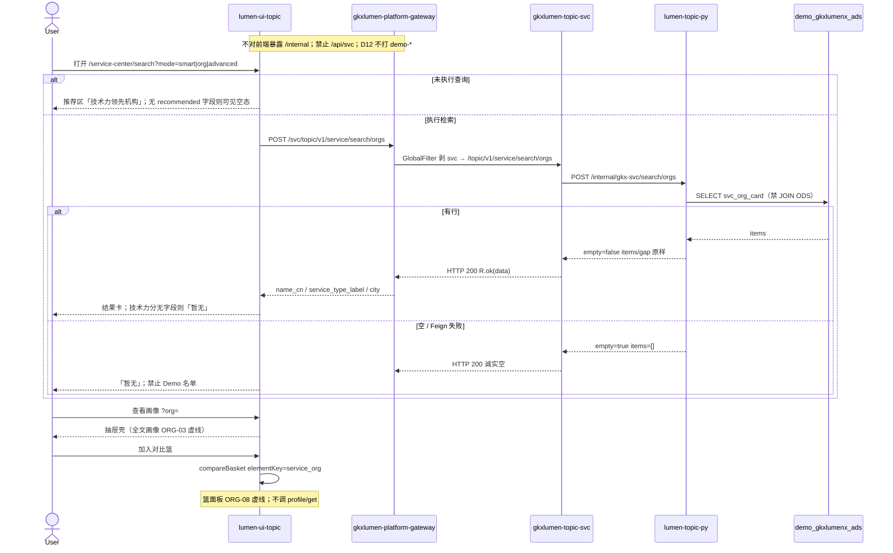

# LUMEN-SVC-P-FE-US-ORG-07 · US-SVC-ORG-07 服务机构检索（V1–V7）

> 日期：2026-08-21  
> Task：`LUMEN-SVC-P-FE-US-ORG-07`  
> 总控：[`LUMEN-SVC-P-长任务总控.md`](./LUMEN-SVC-P-长任务总控.md)（§7 已生效）  
> 仓：`lumen-ui-topic` · `origin/dev`  
> 复刻真源：`demo-ui-topic` `src/app/pages/service-center/ServiceOrgSearchPage.tsx`（只读对照，未贴 JSX、未改 demo）

## 任务认领（必填）

| 字段 | 值 |
|------|-----|
| claimed_by | `agent:frontend-agent` |
| supervised_by | `human:侯佳伟` |
| claim_type | `coordinator_dispatch` |
| 说明 | 长任务 24h 锁；本叶不标 `done` |

## Ponytail（coding 任务必填）

| 字段 | 值 |
|------|-----|
| ponytail | `full` |
| 说明 | 复用 `SearchHub` / `ElementSearchWorkbench` / `RecentSearchPanel` / `SearchContentSurface` / `FilterPanel` / `compareBasket` / `@/review`。未用 YAGNI 跳过 D8 页底 token、D9 不自造 ⓘ、D10 评审自闸、可观测 `request.ts` X-Trace-Id、handoff、图即契约、五维复刻。 |

## Headroom（可选）

| 字段 | 值 |
|------|-----|
| headroom | `skip` |
| 说明 | 本机会话未挂载 Headroom MCP。 |

## 图即契约

| 字段 | 值 |
|------|-----|
| diagram_id | `SVC-STORAGE-LINEAGE`（消费，不改工厂边）；`LUMEN-SVC-P-FE-US-ORG-07-SEQ`（本叶检索） |
| 图 diff | LINEAGE 边未改。本叶把 SHELL 检索占位改成实线：50892 FE `POST /svc/topic/v1/service/search/orgs` → gateway 剥 `svc` → `gkxlumen-topic-svc` → `lumen-topic-py` `/internal/gkx-svc/search/orgs` → ADS `svc_org_card`。画像全文 / 对比篮面板 / 分析工作区仍虚线。禁止事项未变：不打 `demo-*`、不填 Demo 检索 fixture、不改 `industry-center`。 |
| 会签态 | `SVC-STORAGE-LINEAGE` 随 `01-data-flow.md` frontmatter：`approved`（`human:淮政玮` · 2026-08-19 流图；2026-08-20 选 B 增补 LINEAGE，**不改** §1 工厂边）。本叶 SEQ 为 `draft`，禁止自填绿。 |

### L2 消费（不改边）

本叶只读消费 [`storage/SVC/01-data-flow.md`](../../data/data-design/storage/SVC/01-data-flow.md) §1.1 `SVC-STORAGE-LINEAGE`：线上名单读 `svc_org_card`，不联 ODS。前端不扫表，只消费 Java 检索包络。

### L4 本叶 SEQ · `LUMEN-SVC-P-FE-US-ORG-07-SEQ`

| 生产者 | 消费者 | 触发 | 失败语义 | 禁止事项 |
|---|---|---|---|---|
| Java `POST /topic/v1/service/search/orgs` | 本叶 FE | Hub 搜索 / 高级筛选应用 / 最近检索恢复 | HTTP 200 + `empty` → 「暂无」；接口失败 Message + 空名单 | Demo 检索 fixture；页内 `MOCK_`；直连 Python `/internal` |
| 包络 `items` | 结果卡 | 已执行查询 | 0 行 = 空态；不把推荐卡叠成勾选网格 | `industry-search-result-card` 与推荐卡互斥叠用 |
| 包络 `recommended` | 推荐区 | 未执行查询 | 缺字段 / 空数组 = 可见空态 | 用演示技术力名单填推荐区 |
| `compareBasket` `service_org` | 行级加入对比篮 | 点击加入 | 已在篮则 info；满员走 store 警告 | 本叶做完整篮页（ORG-08） |
| `?org=` 抽屉壳 | 用户 | 点名称 | 只展示卡面已有字段；不调 profile/get | 全文画像（ORG-03） |

## 范围与实现

替换 SHELL `/service-center/search` 占位，落地 `US-SVC-ORG-07`：

1. 页壳：标题「服务机构查询」+ 页底 `--sci-bg-page` / `#D8E7FC`
2. SearchHub 三模式：智能检索 / 查机构 / 高级筛选（URL `?mode=smart|org|advanced`）
3. 示例查询可点；独立 `RecentSearchPanel`
4. 未执行查询：推荐区「技术力领先机构」只渲染 Java `recommended`；缺字段则可见空态
5. 已搜索：结果卡标题+摘要横向，操作在下行，技术力分无字段「暂无」；加入分析集合（localStorage）；查看画像 `?org=` 抽屉壳
6. 加入对比篮接线 `compareBasket`（`elementKey=service_org`）；篮面板留给 ORG-08
7. 加载 / 失败 Message / 空「暂无」/ 有结果
8. 评审只走 `@/review`（`ServiceReviewMount`）；不自造 ⓘ
9. `USE_MOCK=false`：页面不 import `@/mock/**`。Mock 开时 `registerApiMock('svcSearchOrgs')` 形状=Java 实包

**非范围**：PT-02…06、ORG-01 工作区、ORG-08 篮面板、CHAIN、改 `industry-center`、改 `DefaultLayout.vue`。

## 偏离说明

- Demo 结果卡用本地 fixture 的 `techScore` / 专利专家案例。Java search/orgs 卡面无这些字段，右侧分数显示「暂无」，不前端算分。
- Demo 推荐区用全库技术力排序 Top6。Java 无 `recommended` 字段 → 诚实空态。
- 示例查询不用 Demo 机构名关键词；用「深圳 / 检验检测 / 科技创新」等可映射到 Java `keyword/city/industry/service_type` 的词。
- 画像只开抽屉壳，不调 `profile/get`（ORG-03）。
- 高级筛选字段库只含 Java 能透传的 `name_cn` / `service_type_candidate` / `city` / `province` / `industry`。

## 复刻五维（R1–R5）

| # | 项 | 结果 |
|---|---|---|
| R1 布局 | 标题 + Hub 三模式 + 示例 + 最近检索 + 推荐/结果卡 + 抽屉壳都在；一节点一套 layout | ✅ |
| R2 交互 | 加载 / 失败 Message / 空「暂无」/ 有结果 / URL mode+kw / 行级加入篮与分析集合 | ✅ |
| R3 样式 | `--sci-bg-page` / `#D8E7FC`；Hero 走已有 `SearchHub` 企业检索皮肤 | ✅ |
| R4 评审 | 只从 `@/review`；mount-id `SVC-ORG-F06-*`；关评审不渲染 metric_id / GAP-* / Q0xx | ✅ |
| R5 Mock | 开：`registerApiMock('svcSearchOrgs')` 形状=Java 实包。关：页面不 import `@/mock/**` | ✅ |

### 检索皮肤（V1–V7）

| # | 结果 |
|---|---|
| V1 页底 `--sci-bg-page` / `#D8E7FC` | ✅ |
| V2 Hub Hero 与本仓企业查询同皮肤（`SearchHub` + `element-search-workbench`） | ✅ |
| V3 卡片标题+摘要横向；操作在下行，分数在右侧 | ✅ |
| V4 推荐/结果共用 `search-content-card svc-org-search-card` flex，不叠勾选网格 | ✅ |
| V5 `min-width: 0` 加在主文列，标题 ellipsis 不塌成 1～2 字 | ✅ |
| V6 推荐无数诚实空；有 `items` 才出卡 | ✅ |
| V7 `article` 不含 `industry-search-result-card` | ✅ |

工作区 W1–W4：N/A（本叶不是分析工作区）。

## Design.md §14

页底 `--sci-bg-page`；主色 `#165DFF`；控件高 32px（检索框沿用 SearchHub）。结果卡 14px 标题。无 `.ant-` / vendor-antd token。本叶无新图表色。

## 测试结果

- `node src/views/service/serviceOrgSearch.selfcheck.mjs` → `serviceOrgSearch.selfcheck ok`
- `node src/router/menu.selfcheck.mjs` → `menu.selfcheck svc-shell ok`
- `npx vue-tsc --build` → 通过

## 遗留风险

- K8s 未注入 Python/MySQL 时检索 `empty`（预期）；勿把空态当 5xx。
- Java 检索无技术力分 / 无推荐字段；对拍 Demo 视觉时分数列为「暂无」、推荐区空，是诚实降级不是漏做。
- 分析集合仅 localStorage，工作区 ORG-01 再消费。
- 对比篮面板 ORG-08 未做；本叶只 `add`。

## CI/CD（必填）

- 分支：`lumen-ui-topic` `origin/dev`
- commit：`6fff279` `feat(svc): implement US-SVC-ORG-07 org search [agent:frontend-agent]`
- pipeline URL / ID：GitLab 跟踪 `lumen-ui-topic` `dev`
- 部署 namespace / 镜像 tag：待 E0 / CI
- K8s rollout：本叶未等
- dev 测试 URL：http://111.198.38.90:50892/service-center/search （CI 滚出后）
- 本地：上述 selfcheck + `vue-tsc --build`

## 可观测性

- 检索请求走 `src/utils/request.ts`：`X-Trace-Id` + `traceparent`
- OTEL_SERVICE_NAME：N/A（前端）
- Tempo / Loki：有（平台已有）

## 架构合规自检

| 铁律 | 结果 |
|------|------|
| 1 算法只在 Python | ✅ |
| 2 调用链 FE→Java→Python `/internal` | ✅ `POST /svc/topic/v1/service/search/orgs` |
| 3 Nebula 非 Neo4j | ✅ 未碰图 |
| 4 可观测 | ✅ request 拦截器 |
| 5 CI | ✅ 已 push `origin/dev`（`6fff279`）；pipeline 由 GitLab 生成 |
| 6 demo2 不 merge 进 lumen | ✅ 只读对照 |
| 7 只调 Java | ✅ |
| 8 数据 ADS / 无硬 mock | ✅ USE_MOCK=false 不填 fixture |
| 9 D8 Design token | ✅ `--sci-bg-page` |
| 10 D9 八件套 / 不自造 ⓘ | ✅ `@/review` |
| 11 D10 `@/review` | ✅ |
| 12 D12 不打 demo-* | ✅ |

## Cost

| 字段 | 值 |
|------|-----|
| `actual_tokens` | 180000 |
| `model_used` | `claude-sonnet-4.5`（registry 合法枚举；本会话为 Cursor Grok 4.6，按 Sonnet 价表回填） |
| `actual_cost` | 0.97 |
| `cost_warn` | green |
| 口径 | frontend-agent 80/20；`180000×0.8×3/1e6 + 180000×0.2×15/1e6 = 0.97`；`source: session_estimate` |

## 涉及文件

- `lumen-ui-topic` `src/api/service/*`
- `lumen-ui-topic` `src/views/service/ServiceOrgSearchPage.vue`
- `lumen-ui-topic` `src/views/service/serviceOrgSearchModel.ts`
- `lumen-ui-topic` `src/views/service/serviceOrgSearch.css`
- `lumen-ui-topic` `src/mock/service/searchOrgsMock.ts`（仅 `registerApiMock`）
- `lumen-ui-topic` `src/router/menu.ts`
- 本 handoff

## 产物清单

- 代码：`6fff279`（`lumen-ui-topic` `dev`）
- 文档：本文件
- 未改：`industry-center` 业务页、`demo-ui-topic`、`DefaultLayout.vue`、ORG-08 篮面板

## 联调确认

联调通过（代码侧）：`/service-center/search` Hub 三模式 + Java search/orgs + 空态诚实 + Mock 形状对齐实包。请 coordinator AV-0，**本叶不自行标 done**。

## Registry（MCP）

`task-update-fields` 已写：evidence / note / cost 四字段；`status` 仍为 `in_progress`（未改 done）。yaml 本机另有无关未提交 diff，**未**把 `task-registry.yaml` 打进本 commit。
