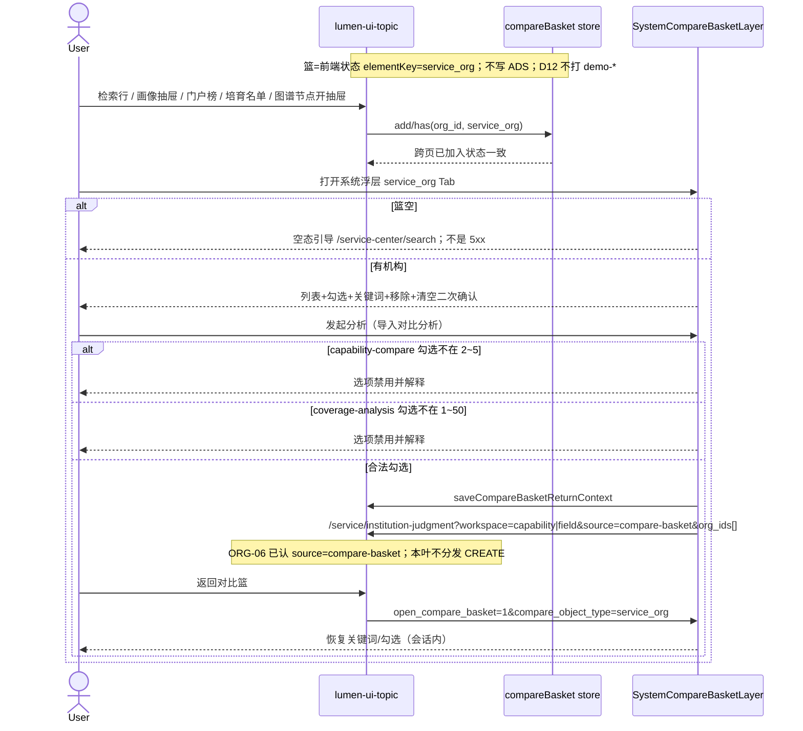

# LUMEN-SVC-P-FE-US-ORG-08 · US-SVC-ORG-08 服务机构对比篮

> 日期：2026-08-22  
> Task：`LUMEN-SVC-P-FE-US-ORG-08`  
> 总控：[`LUMEN-SVC-P-长任务总控.md`](./LUMEN-SVC-P-长任务总控.md)（§7 已生效）  
> 仓：`lumen-ui-topic` · `origin/dev`  
> 复刻真源：`demo-ui-topic` `ServiceOrgCompareBasketPanel.tsx` + `serviceAnalysisRegistry.ts`（只读对照，未贴 JSX、未改 demo）  
> 本仓前置：系统浮层 `SystemCompareBasketLayer` · `useCompareBasketStore` · ORG-06 已认 `source=compare-basket`

## 任务认领（必填）

| 字段 | 值 |
|------|-----|
| claimed_by | `agent:frontend-agent` |
| supervised_by | `human:侯佳伟` |
| claim_type | `coordinator_dispatch` |
| 说明 | 长任务 24h 锁；本叶不标 `done`。coordinator 已 MCP `in_progress`。本会话未挂载 task-registry MCP，未手改 yaml。 |

## Ponytail（coding 任务必填）

| 字段 | 值 |
|------|-----|
| ponytail | `full` |
| 说明 | 加 `service_org` Tab + `ServiceOrgCompareBasketPanel` + 薄 `serviceOrgAnalysisRegistry`。复用 `useCompareBasketStore`、`SVC_ORG_ELEMENT_KEY`、`CompareBasketActionBar`、`saveCompareBasketReturnContext`、`@/review`。未新造第二套篮 / 未改招引契约 / 未改 ORG-06 评估算法。未用 YAGNI 跳过 D8 页底 token、D10 评审自闸、可观测既有 `request.ts`、handoff、图即契约、五维复刻。 |

## Headroom（可选）

| 字段 | 值 |
|------|-----|
| headroom | `skip` |
| 说明 | 本机会话未挂载 Headroom MCP。 |

## 图即契约

| 字段 | 值 |
|------|-----|
| diagram_id | `SVC-STORAGE-LINEAGE`（消费，不改工厂边）；`LUMEN-SVC-P-FE-US-ORG-08-SEQ`（本叶） |
| 图 diff | LINEAGE 边未改。篮是前端状态（`ent.compareBasket.v4` + `elementKey=service_org`），不写 ADS、不新增 Java 路径。本叶把系统浮层 `service_org` Tab 从「开发中」改成实线面板：勾选 → 分发 `source=compare-basket` + `org_ids[]` → ORG-06/ORG-02 已有承接。禁止事项未变：不打 `demo-*`、不跨要素混合对比、不篮云端同步、不新 Java/Python 路径、不改 `industry-center`。 |
| 会签态 | `SVC-STORAGE-LINEAGE` 随 `storage/SVC/01-data-flow.md` frontmatter：`approved`（`human:淮政玮` · 2026-08-19 流图；2026-08-20 选 B 增补 LINEAGE，**不改** §1 工厂边）。本叶 SEQ 为 `draft`，禁止自填绿。 |

### L2 消费（不改边）

本叶只读消费 [`storage/SVC/01-data-flow.md`](../../data/data-design/storage/SVC/01-data-flow.md) §1.1 `SVC-STORAGE-LINEAGE`。对比篮不读表、不直连 nGQL、不改工厂边。机构卡片字段若有则来自入篮时的 Java 实包快照（检索/画像），篮本身是前端状态。

### L4 本叶 SEQ · `LUMEN-SVC-P-FE-US-ORG-08-SEQ`

| 生产者 | 消费者 | 触发 | 失败语义 | 禁止事项 |
|---|---|---|---|---|
| 既有入篮触点 | `compareBasket` `service_org` | 检索/抽屉/榜/培育/图谱抽屉 | 缺 id → Message，不写入 | 招引入篮；覆盖矩阵第二套按钮；新 store |
| 篮面板勾选 | `serviceOrgAnalysisRegistry` | 「发起分析」弹窗 | 2~5 / 1~50 不满足则禁用并解释 | 跨要素混合对比；第二套对比对象入口 |
| 分发 URL | ORG-06 / ORG-02 工作区 | `source=compare-basket` + `org_ids[]` | 无法解析 id 由承接页 Message | 本叶 CREATE；新 Java 路径 |
| 回跳快照 | 浮层 `service_org` Tab | `return_context_id` + `open_compare_basket=1` | 快照失效 → Message，篮内容仍在 | 新 localStorage 平行店 |

## 范围与实现

系统浮层 `service_org` Tab（不是新路由页）：

1. `EnterpriseCompareBasketView` 增加真实 `service_org` Tab，计数 `N/max`。区域仍开发中。
2. `ServiceOrgCompareBasketPanel` 对齐 Demo：列表（名称+类型/环节/城市摘要若有）、勾选、关键词、单个移除、清空二次确认。空篮引导 `/service-center/search`。容量走系统篮已有上限 50。
3. 「发起分析」同构产业弹窗：`capability-compare` → `workspace=capability`；`coverage-analysis` → `workspace=field`；均带 `source=compare-basket` + `org_ids[]`。门控 2~5 / 1~50。
4. 分发前 `saveCompareBasketReturnContext`。评估页已有「返回对比篮」接上 `compare_object_type=service_org`；覆盖配置区 `fromBasket` 同样加「返回对比篮」。会话内恢复关键词/勾选。
5. 入篮触点未新造：检索行 / 画像抽屉 / 门户榜 / 培育名单 / 图谱节点（行头开抽屉）已有；覆盖矩阵无第二套按钮；招引仍不入篮。检索页占位文案改为打开浮层。
6. 评审：`ENT-COMPARE-F10-SERVICE-BASKET-TRACE`（`@/review`）。关评审零泄漏。未自造 `M_SVC_*` seed。
7. 页底 `--sci-bg-page`（浮层跟随系统篮皮肤）。页面不引 `@/mock/**`。

**非范围**：贴 JSX；改招引/培育名单契约；改 ORG-06 评估算法；企业/产业/区域 Tab 业务；宣称 K8s 绿；跨要素混合对比；篮云端同步；新 Java/Python 路径；改 `industry-center`；改 `demo-ui-topic`。

## 偏离说明

- 按钮文案用产业面板既有「发起分析」，语义 = USM「导入对比分析」（弹窗选任务后再进工作区）。
- 入篮触点保持既有「已在对比篮」提示（检索叶口径），未改成再点移除；跨页 `has()` 状态一致。
- 模板 W1：本叶是系统浮层 Tab，不是整页工作区 → W1 N/A 浮层。W4 N/A（本叶不分发 CREATE）。
- 检索皮肤 V2–V7 N/A（非检索 Hub）。V1 浮层跟随系统篮 `--sci-bg-page`。

## 复刻五维（R1–R5）

| # | 项 | 结果 |
|---|---|---|
| R1 布局 | Demo 篮面板区块都有：空态/列表/过滤/操作条/分析弹窗；`v-if`/`v-else` 一节点一套 layout | ✅ |
| R2 交互 | 空篮引导检索；勾选/过滤/移除/清空确认；门控禁用并解释；picker 确定回填 | ✅ |
| R3 样式 | `--sci-*` token；浮层跟随系统篮皮肤；主色 `#165DFF` | ✅ |
| R4 评审 | 只从 `@/review` 挂 `ENT-COMPARE-F10-SERVICE-BASKET-TRACE`；关评审不渲染 metric_id / GAP-* / Q0xx | ✅ |
| R5 Mock | 关：面板/registry/壳不引 `@/mock/**`、无页内 `MOCK_`、无 Demo fixture 填篮 | ✅ |

### 检索皮肤（V1–V7）

本叶是系统浮层 Tab，不是检索 Hub。V1 页底必过；V2–V7 N/A。

| # | 结果 |
|---|---|
| V1 页底 `--sci-bg-page` / `#D8E7FC` | ✅ 浮层跟随系统篮皮肤 |
| V2–V7 | N/A（查询页） |

### 工作区（W1 / W4）

| # | 项 | 结果 |
|---|---|---|
| W1 | 配置区 / 过程壳 / 结果板 / 记录 Tab | N/A（浮层，非整页工作区） |
| W2 | 关系图 | N/A |
| W3 | 报告阅读器 | N/A |
| W4 | 切条件不自动 create | N/A（本叶不分发 CREATE） |

## Design.md §14

浮层浅蓝白工作台皮肤，主色 `#165DFF`，控件 Arco Vue。筛选搜索框 280px < 400px。间距 4/8/12/16 阶梯。无 `.ant-` / vendor-antd token。无新地图。无统计数字新 ⓘ；评审挂点自闸。关评审零泄漏。

## 测试结果

- `node src/views/service/serviceOrgBasket.selfcheck.mjs` → `serviceOrgBasket.selfcheck ok`
- `node src/views/service/serviceOrgSearch.selfcheck.mjs` → `serviceOrgSearch.selfcheck ok`
- `node src/views/service/serviceOrgCapability.selfcheck.mjs` → `serviceOrgCapability.selfcheck ok`
- `node src/views/service/serviceOrgAnalysis.selfcheck.mjs` → `serviceOrgAnalysis.selfcheck coverage+profile ok`
- `node src/router/menu.selfcheck.mjs` → `menu.selfcheck svc-shell ok`
- `npx vue-tsc --build` → 通过（exit 0）
- 本叶未等 K8s rollout

## 遗留风险

- 篮内类型/环节摘要依赖入篮时写入的 `extensions`；旧篮项可能只有名称+城市，诚实不编 Demo 目录。
- 金路径须 E0 滚出后在 50892 打开系统浮层 `服务机构` Tab 点过一遍（空态 → 检索入篮 → 2~5 家 capability / 1~50 家 coverage → 返回对比篮）。**本叶不自行开 E0。**

## CI/CD（必填）

- 分支：`lumen-ui-topic` `origin/dev`
- commit：`1f62f8a` `feat(svc): add US-SVC-ORG-08 service org compare basket [agent:frontend-agent]`
- pipeline URL / ID：https://gitlab.htmisoft.net/gkx-lumen/lumen-ui-topic/-/pipelines?ref=dev
- 部署 namespace / 镜像 tag：待 E0 / CI
- K8s rollout：本叶未等
- dev 测试 URL：http://111.198.38.90:50892/ （系统浮层对比篮 · 服务机构 Tab；需 CI 滚出后可见本叶）
- 本地：`node src/views/service/serviceOrgBasket.selfcheck.mjs`

## 可观测性

- 本叶无新 HTTP。入篮/分发为前端状态 + 路由 query。检索/画像既有调用仍走 `src/utils/request.ts`：`X-Trace-Id` + `traceparent`
- OTEL_SERVICE_NAME：N/A（前端）
- Tempo / Loki：有（平台已有）；本叶无新 span 名

## 涉及文件

- `lumen-ui-topic` `src/components/enterprise/compare/ServiceOrgCompareBasketPanel.vue`（新）
- `lumen-ui-topic` `src/config/serviceOrgAnalysisRegistry.ts`（新）
- `lumen-ui-topic` `src/views/service/serviceOrgBasket.selfcheck.mjs`（新）
- `lumen-ui-topic` `src/views/enterprise/EnterpriseCompareBasketView.vue`
- `lumen-ui-topic` `src/composables/useCompareBasketReturnContext.ts`
- `lumen-ui-topic` `src/views/service/ServiceOrgAnalysisWorkspace.vue`
- `lumen-ui-topic` `src/views/service/ServiceOrgSearchPage.vue`
- `lumen-ui-topic` `src/views/service/SvcOrgProfileDrawer.vue`
- 本 handoff

## 架构合规自检

| 铁律 | 结果 |
|------|------|
| 1 算法只在 Python | ✅ 本叶无算法；评估仍走 ORG-06 GET result |
| 2 调用链 FE→Java→Python `/internal` | ✅ 只走已有网关路径；本叶不新接口 |
| 3 Nebula 非 Neo4j | ✅ 未碰图 |
| 4 可观测 | ✅ 无新 HTTP；既有 request 拦截器 X-Trace-Id |
| 5 CI | ⏳ push 后 |
| 6 demo2 不 merge 进 lumen | ✅ 只读对照 demo-ui-topic |
| 7 共享聚合 / 只调 Java | ✅ 未直连 Python |
| 8 数据 ADS / 无硬 mock | ✅ `USE_MOCK=false` 不填 fixture；篮是前端状态 |
| 9 D8 Design token | ✅ `--sci-*`；浮层跟随系统篮皮肤 |
| 10 D9 八件套 / 不自造 ⓘ | ✅ 未自造 `M_SVC_*`；无新统计数字 |
| 11 D10 `@/review` | ✅ `ENT-COMPARE-F10-SERVICE-BASKET-TRACE` 自闸 |
| 12 D12 不打 demo-* | ✅ |

## Cost

| 字段 | 值 |
|------|-----|
| `actual_tokens` | 300000 |
| `model_used` | `claude-sonnet-4.5`（registry 合法枚举；本会话为 Cursor Grok 4.6，按 Sonnet 价表回填） |
| `actual_cost` | 1.62 |
| `cost_warn` | green |
| 口径 | frontend-agent 80/20；`300000×0.8×3/1e6 + 300000×0.2×15/1e6 = 1.62`；`source: session_estimate` |

## 产物清单

- 代码：`1f62f8a`（`lumen-ui-topic` `dev`）
- 文档：本文件
- 未改：`demo-ui-topic`、Java / Python、`industry-center`、招引名单契约、ORG-06 评估算法、企业/产业 Tab 业务、区域仍开发中、`task-registry.yaml`

## 联调确认

联调通过（代码侧）：系统浮层 `service_org` Tab 为真实面板；复用同一 `compareBasket` store；capability 2~5 / coverage 1~50 门控；`source=compare-basket` + `org_ids[]`；返回对比篮带 `compare_object_type=service_org`；招引仍不入篮；menu 仍绿。请 coordinator AV-0，**本叶不自行标 done**，**不自行开 E0**。

## Registry（MCP）

本会话无 task-registry MCP。请 coordinator `task-update-fields` 写 evidence / note / cost 四字段；`status` 保持 `in_progress`（未改 done）。禁止手改 `task-registry.yaml`。
