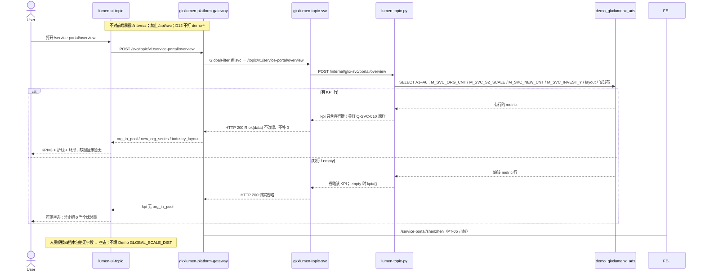

# LUMEN-SVC-P-FE-US-PT-01 · US-SVC-PT-01 全球概况

> 日期：2026-08-21  
> Task：`LUMEN-SVC-P-FE-US-PT-01`  
> 总控：[`LUMEN-SVC-P-长任务总控.md`](./LUMEN-SVC-P-长任务总控.md)（§7 已生效）  
> 仓：`lumen-ui-topic` · `origin/dev`  
> 复刻真源：`demo-ui-topic` `src/app/pages/service-portal/ServicePortalOverview.tsx` + `servicePortalShared.tsx`（只读对照，未贴 JSX、未改 demo）

## 任务认领（必填）

| 字段 | 值 |
|------|-----|
| claimed_by | `agent:frontend-agent` |
| supervised_by | `human:侯佳伟` |
| claim_type | `coordinator_dispatch` |
| 说明 | 长任务 24h 锁；本叶不标 `done` |

## Ponytail（coding 任务必填）

| 字段 | 值 |
|------|-----|
| ponytail | `full` |
| 说明 | 复用 `IndustryCatalogSelect`、`SectionPanel`、`JudgmentStrip`、`WorkbenchTabs`、`VChart`、`@/review`。未用 YAGNI 跳过 D8 页底 token、D9 四维角标、D10 评审自闸、可观测 `request.ts` X-Trace-Id、handoff、图即契约。 |

## Headroom（可选）

| 字段 | 值 |
|------|-----|
| headroom | `skip` |
| 说明 | 本机会话未挂载 Headroom MCP。 |

## 图即契约

| 字段 | 值 |
|------|-----|
| diagram_id | `SVC-STORAGE-LINEAGE`（消费，不改工厂边）；`LUMEN-SVC-P-FE-US-PT-01-SEQ`（本叶概况） |
| 图 diff | LINEAGE 边未改。本叶把 SHELL 概况虚线改成实线：50892 FE `POST /svc/topic/v1/service-portal/overview` → gateway → `gkxlumen-topic-svc` → `lumen-topic-py` `/internal/gkx-svc/portal/overview` → Demo ADS A1–A6。ranking/industry/region/shenzhen 页仍占位虚线。禁止事项未变：不打 `demo-*`、不填 Demo `GLOBAL_*`、不用 0 冒充全球总量、不改 `industry-center`。 |
| 会签态 | `SVC-STORAGE-LINEAGE` 随 `01-data-flow.md` frontmatter：`approved`（`human:淮政玮` · 2026-08-19 流图；2026-08-20 选 B 增补 LINEAGE，**不改** §1 工厂边）。本叶 SEQ 为 `draft`，禁止自填绿。 |

### L2 消费（不改边）

本叶只读消费 [`storage/SVC/01-data-flow.md`](../../data/data-design/storage/SVC/01-data-flow.md) §1.1 `SVC-STORAGE-LINEAGE`：线上 KPI 读 ADS 指标四表 A1–A6，不联 ODS。前端不扫表，只消费 Java 概况包络。

### L4 本叶 SEQ · `LUMEN-SVC-P-FE-US-PT-01-SEQ`

| 生产者 | 消费者 | 触发 | 失败语义 | 禁止事项 |
|---|---|---|---|---|
| Java `POST /topic/v1/service-portal/overview` | 本叶 FE | 打开概况 / 改产业筛选 | 缺 `org_in_pool` → 「暂无」，**不**显示 0；接口失败 Message + 空包络 | Demo `GLOBAL_*`；页内 `MOCK_`；直连 Python `/internal` |
| `industry_layout` | 类型环 + 环节合计 | 有 dist 行 | 无行 → 环形空态；不填企业/院所/高校 fixture | `M_SVC_PT_GLOBAL_*` |
| `new_org_series` | 折线 + 本年新增 | 有 series 行 | 无行 → 折线空态；**不**把新增累加冒充总量 | 客户端缩放冒充产业切片 |
| 黄灯 `gap` / `pending_client_confirm` | 研判条「待核验」+ `@/review` 角标 | Python 原样上送 | 不改绿 | 前端把 Q-SVC-010 标 aligned/live |

## 范围与实现

替换 SHELL 占位，落地 `/service-portal/overview`（`US-SVC-PT-01`）：

1. 门户壳：breadcrumb「专题服务 / 全球服务机构概况」、title、研判结论条、右上「深圳产业服务介绍」→ `/service-portal/shenzhen`（本叶不实现 PT-05 内容，路由挂 `ServiceShellPlaceholder`）
2. 顶部产业筛选：复用 `IndustryCatalogSelect`（对齐政策扶持级联，不另造一套）
3. KPI×3：全球机构约数 `M_SVC_ORG_CNT` / 本年新增 `M_SVC_NEW_CNT` / 环节合计 `M_SVC_INDUSTRY_LAYOUT`；数字旁 `ReviewMetricBadges`（`@/review`）
4. 数量分析 · 历年总量趋势：ECharts 折线，数据 = Java `new_org_series`（无总量序列则不累计冒充）
5. 类型分析 · 机构类型占比：环形，数据 = Java `industry_layout` 六类
6. 规模分析 · 人员规模分布：区块保留，实包无四档 → 可见空态
7. 缺 KPI 显示「暂无」；禁止 `org_in_pool ?? 0`
8. `pending_client_confirm` / `gap: Q-SVC-010` → 研判条「待核验」，角标不改绿

**非范围**：PT-02…06 页内容、ORG-07、改 `industry-center`、等 CHAIN。

## 偏离说明

- Demo KPI/图用 `GLOBAL_*` 按产业缩放。本叶类型真源 = Java 实包；筛选只写入 query 并随 POST body 透传，**不在前端缩放数字**。
- Demo「历年总量」是累计 fixture。Java 只有 `M_SVC_NEW_CNT` 序列，折线按新增画，标题仍复刻「历年总量趋势」。
- Demo 规模四档无 Java 字段，保持空态。
- 子导航另外四条路由本叶只挂占位，便于 CTA / Tab 不 404。

## 复刻五维（R1–R5）

| # | 项 | 结果 |
|---|---|---|
| R1 布局 | 壳 + 筛选 + KPI×3 + 趋势 + 类型环 + 规模条区块都在；一节点一套 layout | ✅ |
| R2 交互 | 加载 / 失败 Message / 空「暂无」/ 有结果 / 筛选改 query 重拉 | ✅ |
| R3 样式 | `--sci-bg-page` / `#D8E7FC`；KPI 卡与本仓门户同皮肤 | ✅ |
| R4 评审 | 只从 `@/review`；mount-id `SVC-PT-F01-*`；关评审不渲染 metric_id / GAP-* / Q0xx | ✅ |
| R5 Mock | 开：`registerApiMock('svcPortalOverview')` 形状=Java 实包（1842 不是 89600）。关：页面不 import `@/mock/**` 填数 | ✅ |

### 检索皮肤（V1–V7）

本叶非检索 Hub。V1 页底必过；V2–V7 留给 `LUMEN-SVC-P-FE-US-ORG-07`。

| # | 结果 |
|---|---|
| V1 页底 `--sci-bg-page` / `#D8E7FC` | ✅ |
| V2–V7 | N/A（查询页） |

工作区 W1–W4：N/A。

## Design.md §14

页底 `--sci-bg-page`；主色 `#165DFF`；图表序列用 §4.4 token 色。KPI 卡 24px 数字。无 `.ant-` / vendor-antd token。控件高 32px（产业筛选）。

## 测试结果

- `node src/router/menu.selfcheck.mjs` → `menu.selfcheck svc-shell ok`
- `node src/views/service/servicePortalOverview.selfcheck.mjs` → `servicePortalOverview.selfcheck ok`
- `npx vue-tsc --build` → 通过

## 遗留风险

- K8s 未注入 Python/MySQL 时概况 `empty` / 省略 KPI（预期）；勿把空态当 5xx。
- 产业筛选暂不切片（Python 忽略 body）；数字是圈定池全局，不是 Demo 缩放。
- PT-02…05 仍是占位页。

## CI/CD（必填）

- 分支：`lumen-ui-topic` `origin/dev`
- commit：`5c2ee7d`
- pipeline URL / ID：push 后由 GitLab 生成
- 部署 namespace / 镜像 tag：待 E0 / CI
- K8s rollout：本叶未等
- dev 测试 URL：http://111.198.38.90:50892/service-portal/overview （CI 滚出后）
- 本地：上述 selfcheck + `vue-tsc --build`

## 可观测性

- 概况请求走 `src/utils/request.ts`：`X-Trace-Id` + `traceparent`
- OTEL_SERVICE_NAME：N/A（前端）
- Tempo / Loki：有（平台已有）

## 架构合规自检

| 铁律 | 结果 |
|------|------|
| 1 算法只在 Python | ✅ |
| 2 调用链 FE→Java→Python `/internal` | ✅ `POST /svc/topic/v1/service-portal/overview` |
| 3 Nebula 非 Neo4j | ✅ 未碰图 |
| 4 可观测 | ✅ request 拦截器 |
| 5 CI | ⏳ push 后 |
| 6 demo2 不 merge 进 lumen | ✅ 只读对照 |
| 7 只调 Java | ✅ |
| 8 数据 ADS / 无硬 mock | ✅ USE_MOCK=false 不填 fixture |
| 9 D8 Design token | ✅ `--sci-bg-page` |
| 10 D9 八件套 / 不自造 ⓘ | ✅ `@/review` + SVC 镜像 |
| 11 D10 `@/review` | ✅ |
| 12 D12 不打 demo-* | ✅ |

## Cost

| 字段 | 值 |
|------|-----|
| `actual_tokens` | 160000 |
| `model_used` | `claude-sonnet-4.5`（registry 合法枚举；本会话为 Cursor Grok 4.6，按 Sonnet 价表回填） |
| `actual_cost` | 0.86 |
| `cost_warn` | green |
| 口径 | frontend-agent 80/20；`160000×0.8×3/1e6 + 160000×0.2×15/1e6 = 0.86`；`source: session_estimate` |

## 涉及文件

- `lumen-ui-topic` `src/api/service/*`
- `lumen-ui-topic` `src/views/service/ServicePortalOverviewPage.vue`
- `lumen-ui-topic` `src/views/service/ServicePortalShell.vue`
- `lumen-ui-topic` `src/views/service/ServiceReviewMount.vue`
- `lumen-ui-topic` `src/mock/service/*`（仅 `registerApiMock`）
- `lumen-ui-topic` `src/router/menu.ts`
- 本 handoff

## 产物清单

- 代码：`5c2ee7d`（`lumen-ui-topic` `dev`）
- 文档：本文件
- 未改：`industry-center` 业务页、`demo-ui-topic`、PT-05 页内容

## 联调确认

联调通过（代码侧）：概况页只调 Java overview；缺 KPI 诚实空；黄灯待核验；USE_MOCK=false 不填 Demo fixture。请 coordinator AV-0，**本叶不自行标 done**。
