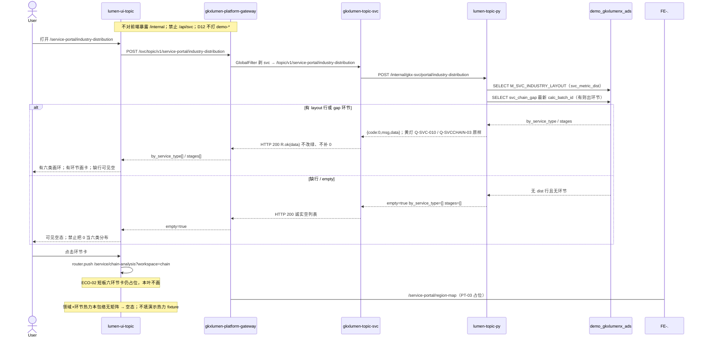

# LUMEN-SVC-P-FE-US-PT-02 · US-SVC-PT-02 产业分布

> 日期：2026-08-22  
> Task：`LUMEN-SVC-P-FE-US-PT-02`  
> 总控：[`LUMEN-SVC-P-长任务总控.md`](./LUMEN-SVC-P-长任务总控.md)（§7 已生效）  
> 仓：`lumen-ui-topic` · `origin/dev`  
> 复刻真源：`demo-ui-topic` `src/app/pages/service-portal/ServicePortalIndustryDistribution.tsx` + `servicePortalShared.tsx`（只读对照，未贴 JSX、未改 demo）

## 任务认领（必填）

| 字段 | 值 |
|------|-----|
| claimed_by | `agent:frontend-agent` |
| supervised_by | `human:侯佳伟` |
| claim_type | `coordinator_dispatch` |
| 说明 | 长任务 24h 锁；本叶不标 `done` |

## Ponytail（coding 任务必填）

| 字段 | 值 |
|------|-----|
| ponytail | `full` |
| 说明 | 复用 `ServicePortalShell`、`IndustryCatalogSelect`、`SectionPanel`、`JudgmentStrip`、`VChart`、`@/review`。未用 YAGNI 跳过 D8 页底 token、D9 四维角标、D10 评审自闸、可观测 `request.ts` X-Trace-Id、handoff、图即契约、五维复刻。 |

## Headroom（可选）

| 字段 | 值 |
|------|-----|
| headroom | `skip` |
| 说明 | 本机会话未挂载 Headroom MCP。 |

## 图即契约

| 字段 | 值 |
|------|-----|
| diagram_id | `SVC-STORAGE-LINEAGE`（消费，不改工厂边）；`LUMEN-SVC-P-FE-US-PT-02-SEQ`（本叶产业分布） |
| 图 diff | LINEAGE 边未改。本叶把 SHELL 产业分布虚线改成实线：50892 FE `POST /svc/topic/v1/service-portal/industry-distribution` → gateway → `gkxlumen-topic-svc` → `lumen-topic-py` `/internal/gkx-svc/portal/industry-distribution` → ADS `M_SVC_INDUSTRY_LAYOUT` + 有则 `svc_chain_gap`。region/sz/capability/keyorg 仍占位虚线。禁止事项未变：不打 `demo-*`、不填演示热力 fixture、不用 0 冒充六类、不改 `industry-center` / REC-02 / ECO-01 / PT-01 KPI omit。 |
| 会签态 | `SVC-STORAGE-LINEAGE` 随 `01-data-flow.md` frontmatter：`approved`（`human:淮政玮` · 2026-08-19 流图；2026-08-20 选 B 增补 LINEAGE，**不改** §1 工厂边）。本叶 SEQ 为 `draft`，禁止自填绿。 |

### L2 消费（不改边）

本叶只读消费 [`storage/SVC/01-data-flow.md`](../../data/data-design/storage/SVC/01-data-flow.md) §1.1 `SVC-STORAGE-LINEAGE`：线上产业分布读 ADS 指标四表 dist（`M_SVC_INDUSTRY_LAYOUT`），有则出十模型 `svc_chain_gap` 环节，不联 ODS。前端不扫表，只消费 Java 产业分布包络。

### L4 本叶 SEQ · `LUMEN-SVC-P-FE-US-PT-02-SEQ`

| 生产者 | 消费者 | 触发 | 失败语义 | 禁止事项 |
|---|---|---|---|---|
| Java `POST /topic/v1/service-portal/industry-distribution` | 本叶 FE | 打开产业分布 / 改产业筛选 | `empty` / `by_service_type=[]` / `stages=[]` → 可见空；接口失败 Message + 空包络 | 演示热力 fixture；页内 `MOCK_`；直连 Python `/internal`；overview 冒充本页 |
| `by_service_type` | 六类环 + 六类合计 KPI | 有 dist 行 | 无行 → 环形空态；**不**补 `count=0` 六类 | `CHAIN_STAGES` 发明类别；`scaleStageCounts` |
| `stages` | 环节卡 + 覆盖/最厚 KPI | 有 gap 环节行 | 无该 stage → 不发明卡；Java `count=0` → 「暂无覆盖」 | 固定六张环节卡；ECO-02 短板分析 |
| 黄灯 `gap` / `pending_client_confirm` | 研判条「待核验」+ `@/review` 角标 | Python 原样上送 | 不改绿 | 前端把 Q-SVC-010 / Q-SVCCHAIN-03 标 aligned/live |

## 范围与实现

替换 SHELL 占位，落地 `/service-portal/industry-distribution`（`US-SVC-PT-02`）：

1. 门户壳：复用 PT-01 `ServicePortalShell`（页底 `--sci-bg-page`、面包屑「专题服务 / 服务机构产业分布」、产业上下文 `IndustryCatalogSelect`）。Java **不按产业切片** dist 时，产业只作上下文，不用 Demo `scaleStageCounts` 伪造另一套数。
2. 六类分布：只渲染 Java `by_service_type`（`category/label/count`）。有则 VChart 环；无则可见空。
3. 环节服务分布：只渲染 Java `stages`。有 count 显示数字；Java 给 0 显示「暂无覆盖」；没有该 stage 不发明卡。点击 `router.push` `/service/chain-analysis?workspace=chain`（可带 `segment`）。
4. 领域×环节热力：Java 包络无矩阵 → 保留区块 + 可见空，不画假热力。
5. 数字旁 `@/review`：`M_SVC_INDUSTRY_LAYOUT`；环节无矩阵 metric 不自造 ⓘ，仅 `Q-SVCCHAIN-03` PendingBadge。关评审零泄漏。
6. Mock 开：`registerApiMock('svcPortalIndustryDistribution')` 形状=Java 实包（4 类 + 3 环节，含一个 count=0）。关：页面不引 `@/mock/**`。
7. 未改 DefaultLayout、industry-center、REC-02、ECO-01、PT-01 KPI omit。

**非范围**：PT-03 区域 / PT-04 技术力 / PT-05 深圳 / PT-06 重点机构；ECO-02 短板；改 Java/Python；宣称 K8s 绿。

## 偏离说明

- Demo 用 `scaleStageCounts` + `CHAIN_STAGES` 固定六卡，并用 `CHAIN_NODE_DIST` 画领域×环节热力。本叶类型真源 = Java 实包；筛选只写入 query 并随 POST body 透传，**不在前端缩放数字**；热力区块诚实空（见上）。
- Demo KPI 三张都挂 `M_SVC_PT_CHAIN_NODE_ORG`（矩阵无此 id）。本叶六类合计挂 `M_SVC_INDUSTRY_LAYOUT`；环节 KPI 不自造 metric ⓘ。
- Demo 无独立六类环（概况页才有类型环）。本叶按 Java `by_service_type` 补环，对应区块清单第 2 项。
- 子导航 PT-03/04/05 仍占位。

## 复刻五维（R1–R5）

| # | 项 | 结果 |
|---|---|---|
| R1 布局 | 壳 + 筛选 + KPI×3 + 六类环 + 环节卡 + 热力空区块都在；一节点一套 layout | ✅ |
| R2 交互 | 加载 / 失败 Message / 空「暂无」/ 有结果 / 筛选改 query 重拉 / 环节卡进 chain workspace | ✅ |
| R3 样式 | `--sci-bg-page` / `#D8E7FC`；KPI 卡与环节卡与本仓门户同皮肤 | ✅ |
| R4 评审 | 只从 `@/review`；mount-id `SVC-PT-F02-*`；关评审不渲染 metric_id / GAP-* / Q0xx | ✅ |
| R5 Mock | 开：`registerApiMock('svcPortalIndustryDistribution')` 形状=Java 实包。关：页面不 import `@/mock/**` 填数 | ✅ |

### 检索皮肤（V1–V7）

本叶非检索 Hub。V1 页底必过；V2–V7 留给 `LUMEN-SVC-P-FE-US-ORG-07`。

| # | 结果 |
|---|---|
| V1 页底 `--sci-bg-page` / `#D8E7FC` | ✅ |
| V2–V7 | N/A（查询页） |

工作区 W1–W4：N/A。

## Design.md §14

页底 `--sci-bg-page`；主色 `#165DFF`；图表序列用 §4.4 token 色。KPI 卡 24px 数字。无 `.ant-` / vendor-antd token。控件高 32px（产业筛选）。

## 测试结果

- `node src/views/service/servicePortalIndustry.selfcheck.mjs` → `servicePortalIndustry.selfcheck ok`
- `node src/views/service/servicePortalOverview.selfcheck.mjs` → `servicePortalOverview.selfcheck ok`
- `node src/router/menu.selfcheck.mjs` → `menu.selfcheck svc-shell ok`
- `npx vue-tsc --build` → 通过

## 遗留风险

- K8s 未注入 Python/MySQL 时产业分布 `empty` / 空六类（预期）；勿把空态当 5xx，不能自行补 0。
- 产业筛选暂不切片（Python 忽略 body）；数字是圈定池全局，不是 Demo 缩放。
- PT-03…05 仍是占位页。ECO-02 短板未做，环节卡只跳工作区入口。

## CI/CD（必填）

- 分支：`lumen-ui-topic` `origin/dev`
- commit：`1e2c66d`
- pipeline URL / ID：https://gitlab.htmisoft.net/gkx-lumen/lumen-ui-topic/-/pipelines?ref=dev （push 后由 GitLab 生成）
- 部署 namespace / 镜像 tag：待 E0 / CI
- K8s rollout：本叶未等、未宣称绿
- dev 测试 URL：http://111.198.38.90:50892/service-portal/industry-distribution （CI 滚出后）
- 本地：上述 selfcheck + `vue-tsc --build`

## 可观测性

- 产业分布请求走 `src/utils/request.ts`：`X-Trace-Id` + `traceparent`
- OTEL_SERVICE_NAME：N/A（前端）
- Tempo / Loki：有（平台已有）

## 架构合规自检

| 铁律 | 结果 |
|------|------|
| 1 算法只在 Python | ✅ |
| 2 调用链 FE→Java→Python `/internal` | ✅ `POST /svc/topic/v1/service-portal/industry-distribution` |
| 3 Nebula 非 Neo4j | ✅ 未碰图 |
| 4 可观测 | ✅ request 拦截器 |
| 5 CI | ✅ 已 push `origin/dev`（`1e2c66d`）；pipeline 由 GitLab 生成 |
| 6 demo2 不 merge 进 lumen | ✅ 只读对照 |
| 7 只调 Java | ✅ |
| 8 数据 ADS / 无硬 mock | ✅ USE_MOCK=false 不填 fixture |
| 9 D8 Design token | ✅ `--sci-bg-page` |
| 10 D9 八件套 / 不自造 ⓘ | ✅ `@/review` + `M_SVC_INDUSTRY_LAYOUT` |
| 11 D10 `@/review` | ✅ |
| 12 D12 不打 demo-* | ✅ |

## Cost

| 字段 | 值 |
|------|-----|
| `actual_tokens` | 175000 |
| `model_used` | `claude-sonnet-4.5`（registry 合法枚举；本会话为 Cursor Grok 4.6，按 Sonnet 价表回填） |
| `actual_cost` | 0.95 |
| `cost_warn` | green |
| 口径 | frontend-agent 80/20；`175000×0.8×3/1e6 + 175000×0.2×15/1e6 = 0.95`；`source: session_estimate` |

## 涉及文件

- `lumen-ui-topic` `src/api/service/*`
- `lumen-ui-topic` `src/views/service/ServicePortalIndustryDistributionPage.vue`
- `lumen-ui-topic` `src/views/service/ServiceReviewMount.vue`（只加 PT-02 mount / pending 分支）
- `lumen-ui-topic` `src/views/service/servicePortal.css`
- `lumen-ui-topic` `src/mock/service/portalIndustryMock.ts`（仅 `registerApiMock`）
- `lumen-ui-topic` `src/router/menu.ts`
- 本 handoff

## 产物清单

- 代码：`1e2c66d`（`lumen-ui-topic` `dev`）
- 文档：本文件
- 未改：`industry-center` 业务页、`demo-ui-topic`、REC-02、ECO-01、PT-01 KPI omit、PT-05 页内容

## 联调确认

联调通过（代码侧）：产业分布页只调 Java industry-distribution；缺六类/环节诚实空；禁用 0 冒充；禁 Demo 热力 fixture；Q-SVCCHAIN-03 待核验不改绿；USE_MOCK=false 不填 fixture。请 coordinator AV-0，**本叶不自行标 done**。

## Registry（MCP）

`task-update-fields` 未落入 `origin/dev`：rebase 后当前 registry **没有** `LUMEN-SVC-P-FE-US-PT-02`（本机曾有未提交条目，禁止手改 yaml 合入）。请 coordinator `task-create` 本 P ID 后再贴：

- evidence：`agent-handoffs/服务机构-SVC/LUMEN-SVC-P-FE-US-PT-02.md`
- actual_tokens：175000 · model_used：`claude-sonnet-4.5` · actual_cost：0.95 · cost_warn：green
- note：联调通过；commit `lumen-ui-topic` `1e2c66d`；请 AV-0

