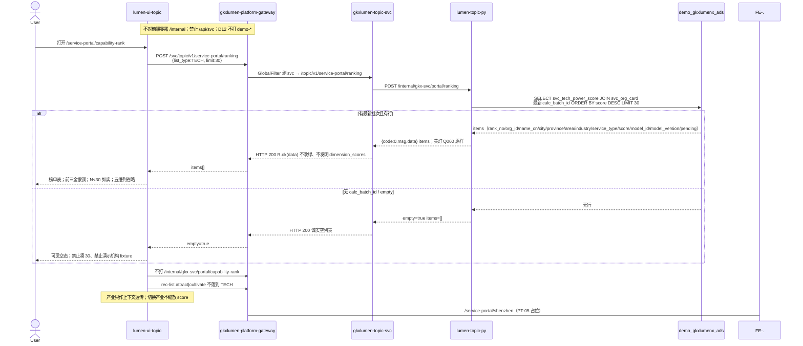

# LUMEN-SVC-P-FE-US-PT-04 · US-SVC-PT-04 技术力 Top30

> 日期：2026-08-22  
> Task：`LUMEN-SVC-P-FE-US-PT-04`  
> 总控：[`LUMEN-SVC-P-长任务总控.md`](./LUMEN-SVC-P-长任务总控.md)（§7 已生效）  
> 仓：`lumen-ui-topic` · `origin/dev`  
> 复刻真源：`demo-ui-topic` `src/app/pages/service-portal/ServicePortalCapabilityRank.tsx` + `servicePortalShared.tsx`（只读对照，未贴 JSX、未改 demo）

## 任务认领（必填）

| 字段 | 值 |
|------|-----|
| claimed_by | `agent:frontend-agent` |
| supervised_by | `human:侯佳伟` |
| claim_type | `coordinator_dispatch` |
| 说明 | 长任务 24h 锁；本叶不标 `done` |

## Ponytail（coding 任务必填）

| 字段 | 值 |
|------|-----|
| ponytail | `full` |
| 说明 | 复用 `ServicePortalShell`、`IndustryCatalogSelect`、`SectionPanel`、`JudgmentStrip`、`SvcOrgProfileDrawer`、`useCompareBasketStore`、`@/review`。未用 YAGNI 跳过 D8 页底 token、D9 四维角标、D10 评审自闸、可观测 `request.ts` X-Trace-Id、handoff、图即契约、五维复刻。 |

## Headroom（可选）

| 字段 | 值 |
|------|-----|
| headroom | `skip` |
| 说明 | 本机会话未挂载 Headroom MCP。 |

## 图即契约

| 字段 | 值 |
|------|-----|
| diagram_id | `SVC-STORAGE-LINEAGE`（消费，不改工厂边）；`LUMEN-SVC-P-FE-US-PT-04-SEQ`（本叶技术力榜） |
| 图 diff | LINEAGE 边未改。本叶把 SHELL 技术力占位虚线改成实线：50892 FE `POST /svc/topic/v1/service-portal/ranking` `{list_type:TECH,limit:30}` → gateway 剥 `svc` → `gkxlumen-topic-svc` → `lumen-topic-py` `POST /internal/gkx-svc/portal/ranking` → ADS `svc_tech_power_score` JOIN `svc_org_card`。C 细叶没有独立 JAVA-CAPABILITY，禁止 invent `/service-portal/capability-rank` Java 路径。sz/keyorg 仍占位虚线。禁止事项未变：不打 `demo-*`、不本地 `computeEvaluation`、不按 Demo 五维字典发明分、不凑 30、不用 rec-list 落到 TECH。 |
| 会签态 | `SVC-STORAGE-LINEAGE` 随 `01-data-flow.md` frontmatter：`approved`（`human:淮政玮` · 2026-08-19 流图；2026-08-20 选 B 增补 LINEAGE，**不改** §1 工厂边）。本叶 SEQ 为 `draft`，禁止自填绿。 |

### L2 消费（不改边）

本叶只读消费 [`storage/SVC/01-data-flow.md`](../../data/data-design/storage/SVC/01-data-flow.md) §1.1 `SVC-STORAGE-LINEAGE`：线上技术力榜读十模型 `svc_tech_power_score` JOIN `svc_org_card`，不联 ODS。前端不扫表，只消费 Java `items` / `empty` / `pending`。

### L4 本叶 SEQ · `LUMEN-SVC-P-FE-US-PT-04-SEQ`

| 生产者 | 消费者 | 触发 | 失败语义 | 禁止事项 |
|---|---|---|---|---|
| Java `POST /topic/v1/service-portal/ranking` `{list_type:TECH,limit:30}` | 本叶 FE | 打开技术力榜 / 改产业筛选 | `empty` / `items=[]` → 可见空；接口失败 Message + 空列表 | Demo `computeEvaluation` / `CAPABILITY_DIM_DEFS` / `industryScaleRatio`；页内 `MOCK_`；直连 Python `/internal`；rec-list 冒充 TECH；invent `/service-portal/capability-rank` Java 路径 |
| Python `_tech_rank` 行字段 | 榜单表 | 有最新 `calc_batch_id` | 无批次 = 空列表，不凑 30 | 前端发明 `dimension_scores`；华大基因/迈瑞/华为 fixture |
| 黄灯 `gap` / `pending.Q060` | 研判条「待核验」+ `@/review` 角标 | Python 原样上送 | 不改绿 | 前端把 Q060 / Q-SVCCHAIN-01 标 aligned/live |
| ORG-03 Drawer `?org=` + `useCompareBasketStore` | 行内分析画像 / 入篮 | 行操作 | 篮满走已有 Message；无 org_id 不可入篮 | 新造第二套篮；落地 ORG-08；打开 ORG-06 评估工作区 |

## 范围与实现

替换 SHELL 占位，落地 `/service-portal/capability-rank`（`US-SVC-PT-04`）：

1. 门户壳：复用 PT-01 `ServicePortalShell`（页底 `--sci-bg-page` / `#D8E7FC`、面包屑「专题服务 / 服务机构技术能力」、产业 `IndustryCatalogSelect` 上下文、标题+口径说明）。
2. 口径条：固定五维等权是 Java 十模型 TECH 已算好的 `score`。页面无第二套 `computeEvaluation`、不按 Demo `CAPABILITY_DIM_DEFS` 本地打分、不 `industryScaleRatio` 缩放。Q060 + Q-SVCCHAIN-01 待核验，不改绿。
3. 榜单表：只认 `POST /svc/topic/v1/service-portal/ranking` body `{list_type:"TECH", limit:30}`（兼 `listType`）。行字段认 `rank_no` `org_id` `name_cn` `city` `province` `area` `industry` `service_type` `score` `model_id` `model_version` `pending`。
4. 前三金银铜复用门户 token（`#f59e0b` / `#94a3b8` / `#b7791f`）；第 4 名起普通名次。N<30 如实展示，顶部「在库/返回 N 家」，不凑 30。
5. 五维列：Java `_tech_rank` 无 `dimension_scores` → 省略列，不发明分。
6. 产业筛选：只写入 query 并随 POST body 透传；切换产业不缩放 score、不另造一套榜。无行 → 可见空。
7. 操作列：行内「分析画像」复用 ORG-03 `SvcOrgProfileDrawer` + `?org=`；入篮复用 `useCompareBasketStore`（`sourceLabel: 门户技术力榜`）；篮满走已有 Message。ORG-08 整页篮不在本叶。
8. 数字旁 `@/review`：`M_SVC_ORG_TECH_SCORE`（D1 draft）。mount-id `SVC-PT-F04-REQ` / `SVC-PT-F04-SCORE` / `SVC-PT-F04-SCORE-HEAD`。关评审 DOM 零泄漏。
9. Mock：开 `registerApiMock('svcPortalRanking')` 形状=Java TECH 实包（3 行）。关：页面不引 `@/mock/**`。
10. 未改 DefaultLayout、industry-center 业务页、PT-01/02/03 契约、REC-02、ECO-01、ORG-07。

**非范围**：PT-05 深圳 / PT-06 重点机构；改 Java/Python；宣称 K8s 绿；第二张 Java/Python 单。

## 偏离说明

- Demo 用 `computeFieldRanking` + `CAPABILITY_DIM_DEFS` 等权本地打分，并按 `industryScaleRatio` 缩放。本叶类型真源 = Java `_tech_rank`；score 原样展示；产业只作上下文透传。
- Demo 五维列来自本地 `dimScores`。本叶包络无 `dimension_scores`，省略列。
- Demo 「分析画像」跳分析工作区 `institution-judgment`。本叶打开已有 ORG-03 Drawer / `?org=`，不落地 ORG-06。
- 子导航 PT-05 仍占位。

## 复刻五维（R1–R5）

| # | 项 | 结果 |
|---|---|---|
| R1 布局 | 壳 + 筛选 + 口径条 + 榜单表 + 空态 + 画像抽屉都在；一节点一套 layout | ✅ |
| R2 交互 | 加载 / 失败 Message / 空「暂无」/ 有结果 / 筛选改 query 重拉 / 画像 `?org=` / 入篮 | ✅ |
| R3 样式 | `--sci-bg-page` / `#D8E7FC`；金银铜复用门户 rank token | ✅ |
| R4 评审 | 只从 `@/review`；mount-id `SVC-PT-F04-*`；关评审不渲染 metric_id / GAP-* / Q0xx | ✅ |
| R5 Mock | 开：`registerApiMock('svcPortalRanking')` 形状=Java TECH 实包（3 行）。关：页面不 import `@/mock/**` 填数 | ✅ |

### 检索皮肤（V1–V7）

本叶非检索 Hub。V1 页底必过；V2–V7 留给 `LUMEN-SVC-P-FE-US-ORG-07`。

| # | 结果 |
|---|---|
| V1 页底 `--sci-bg-page` / `#D8E7FC` | ✅ |
| V2–V7 | N/A（查询页） |

工作区 W1–W4：N/A。

## Design.md §14

页底 `--sci-bg-page`；主色 `#165DFF`；得分条用 primary。控件高 32px（产业筛选 / 操作按钮）。无 `.ant-` / vendor-antd token。前三名配色复用 Demo 门户 `SVC_PORTAL_COLORS.rank`，未硬造第三套色。

## 测试结果

- `node src/views/service/servicePortalCapability.selfcheck.mjs` → `servicePortalCapability.selfcheck ok`
- `node src/views/service/servicePortalRegion.selfcheck.mjs` → `servicePortalRegion.selfcheck ok`
- `node src/views/service/servicePortalIndustry.selfcheck.mjs` → `servicePortalIndustry.selfcheck ok`
- `node src/router/menu.selfcheck.mjs` → `menu.selfcheck svc-shell ok`
- `npx vue-tsc --build` → 通过

## 遗留风险

- K8s 未注入 Python/MySQL 时榜单 `empty` / `items=[]`（预期）；勿把空态当 5xx，不能自行凑 30 或填演示机构。
- 产业筛选暂不切片（Python 忽略 body）；数字是圈定池全局 TECH 分，不是 Demo 缩放。
- `_tech_rank` 无五维分项字段，列省略；PT-05 仍占位。

## CI/CD（必填）

- 分支：`lumen-ui-topic` `origin/dev`
- commit：`124c136`
- pipeline URL / ID：https://gitlab.htmisoft.net/gkx-lumen/lumen-ui-topic/-/pipelines?ref=dev （push 后由 GitLab 生成）
- 部署 namespace / 镜像 tag：待 E0 / CI
- K8s rollout：本叶未等、未宣称绿
- dev 测试 URL：http://111.198.38.90:50892/service-portal/capability-rank （CI 滚出后）
- 本地：上述 selfcheck + `vue-tsc --build`

## 可观测性

- 榜单请求走 `src/utils/request.ts`：`X-Trace-Id` + `traceparent`
- OTEL_SERVICE_NAME：N/A（前端）
- Tempo / Loki：有（平台已有）

## 架构合规自检

| 铁律 | 结果 |
|------|------|
| 1 算法只在 Python | ✅ 前端不打分 |
| 2 调用链 FE→Java→Python `/internal` | ✅ `POST /svc/topic/v1/service-portal/ranking` |
| 3 Nebula 非 Neo4j | ✅ 未碰图库 |
| 4 可观测 | ✅ request 拦截器 |
| 5 CI | ✅ 将 push `origin/dev`；pipeline 由 GitLab 生成；本叶不宣称绿 |
| 6 demo2 不 merge 进 lumen | ✅ 只读对照 |
| 7 只调 Java | ✅ |
| 8 数据 ADS / 无硬 mock | ✅ USE_MOCK=false 不填 fixture |
| 9 D8 Design token | ✅ `--sci-bg-page` |
| 10 D9 八件套 / 不自造 ⓘ | ✅ `@/review` + `M_SVC_ORG_TECH_SCORE` D1 draft |
| 11 D10 `@/review` | ✅ |
| 12 D12 不打 demo-* | ✅ |

## Cost

| 字段 | 值 |
|------|-----|
| `actual_tokens` | 175000 |
| `model_used` | `claude-sonnet-4.5`（registry 合法枚举；本会话为 Cursor Grok 4.6，按 Sonnet 价表回填） |
| `actual_cost` | 0.95 |
| `cost_warn` | green |
| 口径 | frontend-agent 80/20；`175000×0.8×3/1e6 + 175000×0.2×15/1e6 = 0.95`；`source: session_estimate` |

## 涉及文件

- `lumen-ui-topic` `src/api/service/*`
- `lumen-ui-topic` `src/views/service/ServicePortalCapabilityRankPage.vue`
- `lumen-ui-topic` `src/views/service/ServiceReviewMount.vue`（只加 PT-04 mount / TRACE）
- `lumen-ui-topic` `src/views/service/servicePortal.css`
- `lumen-ui-topic` `src/mock/service/portalRankingMock.ts`（仅 `registerApiMock`）
- `lumen-ui-topic` `src/router/menu.ts`
- 本 handoff

## 产物清单

- 代码：`124c136`（`lumen-ui-topic` `dev`）
- 文档：本文件
- 未改：`industry-center` 业务页、`demo-ui-topic`、REC-02、ECO-01、PT-01/02/03 契约、PT-05 页内容、`task-registry.yaml`

## 联调确认

联调通过（代码侧）：技术力榜页只调 Java ranking TECH；empty 诚实空不凑 30；无 dimension_scores 省略列；禁止本地打分与产业缩放；Q060 / Q-SVCCHAIN-01 待核验不改绿；USE_MOCK=false 不填 fixture。请 coordinator AV-0，**本叶不自行标 done**。

## Registry（MCP）

请 coordinator 核对 `task-update-fields` 后 AV-0：

- evidence：`agent-handoffs/服务机构-SVC/LUMEN-SVC-P-FE-US-PT-04.md`
- actual_tokens：175000 · model_used：`claude-sonnet-4.5` · actual_cost：0.95 · cost_warn：green
- note：联调通过；commit `lumen-ui-topic` `124c136`；请 AV-0；本叶不标 done
