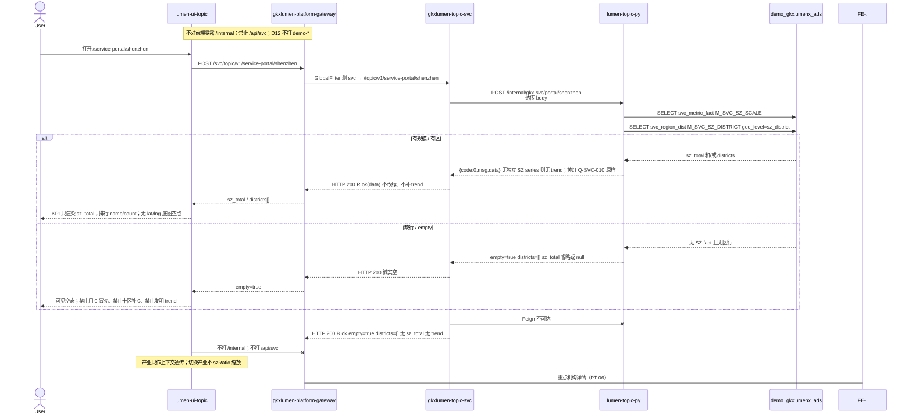

# LUMEN-SVC-P-FE-US-PT-05 · US-SVC-PT-05 深圳产业服务介绍

> 日期：2026-08-22  
> Task：`LUMEN-SVC-P-FE-US-PT-05`  
> 总控：[`LUMEN-SVC-P-长任务总控.md`](./LUMEN-SVC-P-长任务总控.md)（§7 已生效）  
> 仓：`lumen-ui-topic` · `origin/dev`  
> 复刻真源：`demo-ui-topic` `src/app/pages/service-portal/ServicePortalShenzhen.tsx`（只读对照，未贴 JSX、未改 demo）

## 任务认领（必填）

| 字段 | 值 |
|------|-----|
| claimed_by | `agent:frontend-agent` |
| supervised_by | `human:侯佳伟` |
| claim_type | `coordinator_dispatch` |
| 说明 | 长任务 24h 锁；本叶不标 `done` |

## Ponytail（coding 任务必填）

| 字段 | 值 |
|------|-----|
| ponytail | `full` |
| 说明 | 复用 `ServicePortalShell`、`IndustryCatalogSelect`、`SectionPanel`、`JudgmentStrip`、`UnifiedLeafletMap`、`@/review`。未用 YAGNI 跳过 D8 页底 token、D9 四维角标、D10 评审自闸、可观测 `request.ts` X-Trace-Id、handoff、图即契约、五维复刻。 |

## Headroom（可选）

| 字段 | 值 |
|------|-----|
| headroom | `skip` |
| 说明 | 本机会话未挂载 Headroom MCP。 |

## 图即契约

| 字段 | 值 |
|------|-----|
| diagram_id | `SVC-STORAGE-LINEAGE`（消费，不改工厂边）；`LUMEN-SVC-P-FE-US-PT-05-SEQ`（本叶深圳统计） |
| 图 diff | LINEAGE 边未改。本叶把 SHELL 深圳占位虚线改成实线：50892 FE `POST /svc/topic/v1/service-portal/shenzhen` → gateway 剥 `svc` → `gkxlumen-topic-svc` → `lumen-topic-py` `POST /internal/gkx-svc/portal/shenzhen` → ADS `M_SVC_SZ_SCALE` + `M_SVC_SZ_DISTRICT`。无独立 series 无 trend。keyorg 仍虚线（PT-06）。禁止事项未变：不打 `demo-*`、不用 0 冒充深圳规模、不发明 trend、不填 Demo 区级假点、不宣称深圳≤广东≤全国。 |
| 会签态 | `SVC-STORAGE-LINEAGE` 随 `01-data-flow.md` frontmatter：`approved`（`human:淮政玮` · 2026-08-19 流图；2026-08-20 选 B 增补 LINEAGE，**不改** §1 工厂边）。本叶 SEQ 为 `draft`，禁止自填绿。 |

### L2 消费（不改边）

本叶只读消费 [`storage/SVC/01-data-flow.md`](../../data/data-design/storage/SVC/01-data-flow.md) §1.1 `SVC-STORAGE-LINEAGE`：线上深圳统计读 ADS fact `M_SVC_SZ_SCALE` 与 region_dist `M_SVC_SZ_DISTRICT`，不联 ODS。前端不扫表，只消费 Java `sz_total` / `districts` / `empty`。无独立 SZ series 则不出 `trend`。

### L4 本叶 SEQ · `LUMEN-SVC-P-FE-US-PT-05-SEQ`

| 生产者 | 消费者 | 触发 | 失败语义 | 禁止事项 |
|---|---|---|---|---|
| Java `POST /topic/v1/service-portal/shenzhen` | 本叶 FE | 打开深圳介绍 / 改产业筛选 | `empty` / 无 `sz_total` / `districts=[]` → 可见空；接口失败 Message + 空包络 | Demo `szRatio` / `SZ_*` fixture / `PORTAL_YEARS`；页内 `MOCK_`；直连 Python `/internal`；用 0 冒充深圳规模；全球 `new_org_series` 乘比例冒充 trend |
| Python `sz_total` / `sz_metric_id` | KPI | ADS 有 `M_SVC_SZ_SCALE` 行 | 缺行省略规模，不显示 0 | 前端自造 `M_SVC_PT_SZ_*` 写入 seed |
| Python `districts[]` `{name,count,geo_level}` | 排行条 + 地图壳 | ADS 有 `M_SVC_SZ_DISTRICT` 区行 | 缺行空列表；无 lat/lng → 底图空点 | Demo 区级假点；页面 `new L.map`；十区字典补 0 凑满 |
| 黄灯 `gap` / `Q-SVC-010` | 研判条「待核验」+ `@/review` 角标 | Python 原样上送 | 不改绿 | 前端把 Q-SVC-010 标 aligned/live |
| 类型区 / 领域区 | 分区结构 | Java 无矩阵 | 可见空「暂无」 | `SZ_TYPE_DIST` / `SZ_FIELD_DIST` / `CHAIN_STAGES` |
| 页尾重点机构入口 | 文案 + 检索链 | 不调 key-orgs | 空说明，不画卡片墙 | `KeyOrgDetailDrawer` / `?org=` 详情（PT-06） |

## 范围与实现

替换 SHELL 占位，落地 `/service-portal/shenzhen`（`US-SVC-PT-05`）：

1. 门户壳：复用 PT-01 `ServicePortalShell`（页底 `--sci-bg-page` / `#D8E7FC`、面包屑「专题服务 / 深圳产业服务介绍」、产业 `IndustryCatalogSelect` 上下文）。产业只写入 query/body 透传，禁止 Demo `szRatio` 缩放。
2. KPI：只认 Java `sz_total` + `sz_metric_id`（挂仓内已有 `M_SVC_SZ_SCALE`）。缺 `sz_total` → 暂无/省略，禁止用 0 冒充。Demo「本年新增 / 覆盖领域数」Java 没有 → 槽位诚实空，不发明数字、不写 `M_SVC_PT_SZ_*` 进 seed。
3. 数量区：无独立 SZ `trend` → 隐藏折线，可见空说明。禁止 `new_org_series` 乘比例、禁止 `PORTAL_YEARS`。
4. 类型区 / 领域区：Java 无矩阵 → 分区保留、内容「暂无」。禁止 `SZ_TYPE_DIST` / `SZ_FIELD_DIST` / `CHAIN_STAGES`。
5. 区域区：只认 `districts[]` `{name,count,geo_level}`。排行条 name/count。地图复用 `UnifiedLeafletMap`（`presetLayers=false`）；无 lat/lng → 底图壳 + 空点。禁止 Demo 区级假点、禁止 `new L.map`、禁止十区补 0。
6. 页尾 PT-06 入口：文案 + 检索链到 `/service-center/search`。不做 `KeyOrgDetailDrawer` / 卡片墙 / `?org=` 详情。
7. 黄灯 Q-SVC-010 待核验不改绿。mount-id `SVC-PT-F05-*`。关评审 DOM 零泄漏。
8. Mock：开 `registerApiMock('svcPortalShenzhen')` 形状=Java 实包（`sz_total` + 2 条 districts，无 trend/坐标）。关：页面不引 `@/mock/**`。
9. 未改 DefaultLayout、industry-center 业务页、PT-01/02/03/04 契约、REC-02、ECO-01。

**非范围**：PT-06 重点机构详情；改 Java/Python；宣称 K8s 绿；第二张 Java/Python 单；用 overview 数字硬拼「深圳≤广东≤全国」。

## 偏离说明

- Demo 用 `szRatio` 缩放 `SZ_TOTAL_TREND` / 类型 / 十区 / 领域环节。本叶类型真源 = Java shenzhen 实包；产业只作上下文透传。
- Demo 有本年新增、类型环、环节条、十区假点、重点机构卡片墙。本叶 Java 无对应字段则诚实空；地图无坐标不填点。
- Demo KPI 自造 `M_SVC_PT_SZ_*`。本叶只挂仓内已有 `M_SVC_SZ_SCALE`。
- 子导航 PT-06 重点机构详情仍未落地。

## 复刻五维（R1–R5）

| # | 项 | 结果 |
|---|---|---|
| R1 布局 | 壳 + KPI + 趋势区 + 类型区 + 领域区 + 地图/排行 + 重点机构入口都在；一节点一套 layout | ✅ |
| R2 交互 | 加载 / 失败 Message / 空「暂无」/ 有 `sz_total` 或区行则渲染 / 筛选改 query 重拉 / 检索入口 | ✅ |
| R3 样式 | `--sci-bg-page` / `#D8E7FC`；主色 `#165DFF`；与门户兄弟页同皮肤 | ✅ |
| R4 评审 | 只从 `@/review`；mount-id `SVC-PT-F05-*`；关评审不渲染 metric_id / GAP-* / Q0xx | ✅ |
| R5 Mock | 开：`registerApiMock('svcPortalShenzhen')` 形状=Java 实包。关：页面不 import `@/mock/**` 填数 | ✅ |

### 检索皮肤（V1–V7）

本叶非检索 Hub。V1 页底必过；V2–V7 留给 `LUMEN-SVC-P-FE-US-ORG-07`。

| # | 结果 |
|---|---|
| V1 页底 `--sci-bg-page` / `#D8E7FC` | ✅ |
| V2–V7 | N/A（查询页） |

工作区 W1–W4：N/A。

## Design.md §14

页底 `--sci-bg-page`；主色 `#165DFF`；控件高 32px（产业筛选 / 检索按钮）。无 `.ant-` / vendor-antd token。地图用 `UnifiedLeafletMap` 内核，Arco 只做外围空态。仓栈为 Arco Vue（非 React），与本仓兄弟页一致。

## 测试结果

- `node src/views/service/servicePortalShenzhen.selfcheck.mjs` → `servicePortalShenzhen.selfcheck ok`
- `node src/views/service/servicePortalCapability.selfcheck.mjs` → `servicePortalCapability.selfcheck ok`
- `node src/views/service/servicePortalRegion.selfcheck.mjs` → `servicePortalRegion.selfcheck ok`
- `node src/views/service/servicePortalIndustry.selfcheck.mjs` → `servicePortalIndustry.selfcheck ok`
- `node src/router/menu.selfcheck.mjs` → `menu.selfcheck svc-shell ok`
- `npx vue-tsc --build` → 通过

## 遗留风险

- K8s 未注入 Python/MySQL 时深圳统计 `empty` / 无 `sz_total` / `districts=[]`（预期）；勿把空态当 5xx，不能自行补 0 或区级点或全球趋势。
- 产业筛选暂不切片（Python 忽略 body）；数字是圈定池深圳规模，不是 Demo 缩放。
- 无独立 SZ series，折线模块保持空；类型/领域矩阵无字段，分区空。PT-06 重点机构详情仍未落地。

## CI/CD（必填）

- 分支：`lumen-ui-topic` `origin/dev`
- commit：`095d49a`
- pipeline URL / ID：https://gitlab.htmisoft.net/gkx-lumen/lumen-ui-topic/-/pipelines?ref=dev （push 后由 GitLab 生成）
- 部署 namespace / 镜像 tag：待 E0 / CI
- K8s rollout：本叶未等、未宣称绿
- dev 测试 URL：http://111.198.38.90:50892/service-portal/shenzhen （CI 滚出后）
- 本地：上述 selfcheck + `vue-tsc --build`

## 可观测性

- 深圳统计请求走 `src/utils/request.ts`：`X-Trace-Id` + `traceparent`
- OTEL_SERVICE_NAME：N/A（前端）
- Tempo / Loki：有（平台已有）

## 架构合规自检

| 铁律 | 结果 |
|------|------|
| 1 算法只在 Python | ✅ 前端不缩放、不算趋势 |
| 2 调用链 FE→Java→Python `/internal` | ✅ `POST /svc/topic/v1/service-portal/shenzhen` |
| 3 Nebula 非 Neo4j | ✅ 未碰图库 |
| 4 可观测 | ✅ request 拦截器 |
| 5 CI | ✅ 已 push `origin/dev`；pipeline 由 GitLab 生成；本叶不宣称绿 |
| 6 demo2 不 merge 进 lumen | ✅ 只读对照 |
| 7 只调 Java | ✅ |
| 8 数据 ADS / 无硬 mock | ✅ USE_MOCK=false 不填 fixture |
| 9 D8 Design token | ✅ `--sci-bg-page` |
| 10 D9 八件套 / 不自造 ⓘ | ✅ `@/review` + `M_SVC_SZ_SCALE` D1 draft / Q-SVC-010 |
| 11 D10 `@/review` | ✅ |
| 12 D12 不打 demo-* | ✅ |

## Cost

| 字段 | 值 |
|------|-----|
| `actual_tokens` | 180000 |
| `model_used` | `claude-sonnet-4.5`（registry 合法枚举；本会话为 Cursor Grok 4.6，按 Sonnet 价表回填） |
| `actual_cost` | 0.97 |
| `cost_warn` | green |
| 口径 | frontend-agent 80/20；`180000×0.8×3/1e6 + 180000×0.2×15/1e6 = 0.97`；`source: session_estimate` |

## 涉及文件

- `lumen-ui-topic` `src/api/service/*`
- `lumen-ui-topic` `src/views/service/ServicePortalShenzhenPage.vue`
- `lumen-ui-topic` `src/views/service/ServiceReviewMount.vue`（只加 PT-05 mount / TRACE）
- `lumen-ui-topic` `src/views/service/servicePortal.css`
- `lumen-ui-topic` `src/mock/service/portalShenzhenMock.ts`（仅 `registerApiMock`）
- `lumen-ui-topic` `src/router/menu.ts`
- 本 handoff

## 产物清单

- 代码：`095d49a`（`lumen-ui-topic` `dev`）
- 文档：本文件
- 未改：`industry-center` 业务页、`demo-ui-topic`、REC-02、ECO-01、PT-01/02/03/04 契约、`task-registry.yaml`

## 联调确认

联调通过（代码侧）：深圳介绍页只调 Java `POST /svc/topic/v1/service-portal/shenzhen`；缺 `sz_total` 诚实空不用 0 冒充；无独立 series 不发明 trend；`districts=[]` 不补十区；无 lat/lng 底图空点；Q-SVC-010 待核验不改绿；USE_MOCK=false 不填 fixture。请 coordinator AV-0，**本叶不自行标 done**。

## Registry（MCP）

请 coordinator 核对 `task-update-fields` 后 AV-0：

- evidence：`agent-handoffs/服务机构-SVC/LUMEN-SVC-P-FE-US-PT-05.md`
- actual_tokens：180000 · model_used：`claude-sonnet-4.5` · actual_cost：0.97 · cost_warn：green
- note：联调通过；commit `lumen-ui-topic` `095d49a`；请 AV-0；本叶不标 done
