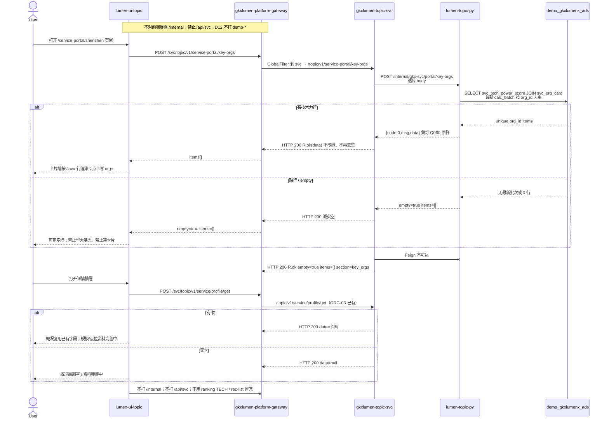

# LUMEN-SVC-P-FE-US-PT-06 · US-SVC-PT-06 重点机构介绍

> 日期：2026-08-22  
> Task：`LUMEN-SVC-P-FE-US-PT-06`  
> 总控：[`LUMEN-SVC-P-长任务总控.md`](./LUMEN-SVC-P-长任务总控.md)（§7 已生效）  
> 仓：`lumen-ui-topic` · `origin/dev`  
> 复刻真源：`demo-ui-topic` `ServicePortalShenzhen.tsx` 页尾卡片墙 + `KeyOrgDetailDrawer.tsx`（只读对照，未贴 JSX、未改 demo、未搬 `KEY_ORG_PROFILES`）

## 任务认领（必填）

| 字段 | 值 |
|------|-----|
| claimed_by | `agent:frontend-agent` |
| supervised_by | `human:侯佳伟` |
| claim_type | `coordinator_dispatch` |
| 说明 | 长任务 24h 锁；本叶不标 `done` |

## Ponytail（coding 任务必填）

| 字段 | 值 |
|------|-----|
| ponytail | `full` |
| 说明 | 复用 PT-05 深圳页壳、ORG-03 `svcProfileGet` / `parseBasicRows`、`useCompareBasketStore`、`@/review`。未用 YAGNI 跳过 D8 页底 token、D9 四维角标、D10 评审自闸、可观测 `request.ts` X-Trace-Id、handoff、图即契约、五维复刻。 |

## Headroom（可选）

| 字段 | 值 |
|------|-----|
| headroom | `skip` |
| 说明 | 本机会话未挂载 Headroom MCP。 |

## 图即契约

| 字段 | 值 |
|------|-----|
| diagram_id | `SVC-STORAGE-LINEAGE`（消费，不改工厂边）；`LUMEN-SVC-P-FE-US-PT-06-SEQ`（本叶重点机构） |
| 图 diff | LINEAGE 边未改。本叶把 PT-05 页尾重点机构虚线改成实线：50892 FE `POST /svc/topic/v1/service-portal/key-orgs` → gateway 剥 `svc` → `gkxlumen-topic-svc` → `lumen-topic-py` `POST /internal/gkx-svc/portal/key-orgs` → ADS `svc_tech_power_score` JOIN `svc_org_card` 按 org_id 去重。详情画像走已有 `POST /svc/topic/v1/service/profile/get`。禁止事项未变：不打 `demo-*`、不发明 Top、不填华大基因、不发明 lat/lng。 |
| 会签态 | `SVC-STORAGE-LINEAGE` 随 `01-data-flow.md` frontmatter：`approved`（`human:淮政玮` · 2026-08-19 流图；2026-08-20 选 B 增补 LINEAGE，**不改** §1 工厂边）。本叶 SEQ 为 `draft`，禁止自填绿。 |

### L2 消费（不改边）

本叶只读消费 [`storage/SVC/01-data-flow.md`](../../data/data-design/storage/SVC/01-data-flow.md) §1.1 `SVC-STORAGE-LINEAGE`：线上重点机构读十模型 `svc_tech_power_score`（最新 `calc_batch_id`）JOIN `svc_org_card` 出名称，按 `org_id` 去重；**不联 ODS**。前端不扫表、不再去重、不发明 Top。

### L4 本叶 SEQ · `LUMEN-SVC-P-FE-US-PT-06-SEQ`

| 生产者 | 消费者 | 触发 | 失败语义 | 禁止事项 |
|---|---|---|---|---|
| Java `POST /topic/v1/service-portal/key-orgs` | 本叶 FE 页尾墙 | 打开深圳介绍 / 改产业筛选 | `empty` / `items=[]` → 可见空；接口失败 Message + 空墙 | Demo `computeKeyOrgCards` / `KEY_ORG_PROFILES` / 华大基因；页内 `MOCK_`；直连 Python `/internal`；ranking TECH / rec-list 冒充 |
| Python `_tech_rank` 按 `org_id` 去重 items | 卡片墙 | ADS 有最新批技术力行 | 缺行空列表，不凑卡片 | 前端再发明 Top；按产业前端过滤伪造另一套墙 |
| 黄灯 `gap` / `Q060` / `Q-SVCCHAIN-06` | 口径条「待核验」+ `@/review` 角标 | Python 原样上送；Q-SVCCHAIN-06 不改绿 | 不改绿 | 前端把 Q060 / Q-SVCCHAIN-06 标 aligned/live |
| Java `POST /topic/v1/service/profile/get` | 详情抽屉概况 / 领域 | 点卡片或直达 `?org=` | `data=null` 局部空 / 资料完善中 | Demo `getKeyOrgProfile`；发明 lat/lng / 人数 / 营收 |

## 范围与实现

在已有 `/service-portal/shenzhen`（PT-05）页尾替换「检索入口文案」为可点业务（**不新路由**）：

1. 卡片墙只调 `POST /svc/topic/v1/service-portal/key-orgs`。行字段认 Java 去重后的 `rank_no` `org_id` `name_cn` `city` `province` `area` `industry` `service_type` `score` `model_id` `model_version` `pending`。
2. 口径条明示「按最新技术力批次按机构去重」；黄灯 Q060 / Q-SVCCHAIN-06 待核验不改绿。
3. `empty` / `items=[]` 可见空，不凑卡片。
4. 点卡片 URL 写入 `org=`；非法 org Message + 清参数；关抽屉去掉 `org` 并 `scrollTo` 保留滚动；直达带 `org` 可恢复。
5. 详情抽屉 Bid 104 四板块结构：概况复用 ORG-03 `profile/get` 已有字段；规模/领导人/营收/业务点位「资料完善中」，禁止 Demo 扩展档案与坐标。
6. 分析画像走已有 `/service/institution-judgment?workspace=field&tab=coverage&org=`；入篮 `useCompareBasketStore`（`sourceLabel: 门户重点机构`）。不落地 ORG-08 整页篮。
7. 产业筛选与 PT-05 相同，只作上下文透传，不前端按产业过滤。
8. 有 score 挂仓内已有 `M_SVC_ORG_TECH_SCORE`。未自造 `M_SVC_PT_KEYORG_SCALE`。
9. mount-id `SVC-PT-F06-*`。关评审 DOM 零泄漏。
10. Mock：`registerApiMock('svcPortalKeyOrgs')` 形状=Java 实包（2 条去重行）。关：页面不引 `@/mock/**`。
11. 未改 PT-05 KPI/趋势/类型/领域/区排行契约；未改 PT-01/02/03/04、REC-02、ECO-01、DefaultLayout、industry-center。

**非范围**：新路由；第二张 Java/Python 单；宣称 K8s 绿；ORG-08 整页篮。

## 偏离说明

- Demo 用 `computeKeyOrgCards` + `KEY_ORG_PROFILES` 填领导人/人数/营收/区级点。本叶类型真源 = Java key-orgs + profile/get；扩展档案诚实「资料完善中」。
- Demo KPI 自造 `M_SVC_PT_KEYORG_SCALE`。本叶只挂仓内已有 `M_SVC_ORG_TECH_SCORE`。
- Demo 按产业 coverage 前端过滤卡片。本叶产业只透传，不另造墙。

## 复刻五维（R1–R5）

| # | 项 | 结果 |
|---|---|---|
| R1 布局 | 页尾卡片墙 + Bid 104 四板块抽屉；一节点一套 layout | ✅ |
| R2 交互 | 加载 / 失败 Message+空墙 / empty 可见空 / 点卡写 org / 非法清参 / 关抽屉保留滚动 / 直达恢复 / 入篮 / 分析画像 | ✅ |
| R3 样式 | `--sci-bg-page` / `#D8E7FC`；主色 `#165DFF`；与门户兄弟页同皮肤 | ✅ |
| R4 评审 | 只从 `@/review`；mount-id `SVC-PT-F06-*`；关评审不渲染 metric_id / GAP-* / Q0xx | ✅ |
| R5 Mock | 开：`registerApiMock('svcPortalKeyOrgs')` 形状=Java 实包。关：页面不 import `@/mock/**` 填数 | ✅ |

### 检索皮肤（V1–V7）

本叶非检索 Hub。V1 页底必过；V2–V7 留给 `LUMEN-SVC-P-FE-US-ORG-07`。

| # | 结果 |
|---|---|
| V1 页底 `--sci-bg-page` / `#D8E7FC` | ✅ |
| V2–V7 | N/A（查询页） |

工作区 W1–W4：N/A。

## Design.md §14

页底 `--sci-bg-page`；主色 `#165DFF`；控件高 32px（抽屉按钮 / 产业筛选沿用壳）。卡片无强阴影。无 `.ant-` / vendor-antd token。仓栈为 Arco Vue（非 React），与本仓兄弟页一致。

## 测试结果

- `node src/views/service/servicePortalKeyOrgs.selfcheck.mjs` → `servicePortalKeyOrgs.selfcheck ok`
- `node src/views/service/servicePortalShenzhen.selfcheck.mjs` → `servicePortalShenzhen.selfcheck ok`
- `node src/views/service/servicePortalCapability.selfcheck.mjs` → `servicePortalCapability.selfcheck ok`
- `node src/views/service/servicePortalRegion.selfcheck.mjs` → `servicePortalRegion.selfcheck ok`
- `node src/views/service/servicePortalIndustry.selfcheck.mjs` → `servicePortalIndustry.selfcheck ok`
- `node src/router/menu.selfcheck.mjs` → `menu.selfcheck svc-shell ok`
- `npx vue-tsc --build` → 通过

## 遗留风险

- K8s 未注入 Python/MySQL 时重点机构 `empty` / `items=[]`（预期）；勿把空态当 5xx，不能自行补华大基因或规模/坐标。
- 产业筛选暂不切片（Python 忽略 body）；墙是圈定池去重技术力行，不是 Demo 按领域过滤。
- 扩展档案（领导人/人数/营收/业务点位）待 Q-SVCCHAIN-06 口径确认后才有数；当前「资料完善中」。

## CI/CD（必填）

- 分支：`lumen-ui-topic` `origin/dev`
- commit：`96f78d4`
- pipeline URL / ID：https://gitlab.htmisoft.net/gkx-lumen/lumen-ui-topic/-/pipelines?ref=dev （push 后由 GitLab 生成）
- 部署 namespace / 镜像 tag：待 E0 / CI
- K8s rollout：本叶未等、未宣称绿
- dev 测试 URL：http://111.198.38.90:50892/service-portal/shenzhen （CI 滚出后）
- 本地：上述 selfcheck + `vue-tsc --build`

## 可观测性

- 重点机构 / 画像请求走 `src/utils/request.ts`：`X-Trace-Id` + `traceparent`
- OTEL_SERVICE_NAME：N/A（前端）
- Tempo / Loki：有（平台已有）

## 架构合规自检

| 铁律 | 结果 |
|------|------|
| 1 算法只在 Python | ✅ 前端不去重、不算 Top、不发明规模 |
| 2 调用链 FE→Java→Python `/internal` | ✅ `POST /svc/topic/v1/service-portal/key-orgs`；画像 `profile/get` |
| 3 Nebula 非 Neo4j | ✅ 未碰图库 |
| 4 可观测 | ✅ request 拦截器 |
| 5 CI | ✅ 已 push `origin/dev`；pipeline 由 GitLab 生成；本叶不宣称绿 |
| 6 demo2 不 merge 进 lumen | ✅ 只读对照 |
| 7 只调 Java | ✅ |
| 8 数据 ADS / 无硬 mock | ✅ USE_MOCK=false 不填 fixture |
| 9 D8 Design token | ✅ `--sci-bg-page` |
| 10 D9 八件套 / 不自造 ⓘ | ✅ `@/review` + `M_SVC_ORG_TECH_SCORE` D1 draft / Q060 / Q-SVCCHAIN-06 |
| 11 D10 `@/review` | ✅ |
| 12 D12 不打 demo-* | ✅ |

## Cost

| 字段 | 值 |
|------|-----|
| `actual_tokens` | 200000 |
| `model_used` | `claude-sonnet-4.5`（registry 合法枚举；本会话为 Cursor Grok 4.6，按 Sonnet 价表回填） |
| `actual_cost` | 1.08 |
| `cost_warn` | green |
| 口径 | frontend-agent 80/20；`200000×0.8×3/1e6 + 200000×0.2×15/1e6 = 1.08`；`source: session_estimate` |

## 涉及文件

- `lumen-ui-topic` `src/api/service/*`
- `lumen-ui-topic` `src/views/service/ServicePortalShenzhenPage.vue`（只换页尾）
- `lumen-ui-topic` `src/views/service/SvcPortalKeyOrgSection.vue`
- `lumen-ui-topic` `src/views/service/SvcPortalKeyOrgDrawer.vue`
- `lumen-ui-topic` `src/views/service/ServiceReviewMount.vue`（加 PT-06 mount / TRACE）
- `lumen-ui-topic` `src/views/service/servicePortal.css`
- `lumen-ui-topic` `src/mock/service/portalKeyOrgsMock.ts`（仅 `registerApiMock`）
- 本 handoff

## 产物清单

- 代码：`96f78d4`（`lumen-ui-topic` `dev`）
- 文档：本文件
- 未改：`industry-center` 业务页、`demo-ui-topic`、REC-02、ECO-01、PT-01/02/03/04 契约、PT-05 KPI/趋势/类型/领域/区排行、`task-registry.yaml`

## 联调确认

联调通过（代码侧）：深圳介绍页尾只调 Java `POST /svc/topic/v1/service-portal/key-orgs`；`items=[]` 诚实空不凑卡片；非法 `org` Message + 清参；详情无扩展档案「资料完善中」不发明 lat/lng；Q060 / Q-SVCCHAIN-06 待核验不改绿；USE_MOCK=false 不填 fixture。请 coordinator AV-0，**本叶不自行标 done**。

## Registry（MCP）

请 coordinator 核对 `task-update-fields` 后 AV-0：

- evidence：`agent-handoffs/服务机构-SVC/LUMEN-SVC-P-FE-US-PT-06.md`
- actual_tokens：200000 · model_used：`claude-sonnet-4.5` · actual_cost：1.08 · cost_warn：green
- note：联调通过；commit `lumen-ui-topic` `96f78d4`；请 AV-0；本叶不标 done
