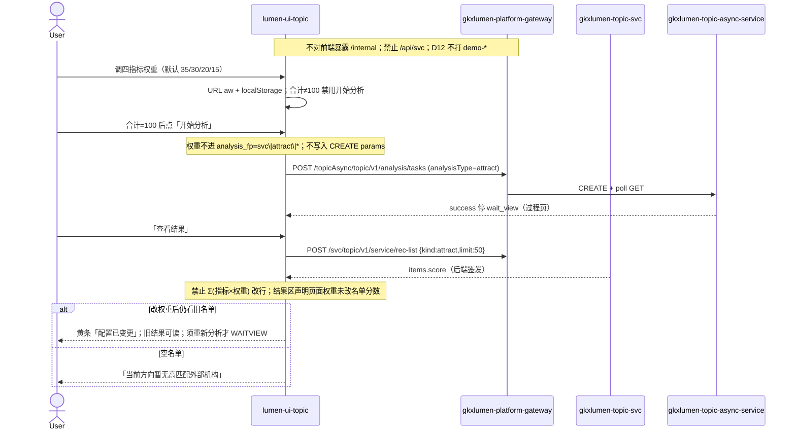

# LUMEN-SVC-P-FE-US-REC-01 · US-SVC-REC-01 招引模型权重

> 日期：2026-08-22  
> Task：`LUMEN-SVC-P-FE-US-REC-01`  
> 总控：[`LUMEN-SVC-P-长任务总控.md`](./LUMEN-SVC-P-长任务总控.md)（§7 已生效；金路径招引配置）  
> 仓：`lumen-ui-topic` · `origin/dev`  
> 复刻真源：`demo-ui-topic` 招引配置交互 + ORG-06 权重门控（只读对照，未贴 JSX、未改 demo、未搬 `computeAttractList` 本地 Σ）  
> 本仓前置：REC-02 `33141a9` · ECO-06 `68cac91` · Java `LUMEN-SVC-P-JAVA-API-REC-LIST-L01`

## 任务认领（必填）

| 字段 | 值 |
|------|-----|
| claimed_by | `agent:frontend-agent` |
| supervised_by | `human:侯佳伟` |
| claim_type | `coordinator_dispatch` |
| 说明 | 长任务 24h 锁；本叶不标 `done`。coordinator 已 MCP `in_progress`。本会话未挂载 task-registry MCP，未手改 yaml。 |

## Ponytail（coding 任务必填）

| 字段 | 值 |
|------|-----|
| ponytail | `full` |
| 说明 | 复用 REC-02 工作区、WAITVIEW、`IndustryCatalogSelect`、`@/review`、ORG-06 合计门控/归一交互。未用 YAGNI 跳过 D8 页底 token、D9 ⓘ/角标、D10 评审自闸、可观测 X-Trace-Id、handoff、图即契约、五维复刻、附录 E。未自造 `M_SVC_REC_WEIGHT_*`，未本地 Σ 重算名单。 |

## Headroom（可选）

| 字段 | 值 |
|------|-----|
| headroom | `skip` |
| 说明 | 本机会话未挂载 Headroom MCP。 |

## 图即契约

| 字段 | 值 |
|------|-----|
| diagram_id | `SVC-STORAGE-LINEAGE`（消费，不改工厂边）；`LUMEN-SVC-P-FE-US-REC-01-SEQ`（本叶） |
| 图 diff | LINEAGE 边未改。本叶把招引配置区四指标卡从只读改成可调演示配置：URL `aw` / localStorage 持久化，合计≠100 禁用「开始分析」。名单仍只走已有 `POST rec-list {kind:attract}`。禁止事项未变：权重不进 `analysis_fp`、不写入 CREATE params、不本地 Σ、不打 `demo-*`、cultivate 仍虚线占位。 |
| 会签态 | `SVC-STORAGE-LINEAGE` 随 `storage/SVC/01-data-flow.md` frontmatter：`approved`（`human:淮政玮` · 2026-08-19 流图；2026-08-20 选 B 增补 LINEAGE，**不改** §1 工厂边）。本叶 SEQ 为 `draft`，禁止自填绿。 |

### L2 消费（不改边）

本叶只读消费 [`storage/SVC/01-data-flow.md`](../../data/data-design/storage/SVC/01-data-flow.md) §1.1 `SVC-STORAGE-LINEAGE`：招引名单仍读 Demo ADS `svc_attraction_recommend`（外部引进），名称 JOIN `svc_org_card`。页面权重不是工厂输入，不改边、不扫表、不直连 nGQL。

### L4 本叶 SEQ · `LUMEN-SVC-P-FE-US-REC-01-SEQ`

| 生产者 | 消费者 | 触发 | 失败语义 | 禁止事项 |
|---|---|---|---|---|
| 页面权重编辑器 | 配置区门控 | 改 `aw` / 归一 / 恢复默认 | 损坏回落 35/30/20/15 + Message | 权重进 fingerprint；写入 CREATE params；本地 Σ |
| Java `POST /topic/v1/service/rec-list` | 名单结果板 | 「查看结果」后 | HTTP 200 空名单 / FE catch → 可见空 | GET result 当名单；按新权重改行 |
| Java `POST\|GET /topicAsync/.../tasks*` | WAITVIEW | 「开始分析」/「重新分析」且合计=100 | 失败红 alert ≠ 空名单 | 切权重/产业自动 CREATE |
| `M_SVC_REC_ATTRACT_SCORE` | 综合分 ⓘ | 名单行 / 模型头 | Q063 / Q-SVCCHAIN-05 待核验，不改绿 | 自造 `M_SVC_REC_WEIGHT_*` |

## 范围与实现

落地 `US-SVC-REC-01` 招引模型权重，挂已有 `/service/institution-decision?workspace=attract` 配置区：

1. Bid 7.6.1 四指标卡可调：产业匹配度 / 技术领先性 / 发展潜力 / 对外合作意愿，默认 **35/30/20/15**（切法 A）。0–100 整数；实时合计；合计 ≠100 禁用「开始分析 / 重新分析」并显示差值。
2. 「按比例归一」后合计恰为 100；「恢复默认权重」复位 35/30/20/15。
3. 持久化：URL `aw=35,30,20,15` 与 localStorage `lumen-svc-rec-attract-weights-v1`。损坏回落默认 + Message。
4. 名单综合分只认 Java `POST /svc/topic/v1/service/rec-list {kind:attract}` 的 `score`。**禁止** `Σ(指标值 × 权重)`。页面权重 **不进** `analysis_fp`（仍 `svc|attract|*`）、**不写入** CREATE params。
5. 结果区 ⚠️「当前为后端签发分，页面权重仅演示配置，未改名单分数」。改权重后若已有名单：黄条「配置已变更」，旧结果仍可读，须重新分析才 WAITVIEW。
6. 评审挂已有 `M_SVC_REC_ATTRACT_SCORE`（`@/review`，新增 `SVC-REC-01-MODEL`）。不自造 `M_SVC_REC_WEIGHT_*`。关评审零泄漏。业务态保留「演示模型口径」。
7. 附录 E：切条件/改权重不自动 CREATE。空名单仍走 REC-02 文案。招引行不入篮。cultivate 仍占位。
8. Mock 关：页面不引 `@/mock/**`。

**非范围**：US-SVC-REC-03/04 培育；改 rec-list 契约；派 Python 改招引模型；宣称 K8s 绿；改 `industry-center` / `demo-ui-topic`。

## 偏离说明

- Demo AttractTab 现为内置固定权重 + 本地 `computeAttractList` Σ。本叶按 `/goal` **禁止**搬本地 Σ，列以 Java 实包为准；页面权重只做演示配置与门控，**不改**后端签发分，**不进**指纹。
- Q063 / Q-SVCCHAIN-05 **不改绿**。
- 模板 W4「当天已成功直接打开结果」：沿用 WAITVIEW，restore 到过程页再点「查看结果」。改权重不换指纹，因此会复用当天任务；结果板用「配置已变更」黄条提示页面配置与签发分脱节。
- 未做报告阅读器（W3 N/A）。
- 按钮文案沿用 REC-02「开始分析」，无单独「生成名单」；合计≠100 时该按钮禁用，语义等同 USM 生成门控。

## 复刻五维（R1–R5）

| # | 项 | 结果 |
|---|---|---|
| R1 布局 | 配置区四卡可调 + 合计/归一/恢复默认 + 过程壳 + 名单结果；cultivate 独立占位 | ✅ |
| R2 交互 | 合计门控；损坏回落；配置已变更黄条；不自动 CREATE；查看结果才 rec-list | ✅ |
| R3 样式 | `--sci-bg-page` / `#D8E7FC`；主色 `#165DFF`；四卡网格沿 REC-02 | ✅ |
| R4 评审 | 只从 `@/review`（`SVC-REC-01-MODEL` / `SVC-REC-02-*`）；关评审不泄漏 metric_id / GAP-* / Q063 | ✅ |
| R5 Mock | 关：页面不引 `@/mock/**`、无页内 `MOCK_`、无华大基因填数 | ✅ |

### 检索皮肤（V1–V7）

本叶是分析工作区配置增强，不是检索 Hub。V1 页底必过；V2–V7 N/A。

| # | 结果 |
|---|---|
| V1 页底 `--sci-bg-page` / `#D8E7FC` | ✅ |
| V2–V7 | N/A（查询页） |

### 工作区（W1 / W4）

| # | 项 | 结果 |
|---|---|---|
| W1 | 配置区（可调四卡）/ 过程壳 / 名单结果 / 记录 Tab | ✅ |
| W2 | 关系图 | N/A |
| W3 | 报告阅读器 | N/A |
| W4 | 切条件/改权重不自动 create；「开始分析」；同指纹一条在跑；当天成功可恢复；「重新分析」可 force | ✅ |

## 附录 E（I2-12）

| # | 项 | 结果 |
|---|---|---|
| E.1 页清单 | `/service/institution-decision?workspace=attract`（本叶）；cultivate 占位 | ✅ |
| E.2 CTA | 配置区「开始分析」（合计=100 才可点） | ✅ |
| E.3 禁自动 create | 无 `watch → create`；改权重/产业只改 query | ✅ |
| E.4 单飞 | `decideAnalysisTaskGate` + `svc\|attract\|*`；权重/产业不进指纹 | ✅ |
| E.5 当天复用 | `forceCreate=false` restore 过程页；`重新分析` `force=true` | ✅ |
| failed | 过程壳红 alert ≠ 名单空态 | ✅ |

## Design.md §14

页底 token `--sci-bg-page`；主色 `#165DFF`；控件高走 Arco InputNumber 默认 32px。无 `.ant-` / vendor-antd token。无新地图。综合分旁走 `@/review`，不自造 ⓘ / emoji 角标。权重警告色用 `#FF7D00`（待核验橙，不是涨跌方向色）。

## 测试结果

- `node src/views/service/serviceRecommendAttract.selfcheck.mjs` → `serviceRecommendAttract.selfcheck rec-list ok`
- `node src/views/service/serviceRecAttractWeight.selfcheck.mjs` → `serviceRecAttractWeight.selfcheck ok`
- `node src/router/menu.selfcheck.mjs` → `menu.selfcheck svc-shell ok`
- `npx vue-tsc --build` → 通过（exit 0）
- 本叶未等 K8s rollout

## 遗留风险

- 现网 ADS 若无招引批次，50892 上会看到诚实空名单，这不是前端 fixture。
- 页面权重与后端签发分脱节是本叶明确偏离；Q063 / Q-SVCCHAIN-05 闭合前不得把演示权重当正式模型。
- 改权重不换指纹：当天已成功任务会 restore 过程页，须点「重新分析」才新建 Job。
- 金路径仍须 E0 滚出后在 50892 点过一遍（调权重 → 合计门控 → 开始分析 → 查看结果 → 签发分黄条）。

## CI/CD（必填）

- 分支：`lumen-ui-topic` `origin/dev`（push `68cac91..9f58610`，未 force）
- commit：`9f58610` `feat(svc): add US-SVC-REC-01 attract weight editor [agent:frontend-agent]`
- pipeline URL / ID：GitLab 对 dev 自动建管线（本叶未等绿、未宣称 K8s 已滚出）
- 部署 namespace / 镜像 tag：待 E0 / CI
- K8s rollout：本叶未等
- dev 测试 URL：http://111.198.38.90:50892/service/institution-decision?workspace=attract （需 CI 滚出后可见本叶）
- 本地：`node src/views/service/serviceRecAttractWeight.selfcheck.mjs`

## 可观测性

- `svcRecList` / CREATE / GET / RESULT 均走 `src/utils/request.ts`：`X-Trace-Id` + `traceparent`
- 名单失败展示 `traceId`
- OTEL_SERVICE_NAME：N/A（前端）
- Tempo / Loki：有（平台已有）；本叶无新 span 名

## 架构合规自检

| 铁律 | 结果 |
|------|------|
| 1 算法只在 Python | ✅ 前端无排名算法；只展示 Java `score`；权重只做 UI 门控 |
| 2 调用链 FE→Java→Python `/internal` | ✅ 只调已有 rec-list + tasks；无第二张 Java/Python 单 |
| 3 Nebula 非 Neo4j | ✅ 未碰图 |
| 4 可观测 | ✅ request 拦截器 X-Trace-Id |
| 5 CI | ⏳ push 后 |
| 6 demo2 不 merge 进 lumen | ✅ 只读对照 demo-ui-topic |
| 7 共享聚合 / 只调 Java | ✅ 未直连 Python |
| 8 数据 ADS / 无硬 mock | ✅ `USE_MOCK=false` 不填 fixture |
| 9 D8 Design token | ✅ `--sci-bg-page` |
| 10 D9 八件套 / 不自造 ⓘ | ✅ `M_SVC_REC_ATTRACT_SCORE`；未造 `M_SVC_REC_WEIGHT_*`；Q063 不改绿 |
| 11 D10 `@/review` | ✅ |
| 12 D12 不打 demo-* | ✅ |

## Cost

| 字段 | 值 |
|------|-----|
| `actual_tokens` | 215000 |
| `model_used` | `claude-sonnet-4.5`（registry 合法枚举；本会话为 Cursor Grok 4.6，按 Sonnet 价表回填） |
| `actual_cost` | 1.16 |
| `cost_warn` | green |
| 口径 | frontend-agent 80/20；`215000×0.8×3/1e6 + 215000×0.2×15/1e6 = 1.161` 取 `1.16`；`source: session_estimate` |

## 涉及文件

- `lumen-ui-topic` `src/views/service/ServiceRecommendAttractWorkspace.vue`
- `lumen-ui-topic` `src/views/service/svcRecommendAttractModel.ts`
- `lumen-ui-topic` `src/views/service/serviceRecommendAttract.css`
- `lumen-ui-topic` `src/views/service/serviceRecommendAttract.selfcheck.mjs`
- `lumen-ui-topic` `src/views/service/serviceRecAttractWeight.selfcheck.mjs`
- `lumen-ui-topic` `src/views/service/ServiceReviewMount.vue`
- 本 handoff

## 产物清单

- 代码：`9f58610`（`lumen-ui-topic` `dev`）
- 文档：本文件
- 未改：`DefaultLayout.vue`、`industry-center`、`demo-ui-topic`、Java / Python、rec-list 契约、WAITVIEW 过程壳

## 联调确认

联调通过（代码侧）：配置区四卡可调且合计门控；权重不进指纹、不写入 CREATE；名单仍只认 Java rec-list `score`；不本地 Σ；空名单仍走 REC-02 文案；Q063 / Q-SVCCHAIN-05 不改绿；cultivate 仍占位。请 coordinator AV-0，**本叶不自行标 done**。

## Registry（MCP）

本会话未挂载 `task-registry` MCP。`status` 仍为 `in_progress`（未改 done）。禁止手改 `task-registry.yaml`。请 coordinator 代写 evidence / note / cost 四字段。
