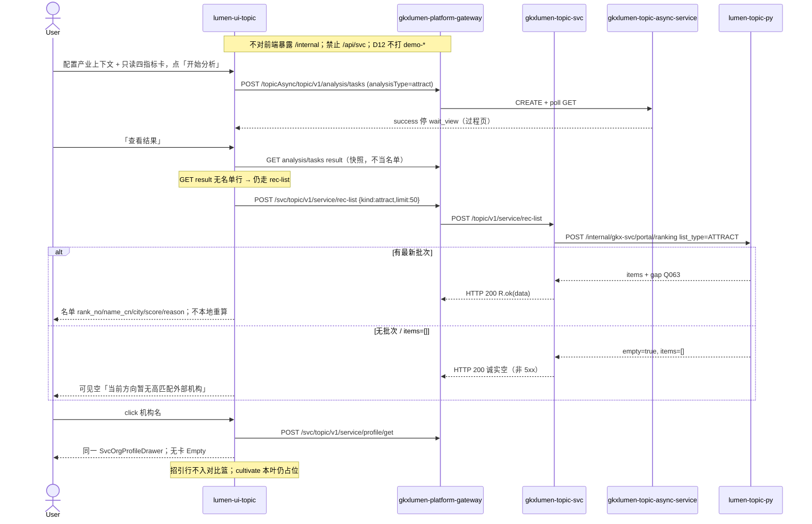

# LUMEN-SVC-P-FE-US-REC-02 · US-SVC-REC-02 招引名单

> 日期：2026-08-21  
> Task：`LUMEN-SVC-P-FE-US-REC-02`  
> 总控：[`LUMEN-SVC-P-长任务总控.md`](./LUMEN-SVC-P-长任务总控.md)（§7 已生效；金路径 #5）  
> 仓：`lumen-ui-topic` · `origin/dev`  
> 复刻真源：`demo-ui-topic` `ServiceRecommendPage.tsx` + `serviceRecommendModel.ts`（只读对照，未贴 JSX、未改 demo）  
> 本仓前置：SHELL `76a590a` · WAITVIEW `7f83a82` · ECO-01 `ebad391` · Java `LUMEN-SVC-P-JAVA-API-REC-LIST-L01`

## 任务认领（必填）

| 字段 | 值 |
|------|-----|
| claimed_by | `agent:frontend-agent` |
| supervised_by | `human:侯佳伟` |
| claim_type | `coordinator_dispatch` |
| 说明 | 长任务 24h 锁；本叶不标 `done` |

## Ponytail（coding 任务必填）

| 字段 | 值 |
|------|-----|
| ponytail | `full` |
| 说明 | 复用 WAITVIEW 过程壳、`IndustryCatalogSelect`、`SvcOrgProfileDrawer`、`@/review`、`request.ts`。未用 YAGNI 跳过 D8 页底 token、D9 ⓘ/角标、D10 评审自闸、可观测 X-Trace-Id、handoff、图即契约、五维复刻、附录 E。未落地 US-SVC-REC-01 权重编辑 / US-03/04 培育。 |

## Headroom（可选）

| 字段 | 值 |
|------|-----|
| headroom | `skip` |
| 说明 | 本机会话未挂载 Headroom MCP。 |

## 图即契约

| 字段 | 值 |
|------|-----|
| diagram_id | `SVC-STORAGE-LINEAGE`（消费，不改工厂边）；`LUMEN-SVC-P-FE-US-REC-02-SEQ`（本叶） |
| 图 diff | LINEAGE 边未改。本叶把招引名单从 SHELL 占位改成实线：`workspace=attract` 经 WAITVIEW 后 POST Java `rec-list` `{kind:"attract"}`，渲染 `items` 或可见空名单。`workspace=cultivate` 仍虚线占位。禁止事项未变：不打 `demo-*`、不本地 Σ 重算、不填华大基因、GET result 不当名单。 |
| 会签态 | `SVC-STORAGE-LINEAGE` 随 `storage/SVC/01-data-flow.md` frontmatter：`approved`（`human:淮政玮` · 2026-08-19 流图；2026-08-20 选 B 增补 LINEAGE，**不改** §1 工厂边）。本叶 SEQ 为 `draft`，禁止自填绿。 |

### L2 消费（不改边）

本叶只读消费 [`storage/SVC/01-data-flow.md`](../../data/data-design/storage/SVC/01-data-flow.md) §1.1 `SVC-STORAGE-LINEAGE`：招引名单读 Demo ADS `svc_attraction_recommend`（外部引进），名称 JOIN `svc_org_card`。前端不扫表、不直连 nGQL、不改工厂边。无批次 → `items=[]` 可见空，不拿 Demo 外部候选 / 华大基因填数。

### L4 本叶 SEQ · `LUMEN-SVC-P-FE-US-REC-02-SEQ`

| 生产者 | 消费者 | 触发 | 失败语义 | 禁止事项 |
|---|---|---|---|---|
| Java `POST /topic/v1/service/rec-list` | 名单结果板 | 「查看结果」后 | HTTP 200 空名单 / FE catch → 可见空，不报 5xx | `/api/svc`；直连 `/internal`；门户 ranking 冒充本叶；GET result 当名单；Demo 四指标重算；华大基因填数 |
| Java `POST\|GET /topicAsync/.../tasks*` | WAITVIEW 过程壳 | 「开始分析」/「重新分析」 | 失败红 alert ≠ 空名单 | 切 workspace/产业自动 CREATE；指纹带产业 |
| Java `POST /topic/v1/service/profile/get` | 机构 Drawer | 机构名 click / `?org=` | 沿用 ORG-03 无卡 Empty | 招引行入对比篮 |
| `M_SVC_REC_ATTRACT_SCORE` | 综合分 ⓘ | 名单行 | Q063 / Q-SVC-010 / Q-SVCCHAIN-05 待核验，不改绿 | D1 改 aligned；页内自造 ⓘ |

## 范围与实现

落地金路径 #5 `US-SVC-REC-02` 招引名单：

1. 路由 `/service/institution-decision?workspace=attract`：`ServiceRecommendAttractWorkspace` 接管同 path；`cultivate` 仍占位空态。
2. 配置区：`IndustryCatalogSelect` + 四指标只读卡（默认 35/30/20/15 + 演示口径声明）+「开始分析」。产业只作上下文，**不**前端过滤出另一套名单。
3. WAITVIEW：点开始才 CREATE `analysisType=attract`；success 停过程页；须点「查看结果」才 POST `rec-list`。切产业/workspace 不自动 create。指纹 `svc|attract|*`（产业不进 fingerprint）。
4. 结果板：只认 Java `items`。列 = `rank_no` / `name_cn` / `city` / `score|attraction_index` / `reason`。没有四指标分列不发明。`empty` / `items=[]` →「当前方向暂无高匹配外部机构」。
5. 综合分旁挂 `@/review`（`M_SVC_REC_ATTRACT_SCORE`；Q063 待核验不改绿）。理由 🧪 走 `MockBadge`，关评审零泄漏。
6. 机构名 click → `?org=` + 已有 `SvcOrgProfileDrawer`。招引行不入对比篮。
7. 有 items 可导出 CSV（实包列 + 演示口径声明行）；空名单不造假文件。
8. Mock 开：`registerApiMock('svcRecList')`，点用 `org-live-1/2`。关：页面不引 `@/mock/**`。
9. `serviceRecommendAttract.selfcheck.mjs` + `vue-tsc --build` 通过。

**非范围**：US-SVC-REC-01 权重可调/归一；US-03/04 培育；入篮；改 Java/Python；宣称 K8s 绿；改 ECO-01 图谱页。

## 偏离说明

- Demo AttractTab 在同屏用 `computeAttractList` 本地加权。本叶按 `/goal` **禁止** Σ 重算，列以 Java 实包为准；四指标卡只读演示口径，不是 US-01 编辑器。
- Demo 开始分析要求已选产业。Java rec-list 不按产业切片，本叶允许未选产业（指纹 `svc|attract|*`），产业仅作上下文。
- 模板 W4「当天已成功直接打开结果」：沿用 WAITVIEW，restore 到过程页再点「查看结果」。
- Demo 名单行展示四指标分。Java 实包无四指标分列，本叶不发明。
- 未做报告阅读器（W3 N/A；本叶区块清单无报告）。

## 复刻五维（R1–R5）

| # | 项 | 结果 |
|---|---|---|
| R1 布局 | 配置 / 过程壳 / 名单结果 / 四指标只读卡 / 记录 Tab；cultivate 独立占位；`v-if` 一节点一套 layout | ✅ |
| R2 交互 | 「开始分析」才 CREATE；查看结果才 rec-list；机构 Drawer；导出 CSV；wait_view 未改 | ✅ |
| R3 样式 | `--sci-bg-page` / `#D8E7FC`；排名行对齐 Demo `svc-rank-row`；主色 `#165DFF` | ✅ |
| R4 评审 | 只从 `@/review`（`SVC-REC-02-*`）；关评审不泄漏 metric_id / GAP-* / Q063 | ✅ |
| R5 Mock | 开：`registerApiMock`。关：页面不引 `@/mock/**`、无页内 `MOCK_`、无华大基因填数 | ✅ |

### 检索皮肤（V1–V7）

本叶是分析工作区，不是检索 Hub。V1 页底必过；V2–V7 N/A。

| # | 结果 |
|---|---|
| V1 页底 `--sci-bg-page` / `#D8E7FC` | ✅ |
| V2–V7 | N/A（查询页） |

### 工作区（W1 / W4）

| # | 项 | 结果 |
|---|---|---|
| W1 | 配置区 / 过程壳 / 名单结果 / 记录 Tab | ✅ |
| W2 | 关系图 | N/A（本叶禁止画图谱） |
| W3 | 报告阅读器 | N/A |
| W4 | 切条件不自动 create；「开始分析」；同指纹一条在跑；当天成功可恢复；「重新分析」可 force | ✅（WAITVIEW：当天成功恢复过程页） |

## 附录 E（I2-12）

| # | 项 | 结果 |
|---|---|---|
| E.1 页清单 | `/service/institution-decision?workspace=attract`（本叶）；cultivate 占位 | ✅ |
| E.2 CTA | 配置区「开始分析」 | ✅ |
| E.3 禁自动 create | 无 `watch → create`；切产业只改 query | ✅ |
| E.4 单飞 | `decideAnalysisTaskGate` + `svc\|attract\|*`；产业不进指纹 | ✅ |
| E.5 当天复用 | `forceCreate=false` restore 过程页；`重新分析` `force=true` | ✅ |
| failed | 过程壳红 alert ≠ 名单空态 | ✅ |

## Design.md §14

页底 token `--sci-bg-page`；主色 `#165DFF`。无 `.ant-` / vendor-antd token。无新地图。综合分旁走 `@/review`，不自造 ⓘ / emoji 角标。

## 测试结果

- `node src/views/service/serviceRecommendAttract.selfcheck.mjs` → `serviceRecommendAttract.selfcheck rec-list ok`
- `node src/router/menu.selfcheck.mjs` → `menu.selfcheck svc-shell ok`
- `vue-tsc --build` → 通过（exit 0）
- 本叶未等 K8s rollout

## 遗留风险

- 现网 ADS 若无招引批次，50892 上会看到诚实空名单，这不是前端 fixture。
- Java Feign 失败回 200 空名单；前端网络失败同样空名单 + 警告，不报 5xx。
- 金路径 #5 仍须 E0 滚出后在 50892 点过一遍（开始分析 → 查看结果 → 空或有名单 → 机构 click）。
- 外部机构多无画像卡，Drawer Empty 是预期。

## CI/CD（必填）

- 分支：`lumen-ui-topic` `origin/dev`（push `ebad391..33141a9`，未 force）
- commit：`33141a9` `feat(svc): add US-SVC-REC-02 attract rec-list workspace [agent:frontend-agent]`
- pipeline URL / ID：GitLab 对 dev 自动建管线（本叶未等绿、未宣称 K8s 已滚出）
- 部署 namespace / 镜像 tag：待 E0 / CI
- K8s rollout：本叶未等
- dev 测试 URL：http://111.198.38.90:50892/service/institution-decision?workspace=attract （需 CI 滚出后可见本叶）
- 本地：`node src/views/service/serviceRecommendAttract.selfcheck.mjs`

## 可观测性

- `svcRecList` / CREATE / GET / RESULT / `profile/get` 均走 `src/utils/request.ts`：`X-Trace-Id` + `traceparent`
- 名单失败展示 `traceId`
- OTEL_SERVICE_NAME：N/A（前端）
- Tempo / Loki：有（平台已有）；本叶无新 span 名

## 架构合规自检

| 铁律 | 结果 |
|------|------|
| 1 算法只在 Python | ✅ 前端无排名算法；只展示 Java 返回值 |
| 2 调用链 FE→Java→Python `/internal` | ✅ 只调 `/svc/topic/v1/service/rec-list` + tasks + profile/get |
| 3 Nebula 非 Neo4j | ✅ 未碰图 |
| 4 可观测 | ✅ request 拦截器 X-Trace-Id |
| 5 CI | ⏳ push 后 |
| 6 demo2 不 merge 进 lumen | ✅ 只读对照 demo-ui-topic |
| 7 共享聚合 / 只调 Java | ✅ 未直连 Python |
| 8 数据 ADS / 无硬 mock | ✅ `USE_MOCK=false` 不填 fixture |
| 9 D8 Design token | ✅ `--sci-bg-page` |
| 10 D9 八件套 / 不自造 ⓘ | ✅ `M_SVC_REC_ATTRACT_SCORE` 走 `@/review`；Q063 不改绿 |
| 11 D10 `@/review` | ✅ |
| 12 D12 不打 demo-* | ✅ |

## Cost

| 字段 | 值 |
|------|-----|
| `actual_tokens` | 230000 |
| `model_used` | `claude-sonnet-4.5`（registry 合法枚举；本会话为 Cursor Grok 4.6，按 Sonnet 价表回填） |
| `actual_cost` | 1.24 |
| `cost_warn` | green |
| 口径 | frontend-agent 80/20；`230000×0.8×3/1e6 + 230000×0.2×15/1e6 = 1.242` 取 `1.24`；`source: session_estimate` |

## 涉及文件

- `lumen-ui-topic` `src/views/service/ServiceRecommendAttractWorkspace.vue`
- `lumen-ui-topic` `src/views/service/svcRecommendAttractModel.ts`
- `lumen-ui-topic` `src/views/service/svcRecommendAttractWorkspace.ts`
- `lumen-ui-topic` `src/views/service/serviceRecommendAttract.css`
- `lumen-ui-topic` `src/views/service/serviceRecommendAttract.selfcheck.mjs`
- `lumen-ui-topic` `src/views/service/ServiceReviewMount.vue`
- `lumen-ui-topic` `src/api/service/{index,paths,types}.ts`
- `lumen-ui-topic` `src/router/menu.ts` + `menu.selfcheck.mjs`
- `lumen-ui-topic` `src/mock/service/recListMock.ts` + `register.ts`
- `lumen-ui-topic` `src/mock/service/svcMetricSeed.ts` / `svcReadinessSeed.ts` / `svcGapCatalog.ts`
- 本 handoff

## 产物清单

- 代码：`33141a9`（`lumen-ui-topic` `dev`）
- 文档：本文件
- 未改：`DefaultLayout.vue`、`industry-center` 业务页、`demo-ui-topic`、Java / Python、ECO-01 图谱页

## 联调确认

联调通过（代码侧）：`workspace=attract` 经 WAITVIEW 后只调 Java `rec-list` 出名单或诚实空；GET result 不当名单；不本地重算；Q063 不改绿；cultivate 仍占位。请 coordinator AV-0，**本叶不自行标 done**。

## Registry（MCP）

`task-update-fields` 写 evidence / note / cost 四字段；`status` 仍为 `in_progress`（未改 done）。禁止手改 `task-registry.yaml`。
