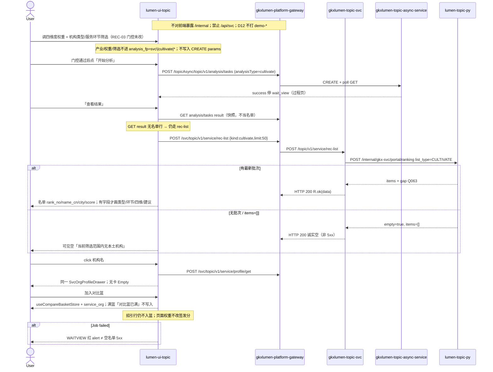

# LUMEN-SVC-P-FE-US-REC-04 · US-SVC-REC-04 培育名单与建议

> 日期：2026-08-22  
> Task：`LUMEN-SVC-P-FE-US-REC-04`  
> 总控：[`LUMEN-SVC-P-长任务总控.md`](./LUMEN-SVC-P-长任务总控.md)（§7 已生效；金路径培育名单）  
> 仓：`lumen-ui-topic` · `origin/dev`  
> 复刻真源：`demo-ui-topic` CultivateTab 名单交互（只读对照，未贴 JSX、未改 demo、未搬 `computeCultivateList` 本地 Σ）  
> 本仓前置：REC-03 `bccdd98` · REC-02 `33141a9` · Java `LUMEN-SVC-P-JAVA-API-REC-LIST-L01`

## 任务认领（必填）

| 字段 | 值 |
|------|-----|
| claimed_by | `agent:frontend-agent` |
| supervised_by | `human:侯佳伟` |
| claim_type | `coordinator_dispatch` |
| 说明 | 长任务 24h 锁；本叶不标 `done`。coordinator 已 MCP `in_progress`。本会话未挂载 task-registry MCP，未手改 yaml。 |

## Ponytail（coding 任务必填）

| 字段 | 值 |
|------|-----|
| ponytail | `full` |
| 说明 | 在 REC-03 cultivate 工作区接名单板；复用招引 rank 行 / CSV / Drawer / `useCompareBasketStore`。未用 YAGNI 跳过 D8 页底 token、D9 GAP 红问号、D10 评审自闸、可观测 X-Trace-Id、handoff、图即契约、五维复刻、附录 E。未自造 `M_SVC_REC_CULTIVATE_SCORE` 进 seed，未挪用 `M_SVC_REC_ATTRACT_SCORE`，未本地 Σ，未改招引 REC-01/02 契约，未改 REC-03 权重/筛选/WAITVIEW 门控。 |

## Headroom（可选）

| 字段 | 值 |
|------|-----|
| headroom | `skip` |
| 说明 | 本机会话未挂载 Headroom MCP。 |

## 图即契约

| 字段 | 值 |
|------|-----|
| diagram_id | `SVC-STORAGE-LINEAGE`（消费，不改工厂边）；`LUMEN-SVC-P-FE-US-REC-04-SEQ`（本叶） |
| 图 diff | LINEAGE 边未改。本叶把 REC-03 结果空位改成实线：`workspace=cultivate` 经 WAITVIEW 后 POST 已有 Java `rec-list` `{kind:"cultivate"}`，渲染 `items` 或可见空名单。不新 Java 路径。禁止事项未变：权重/筛选/产业不进 `analysis_fp`、不写入 CREATE params、不本地 Σ、不按页面筛选裁剪签发名单、不打 `demo-*`、招引行仍不入篮。 |
| 会签态 | `SVC-STORAGE-LINEAGE` 随 `storage/SVC/01-data-flow.md` frontmatter：`approved`（`human:淮政玮` · 2026-08-19 流图；2026-08-20 选 B 增补 LINEAGE，**不改** §1 工厂边）。本叶 SEQ 为 `draft`，禁止自填绿。 |

### L2 消费（不改边）

本叶只读消费 [`storage/SVC/01-data-flow.md`](../../data/data-design/storage/SVC/01-data-flow.md) §1.1 `SVC-STORAGE-LINEAGE`：培育名单 ADS `svc_cultivation_recommend`（深圳本土），名称 JOIN `svc_org_card`。前端不扫表、不直连 nGQL、不改工厂边。名单走已有 Java `POST /topic/v1/service/rec-list`，不新 Java 路径。无批次 → `items=[]` 可见空，不拿 Demo 本土机构 / 华大基因填数。

### L4 本叶 SEQ · `LUMEN-SVC-P-FE-US-REC-04-SEQ`

| 生产者 | 消费者 | 触发 | 失败语义 | 禁止事项 |
|---|---|---|---|---|
| Java `POST /topic/v1/service/rec-list` | 培育名单结果板 | 「查看结果」后 | HTTP 200 空名单 / FE catch → 可见空，不报 5xx | `/api/svc`；直连 `/internal`；TECH ranking 落到 cultivate；GET result 当名单；本地 Σ；页面筛选裁剪签发名单；华大基因填数 |
| Java `POST\|GET /topicAsync/.../tasks*` | WAITVIEW | 「开始分析」/「重新分析」且门控通过 | 失败红 alert ≠ 空名单 | 切权重/筛选/产业自动 CREATE；指纹带产业/权重/筛选 |
| Java `POST /topic/v1/service/profile/get` | 机构 Drawer | 机构名 click / `?org=` | 沿用 ORG-03 无卡 Empty | 招引行入对比篮 |
| `GAP-SVC-REC-CULTIVATE-SCORE` | 综合分红问号 | 名单行 | Q063 / Q-SVCCHAIN-05 待核验，不改绿 | 自造 `M_SVC_REC_CULTIVATE_SCORE` 进 seed；挪用 `M_SVC_REC_ATTRACT_SCORE` |

## 范围与实现

落地 `US-SVC-REC-04` 培育名单与建议，挂 `/service/institution-decision?workspace=cultivate`，把 REC-03 结果区空位换成名单板：

1. 「查看结果」后才 `POST /svc/topic/v1/service/rec-list {kind:cultivate,limit:50}`。GET result 不当名单。指纹仍 `svc|cultivate|*`。切条件/改权重/筛选不自动 CREATE。
2. 只认 Java `items`。列优先 `rank_no` / `name_cn` / city / `score`（或 `cultivation_index`）。类型/环节/四维度分/建议标签/建议文本：有字段才画；没有不发明、不补 0。空名单「当前筛选范围内无本土机构」。
3. 页面权重/筛选不改签发分。结果区 ⚠️「当前为后端签发分，页面权重仅演示配置，未改名单分数」。改配置后若已有名单：黄条「配置已变更」，旧结果可读。
4. 机构名 click → 已有 `SvcOrgProfileDrawer` + `?org=`。培育行可入篮：`useCompareBasketStore` + `SVC_ORG_ELEMENT_KEY='service_org'`。满篮 Message「对比篮已满」不写入。招引行仍不入篮。
5. 有 items 可导出 CSV（实包列 + 演示口径声明）；空名单不造假文件。
6. 评审：不自造 `M_SVC_REC_CULTIVATE_SCORE` 进 seed，不挪用招引综合分。沿用 `GAP-SVC-REC-CULTIVATE-SCORE` 红问号。`Q063` / `Q-SVCCHAIN-05` 不改绿。关评审零泄漏。建议标签若有则 🧪 MockBadge。
7. Mock 开：`registerApiMock('svcRecList')` 培育 kind 返回契约形 `org-live-3/4`（深圳本土语义）。关：页面不引 `@/mock/**`。
8. 页底 `--sci-bg-page`。筛选全空仍由 REC-03 禁用开始。前端不用页面筛选本地裁剪签发名单。

**非范围**：改招引 REC-01/02 契约；改 REC-03 权重/筛选/WAITVIEW 门控；派 Python 改培育模型；TECH ranking 落到 cultivate；本地 Σ；宣称 K8s 绿；改 `industry-center` / `demo-ui-topic`。

## 偏离说明

- USM「Σ 综合分」以 Java `score`（或 `cultivation_index`）为准，前端不按四维度×权重重算。
- Demo CultivateTab 用 `computeCultivateList` 出类型/环节/四维分/一企一策建议。Java 实包无这些字段则诚实不发明、不补 0、不搬 Demo 规则。
- 培育行可入篮（对照查询页 `addToBasket`）；招引行仍不入篮。
- Java rec-list 不按类型/环节切片。页面筛选只作开始分析门控，不二次伪造过滤。
- 权重与筛选 **不进** 指纹。改筛选会复用当天同指纹任务；须「重新分析」才新建 Job。
- Q063 / Q-SVCCHAIN-05 **不改绿**。仓内无 `M_SVC_REC_CULTIVATE_SCORE` 种子，不自造、不挪用招引综合分。
- 未做报告阅读器（W3 N/A）。模板 W2 关系图 N/A。
- 按钮文案沿用 WAITVIEW「开始分析」，无单独「生成培育名单」。

## 复刻五维（R1–R5）

| # | 项 | 结果 |
|---|---|---|
| R1 布局 | 配置区四卡+筛选 + 过程壳 + 名单结果板 + 记录 Tab；招引仍独立名单页 | ✅ |
| R2 交互 | 查看结果才 rec-list；机构 Drawer；可入篮；导出 CSV；配置脏黄条；Job failed 走 WAITVIEW | ✅ |
| R3 样式 | `--sci-bg-page` / `#D8E7FC`；排名行对齐招引 `svc-rec-rank-row`；主色 `#165DFF` | ✅ |
| R4 评审 | 只从 `@/review`（`SVC-REC-04-*` + 沿用 REC-03 GAP）；关评审不泄漏 metric_id / GAP-* / Q063 | ✅ |
| R5 Mock | 开：`registerApiMock` 培育 kind 出 `org-live-*`。关：页面不引 `@/mock/**`、无页内 `MOCK_`、无华大基因填数 | ✅ |

### 检索皮肤（V1–V7）

本叶是分析工作区，不是检索 Hub。V1 页底必过；V2–V7 N/A。

| # | 结果 |
|---|---|
| V1 页底 `--sci-bg-page` / `#D8E7FC` | ✅ |
| V2–V7 | N/A（查询页） |

### 工作区（W1 / W4）

| # | 项 | 结果 |
|---|---|---|
| W1 | 配置区 / 过程壳 / 名单结果板 / 记录 Tab | ✅ |
| W2 | 关系图 | N/A |
| W3 | 报告阅读器 | N/A |
| W4 | 切条件/改权重/筛选不自动 create；「开始分析」；同指纹一条在跑；当天成功可恢复；「重新分析」可 force | ✅ |

## 附录 E（I2-12）

| # | 项 | 结果 |
|---|---|---|
| E.1 页清单 | `/service/institution-decision?workspace=cultivate`（本叶） | ✅ |
| E.2 CTA | 配置区「开始分析」（合计=100 且筛选非空才可点） | ✅ |
| E.3 禁自动 create | 无 `watch → create`；改权重/筛选/产业只改 query | ✅ |
| E.4 单飞 | `decideAnalysisTaskGate` + `svc\|cultivate\|*`；产业/权重/筛选不进指纹 | ✅ |
| E.5 当天复用 | `forceCreate=false` restore 过程页；`重新分析` `force=true` | ✅ |
| failed | 过程壳红 alert ≠ 空名单 | ✅ |

## Design.md §14

页底 token `--sci-bg-page`；主色 `#165DFF`；控件高走 Arco Button / Tag / Spin 默认 32px。无 `.ant-` / vendor-antd token。无新地图。培育综合分走 `@/review` GAP 红问号，不自造 ⓘ / emoji 角标。警告色用 Arco warning，不是涨跌方向色。

## 测试结果

- `node src/views/service/serviceRecCultivate.selfcheck.mjs` → `serviceRecCultivate.selfcheck ok`
- `node src/views/service/serviceRecAttractWeight.selfcheck.mjs` → `serviceRecAttractWeight.selfcheck ok`
- `node src/views/service/serviceRecommendAttract.selfcheck.mjs` → `serviceRecommendAttract.selfcheck rec-list ok`
- `node src/router/menu.selfcheck.mjs` → `menu.selfcheck svc-shell ok`
- `npx vue-tsc --build` → 通过（exit 0）
- 本叶未等 K8s rollout

## 遗留风险

- 现网 ADS 若无培育批次，50892 上会看到诚实空名单「当前筛选范围内无本土机构」，这不是 5xx，也不是前端 fixture。
- Java 实包若无类型/环节/四维分/建议字段，名单只画 rank / 名称 / 城市 / 签发分；不要当成漏复刻 Demo 一企一策。
- 改筛选不换指纹：当天已成功任务会 restore 过程页，须点「重新分析」才新建 Job；旧名单可读并出「配置已变更」。
- Q063 / Q-SVCCHAIN-05 闭合前不得把演示权重当正式模型。
- 金路径仍须 E0 滚出后在 50892 点过一遍（开始分析 → 查看结果 → 空或有名单 → 机构 click → 入篮）。

## CI/CD（必填）

- 分支：`lumen-ui-topic` `origin/dev`（push `bccdd98..2bb8dba`，未 force）
- commit：`2bb8dba` `feat(svc): add US-SVC-REC-04 cultivate rec-list board [agent:frontend-agent]`
- pipeline URL / ID：GitLab 对 dev 自动建管线（本叶未等绿、未宣称 K8s 已滚出）
- 部署 namespace / 镜像 tag：待 E0 / CI
- K8s rollout：本叶未等
- dev 测试 URL：http://111.198.38.90:50892/service/institution-decision?workspace=cultivate （需 CI 滚出后可见本叶）
- 本地：`node src/views/service/serviceRecCultivate.selfcheck.mjs`

## 可观测性

- `svcRecList` / CREATE / GET / RESULT / `profile/get` 均走 `src/utils/request.ts`：`X-Trace-Id` + `traceparent`
- 名单失败展示 `traceId`
- OTEL_SERVICE_NAME：N/A（前端）
- Tempo / Loki：有（平台已有）；本叶无新 span 名

## 架构合规自检

| 铁律 | 结果 |
|------|------|
| 1 算法只在 Python | ✅ 前端无排名算法；不本地 Σ；只展示 Java score |
| 2 调用链 FE→Java→Python `/internal` | ✅ 只调已有 rec-list + tasks + profile/get；无第二张 Java/Python 单 |
| 3 Nebula 非 Neo4j | ✅ 未碰图 |
| 4 可观测 | ✅ request 拦截器 X-Trace-Id |
| 5 CI | ⏳ push 后 |
| 6 demo2 不 merge 进 lumen | ✅ 只读对照 demo-ui-topic |
| 7 共享聚合 / 只调 Java | ✅ 未直连 Python |
| 8 数据 ADS / 无硬 mock | ✅ `USE_MOCK=false` 不填 fixture |
| 9 D8 Design token | ✅ `--sci-bg-page` |
| 10 D9 八件套 / 不自造 ⓘ | ✅ `GAP-SVC-REC-CULTIVATE-SCORE`；未造 `M_SVC_REC_CULTIVATE_SCORE`；Q063 不改绿 |
| 11 D10 `@/review` | ✅ |
| 12 D12 不打 demo-* | ✅ |

## Cost

| 字段 | 值 |
|------|-----|
| `actual_tokens` | 260000 |
| `model_used` | `claude-sonnet-4.5`（registry 合法枚举；本会话为 Cursor Grok 4.6，按 Sonnet 价表回填） |
| `actual_cost` | 1.40 |
| `cost_warn` | green |
| 口径 | frontend-agent 80/20；`260000×0.8×3/1e6 + 260000×0.2×15/1e6 = 1.404` 取 `1.40`；`source: session_estimate` |

## 涉及文件

- `lumen-ui-topic` `src/views/service/ServiceRecommendCultivateWorkspace.vue`
- `lumen-ui-topic` `src/views/service/svcRecommendCultivateModel.ts`
- `lumen-ui-topic` `src/views/service/serviceRecommendAttract.css`
- `lumen-ui-topic` `src/views/service/serviceRecCultivate.selfcheck.mjs`
- `lumen-ui-topic` `src/views/service/ServiceReviewMount.vue`
- `lumen-ui-topic` `src/api/service/types.ts`（培育等价键可选字段）
- `lumen-ui-topic` `src/mock/service/recListMock.ts`（仅 mock 目录）
- `lumen-ui-topic` `src/mock/service/svcGapCatalog.ts`（GAP 文案，未写 CULTIVATE_SCORE seed）
- 本 handoff

## 产物清单

- 代码：`2bb8dba`（`lumen-ui-topic` `dev`）
- 文档：本文件
- 未改：`DefaultLayout.vue`、`industry-center`、`demo-ui-topic`、Java / Python、招引 REC-01/02 契约、REC-03 权重/筛选/WAITVIEW 门控

## 联调确认

联调通过（代码侧）：`workspace=cultivate` 经 WAITVIEW 后只调 Java `rec-list` kind=cultivate 出名单或诚实空；GET result 不当名单；不本地 Σ；无四维分/建议字段则诚实不发明；培育行可入篮、招引行仍不入篮；Q063 / Q-SVCCHAIN-05 不改绿；招引 REC-01/02 自检仍绿。请 coordinator AV-0，**本叶不自行标 done**。

## Registry（MCP）

本会话未挂载 `task-registry` MCP。`status` 仍为 `in_progress`（未改 done）。禁止手改 `task-registry.yaml`。请 coordinator 代写 evidence / note / cost 四字段。
