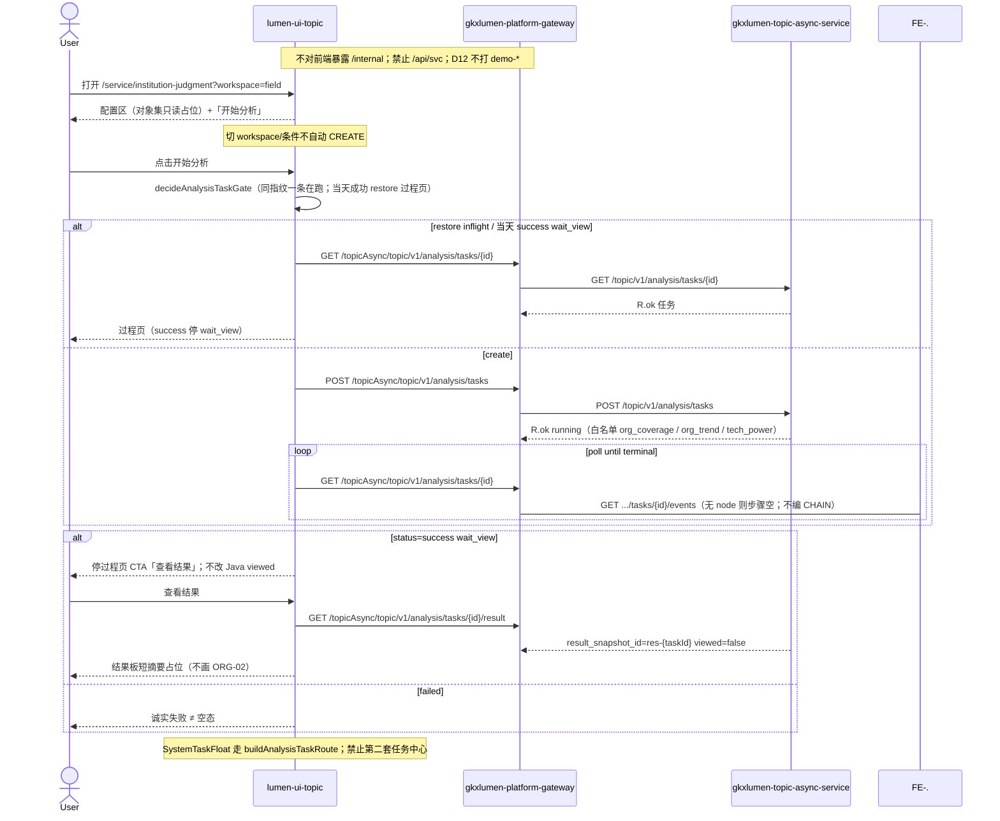

# LUMEN-SVC-P-FE-WAITVIEW-L01 · SVC 分析过程 / wait_view 壳

> 日期：2026-08-21  
> Task：`LUMEN-SVC-P-FE-WAITVIEW-L01`  
> 总控：[`LUMEN-SVC-P-长任务总控.md`](./LUMEN-SVC-P-长任务总控.md)（§7 已生效；金路径 #3 前置）  
> 仓：`lumen-ui-topic` · `origin/dev`  
> 复刻真源：`demo-ui-topic` `analysisTaskGate` / 企业·产业链过程页（只读对照，未贴 JSX、未改 demo）  
> 本仓对照：`SystemTaskFloat` / `composables/analysisTaskGate.ts` / `analysisTaskRoutes.ts`

## 任务认领（必填）

| 字段 | 值 |
|------|-----|
| claimed_by | `agent:frontend-agent` |
| supervised_by | `human:侯佳伟` |
| claim_type | `coordinator_dispatch` |
| 说明 | 长任务 24h 锁；本叶不标 `done` |

## Ponytail（coding 任务必填）

| 字段 | 值 |
|------|-----|
| ponytail | `full` |
| 说明 | 复用已有 `analysisTask*` / `SystemTaskFloat` / `decideAnalysisTaskGate` / `@/review` / `WorkbenchTabs`。未用 YAGNI 跳过 D8 页底 token、D9 不自造 ⓘ、D10 评审自闸、可观测 `request.ts` X-Trace-Id、handoff、图即契约、五维复刻、附录 E。 |

## Headroom（可选）

| 字段 | 值 |
|------|-----|
| headroom | `skip` |
| 说明 | 本机会话未挂载 Headroom MCP。 |

## 图即契约

| 字段 | 值 |
|------|-----|
| diagram_id | `SVC-STORAGE-LINEAGE`（消费，不改工厂边）；`LUMEN-SVC-P-FE-WAITVIEW-L01-SEQ`（本叶） |
| 图 diff | LINEAGE 边未改。本叶把 WAITVIEW 过程壳改成实线：50892 FE → gateway `/topicAsync/**` → `gkxlumen-topic-async-service` CREATE/GET/RESULT。EVENTS 可调、无 node 则步骤空（虚线不编 CHAIN 阶段）。ORG-01 对象集 / ORG-02 业务图仍虚线。禁止事项未变：不打 `demo-*`、不改 Java `viewed`、不改 CHAIN type、不填 Demo fixture。 |
| 会签态 | `SVC-STORAGE-LINEAGE` 随 `storage/SVC/01-data-flow.md` frontmatter：`approved`（`human:淮政玮` · 2026-08-19 流图；2026-08-20 选 B 增补 LINEAGE，**不改** §1 工厂边）。本叶 SEQ 为 `draft`，禁止自填绿。 |

### L2 消费（不改边）

本叶只读消费 [`storage/SVC/01-data-flow.md`](../../data/data-design/storage/SVC/01-data-flow.md) §1.1 `SVC-STORAGE-LINEAGE`：分析任务经 Java Job 读 CREATE 已签发的 snapshot；十模型 ADS 仍在 create 下游 svcan 只读。前端不扫表、不直连 nGQL、不改工厂边。

### L4 本叶 SEQ · `LUMEN-SVC-P-FE-WAITVIEW-L01-SEQ`

| 生产者 | 消费者 | 触发 | 失败语义 | 禁止事项 |
|---|---|---|---|---|
| `lumen-ui-topic` 配置区「开始分析」 | `gkxlumen-topic-async-service` CREATE | 用户点击 CTA | 未知 type / 创建失败 → 页内 error + traceId；不自动重试 CREATE | 切条件自动 create；改 CHAIN type；`/api/svc` |
| Java GET detail | 过程壳 poll | running/queued 每 4s | 未知 id / 无权 → 诚实失败；events `[]` → 步骤空态可见 | 编 CHAIN 阶段；SSE 假进度 |
| Java GET result | 结果板占位 | 仅用户点「查看结果」 | 无 snapshot → 可见「尚未取得」；failed 不走结果板 | 为进结果改 Java `viewed`；画 ORG-02 / ECO 图 |
| `SystemTaskFloat` | 当前用户 | CREATE `notifySystemTaskCreated` | 浮层点「查看结果」进 wait_view 过程页（未本地 viewed） | 第二套任务中心 |

## 范围与实现

主路由 `/service/institution-judgment?workspace=field`（trend/capability 同壳切 workspace）。`analysisType` 就近读面：`org_coverage` / `org_trend` / `tech_power`。

区块清单（已落地）：

1. **配置区**：分析对象集只读占位（「待 ORG-01 组装」）+ 条件栏 **「开始分析」**；切 workspace/条件 **不**自动 create
2. **过程壳**：poll GET；running/queued 显示进行中；events `[]` 步骤空态可见，不编 CHAIN 阶段
3. **wait_view**：`status=success` 停过程页；CTA「查看结果」才 GET result / `view=result`
4. **结果板占位**：短摘要证明已取 snapshot（`result_snapshot_id` / `page_mode_hint`）；**未**画 ORG-02 领域覆盖 / ECO 图谱
5. **记录/浮层**：复用 `SystemTaskFloat`；`buildAnalysisTaskRoute` 接到 `/service/institution-judgment?...&view=processing|result&task_id=`；无第二套任务中心
6. **附录 E**：同用户同条件指纹只一条在跑；当天已成功 restore **到过程页**等用户点查看；「重新分析」`forceCreate`；failed 诚实失败 ≠ 空态
7. **页底** `--sci-bg-page` / `#D8E7FC`；评审只走 `@/review`（mount：`SVC-ORG-WAIT-TITLE` / `CONFIG` / `PROCESS` / `RESULT` / `RECORDS`）
8. **`USE_MOCK=false`** 不填 Demo fixture。Mock 开时既有 `registerApiMock` 形状=Java 任务实体（含 `process_succeeded_wait_view` / `res-{taskId}` / `viewed=false`）；SVC events 返回 `[]`

**非范围**：ORG-01 对象集组装、ORG-02 业务图、ORG-08 篮面板、PT-02…06、ECO-01、改 `industry-center`、改 `DefaultLayout.vue`。

## 偏离说明

- 模板 W4 写「当天已成功直接打开结果」；本叶按金路径 #3 / 派单 wait_view：**restore 到过程页**，必须再点「查看结果」。浮层成功且本地未 viewed 同样落到 `view=processing`。
- 未接 `analysisTaskStream`（SSE），避免无 node 时编假阶段。
- 对象集指纹暂为 `svc|{workspace}|placeholder`（ORG-01 到位后再纳入真实对象集）。

## 复刻五维（R1–R5）

| # | 项 | 结果 |
|---|---|---|
| R1 布局 | 配置区 / 过程壳 / 结果占位 / 记录 Tab 都有结构；`v-if`/`v-else-if` 一节点一套 layout | ✅ |
| R2 交互 | 空配置提示、loading、failed 诚实失败、wait_view、有 snapshot、条件不脏不自动 create | ✅ |
| R3 样式 | `--sci-bg-page` / `#D8E7FC`；面板走 `--sci-surface-main`；与企业/产业链同壳 | ✅ |
| R4 评审 | 只从 `@/review` 挂点（上列 5 个 mount-id）；关评审不渲染 metric_id / GAP-* / Q0xx | ✅ |
| R5 Mock | 开：既有 `registerApiMock`（`analysisTaskCreate/Detail/Result/Events`）。关：页面不引 `@/mock/**`、无 `MOCK_`、无华大基因 fixture | ✅ |

### 检索皮肤（V1–V7）

本叶是分析工作区，不是检索 Hub。V1 页底必过；V2–V7 N/A。

| # | 结果 |
|---|---|
| V1 页底 `--sci-bg-page` / `#D8E7FC` | ✅ |
| V2–V7 | N/A（查询页） |

### 工作区（W1 / W4）

| # | 项 | 结果 |
|---|---|---|
| W1 | 配置区 / 过程壳 / 结果板占位 / 记录 Tab | ✅（结果板仅为 snapshot 证明；业务图留给 ORG-02） |
| W2 | 关系图 | N/A（本叶禁止画 ECO/覆盖图） |
| W3 | 报告阅读器 | N/A |
| W4 | 切条件不自动 create；「开始分析」；同指纹一条在跑；当天成功可恢复；「重新分析」可 force | ✅（恢复目标=过程页 wait_view，见偏离） |

## 附录 E（I2-12）

| # | 项 | 结果 |
|---|---|---|
| E.1 页清单 | `/service/institution-judgment?workspace=field\|trend\|capability` | ✅ |
| E.2 CTA | 配置区「开始分析」 | ✅ |
| E.3 禁自动 create | 无 `watch(workspace → create)`；只 `refreshGate` | ✅ |
| E.4 单飞 | `decideAnalysisTaskGate` + Mock 同指纹 running 复用 | ✅ |
| E.5 当天复用 | `forceCreate=false` restore 过程页；`重新分析` `force=true` | ✅ |
| failed | 红 alert + 返回配置；≠ 空态 | ✅ |

## Design.md §14

工作区无新图表色/新控件色。页底 token `--sci-bg-page`；主色仍 `#165DFF`（Arco primary）。无 `.ant-` / vendor-antd token。无 KPI 卡、无地图（本叶 N/A）。无统计数字，不自造 ⓘ。

## 测试结果

- `node src/views/service/serviceOrgAnalysis.selfcheck.mjs` → `serviceOrgAnalysis.selfcheck wait_view ok`
- `node src/router/menu.selfcheck.mjs` → `menu.selfcheck svc-shell ok`
- `vue-tsc --build` → 通过（exit 0）
- 本叶未等 K8s rollout；Java CREATE/GET/RESULT 已由对应 C 叶交付，前端按契约接线

## 遗留风险

- 对象集仍是占位指纹；ORG-01 组装后需把真实对象集纳入 `analysis_fp`，否则同 workspace 会互相复用。
- 任务列表无 type 过滤、size=50：用户企业任务很多时，当天 SVC 成功可能不在第一页（客户端 `svcAnalysisTypesMatch` 过滤）。
- EVENTS 叶若后续返回 node，过程条会从空态变为真实步骤；本叶不预编阶段。
- 金路径 #3 仍须 E0 滚出后在 50892 点过一遍。

## CI/CD（必填）

- 分支：`lumen-ui-topic` `origin/dev`
- commit：`7f83a82`
- pipeline URL / ID：push 后由 GitLab 生成（本机提交时未取到 pipeline id）
- 部署 namespace / 镜像 tag：待 E0 / CI
- K8s rollout：本叶未等
- dev 测试 URL / 命令与结果：已发布前端 http://111.198.38.90:50892/service/institution-judgment?workspace=field （需 CI 滚出后可见本叶）。本地：`node src/views/service/serviceOrgAnalysis.selfcheck.mjs`

## 可观测性

- 走已有 `src/utils/request.ts`：`X-Trace-Id` + `traceparent`（`createTraceId` / `createTraceparent`）。CREATE/GET/RESULT 均经该拦截器。
- 失败态展示 `errorTraceId`。
- OTEL_SERVICE_NAME：N/A（前端）
- Tempo / Loki：有（平台已有）；本叶无新 span 名

## 架构合规自检

| 铁律 | 结果 |
|------|------|
| 1 算法只在 Python | ✅ 前端无算法 |
| 2 调用链 FE→Java→Python `/internal` | ✅ 只调 `/topicAsync/topic/v1/analysis/tasks*` |
| 3 Nebula 非 Neo4j | ✅ 未碰图 |
| 4 可观测 | ✅ request 拦截器 X-Trace-Id |
| 5 CI | ⏳ push 后 |
| 6 demo2 不 merge 进 lumen | ✅ 只读对照 demo-ui-topic |
| 7 共享聚合 / 只调 Java | ✅ 未直连 Python |
| 8 数据 ADS / 无硬 mock | ✅ `USE_MOCK=false` 不填 fixture |
| 9 D8 Design token | ✅ `--sci-bg-page` |
| 10 D9 八件套 / 不自造 ⓘ | ✅ 无统计数字；评审走 `@/review` |
| 11 D10 `@/review` | ✅ |
| 12 D12 不打 demo-* | ✅ |

## Cost

| 字段 | 值 |
|------|-----|
| `actual_tokens` | 200000 |
| `model_used` | `claude-sonnet-4.5`（registry 合法枚举；本会话为 Cursor Grok 4.6，按 Sonnet 价表回填） |
| `actual_cost` | 1.08 |
| `cost_warn` | green |
| 口径 | frontend-agent 80/20；`200000×0.8×3/1e6 + 200000×0.2×15/1e6 = 1.08`；`source: session_estimate` |

## 涉及文件

- `lumen-ui-topic` `src/views/service/ServiceOrgAnalysisWorkspace.vue`
- `lumen-ui-topic` `src/views/service/ServiceAnalysisProcessShell.vue`
- `lumen-ui-topic` `src/views/service/svcAnalysisWorkspace.ts`
- `lumen-ui-topic` `src/views/service/serviceOrgAnalysis.css`
- `lumen-ui-topic` `src/composables/useSvcAnalysisJob.ts`
- `lumen-ui-topic` `src/composables/analysisTaskGate.ts`
- `lumen-ui-topic` `src/composables/analysisTaskRoutes.ts`
- `lumen-ui-topic` `src/api/enterprise/types/analysisTask.ts`
- `lumen-ui-topic` `src/mock/enterprise/analysisTaskStore.ts`（仅 `registerApiMock` 形状）
- `lumen-ui-topic` `src/router/menu.ts`
- `lumen-ui-topic` `src/views/service/ServiceReviewMount.vue`
- 本 handoff

## 产物清单

- 代码：`7f83a82`（`lumen-ui-topic` `dev`）
- 文档：本文件
- 未改：`DefaultLayout.vue`、`industry-center` 业务页、`demo-ui-topic`、CHAIN `analysisType`

## 联调确认

联调通过（代码侧）：开始分析 → poll GET → success 停 wait_view → 点查看结果才 GET result；附录 E 单飞/当天恢复/force；failed ≠ 空态。请 coordinator AV-0，**本叶不自行标 done**。

## Registry（MCP）

`task-update-fields` 写 evidence / note / cost 四字段；`status` 仍为 `in_progress`（未改 done）。禁止手改 `task-registry.yaml`。
