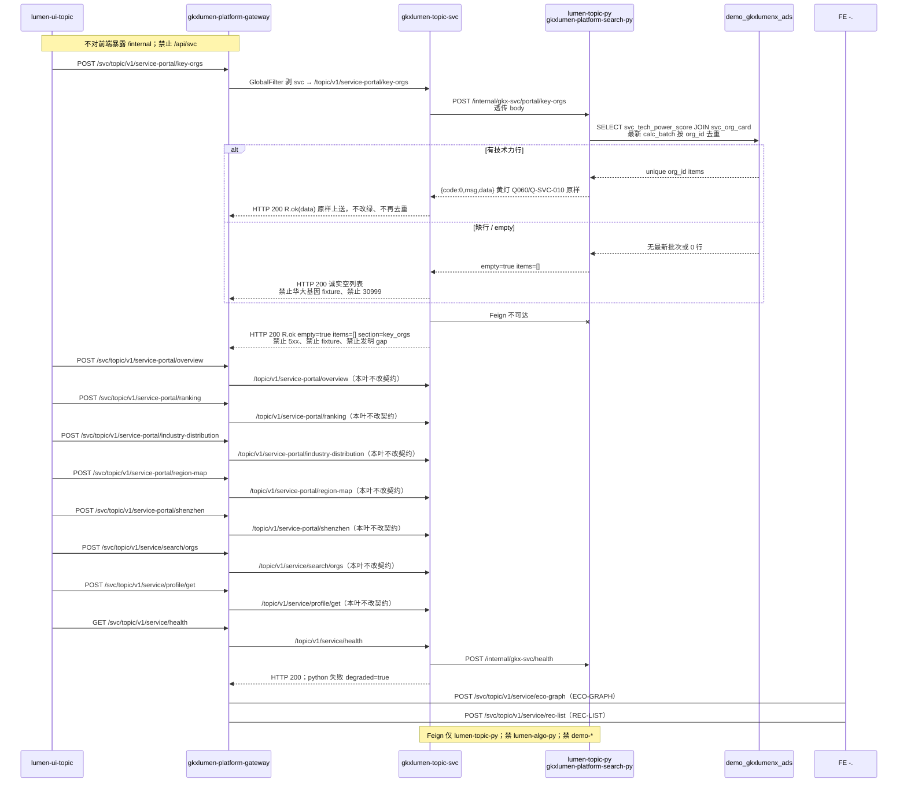

# LUMEN-SVC-P-JAVA-API-PORTAL-KEYORG-L01 · POST /topic/v1/service-portal/key-orgs

> 日期：2026-08-21  
> Task：`LUMEN-SVC-P-JAVA-API-PORTAL-KEYORG-L01`  
> 总控：[`LUMEN-SVC-P-长任务总控.md`](./LUMEN-SVC-P-长任务总控.md)（§7 已生效）  
> 仓：`lumen-svc-platform` · `origin/dev`  
> 故事：`US-SVC-PT-06`（本叶只出门户重点机构 REST，不做 50892 前端）

## 任务认领（必填）

| 字段 | 值 |
|------|-----|
| claimed_by | `agent:api-agent` |
| supervised_by | `human:侯佳伟` |
| claim_type | `coordinator_dispatch` |
| 说明 | 长任务 24h 锁；未自行标 `done` |

## Ponytail（coding 任务必填）

| 字段 | 值 |
|------|-----|
| ponytail | `full` |
| 说明 | 复用 SZ 的 `gkxlumen-topic-svc` 门面 + Feign；只加一条 REST。未用 YAGNI 跳过 OTel、空态诚实、handoff、图即契约、D9。Java 不查 ADS、不按 org_id 再去重、不填华大基因 fixture。 |

## Headroom（可选）

| 字段 | 值 |
|------|-----|
| headroom | `skip` |
| 说明 | 本机会话未挂载 Headroom MCP。 |

## 图即契约

| 字段 | 值 |
|------|-----|
| diagram_id | `SVC-STORAGE-LINEAGE`（消费，不改工厂边）；`LUMEN-SVC-P-JAVA-API-PORTAL-KEYORG-L01-SEQ`（本叶重点机构） |
| 图 diff | LINEAGE 边未改。本叶把 SZ SEQ 的 portal key-orgs 虚线改成实线：50892 → gateway `/svc/**` → `gkxlumen-topic-svc` `POST /topic/v1/service-portal/key-orgs` → `lumen-topic-py` `POST /internal/gkx-svc/portal/key-orgs` → ADS 技术力按 `org_id` 去重 JOIN `svc_org_card`。ECO-GRAPH / REC-LIST 仍虚线。禁止事项未变：不写正式库、对拍前不写 Demo ADS/图、不对前端暴露 `/internal`、禁 Feign `lumen-algo-py` 与 `demo-*`、禁 `/api/svc`、禁 Java fixture / 华大基因 / 30999 填数。 |
| 会签态 | `SVC-STORAGE-LINEAGE` 随 `01-data-flow.md` frontmatter：`approved`（`human:淮政玮` · 2026-08-19 流图；2026-08-20 选 B 增补 LINEAGE，**不改** §1 工厂边） |

### L2 消费（不改边）

本叶只读消费 [`storage/SVC/01-data-flow.md`](../../data/data-design/storage/SVC/01-data-flow.md) §1.1 `SVC-STORAGE-LINEAGE`：线上重点机构读十模型 `svc_tech_power_score`（最新 `calc_batch_id`）JOIN `svc_org_card` 出名称，按 `org_id` 去重；**不联 ODS**。Java **不扫表**；经 Feign 让 `lumen-topic-py` SELECT。缺行则 `items=[]` `empty=true`。不写工厂边、不灌数。

### L4 本叶 SEQ · `LUMEN-SVC-P-JAVA-API-PORTAL-KEYORG-L01-SEQ`

| 生产者 | 消费者 | 触发 | 失败语义 | 禁止事项 |
|---|---|---|---|---|
| `gkxlumen-topic-svc` portal/key-orgs | 50892 经网关 | 在线 POST `/topic/v1/service-portal/key-orgs` | Python 空 → HTTP 200 `empty=true` `items=[]`；Feign 失败同左，**不** 5xx、**不** fixture、**不** 华大基因 | `/api/svc`；Java 查 ADS / 再去重 / 填名单；把 SVC 塞进薄 `gkxlumen-topic` |
| `lumen-topic-py` `POST /internal/gkx-svc/portal/key-orgs` | 本叶 Feign | Java 透传 body | 连不上 → 诚实空 items；有行则黄灯 Q060 / Q-SVC-010 原样透传，不改绿 | Feign `lumen-algo-py`；Feign `demo-*`；对前端暴露 `/internal`；30999 常量填数；Java 改写 items |
| ADS `svc_tech_power_score` JOIN `svc_org_card`（Python 读） | 门户重点机构 | 最新批次按 `org_id` 去重才出 items | 缺行 = 空列表，不用华大基因冒充重点机构 | 本叶写 Demo ADS/图；扫 DWD；直连 nGQL；扩 async-service |
| overview + ranking + industry-distribution + region-map + shenzhen + search/orgs + profile/get + health（已有） | 自检 | 本叶不改 | empty / kpi omit / items=[] / by_service_type=[] / china=[] / districts=[] / data=null / degraded 契约保持 | 本叶改坏 overview KPI、ranking items、industry 六类、region 省/国、shenzhen 规模、search empty、profile null 或 health degraded |

## 范围与实现

在 SZ 模块上只加一条门户重点机构 REST：

- `POST /topic/v1/service-portal/key-orgs`（网关外网 `/svc/topic/v1/service-portal/key-orgs`）
- Feign `POST /internal/gkx-svc/portal/key-orgs`，body 原样透传
- 拆 Python `{code,msg,data}` 后 `R.ok(data)`；`items` / `empty` / `gap` / `pending_client_confirm` 不改写；不去重、不改绿
- Feign 失败：HTTP 200 + `empty=true` + `items=[]` + `section=key_orgs`，不填「华大基因」、不用 30999、不发明 `gap`
- overview、ranking、industry-distribution、region-map、shenzhen、search/orgs、profile/get、health 未改

**非范围**：ECO-GRAPH；REC-LIST；TASK-* / CHAIN / async-service；改 Python / 前端；写 Demo ADS/图。

## 偏离说明

- PATH 上默认 `mvn` 仍是 3.6.2（compiler-plugin 3.14.0 要求 ≥3.6.3）。本叶用本机 `D:\temp\apache-maven-3.9.9` + Zulu 17 跑通模块单测。
- Feign 失败时 Java **不发明** `gap: Q060` / `Q-SVC-010`（黄灯只随 Python 包络透传）；只给诚实空 `items=[]`。
- 不把旧 `LUMEN-SVC-JAVA-*` 当 `depends_on`。

## 产物清单

| 产物 | 路径 |
|------|-----|
| Controller | `repos/lumen-svc-platform/gkxlumen-topic-svc/gkxlumen-topic-svc-biz/.../ServicePortalFacadeController.java` |
| Feign | `.../feign/RemoteSvcPythonClient.java` · api `RemoteTopicSvcService.java` |
| 透传 | `.../service/impl/ServiceFacadeServiceImpl.java` |
| 测试 | `ServiceFacadeControllerTest` · `ServiceFacadeServiceImplTest` |
| 本 handoff | `agent-handoffs/服务机构-SVC/LUMEN-SVC-P-JAVA-API-PORTAL-KEYORG-L01.md` |

## 测试结果

- [x] MockMvc：`POST /topic/v1/service-portal/key-orgs` 透传按 org_id 去重后的包络；empty 不造华大基因；Feign 失败不造假；overview、ranking、industry-distribution、region-map、shenzhen、search/orgs、profile/get 与 health 仍映射
- [x] 服务单测：Python 去重后 items + Q060/Q-SVC-010 透传不改绿；empty 不填华大基因；Feign 5xx → `R.code=0` + `items=[]` 无 gap；overview omit、ranking items、industry 六类、region 省/国、shenzhen 规模、search empty、profile null 与 health degraded 契约未改
- [x] 本机 `mvn`（3.9.9 + Zulu 17）：`ServiceFacadeControllerTest` 26 · `ServiceFacadeServiceImplTest` 31，合计 57 Tests run, Failures: 0

## 验收证据

- [x] POST `/topic/v1/service-portal/key-orgs` 经 Feign 打 `lumen-topic-py` `/internal/gkx-svc/portal/key-orgs`；技术力按 org_id 去重透传；缺行诚实空，禁华大基因 fixture
- [x] 禁 `/api/svc`；禁 Feign `lumen-algo-py` 与 `demo-*`；不改 overview/ranking/industry/region/shenzhen 契约
- [x] handoff 含 ponytail: full、cost 四字段、diagram_id、SEQ
- [x] `origin/dev` `5aa8a9e`；未标 `done`

## 遗留风险

- K8s 未注入 Python/MySQL 时重点机构为 `empty` / 空列表（预期）；前端 D 叶须按空态展示，不能当 5xx，不能自行补华大基因。
- `deploy:topic-svc` / 网关 Nacos 种子仍可能未灌；本叶不宣称 K8s rollout 已绿（E0 另叶）。
- ECO-GRAPH / REC-LIST 仍未出门面（留给后续叶，预期）。

## CI/CD（必填）

- 分支：`origin/dev`（`lumen-svc-platform`）
- commit：`5aa8a9e` `feat(svc): add POST /topic/v1/service-portal/key-orgs [agent:api-agent]`
- pipeline URL：https://gitlab.htmisoft.net/gkx-lumen/lumen-svc-platform/-/pipelines?ref=dev
- 部署 namespace / 镜像 tag：本叶未宣称 rollout
- K8s rollout：本叶未执行（E0 另叶）
- 本地：Maven 3.9.9 + Zulu 17，`Tests run: 57, Failures: 0`

## 可观测性

- OTEL_SERVICE_NAME：`gkxlumen-topic-svc-biz`（Dockerfile + Helm env，BOOT 已有）
- Feign 失败：`ServiceFacadeServiceImpl` warn 日志，不抛 5xx
- traceId（dev 抽样）：无（本叶未 rollout）
- Tempo / Loki：沿用平台 Java Agent

## 架构合规自检

| # | 铁律 | 结果 |
|---|---|---|
| 1 | 算法只在 Python | ✅ Java 不写算法、不扫 ADS、不按 org_id 再去重 |
| 2 | 前端 → Java → `/internal/*` | ✅ Feign `POST /internal/gkx-svc/portal/key-orgs` |
| 3 | Nebula，禁 Neo4j | ✅ 本叶不碰图 |
| 4 | 可观测 OTel | ✅ `OTEL_SERVICE_NAME=gkxlumen-topic-svc-biz` + Feign warn |
| 5 | CI | ✅ 测写在模块内；本叶不宣称绿 |
| 6 | demo2 不 merge lumen | ✅ N/A |
| 7 | 共享聚合 / 分仓 | ✅ 只改 `gkxlumen-topic-svc`，未塞进薄 `gkxlumen-topic` |
| 8 | 只读 ADS；不写库 | ✅ Java 不查表；Python 只读 |
| 9 | D8 | N/A 无 UI |
| 10 | D9 | ✅ 不造假重点机构；缺行 `items=[]`；黄灯 Q060 / Q-SVC-010 透传不改绿 |
| 11 | D10 | N/A |
| 12 | D12 不调 demo-* | ✅ Feign 仅 `lumen-topic-py`；禁 `demo-*` 与 `lumen-algo-py` |

## Cost

| 字段 | 值 |
|------|-----|
| actual_tokens | 140000（估 in+out；source: session_estimate） |
| model_used | `claude-sonnet-4.5`（registry enum；本会话 Cursor Grok 4.6，enum 无 grok） |
| actual_cost | 0.84（api 75/25 × Sonnet $3/$15 per M） |
| cost_warn | `green` |

## 联调确认

联调通过（代码侧）：重点机构 REST / Feign / 按 org_id 去重包络透传 / 缺行诚实空列表 / overview·ranking·industry·region·shenzhen·search·profile·health 契约未改，可对接已发布 `gkx_svc_service` `POST /internal/gkx-svc/portal/key-orgs`。下一叶：按 DAG（ECO-GRAPH / REC-LIST 或对应 D 叶）。请 coordinator AV-0，**本叶不自行标 done**。
