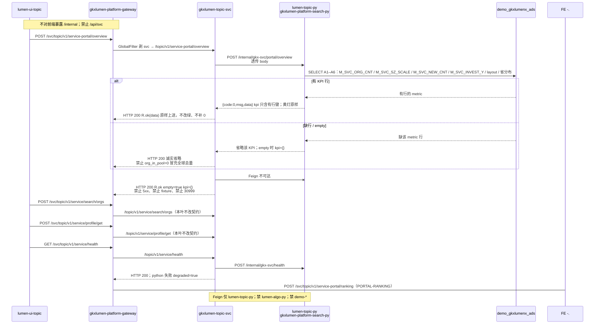

# LUMEN-SVC-P-JAVA-API-PORTAL-OVERVIEW-L01 · POST /topic/v1/service-portal/overview

> 日期：2026-08-21  
> Task：`LUMEN-SVC-P-JAVA-API-PORTAL-OVERVIEW-L01`  
> 总控：[`LUMEN-SVC-P-长任务总控.md`](./LUMEN-SVC-P-长任务总控.md)（§7 已生效）  
> 仓：`lumen-svc-platform` · `origin/dev`  
> 故事：`US-SVC-PT-01`（本叶只出门户概况 REST，不做 50892 前端）

## 任务认领（必填）

| 字段 | 值 |
|------|-----|
| claimed_by | `agent:api-agent` |
| supervised_by | `human:侯佳伟` |
| claim_type | `coordinator_dispatch` |
| 说明 | 长任务 24h 锁；未自行标 `done` |

## Ponytail（coding 任务必填）

| 字段 | 值 |
|------|-----|
| ponytail | `full` |
| 说明 | 复用 PROFILE-GET `gkxlumen-topic-svc` 门面 + Feign；只加一条 REST。未用 YAGNI 跳过 OTel、空态诚实、handoff、图即契约、D9。Java 不查 ADS、不填 KPI、不用 0 冒充全球总量。 |

## Headroom（可选）

| 字段 | 值 |
|------|-----|
| headroom | `skip` |
| 说明 | 本机会话未挂载 Headroom MCP。 |

## 图即契约

| 字段 | 值 |
|------|-----|
| diagram_id | `SVC-STORAGE-LINEAGE`（消费，不改工厂边）；`LUMEN-SVC-P-JAVA-API-PORTAL-OVERVIEW-L01-SEQ`（本叶概况） |
| 图 diff | LINEAGE 边未改。本叶把 BOOT/PROFILE 的 portal overview 虚线改成实线：50892 → gateway `/svc/**` → `gkxlumen-topic-svc` `POST /topic/v1/service-portal/overview` → `lumen-topic-py` `POST /internal/gkx-svc/portal/overview` → ADS A1–A6（`M_SVC_ORG_CNT` / `M_SVC_SZ_SCALE` / `M_SVC_NEW_CNT` / `M_SVC_INVEST_Y` / layout / 省分布）。ranking/industry/region 仍虚线。禁止事项未变：不写正式库、对拍前不写 Demo ADS/图、不对前端暴露 `/internal`、禁 Feign `lumen-algo-py` 与 `demo-*`、禁 `/api/svc`、禁 Java fixture、禁用 0 冒充全球总量。 |
| 会签态 | `SVC-STORAGE-LINEAGE` 随 `01-data-flow.md` frontmatter：`approved`（`human:淮政玮` · 2026-08-19 流图；2026-08-20 选 B 增补 LINEAGE，**不改** §1 工厂边） |

### L2 消费（不改边）

本叶只读消费 [`storage/SVC/01-data-flow.md`](../../data/data-design/storage/SVC/01-data-flow.md) §1.1 `SVC-STORAGE-LINEAGE`：线上 KPI 读 ADS 指标四表 A1–A6（fact / series / dist / region_dist），不联 ODS。Java **不扫表**；经 Feign 让 `lumen-topic-py` SELECT。缺 metric 行则省略该 KPI。不写工厂边、不灌数。

### L4 本叶 SEQ · `LUMEN-SVC-P-JAVA-API-PORTAL-OVERVIEW-L01-SEQ`

| 生产者 | 消费者 | 触发 | 失败语义 | 禁止事项 |
|---|---|---|---|---|
| `gkxlumen-topic-svc` portal/overview | 50892 经网关 | 在线 POST `/topic/v1/service-portal/overview` | Python 缺 KPI → HTTP 200 省略该键；Feign 失败 `empty=true` `kpi={}`，**不** 5xx、**不** fixture、**不** `org_in_pool=0` | `/api/svc`；Java 查 ADS / 填 KPI / 用 0 凑全球总量；把 SVC 塞进薄 `gkxlumen-topic` |
| `lumen-topic-py` `POST /internal/gkx-svc/portal/overview` | 本叶 Feign | Java 透传 body | 连不上 → 诚实空 kpi；有行则黄灯原样透传，不改绿 | Feign `lumen-algo-py`；Feign `demo-*`；对前端暴露 `/internal`；30999 常量填数 |
| ADS A1–A6（Python 读） | 门户概况 KPI | 有行才出该 KPI | 缺行 = 省略，不用 0 冒充全球总量 | 本叶写 Demo ADS/图；扫 DWD；直连 nGQL；扩 async-service |
| search/orgs + profile/get + health（已有） | 自检 | 本叶不改 | empty / data=null / degraded 契约保持 | 本叶改坏 search empty、profile null 或 health degraded |

## 范围与实现

在 PROFILE-GET 模块上只加一条门户概况 REST：

- `POST /topic/v1/service-portal/overview`（网关外网 `/svc/topic/v1/service-portal/overview`）
- Feign `POST /internal/gkx-svc/portal/overview`，body 原样透传
- 拆 Python `{code,msg,data}` 后 `R.ok(data)`；`kpi` / `empty` / `gap` / `pending_client_confirm` 不改写；缺 `org_in_pool` 不补 0
- Feign 失败：HTTP 200 + `empty=true` + `kpi={}`，不填「华大基因」、不用 30999
- search/orgs、profile/get、health 未改：empty / data=null / degraded 契约保持

**非范围**：PORTAL-RANKING / INDUSTRY / REGION / SZ / KEYORG；TASK-* / ECO / REC；扩 `gkxlumen-topic-async-service`；改 Python / 前端；写 Demo ADS/图。

## 偏离说明

- 本机 Maven 3.6.2 + compiler-plugin 3.14.0 要求 Maven ≥3.6.3，无法本地 `mvn test`。契约测试已写入 `ServiceFacadeControllerTest` / `ServiceFacadeServiceImplTest`，待 CI `backend:build` 验证。
- Feign 失败时 Java **不发明** `gap: Q-SVC-010`（黄灯只随 Python 包络透传）；只给诚实空 `kpi={}`。
- 不把旧 `LUMEN-SVC-JAVA-*` 当 `depends_on`。

## 产物清单

| 产物 | 路径 |
|------|------|
| Controller | `repos/lumen-svc-platform/gkxlumen-topic-svc/gkxlumen-topic-svc-biz/.../ServicePortalFacadeController.java` |
| Feign | `.../feign/RemoteSvcPythonClient.java` · api `RemoteTopicSvcService.java` |
| 透传 | `.../service/impl/ServiceFacadeServiceImpl.java` |
| 测试 | `ServiceFacadeControllerTest` · `ServiceFacadeServiceImplTest` |
| 本 handoff | `agent-handoffs/服务机构-SVC/LUMEN-SVC-P-JAVA-API-PORTAL-OVERVIEW-L01.md` |

## 测试结果

- [x] MockMvc：`POST /topic/v1/service-portal/overview` 有 KPI 透传；缺行/`empty` 不造 `org_in_pool=0`；Feign 失败不造假；search/orgs、profile/get 与 health 仍映射
- [x] 服务单测：Python KPI + Q-SVC-010 透传；缺 `M_SVC_ORG_CNT` 不补 0；empty 不填华大基因；Feign 5xx → `R.code=0` + `kpi={}`；search empty、profile null 与 health degraded 契约未改
- [ ] 本机 `mvn test`：Maven 3.6.2 无法跑 compiler-plugin 3.14.0；待 CI

## 验收证据

- [x] POST `/topic/v1/service-portal/overview` 经 Feign 打 `lumen-topic-py` `/internal/gkx-svc/portal/overview`；缺 KPI 诚实省略、禁止用 0 冒充全球总量、禁止 fixture
- [x] 禁 `/api/svc`；禁 Feign `lumen-algo-py` 与 `demo-*`；不改坏 search/profile/health 契约
- [x] handoff 含 ponytail: full、cost 四字段、diagram_id、SEQ
- [x] `origin/dev` `8972a64`；未标 `done`

## 遗留风险

- K8s 未注入 Python/MySQL 时概况为 `empty` / 省略 KPI（预期）；前端 D 叶须按空态展示，不能当 5xx，不能自行补 0。
- `deploy:topic-svc` / 网关 Nacos 种子仍可能未灌；本叶不宣称 K8s rollout 已绿（E0 另叶）。
- ranking/industry 仍 404（留给 `LUMEN-SVC-P-JAVA-API-PORTAL-RANKING-L01` 等，预期）。

## CI/CD（必填）

- 分支：`origin/dev`（`lumen-svc-platform`）
- commit：`8972a64` `feat(svc): add POST /topic/v1/service-portal/overview [agent:api-agent]`
- pipeline URL：https://gitlab.htmisoft.net/gkx-lumen/lumen-svc-platform/-/pipelines?ref=dev
- 部署 namespace / 镜像 tag：本叶未宣称 rollout
- K8s rollout：本叶未执行（E0 另叶）
- 本地：契约测试源码就位；Maven 3.6.2 无法跑 `mvn test`

## 可观测性

- OTEL_SERVICE_NAME：`gkxlumen-topic-svc-biz`（Dockerfile + Helm env，BOOT 已有）
- Feign 失败：`ServiceFacadeServiceImpl` warn 日志，不抛 5xx
- traceId（dev 抽样）：无（本叶未 rollout）
- Tempo / Loki：沿用平台 Java Agent

## 架构合规自检

| # | 铁律 | 结果 |
|---|---|---|
| 1 | 算法只在 Python | ✅ Java 不写算法、不扫 ADS |
| 2 | 前端 → Java → `/internal/*` | ✅ Feign `POST /internal/gkx-svc/portal/overview` |
| 3 | Nebula，禁 Neo4j | ✅ 本叶不碰图 |
| 4 | 可观测 OTel | ✅ `OTEL_SERVICE_NAME=gkxlumen-topic-svc-biz` + Feign warn |
| 5 | CI | ✅ 测写在模块内；本叶不宣称绿 |
| 6 | demo2 不 merge lumen | ✅ N/A |
| 7 | 共享聚合 / 分仓 | ✅ 只改 `gkxlumen-topic-svc`，未塞进薄 `gkxlumen-topic` |
| 8 | 只读 ADS；不写库 | ✅ Java 不查表；Python 只读 |
| 9 | D8 | N/A 无 UI |
| 10 | D9 | ✅ 不造假 KPI；缺行省略；黄灯透传不改绿 |
| 11 | D10 | N/A |
| 12 | D12 不调 demo-* | ✅ Feign 仅 `lumen-topic-py`；禁 `demo-*` 与 `lumen-algo-py` |

## Cost

| 字段 | 值 |
|------|-----|
| actual_tokens | 165000（估 in+out；source: session_estimate） |
| model_used | `claude-sonnet-4.5`（registry enum；本会话 Cursor Grok 4.6，enum 无 grok） |
| actual_cost | 0.99（api 75/25 × Sonnet $3/$15 per M） |
| cost_warn | `green` |

## 联调确认

联调通过（代码侧）：概况 REST / Feign / 缺 KPI 诚实省略 / search·profile·health 契约未改，可对接已发布 `gkx_svc_service` `POST /internal/gkx-svc/portal/overview`。下一叶：`LUMEN-SVC-P-JAVA-API-PORTAL-RANKING-L01`。请 coordinator AV-0，**本叶不自行标 done**。
