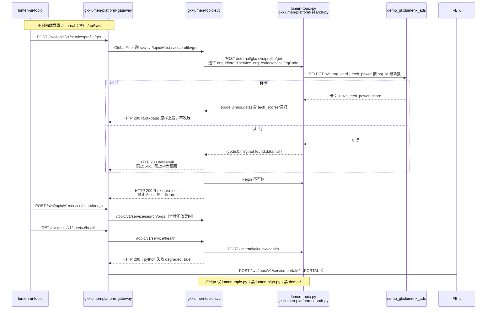

# LUMEN-SVC-P-JAVA-API-PROFILE-GET-L01 · POST /topic/v1/service/profile/get

> 日期：2026-08-21  
> Task：`LUMEN-SVC-P-JAVA-API-PROFILE-GET-L01`  
> 总控：[`LUMEN-SVC-P-长任务总控.md`](./LUMEN-SVC-P-长任务总控.md)（§7 已生效）  
> 仓：`lumen-svc-platform` · `origin/dev`  
> 故事：`US-SVC-ORG-03`（本叶只出画像 REST，不做前端抽屉）

## 任务认领（必填）

| 字段 | 值 |
|------|-----|
| claimed_by | `agent:api-agent` |
| supervised_by | `human:侯佳伟` |
| claim_type | `coordinator_dispatch` |
| 说明 | 长任务 24h 锁；未自行标 `done` |

## Ponytail（coding 任务必填）

| 字段 | 值 |
|------|-----|
| ponytail | `full` |
| 说明 | 复用 SEARCH-ORGS `gkxlumen-topic-svc` 门面 + Feign；只加一条 REST。未用 YAGNI 跳过 OTel、空态诚实、handoff、图即契约。Java 不查 ADS、不 JOIN ODS、不填华大基因。 |

## Headroom（可选）

| 字段 | 值 |
|------|-----|
| headroom | `skip` |
| 说明 | 本机会话未挂载 Headroom MCP。 |

## 图即契约

| 字段 | 值 |
|------|-----|
| diagram_id | `SVC-STORAGE-LINEAGE`（消费，不改工厂边）；`LUMEN-SVC-P-JAVA-API-PROFILE-GET-L01-SEQ`（本叶画像） |
| 图 diff | LINEAGE 边未改。本叶把 SEARCH-ORGS 的 profile 虚线改成实线：50892 → gateway `/svc/**` → `gkxlumen-topic-svc` `POST /topic/v1/service/profile/get` → `lumen-topic-py` `POST /internal/gkx-svc/profile/get` → ADS `svc_org_card` + 最新批 `svc_tech_power_score`。portal/analysis 仍虚线。禁止事项未变：不写正式库、对拍前不写 Demo ADS/图、不对前端暴露 `/internal`、禁 Feign `lumen-algo-py` 与 `demo-*`、禁 `/api/svc`、禁 Java fixture。 |
| 会签态 | `SVC-STORAGE-LINEAGE` 随 `01-data-flow.md` frontmatter：`approved`（`human:淮政玮` · 2026-08-19 流图；2026-08-20 选 B 增补 LINEAGE，**不改** §1 工厂边） |

### L2 消费（不改边）

本叶只读消费 [`storage/SVC/01-data-flow.md`](../../data/data-design/storage/SVC/01-data-flow.md) §1.1 `SVC-STORAGE-LINEAGE`：线上画像读 `svc_org_card`，技术力读十模型回写，不联 ODS。Java **不扫表**；经 Feign 让 `lumen-topic-py` SELECT。不写工厂边、不灌数。

### L4 本叶 SEQ · `LUMEN-SVC-P-JAVA-API-PROFILE-GET-L01-SEQ`

| 生产者 | 消费者 | 触发 | 失败语义 | 禁止事项 |
|---|---|---|---|---|
| `gkxlumen-topic-svc` profile/get | 50892 经网关 | 在线 POST `/topic/v1/service/profile/get` | Python 无卡 → HTTP 200 + `data=null` `msg=not found`；Feign 失败同诚实空，**不** 5xx、**不** fixture | `/api/svc`；Java 查 ADS / JOIN ODS / 填华大基因；把 SVC 塞进薄 `gkxlumen-topic` |
| `lumen-topic-py` `POST /internal/gkx-svc/profile/get` | 本叶 Feign | Java 透传 body | 连不上 → `data=null`；有卡则 `tech_scores` / 黄灯原样透传，不改绿 | Feign `lumen-algo-py`；Feign `demo-*`；对前端暴露 `/internal` |
| ADS `svc_org_card` + `svc_tech_power_score`（Python 读） | 画像卡面 | 有行才出 data | 0 行 = `data=null`；Q060 / Q-SVC-010 留 pending | 本叶写 Demo ADS/图；扫 DWD；直连 nGQL；扩 async-service |
| search/orgs + health（已有） | 自检 | 本叶不改 | empty/degraded 契约保持 | 本叶改坏 search empty 或 health degraded |

## 范围与实现

在 SEARCH-ORGS 模块上只加一条画像 REST：

- `POST /topic/v1/service/profile/get`（网关外网 `/svc/topic/v1/service/profile/get`）
- Feign `POST /internal/gkx-svc/profile/get`，body 原样透传（`org_id`/`orgId`/`service_org_code`/`serviceOrgCode`）
- 拆 Python `{code,msg,data}`：有卡 `R.ok(data)`（含 `tech_scores` / 黄灯）；无卡 `data=null` `msg=not found`
- Feign 失败：HTTP 200 + `data=null`，不填「华大基因」
- search/orgs 与 health 未改：empty / degraded 契约保持

**非范围**：PORTAL-* / TASK-* / ECO / REC；扩 `gkxlumen-topic-async-service`；改 Python / 前端；写 Demo ADS/图。

## 偏离说明

- 本机 Maven 3.6.2 + compiler-plugin 3.14.0 要求 Maven ≥3.6.3，无法本地 `mvn test`。契约测试已写入 `ServiceFacadeControllerTest` / `ServiceFacadeServiceImplTest`，待 CI `backend:build` 验证。
- Python 字段名为 `tech_scores`（最新批 `svc_tech_power_score`）；Java 原样透传，不发明 `tech_power` 别名、不改绿黄灯。
- 不把旧 `LUMEN-SVC-JAVA-*` 当 `depends_on`。

## 产物清单

| 产物 | 路径 |
|------|------|
| Controller | `repos/lumen-svc-platform/gkxlumen-topic-svc/gkxlumen-topic-svc-biz/.../ServiceFacadeController.java` |
| Feign | `.../feign/RemoteSvcPythonClient.java` · api `RemoteTopicSvcService.java` |
| 透传 | `.../service/impl/ServiceFacadeServiceImpl.java` |
| 测试 | `ServiceFacadeControllerTest` · `ServiceFacadeServiceImplTest` |
| 本 handoff | `agent-handoffs/服务机构-SVC/LUMEN-SVC-P-JAVA-API-PROFILE-GET-L01.md` |

## 测试结果

- [x] MockMvc：`POST /topic/v1/service/profile/get` 有卡透传 tech_scores / 黄灯；not found `data=null` 不造假；Feign 失败不造假；search/orgs 与 health 仍映射
- [x] 服务单测：Python 卡面 + Q060 透传；`data=null` 不填华大基因；Feign 5xx → `R.code=0` + `data=null`；search empty 与 health degraded 契约未改
- [ ] 本机 `mvn test`：Maven 3.6.2 无法跑 compiler-plugin 3.14.0；待 CI

## 验收证据

- [x] POST `/topic/v1/service/profile/get` 经 Feign 打 `lumen-topic-py` `/internal/gkx-svc/profile/get`；无卡诚实 `data=null`、不填 fixture
- [x] 禁 `/api/svc`；禁 Feign `lumen-algo-py` 与 `demo-*`；不改坏 search/orgs 与 health 契约
- [x] handoff 含 ponytail: full、cost 四字段、diagram_id、SEQ
- [x] `origin/dev` `59c658a`；未标 `done`

## 遗留风险

- K8s 未注入 Python/MySQL 时画像为 `data=null` 或 Python 的 `found=false` 空包络（预期）；前端 D 叶须按空态展示，不能当 5xx。
- `deploy:topic-svc` / 网关 Nacos 种子仍可能未灌；本叶不宣称 K8s rollout 已绿（E0 另叶）。
- portal 仍 404（留给 `LUMEN-SVC-P-JAVA-API-PORTAL-OVERVIEW-L01`，预期）。

## CI/CD（必填）

- 分支：`origin/dev`（`lumen-svc-platform`）
- commit：`59c658a` `feat(svc): add POST /topic/v1/service/profile/get [agent:api-agent]`
- pipeline URL：https://gitlab.htmisoft.net/gkx-lumen/lumen-svc-platform/-/pipelines?ref=dev
- 部署 namespace / 镜像 tag：本叶未宣称 rollout
- K8s rollout：本叶未执行（E0 另叶）
- 本地：契约测试源码就位；Maven 3.6.2 无法跑 `mvn test`

## 可观测性

- OTEL_SERVICE_NAME：`gkxlumen-topic-svc-biz`（Dockerfile + Helm env，BOOT 已有）
- Feign 失败：`ServiceFacadeServiceImpl` warn 日志，不抛 5xx
- traceId（dev 抽样）：无（本叶未 rollout）
- Tempo / Loki：沿用平台 Java Agent

## 架构合规自检

| # | 铁律 | 结果 |
|---|---|---|
| 1 | 算法只在 Python | ✅ Java 不写算法、不扫 ADS |
| 2 | 前端 → Java → `/internal/*` | ✅ Feign `POST /internal/gkx-svc/profile/get` |
| 3 | Nebula，禁 Neo4j | ✅ 本叶不碰图 |
| 4 | 可观测 OTel | ✅ `OTEL_SERVICE_NAME=gkxlumen-topic-svc-biz` + Feign warn |
| 5 | CI | ✅ 测写在模块内；本叶不宣称绿 |
| 6 | demo2 不 merge lumen | ✅ N/A |
| 7 | 共享聚合 / 分仓 | ✅ 只改 `gkxlumen-topic-svc`，未塞进薄 `gkxlumen-topic` |
| 8 | 只读 ADS；不写库 | ✅ Java 不查表；Python 只读 |
| 9 | D8 | N/A 无 UI |
| 10 | D9 | ✅ 不造假画像；黄灯透传不改绿 |
| 11 | D10 | N/A |
| 12 | D12 不调 demo-* | ✅ Feign 仅 `lumen-topic-py`；禁 `demo-*` 与 `lumen-algo-py` |

## Cost

| 字段 | 值 |
|------|-----|
| actual_tokens | 155000（估 in+out；source: session_estimate） |
| model_used | `claude-sonnet-4.5`（registry enum；本会话 Cursor Grok 4.6，enum 无 grok） |
| actual_cost | 0.93（api 75/25 × Sonnet $3/$15 per M） |
| cost_warn | `green` |

## 联调确认

联调通过（代码侧）：画像 REST / Feign / 无卡 `data=null` / search 与 health 契约未改，可对接已发布 `gkx_svc_service` `POST /internal/gkx-svc/profile/get`。下一叶：`LUMEN-SVC-P-JAVA-API-PORTAL-OVERVIEW-L01`。请 coordinator AV-0，**本叶不自行标 done**。
