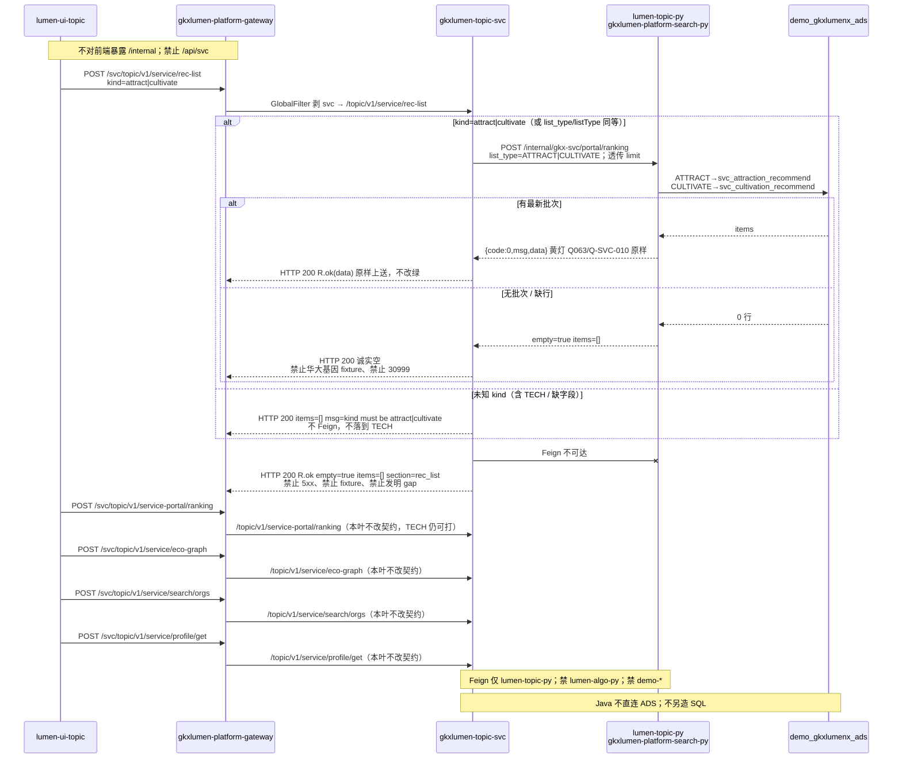

# LUMEN-SVC-P-JAVA-API-REC-LIST-L01 · POST /topic/v1/service/rec-list

> 日期：2026-08-21  
> Task：`LUMEN-SVC-P-JAVA-API-REC-LIST-L01`  
> 总控：[`LUMEN-SVC-P-长任务总控.md`](./LUMEN-SVC-P-长任务总控.md)（§7 已生效）  
> 仓：`lumen-svc-platform` · `origin/dev`  
> 故事：`US-SVC-REC-02` / `US-SVC-REC-04`（本叶只出招引/培育名单读面 REST；招引=外部引进，培育=深圳本土。不做前端、不改 Python、不算 REC 模型权重）

## 任务认领（必填）

| 字段 | 值 |
|------|-----|
| claimed_by | `agent:api-agent` |
| supervised_by | `human:侯佳伟` |
| claim_type | `coordinator_dispatch` |
| 说明 | 长任务 24h 锁；未自行标 `done` |

## Ponytail（coding 任务必填）

| 字段 | 值 |
|------|-----|
| ponytail | `full` |
| 说明 | 复用已有 `gkxlumen-topic-svc` 查询门面 + `POST /internal/gkx-svc/portal/ranking` Feign，只加一条 REST。未用 YAGNI 跳过 OTel、空态诚实、handoff、图即契约、D9。Java 不查 ADS、不写 SQL、不重算权重、不填华大基因/迈瑞/华为 fixture。未知 kind 拦截，不落到 TECH。 |

## Headroom（可选）

| 字段 | 值 |
|------|-----|
| headroom | `skip` |
| 说明 | 本机会话未挂载 Headroom MCP。 |

## 图即契约

| 字段 | 值 |
|------|-----|
| diagram_id | `SVC-STORAGE-LINEAGE`（消费，不改工厂边）；`LUMEN-SVC-P-JAVA-API-REC-LIST-L01-SEQ`（本叶招引/培育名单） |
| 图 diff | LINEAGE 边未改。本叶把 ECO-GRAPH SEQ 的 rec-list 虚线改成实线：50892 → gateway `/svc/**` → `gkxlumen-topic-svc` `POST /topic/v1/service/rec-list` → Feign 复用 `lumen-topic-py` `POST /internal/gkx-svc/portal/ranking`（`kind=attract\|cultivate` → `list_type=ATTRACT\|CULTIVATE`）→ Python 读 `svc_attraction_recommend` / `svc_cultivation_recommend`。门户 `/service-portal/ranking` 仍实线且契约未改。禁止事项未变：不写正式库、对拍前不写 Demo ADS/图、不对前端暴露 `/internal`、禁 Feign `lumen-algo-py` 与 `demo-*`、禁 `/api/svc`、禁 Java fixture / 华大基因 / 30999、禁未知 kind 落到 TECH。 |
| 会签态 | `SVC-STORAGE-LINEAGE` 随 `01-data-flow.md` frontmatter：`approved`（`human:淮政玮` · 2026-08-19 流图；2026-08-20 选 B 增补 LINEAGE，**不改** §1 工厂边） |

### L2 消费（不改边）

本叶只读消费 [`storage/SVC/01-data-flow.md`](../../data/data-design/storage/SVC/01-data-flow.md) §1.1 `SVC-STORAGE-LINEAGE`：招引名单读 Demo ADS `svc_attraction_recommend`（外部引进），培育名单读 `svc_cultivation_recommend`（深圳本土）；名称 JOIN `svc_org_card`。Java **不扫表、不写 SQL**；经 Feign 让 `lumen-topic-py` 出 `items`。无批次则 `items=[]` `empty=true`。不写工厂边、不灌数、不改绿 Q063 / Q-SVC-010。

### L4 本叶 SEQ · `LUMEN-SVC-P-JAVA-API-REC-LIST-L01-SEQ`

| 生产者 | 消费者 | 触发 | 失败语义 | 禁止事项 |
|---|---|---|---|---|
| `gkxlumen-topic-svc` rec-list | 50892 经网关 · 金路径 #5 | 在线 POST `/topic/v1/service/rec-list` | Python 空 → HTTP 200 `empty=true` `items=[]`；Feign 失败同左；未知 kind 同左 + `msg=kind must be attract\|cultivate`，**不** 5xx、**不** fixture、**不** 落到 TECH | `/api/svc`；Java 查 ADS / 写 SQL / 填华大基因；把 SVC 塞进薄 `gkxlumen-topic`；改坏 portal ranking |
| `lumen-topic-py` `POST /internal/gkx-svc/portal/ranking` | 本叶 Feign（复用，不新造） | Java 映射后透传 `list_type=ATTRACT\|CULTIVATE` + `limit` | 连不上 → 诚实空名单；有行则黄灯 Q063 / Q-SVC-010 原样透传，不改绿 | Feign `lumen-algo-py`；Feign `demo-*`；对前端暴露 `/internal`；30999 常量填数；REC 权重在 Java 重算 |
| ADS `svc_attraction_recommend` / `svc_cultivation_recommend`（Python 读） | 招引=外部引进；培育=深圳本土 | 无最新 `calc_batch_id` 则空列表 | 缺行 = 空名单，不用华大基因冒充 | 本叶写 Demo ADS；直连 MySQL；扩 async-service / CHAIN analysisType |
| portal/ranking + eco-graph + search/orgs + profile/get（已有） | 自检 | 本叶不改 | empty / items=[] / data=null / 双密度 契约保持；门户 TECH 仍可打 | 本叶改坏 portal ranking、eco-graph、search empty、profile null |

## 范围与实现

在查询门面只加一条招引/培育名单 REST：

- `POST /topic/v1/service/rec-list`（网关外网 `/svc/topic/v1/service/rec-list`）
- Feign 复用 `POST /internal/gkx-svc/portal/ranking`：`kind=attract|cultivate`（或 `list_type`/`listType`）→ `list_type=ATTRACT|CULTIVATE`，透传 `limit` 等
- 拆 Python `{code,msg,data}` 后 `R.ok(data)`；`items` / `empty` / `gap` / `pending_client_confirm` 不改写；Q063 不改绿
- 未知 kind（含 `TECH`、缺字段）：HTTP 200 + `items=[]` + `msg=kind must be attract|cultivate`，**不** Feign、**不** 落到 TECH
- Feign 失败：HTTP 200 + `empty=true` + `items=[]` + `section=rec_list`，不填华大基因、不用 30999、不发明 `gap`
- portal/ranking、eco-graph、search、profile、CHAIN 未改

**非范围**：改 Python / 前端；REC 模型权重计算；TASK-* / async-service；宣称 K8s 绿。

## 偏离说明

- PATH 上默认 `mvn` 仍是 3.6.2（compiler-plugin 3.14.0 要求 ≥3.6.3）。本叶用本机 `D:\temp\apache-maven-3.9.9` + Zulu 17 跑通模块单测。
- Feign 失败时 Java **不发明** `gap: Q063` / `Q-SVC-010`（黄灯只随 Python 包络透传）；只给诚实空名单。
- Python `ranking_list` 对未知 `list_type` 会落到 ATTRACT；本叶在 Java 拦截未知 kind（含 TECH），避免查询域名单默默打到 TECH 或默认招引榜。
- 不把旧 `LUMEN-SVC-JAVA-*` 当 `depends_on`。

## 产物清单

| 产物 | 路径 |
|------|-----|
| Controller | `repos/lumen-svc-platform/gkxlumen-topic-svc/gkxlumen-topic-svc-biz/.../ServiceFacadeController.java` |
| 对外 Feign | api `RemoteTopicSvcService.java` |
| 透传 | `.../service/impl/ServiceFacadeServiceImpl.java`（复用已有 `RemoteSvcPythonClient.portalRanking`） |
| 测试 | `ServiceFacadeControllerTest` · `ServiceFacadeServiceImplTest` |
| 本 handoff | `agent-handoffs/服务机构-SVC/LUMEN-SVC-P-JAVA-API-REC-LIST-L01.md` |

## 测试结果

- [x] MockMvc：`POST /topic/v1/service/rec-list` attract/cultivate 透传 items + Q063；empty 不填华大基因；未知 kind 不落到 TECH；Feign 失败诚实空；portal ranking TECH 契约仍映射
- [x] 服务单测：kind→`list_type=ATTRACT|CULTIVATE` 透传 limit；empty 不填 fixture；`kind=TECH` / 缺字段 **不** 调用 Python；Feign 5xx → `R.code=0` + `items=[]` 无 gap；门户 ranking TECH 原样
- [x] 本机 `mvn`（3.9.9 + Zulu 17）：`ServiceFacadeControllerTest` 35 · `ServiceFacadeServiceImplTest` 40，合计 75 Tests run, Failures: 0

## 验收证据

- [x] POST `/topic/v1/service/rec-list` 经 Feign 打 `lumen-topic-py` `/internal/gkx-svc/portal/ranking` 招引/培育读面；缺行诚实空，禁华大基因 fixture
- [x] 禁 `/api/svc`；禁 Feign `lumen-algo-py` 与 `demo-*`；不改 portal ranking / eco-graph / search / profile
- [x] handoff 含 ponytail: full、cost 四字段、diagram_id、SEQ
- [x] `origin/dev` `d54ec0b`；未标 `done`

## 遗留风险

- K8s 未注入 Python/MySQL 或 Demo ADS 无批次时名单为 `empty` / 空 `items`（预期）；前端 D 叶须按空态展示，不能当 5xx，不能自行补华大基因。
- `deploy:topic-svc` / 网关 Nacos 种子仍可能未灌；本叶不宣称 K8s rollout 已绿（E0 另叶）。
- 本叶是查询域读面。模型权重可调（US-SVC-REC-01/03）仍是演示口径，Python/ADS 已出分，Java 不算。

## CI/CD（必填）

- 分支：`origin/dev`（`lumen-svc-platform`）
- commit：`d54ec0b` `feat(svc): add POST /topic/v1/service/rec-list [agent:api-agent]`
- pipeline URL：https://gitlab.htmisoft.net/gkx-lumen/lumen-svc-platform/-/pipelines?ref=dev
- 部署 namespace / 镜像 tag：本叶未宣称 rollout
- K8s rollout：本叶未执行（E0 另叶）
- 本地：Maven 3.9.9 + Zulu 17，`Tests run: 75, Failures: 0`

## 可观测性

- OTEL_SERVICE_NAME：`gkxlumen-topic-svc-biz`（Dockerfile + Helm env，BOOT 已有）
- Feign 失败：`ServiceFacadeServiceImpl` warn 日志 `svc rec-list python unavailable`，不抛 5xx
- 未知 kind：warn `svc rec-list unknown kind, refuse TECH/ATTRACT fallback`
- traceId（dev 抽样）：无（本叶未 rollout）
- Tempo / Loki：沿用平台 Java Agent

## 架构合规自检

| # | 铁律 | 结果 |
|---|---|---|
| 1 | 算法只在 Python | ✅ Java 不写算法、不扫 ADS、不重算 REC 权重 |
| 2 | 前端 → Java → `/internal/*` | ✅ Feign 复用 `POST /internal/gkx-svc/portal/ranking` |
| 3 | Nebula，禁 Neo4j | ✅ 本叶不连图 |
| 4 | 可观测 OTel | ✅ `OTEL_SERVICE_NAME=gkxlumen-topic-svc-biz` + Feign/unknown-kind warn |
| 5 | CI | ✅ 测写在模块内；本叶不宣称绿 |
| 6 | demo2 不 merge lumen | ✅ N/A |
| 7 | 共享聚合 / 分仓 | ✅ 只改 `gkxlumen-topic-svc`，未塞进薄 `gkxlumen-topic` |
| 8 | 只读 ADS；不写库 | ✅ Java 不查表；Python 只读 |
| 9 | D8 | N/A 无 UI |
| 10 | D9 | ✅ 不造假名单；缺行 `items=[]`；黄灯 Q063 / Q-SVC-010 透传不改绿 |
| 11 | D10 | N/A |
| 12 | D12 不调 demo-* | ✅ Feign 仅 `lumen-topic-py`；禁 `demo-*` 与 `lumen-algo-py` |

## Cost

| 字段 | 值 |
|------|-----|
| actual_tokens | 110000（估 in+out；source: session_estimate） |
| model_used | `claude-sonnet-4.5`（registry enum；本会话 Cursor Grok 4.6，enum 无 grok） |
| actual_cost | 0.66（api 75/25 × Sonnet $3/$15 per M） |
| cost_warn | `green` |

## 联调确认

联调通过（代码侧）：招引/培育名单 REST / Feign 复用 portal/ranking / kind→list_type 映射 / 缺行诚实空 / 未知 kind 不落到 TECH / portal ranking·eco-graph·search·profile 契约未改。下一叶：按 DAG（D 叶 `LUMEN-SVC-P-FE-US-REC-02` 或对应前端）。请 coordinator AV-0，**本叶不自行标 done**。
