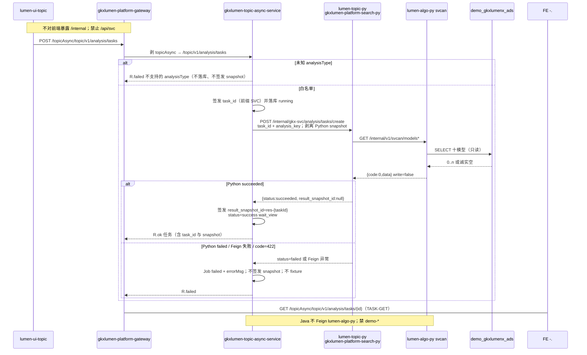

# LUMEN-SVC-P-JAVA-API-TASK-CREATE-L01 · POST /topic/v1/analysis/tasks + SVC analysisType 白名单

> 日期：2026-08-21  
> Task：`LUMEN-SVC-P-JAVA-API-TASK-CREATE-L01`  
> 总控：[`LUMEN-SVC-P-长任务总控.md`](./LUMEN-SVC-P-长任务总控.md)（§7 已生效）  
> 仓：`lumen-svc-platform` · `origin/dev`  
> 前置：`LUMEN-SVC-P-PY-MIDDLE-TASK-L01` `de8d36a` · `LUMEN-SVC-P-PY-SVCAN-BOOT-L01`

## 任务认领（必填）

| 字段 | 值 |
|------|-----|
| claimed_by | `agent:api-agent` |
| supervised_by | `human:侯佳伟` |
| claim_type | `coordinator_dispatch` |
| 说明 | 长任务 24h 锁；未自行标 `done` |

## Ponytail（coding 任务必填）

| 字段 | 值 |
|------|-----|
| ponytail | `full` |
| 说明 | 扩 `gkxlumen-topic-async-service`，复用 CHAIN/企业 Adapter 注册表与 create 落库；不新建第三套任务微服务、不把 SVC 塞进薄 `gkxlumen-topic`。未用 YAGNI 跳过可观测、Job 签发、handoff、图即契约。禁止改 CHAIN `analysisType`。 |

## Headroom（可选）

| 字段 | 值 |
|------|-----|
| headroom | `skip` |
| 说明 | 本机会话未挂载 Headroom MCP。 |

## 图即契约

| 字段 | 值 |
|------|-----|
| diagram_id | `SVC-STORAGE-LINEAGE`（消费，不改工厂边）；`LUMEN-SVC-P-JAVA-API-TASK-CREATE-L01-SEQ`（本叶） |
| 图 diff | LINEAGE 边未改。本叶把 MIDDLE-TASK 的 Java create 虚线改成实线：50892 → gateway `/topicAsync/**` → `gkxlumen-topic-async-service` `POST /topic/v1/analysis/tasks` → Feign `lumen-topic-py` `POST /internal/gkx-svc/analysis/tasks/create`（Java 签发 `task_id` / 成功后 `result_snapshot_id`）。TASK-GET/RESULT/EVENTS 仍虚线。禁止事项未变：不写正式库、对拍前不写 Demo ADS/图、不对前端暴露 `/internal`、禁 Feign `lumen-algo-py` 与 `demo-*`、禁 `/api/svc`、禁 Python 自签 snapshot、禁改 CHAIN type。 |
| 会签态 | `SVC-STORAGE-LINEAGE` 随 `storage/SVC/01-data-flow.md` frontmatter：`approved`（`human:淮政玮` · 2026-08-19 流图；2026-08-20 选 B 增补 LINEAGE，**不改** §1 工厂边） |

### L2 消费（不改边）

本叶只读消费 [`storage/SVC/01-data-flow.md`](../../data/data-design/storage/SVC/01-data-flow.md) §1.1 `SVC-STORAGE-LINEAGE`：分析任务经 Java → 中间层 → svcan **只读**十模型 ADS。不写工厂边、不灌数、不 hang `demo_gkx_chain`。Java 不扫 ADS、不直连 nGQL。

### L4 本叶 SEQ · `LUMEN-SVC-P-JAVA-API-TASK-CREATE-L01-SEQ`

| 生产者 | 消费者 | 触发 | 失败语义 | 禁止事项 |
|---|---|---|---|---|
| `gkxlumen-topic-async-service` create | 50892 经网关 `/topicAsync/**` | 在线 POST `/topic/v1/analysis/tasks` | 未知 type → 拒绝且不落库；Python/Feign 失败 → Job `failed` + `errorMsg`，**不**签发 snapshot、**不** fixture | `/api/svc`；改 CHAIN `analysisType`；新建第三套任务微服务；把 SVC 塞进薄 `gkxlumen-topic` |
| Java 签发 `task_id` / `result_snapshot_id` | 中间层 create；后续 GET/RESULT 叶 | 同步 create | 仅 `succeeded`/`success` 签发 `res-{taskId}`；Python 带回的 snapshot 字段剥离 | Python 自签 snapshot；Java 直连 svcan |
| `lumen-topic-py` `POST /internal/gkx-svc/analysis/tasks/create` | 本叶 Feign | Java 已签发 task_id | 未知 key → 422 → Java failed；algo 不可达 → `status=failed` 仍不签发 snapshot | Feign `lumen-algo-py`；Feign `demo-*`；对前端暴露 `/internal` |
| F 已写入的 Demo ADS 十模型（经 svcan，本叶不直连） | 成功后 Java 快照 payload | 同步 GET 读面 | 诚实空仍可 `succeeded`；写失败走 Python failed | 对拍前写 Demo ADS/图；写正式 `gkxlumenx_*`；`/sample/shortboard` 当真源 |

## 范围与实现

扩展已有 `POST /topic/v1/analysis/tasks`（`AnalysisTaskController`，网关 `/topicAsync/**`），**不**做成 `/api/svc`：

- `SvcAnalysisTypes` 白名单：八叶子 `svc:analysis:*`、`svcan.{leaf}.v0`、就近读面裸键 `org_coverage` / `org_trend` / `shenzhen`（及同组叶子裸键）
- `SvcAnalysisAdapterImpl` 显式注册；Feign `RemoteSvcAnalysisPythonClient` → `lumen-topic-py` `/internal/gkx-svc/analysis/tasks/{create,status}`
- Java 签发 `task_id`（前缀 `SVC`）与成功后的 `result_snapshot_id=res-{taskId}`；剥离 Python snapshot
- 失败：Python `failed` / Feign / `code=422` → Job `failed` + `errorMsg`，不签发 snapshot
- Helm：`GKXLUMEN_TOPIC_ASYNC_SVC_PYTHON_BASE_URL=http://gkxlumen-platform-search-py:8080`；Nacos `gkxlumen.topic.async.svc.python-base-url`
- **未改** `ChainAnalysisTypes` / CHAIN Adapter / CHAIN Feign

**非范围**：TASK-GET / RESULT / EVENTS；PORTAL-INDUSTRY 等 topic-svc 路径；改 Python / 前端；写 Demo ADS/图；宣称 K8s rollout 已绿。

## 偏离说明

- 默认 PATH 上 Maven 3.6.2 无法编 compiler-plugin 3.14.0。本叶用便携 Maven 3.9.9 + Zulu 17 跑指定单测 **17 passed**。
- Feign **NEVER_RETRY**：Python create 先落内存 `running` 再 GET svcan，重试会命中幂等 `running` 行、误判失败且不签发 snapshot。
- 旧 ABCD `Svc*` 已随 ABORT 删除；本叶按企业/CHAIN Job 模式重建，不复活 `/api/svc`、不 Feign `/analyze`。

## 产物清单

| 产物 | 路径 |
|------|------|
| 白名单 | `gkxlumen-topic-async-service-biz/.../support/analysis/SvcAnalysisTypes.java` |
| Adapter / Feign | `.../SvcAnalysisAdapterImpl.java` · `RemoteSvcAnalysisPythonClient.java` · `SvcJobPythonFeignConfig.java` · `SvcJobPythonProperties.java` |
| create 分支 | `.../AnalysisTaskServiceImpl.java`（`applySvcSyncResult`）；`AnalysisTaskIdGenerator` 前缀 `SVC` |
| Helm / Nacos | `helm/gkxlumen-platform/values.yaml` · `configs/gkxlumen-topic-async-service-biz-dev.yml` |
| 单测 | `SvcAnalysisTypesTest` · `SvcAnalysisAdapterImplTest` · `AnalysisTaskServiceImplSvcJobTest` · `AnalysisAdapterRegistryChainTest` |
| 本 handoff | `agent-handoffs/服务机构-SVC/LUMEN-SVC-P-JAVA-API-TASK-CREATE-L01.md` |

## 测试结果

- [x] 白名单拒绝未知 type（registry `null` → create `R.failed`，不落库、不签发 snapshot）
- [x] 成功签发 `res-{taskId}`；忽略 Python `result_snapshot_id`
- [x] Python `failed` / Feign 失败不签发 snapshot
- [x] CHAIN type 未被 SVC 覆盖（`AnalysisAdapterRegistryChainTest` + `ChainAnalysisTypesTest`）
- [x] 指定单测 **17 passed**（Maven 3.9.9 + JDK 17）

## 验收证据

- [x] 扩展 `gkxlumen-topic-async-service`：`POST /topic/v1/analysis/tasks` 签发 `task_id` 与 `result_snapshot_id`；Feign `lumen-topic-py` `/internal/gkx-svc/analysis/tasks/create`；剥离 Python 自签 snapshot
- [x] 本叶含 SVC `analysisType` 白名单；未改 CHAIN 已有 type；禁 Feign `lumen-algo-py` 与 `demo-*`
- [x] handoff 含 ponytail: full、cost 四字段、diagram_id、SEQ
- [x] `origin/dev` `a1f5191`；未标 `done`

## 遗留风险

- Helm env / Nacos `python-base-url` 需随 deploy 注入；未注入则默认 `gkxlumen-platform-search-py:8080`。本叶不宣称 K8s rollout 已绿（E0 另叶）。
- 中间层任务表在 search-py 进程内，重启丢失；Java Job 为真源。GET/RESULT/EVENTS 仍待后续叶。
- 未知 type 拒绝文案走既有「功能尚未开放或不支持的 analysisType」，与 Python 422 文案不同，但都不默默 shortboard。

## CI/CD（必填）

- 分支：`origin/dev`（`lumen-svc-platform`）
- commit：`a1f5191` `feat(svc): async-service TASK-CREATE signs snapshot via topic-py [agent:api-agent]`
- pipeline URL：https://gitlab.htmisoft.net/gkx-lumen/lumen-svc-platform/-/pipelines?ref=dev
- 部署 namespace / 镜像 tag：本叶未宣称 rollout
- K8s rollout：本叶未执行（E0 另叶）
- 本地：`mvn -pl gkxlumen-topic-async-service/gkxlumen-topic-async-service-biz -am test -Dtest=SvcAnalysisTypesTest,SvcAnalysisAdapterImplTest,AnalysisTaskServiceImplSvcJobTest,AnalysisAdapterRegistryChainTest,ChainAnalysisTypesTest` → **17 passed**

## 可观测性

- OTEL_SERVICE_NAME：`gkxlumen-topic-async-service-biz`（Dockerfile + Helm env，已有 Java Agent）
- create：`SvcAnalysisAdapterImpl` / `AnalysisTaskServiceImpl` 打 taskId / analysisType / analysisKey / 签发 snapshot
- Feign 失败：warn + Job `failed`，不抛成成功 snapshot
- traceId（dev 抽样）：无（本叶未 rollout）
- Tempo / Loki：沿用平台 Java Agent

## 架构合规自检

| # | 铁律 | 结果 |
|---|---|---|
| 1 | 算法只在 Python | ✅ Java 不写算法；svcan GET 在 `lumen-topic-py` |
| 2 | 前端 → Java → `/internal/*` | ✅ Feign `POST /internal/gkx-svc/analysis/tasks/create` |
| 3 | Nebula，禁 Neo4j | ✅ 本叶不碰图 |
| 4 | 可观测 OTel | ✅ `OTEL_SERVICE_NAME=gkxlumen-topic-async-service-biz` + create/snapshot 日志 |
| 5 | CI | ✅ 单测 17 passed；push `origin/dev` 后走仓流水线；不宣称绿 |
| 6 | demo2 不 merge lumen | ✅ N/A |
| 7 | 共享聚合 / 分仓 | ✅ 只扩 `gkxlumen-topic-async-service`，未塞进薄 `gkxlumen-topic` |
| 8 | 只读 ADS；不写库 | ✅ Java 不查表；Python/svcan 只读 |
| 9 | D8 | N/A 无 UI |
| 10 | D9 | ✅ 不造假 KPI；失败不 fixture |
| 11 | D10 | N/A |
| 12 | D12 不调 demo-* | ✅ Feign 仅 `lumen-topic-py`；禁 `demo-*` 与 `lumen-algo-py` |

## Cost

| 字段 | 值 |
|------|-----|
| actual_tokens | 200000（估 in+out；source: session_estimate） |
| model_used | `claude-sonnet-4.5`（registry enum；本会话 Cursor Grok 4.6，enum 无 grok） |
| actual_cost | 1.20（api 75/25 × Sonnet $3/$15 per M） |
| cost_warn | `green` |

## 联调确认

联调通过（代码侧）：SVC 白名单 create 经 topic-py；Java 签发 `task_id` 与成功 snapshot；失败不签发。下一叶：`LUMEN-SVC-P-JAVA-API-TASK-GET-L01`（本叶 ≥ integration）。请 coordinator AV-0，**本叶不自行标 done**。
