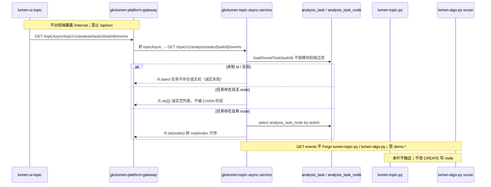

# LUMEN-SVC-P-JAVA-API-TASK-EVENTS-L01 · GET /topic/v1/analysis/tasks/{id}/events（SVC 收口）

> 日期：2026-08-21  
> Task：`LUMEN-SVC-P-JAVA-API-TASK-EVENTS-L01`  
> 总控：[`LUMEN-SVC-P-长任务总控.md`](./LUMEN-SVC-P-长任务总控.md)（§7 已生效）  
> 仓：`lumen-svc-platform` · `origin/dev`  
> 前置：`LUMEN-SVC-P-JAVA-API-TASK-CREATE-L01` `a1f5191` · `LUMEN-SVC-P-JAVA-API-TASK-GET-L01` `025e1a2` · `LUMEN-SVC-P-JAVA-API-TASK-RESULT-L01` `28de933`

## 任务认领（必填）

| 字段 | 值 |
|------|-----|
| claimed_by | `agent:api-agent` |
| supervised_by | `human:侯佳伟` |
| claim_type | `coordinator_dispatch` |
| 说明 | 长任务 24h 锁；未自行标 `done` |

## Ponytail（coding 任务必填）

| 字段 | 值 |
|------|-----|
| ponytail | `full` |
| 说明 | 现有 `GET /topic/v1/analysis/tasks/{taskId}/events` → `analysisTaskService.listEvents` → `loadOwnedTask` 再查 `analysis_task_node`。未复制 Controller、未造 `/api/svc`、未改 CREATE 写 node。未用 YAGNI 跳过可观测（events 打 taskId/nodeCount，miss 打原因）、handoff、图即契约。禁止编 CHAIN 阶段；禁止改 CHAIN events 契约。 |

## Headroom（可选）

| 字段 | 值 |
|------|-----|
| headroom | `skip` |
| 说明 | 本机会话未挂载 Headroom MCP。 |

## 图即契约

| 字段 | 值 |
|------|-----|
| diagram_id | `SVC-STORAGE-LINEAGE`（消费，不改工厂边）；`LUMEN-SVC-P-JAVA-API-TASK-EVENTS-L01-SEQ`（本叶） |
| 图 diff | LINEAGE 边未改。本叶把 RESULT SEQ 上 TASK-EVENTS 虚线改成实线：50892 → gateway `/topicAsync/**` → `gkxlumen-topic-async-service` `GET /topic/v1/analysis/tasks/{id}/events` → Java `analysis_task` 鉴权后再读 `analysis_task_node`。无 node 诚实 `[]`。禁止事项未变：不写正式库、不扫 ADS、不对前端暴露 `/internal`、禁 Feign `lumen-algo-py` 与 `demo-*`、禁 `/api/svc`、禁编 CHAIN 阶段、禁改 CREATE 写 node。 |
| 会签态 | `SVC-STORAGE-LINEAGE` 随 `storage/SVC/01-data-flow.md` frontmatter：`approved`（`human:淮政玮` · 2026-08-19 流图；2026-08-20 选 B 增补 LINEAGE，**不改** §1 工厂边） |

### L2 消费（不改边）

本叶只读消费 [`storage/SVC/01-data-flow.md`](../../data/data-design/storage/SVC/01-data-flow.md) §1.1 `SVC-STORAGE-LINEAGE`：分析任务经 Java Job 表查询；十模型 ADS 仍只在 create 下游 svcan 只读。GET events **不查 ADS、不 Feign Python**。不写工厂边、不灌数、不 hang `demo_gkx_chain`。

### L4 本叶 SEQ · `LUMEN-SVC-P-JAVA-API-TASK-EVENTS-L01-SEQ`

| 生产者 | 消费者 | 触发 | 失败语义 | 禁止事项 |
|---|---|---|---|---|
| `gkxlumen-topic-async-service` GET events | 50892 经网关 `/topicAsync/**` | 在线 GET `/topic/v1/analysis/tasks/{id}/events` | 未知 id / 空 user / 无权 → `R.failed` 诚实失败；任务存在无 node → `R.ok([])` | `/api/svc`；第二套 Controller；编 CHAIN 阶段名；改 CHAIN events 契约；GET 时 Feign Python/algo；本叶改 CREATE 写 node |
| Java Job 表 `analysis_task` | 本叶 GET events 鉴权 | 已有 CREATE 落库的 `SVC-*` / CHAIN | 表无行 → 任务不存在；归属不符 → 无权 | Java 扫 ADS；直连 nGQL；对拍前写 Demo ADS/图 |
| `analysis_task_node` | 本叶 GET events 列表 | CHAIN ReportStage 已写行；SVC 同步 Job 通常无行 | 无行诚实空；有行按表返回 | fixture 步骤；把 wait_view「必须一步」做成假 node |

## 范围与实现

复用已有 `GET /topic/v1/analysis/tasks/{taskId}/events`（`AnalysisTaskController.events`，网关 `/topicAsync/**`），**不**做成 `/api/svc`、**不**新建 Controller：

- `listEvents()` 仍先 `loadOwnedTask`，再按 taskId 查 `analysis_task_node`；无 CHAIN/EVAL/SVC 前缀过滤
- 无 node / mapper 返回 null → `R.ok([])` 诚实空列表，不编 CHAIN 阶段名
- 未知 id：`R.failed("任务不存在")`；无权：`R.failed("无权访问该任务")`
- GET **不**调用 `RemoteSvcAnalysisPythonClient.createTask` / `taskStatus`
- events 增加 info 日志（hit：taskId + nodeCount；miss：taskId + 原因）
- **未改** CHAIN events 契约 / `reportChainStage` / `upsertChainNode` / CREATE 写 node

**wait_view 过程页：** 若前端要求「必须至少一条已完成步骤」才能工作，本叶只保证诚实空 `[]`。补写 SVC node **不在本叶**，留给 WAITVIEW 联调缺口单；同仓下一张是 PORTAL-INDUSTRY，不要扩 CREATE。

**非范围**：PORTAL-INDUSTRY/REGION/SZ/KEYORG；ECO-GRAPH；REC-LIST；改 Python / 前端；写 Demo ADS/图；宣称 K8s rollout 已绿。

## 偏离说明

- 默认 PATH 上 Maven 3.6.2 无法编 compiler-plugin 3.14.0。本叶用便携 Maven 3.9.9 + Zulu 17 跑指定单测 **42 passed**。
- SVC 同步 Job 确认不写 `analysis_task_node`；本叶不补写，只测/文档诚实空。

## 产物清单

| 产物 | 路径 |
|------|------|
| GET events 复用 | `AnalysisTaskController.events` · `AnalysisTaskServiceImpl.listEvents` |
| 单测 | `AnalysisTaskServiceImplSvcJobTest`（无 node 空列表 / 未知 id / 无权）；`AnalysisTaskControllerTest.eventsReusesExistingMappingForSvcTask` |
| CHAIN 回归 | `AnalysisTaskServiceImplChainJobTest.listEventsReturnsChainStageFromNodeTable`（仍读 ReportStage 写入的 node） |
| 本 handoff | `agent-handoffs/服务机构-SVC/LUMEN-SVC-P-JAVA-API-TASK-EVENTS-L01.md` |

## 测试结果

- [x] SVC 成功任务 GET events：`[]`；不 insert node；不 Feign `taskStatus`
- [x] 未知 id 诚实失败（`任务不存在`）
- [x] 无权诚实失败（`无权访问该任务`）
- [x] Controller 仍委托已有 `analysisTaskService.listEvents`（无第二套映射）
- [x] CHAIN ReportStage 后 GET events 仍返回 `collect`/`采集`（契约未改）
- [x] 指定单测 **42 passed**（Maven 3.9.9 + JDK 17）

## 验收证据

- [x] GET `/topic/v1/analysis/tasks/{id}/events` 可查 SVC 任务节点；复用已有 `listEvents`，禁止复制一套 Controller
- [x] 无 node 返回诚实空列表，禁止编 CHAIN 阶段；不改 CHAIN events 契约；禁 Feign `lumen-algo-py` 与 `demo-*`；禁 `/api/svc`
- [x] handoff 含 ponytail: full、cost 四字段、diagram_id、SEQ
- [x] `origin/dev` `82d7cdd`；未标 `done`

## 遗留风险

- Helm env / Nacos `python-base-url` 仍属 CREATE 叶；本叶 GET events 不依赖 Python。未宣称 K8s rollout 已绿（E0 另叶）。
- wait_view 过程页若硬依赖「至少一条已完成步骤」，SVC 同步 Job 当前会显示空步骤条。补写 node 留给 WAITVIEW 联调缺口单，**本叶未改 CREATE**。
- 中间层任务表在 search-py 进程内仍会丢；Java Job 为真源，GET events 只读 Java 表。

## CI/CD（必填）

- 分支：`origin/dev`（`lumen-svc-platform`）
- commit：`82d7cdd` `feat(svc): GET analysis task events covers SVC empty nodes [agent:api-agent]`
- pipeline URL：https://gitlab.htmisoft.net/gkx-lumen/lumen-svc-platform/-/pipelines?ref=dev
- 部署 namespace / 镜像 tag：本叶未宣称 rollout
- K8s rollout：本叶未执行（E0 另叶）
- 本地：`mvn -pl gkxlumen-topic-async-service/gkxlumen-topic-async-service-biz -am test -Dtest=SvcAnalysisTypesTest,SvcAnalysisAdapterImplTest,AnalysisTaskServiceImplSvcJobTest,AnalysisTaskControllerTest,AnalysisAdapterRegistryChainTest,ChainAnalysisTypesTest,AnalysisTaskServiceImplChainJobTest` → **42 passed**

## 可观测性

- OTEL_SERVICE_NAME：`gkxlumen-topic-async-service-biz`（Dockerfile + Helm env，已有 Java Agent）
- GET events：`AnalysisTaskServiceImpl.listEvents` 打 taskId + nodeCount；miss 打 taskId + msg
- Feign：本叶 GET events 不发起 Feign
- traceId（dev 抽样）：无（本叶未 rollout）
- Tempo / Loki：沿用平台 Java Agent

## 架构合规自检

| # | 铁律 | 结果 |
|---|---|---|
| 1 | 算法只在 Python | ✅ Java GET events 不写算法、不调 svcan |
| 2 | 前端 → Java → `/internal/*` | ✅ GET events 停在 Java Job/node 表；create 下游仍走已有 `/internal/gkx-svc/**` |
| 3 | Nebula，禁 Neo4j | ✅ 本叶不碰图 |
| 4 | 可观测 OTel | ✅ `OTEL_SERVICE_NAME=gkxlumen-topic-async-service-biz` + events 日志 |
| 5 | CI | ✅ 单测 42 passed；push `origin/dev` 后走仓流水线；不宣称绿 |
| 6 | demo2 不 merge lumen | ✅ N/A |
| 7 | 共享聚合 / 分仓 | ✅ 只扩 `gkxlumen-topic-async-service`，未塞进薄 `gkxlumen-topic` |
| 8 | 只读 ADS；不写库 | ✅ GET events 不查 ADS；不写表；不改 CREATE |
| 9 | D8 | N/A 无 UI |
| 10 | D9 | ✅ 无 node 不 fixture 步骤 |
| 11 | D10 | N/A |
| 12 | D12 不调 demo-* | ✅ GET events 不 Feign；禁 `demo-*` 与 `lumen-algo-py` |

## Cost

| 字段 | 值 |
|------|-----|
| actual_tokens | 110000（估 in+out；source: session_estimate） |
| model_used | `claude-sonnet-4.5`（registry enum；本会话 Cursor Grok 4.6，enum 无 grok） |
| actual_cost | 0.66（api 75/25 × Sonnet $3/$15 per M） |
| cost_warn | `green` |

## 联调确认

联调通过（代码侧）：SVC 任务经已有 `GET /topic/v1/analysis/tasks/{id}/events` 可查；无 node 诚实 `[]`；未知 id / 无权诚实失败；CHAIN events 仍读 `analysis_task_node`。不 Feign Python。wait_view 空步骤留给 WAITVIEW 缺口单。请 coordinator AV-0，**本叶不自行标 done**。
