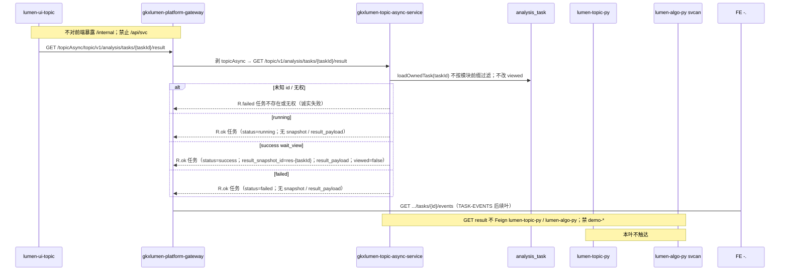

# LUMEN-SVC-P-JAVA-API-TASK-RESULT-L01 · GET /topic/v1/analysis/tasks/{id}/result（SVC 收口）

> 日期：2026-08-21  
> Task：`LUMEN-SVC-P-JAVA-API-TASK-RESULT-L01`  
> 总控：[`LUMEN-SVC-P-长任务总控.md`](./LUMEN-SVC-P-长任务总控.md)（§7 已生效）  
> 仓：`lumen-svc-platform` · `origin/dev`  
> 前置：`LUMEN-SVC-P-JAVA-API-TASK-CREATE-L01` `a1f5191` · `LUMEN-SVC-P-JAVA-API-TASK-GET-L01` `025e1a2`

## 任务认领（必填）

| 字段 | 值 |
|------|-----|
| claimed_by | `agent:api-agent` |
| supervised_by | `human:侯佳伟` |
| claim_type | `coordinator_dispatch` |
| 说明 | 长任务 24h 锁；未自行标 `done` |

## Ponytail（coding 任务必填）

| 字段 | 值 |
|------|-----|
| ponytail | `full` |
| 说明 | 现有 `GET /topic/v1/analysis/tasks/{taskId}/result` → `analysisTaskService.result` → `loadOwnedTask` 与 detail 同源，已能带回 CREATE 签发的 `result_snapshot_id` + `result_payload`。未复制 Controller、未造 `/api/svc`。未用 YAGNI 跳过可观测（result 打 taskId/type/status/snapshot）、handoff、图即契约。禁止改 CHAIN result 契约；禁止把 `viewed` 改 true。 |

## Headroom（可选）

| 字段 | 值 |
|------|-----|
| headroom | `skip` |
| 说明 | 本机会话未挂载 Headroom MCP。 |

## 图即契约

| 字段 | 值 |
|------|-----|
| diagram_id | `SVC-STORAGE-LINEAGE`（消费，不改工厂边）；`LUMEN-SVC-P-JAVA-API-TASK-RESULT-L01-SEQ`（本叶） |
| 图 diff | LINEAGE 边未改。本叶把 GET SEQ 上 TASK-RESULT 虚线改成实线：50892 → gateway `/topicAsync/**` → `gkxlumen-topic-async-service` `GET /topic/v1/analysis/tasks/{id}/result` → Java `analysis_task`（Job 真源，含 `result_snapshot_id` + `result_payload`）。EVENTS 仍虚线。禁止事项未变：不写正式库、不扫 ADS、不对前端暴露 `/internal`、禁 Feign `lumen-algo-py` 与 `demo-*`、禁 `/api/svc`、禁改 CHAIN result、禁把 `viewed` 改 true。 |
| 会签态 | `SVC-STORAGE-LINEAGE` 随 `storage/SVC/01-data-flow.md` frontmatter：`approved`（`human:淮政玮` · 2026-08-19 流图；2026-08-20 选 B 增补 LINEAGE，**不改** §1 工厂边） |

### L2 消费（不改边）

本叶只读消费 [`storage/SVC/01-data-flow.md`](../../data/data-design/storage/SVC/01-data-flow.md) §1.1 `SVC-STORAGE-LINEAGE`：分析任务经 Java Job 表查询；十模型 ADS 仍只在 create 下游 svcan 只读。GET result **不查 ADS、不 Feign Python**。不写工厂边、不灌数、不 hang `demo_gkx_chain`。

### L4 本叶 SEQ · `LUMEN-SVC-P-JAVA-API-TASK-RESULT-L01-SEQ`

| 生产者 | 消费者 | 触发 | 失败语义 | 禁止事项 |
|---|---|---|---|---|
| `gkxlumen-topic-async-service` GET result | 50892 经网关 `/topicAsync/**` | 在线 GET `/topic/v1/analysis/tasks/{id}/result` | 未知 id / 空 user → `R.failed` 诚实失败；失败 Job 仍可查但无 payload | `/api/svc`；第二套 Controller；改 CHAIN result 契约；GET 时 Feign Python/algo；把 `viewed` 改 true |
| Java Job 表 `analysis_task` | 本叶 GET result | 已有 CREATE 落库的 `SVC-*` | 表无行 → 任务不存在；归属不符 → 无权 | Java 扫 ADS；直连 nGQL；对拍前写 Demo ADS/图 |
| CREATE 已签发的 `result_snapshot_id` + `result_payload` | 前端 wait_view | 仅 success | failed / running 不签发、GET 不得伪造 | Python 自签 snapshot；fixture 填成功态；本接口标已读 |

## 范围与实现

复用已有 `GET /topic/v1/analysis/tasks/{taskId}/result`（`AnalysisTaskController.result`，网关 `/topicAsync/**`），**不**做成 `/api/svc`、**不**新建 Controller：

- `result()` 仍委托 `loadOwnedTask`，与 detail 同源；无 CHAIN/EVAL/SVC 前缀过滤
- success：`resultAssetId=res-{taskId}`，`targetParams.result_snapshot_id` / `result_payload` / `page_mode_hint=process_succeeded_wait_view` / `viewed=false`
- failed / running：无 snapshot、无 `result_payload`
- 未知 id：`R.failed("任务不存在")`
- GET **不**调用 `RemoteSvcAnalysisPythonClient.createTask` / `taskStatus`
- result 增加 info 日志（taskId / analysisType / status / snapshot）；**未**把 `viewed` 改 true
- **未改** CHAIN result 契约 / `ChainAnalysisTypes` / CHAIN Adapter / Complete 签发

**非范围**：TASK-EVENTS（Controller 已有 `/events` 映射，本叶不扩语义）；PORTAL-INDUSTRY；改 Python / 前端；写 Demo ADS/图；宣称 K8s rollout 已绿。

## 偏离说明

- 默认 PATH 上 Maven 3.6.2 无法编 compiler-plugin 3.14.0。本叶用便携 Maven 3.9.9 + Zulu 17 跑指定单测 **37 passed**。
- `result` 与 `detail` 同形（均 `loadOwnedTask`）；未复制查询、只补日志与 SVC 单测。

## 产物清单

| 产物 | 路径 |
|------|------|
| GET result 复用 | `AnalysisTaskController.result` · `AnalysisTaskServiceImpl.result` |
| 单测 | `AnalysisTaskServiceImplSvcJobTest`（success snapshot+payload / failed 无 payload / running 无 payload / 未知 id；viewed 仍 false）；`AnalysisTaskControllerTest.resultReusesExistingMappingForSvcTask` |
| CHAIN 回归 | `AnalysisTaskServiceImplChainJobTest`（GetResult 仍绿、不改 viewed） |
| 本 handoff | `agent-handoffs/服务机构-SVC/LUMEN-SVC-P-JAVA-API-TASK-RESULT-L01.md` |

## 测试结果

- [x] SVC 成功任务 GET result：`res-SVC-1` + `result_payload`；`viewed=false`
- [x] SVC 失败任务 GET result：可查、无 snapshot / payload
- [x] SVC running GET result：可查、无 payload；不 Feign Python
- [x] 未知 id 诚实失败（`任务不存在`）
- [x] Controller 仍委托已有 `analysisTaskService.result`（无第二套映射）
- [x] CHAIN Job 单测仍绿（`AnalysisTaskServiceImplChainJobTest` 7 passed，result 不改 viewed）
- [x] 指定单测 **37 passed**（Maven 3.9.9 + JDK 17）

## 验收证据

- [x] GET `/topic/v1/analysis/tasks/{id}/result` 可取 SVC 成功快照（`result_snapshot_id` + `result_payload`）；复用已有 result
- [x] running/failed 诚实无 payload；不把 viewed 改 true；未改 CHAIN result 契约；禁 Feign `lumen-algo-py` 与 `demo-*`；禁 `/api/svc`
- [x] handoff 含 ponytail: full、cost 四字段、diagram_id、SEQ
- [x] `origin/dev` `28de933`；未标 `done`

## 遗留风险

- Helm env / Nacos `python-base-url` 仍属 CREATE 叶；本叶 GET result 不依赖 Python。未宣称 K8s rollout 已绿（E0 另叶）。
- TASK-EVENTS 仍待后续叶；本叶不扩 `/events` 语义。
- 中间层任务表在 search-py 进程内仍会丢；Java Job 为真源，GET result 只读 Java 表。

## CI/CD（必填）

- 分支：`origin/dev`（`lumen-svc-platform`）
- commit：`28de933` `feat(svc): GET analysis task result covers SVC snapshots [agent:api-agent]`
- pipeline URL：https://gitlab.htmisoft.net/gkx-lumen/lumen-svc-platform/-/pipelines?ref=dev
- 部署 namespace / 镜像 tag：本叶未宣称 rollout
- K8s rollout：本叶未执行（E0 另叶）
- 本地：`mvn -pl gkxlumen-topic-async-service/gkxlumen-topic-async-service-biz -am test -Dtest=SvcAnalysisTypesTest,SvcAnalysisAdapterImplTest,AnalysisTaskServiceImplSvcJobTest,AnalysisTaskControllerTest,AnalysisAdapterRegistryChainTest,ChainAnalysisTypesTest,AnalysisTaskServiceImplChainJobTest` → **37 passed**

## 可观测性

- OTEL_SERVICE_NAME：`gkxlumen-topic-async-service-biz`（Dockerfile + Helm env，已有 Java Agent）
- GET result：`AnalysisTaskServiceImpl.result` 打 taskId / analysisType / status / snapshot；miss 打 taskId + msg
- Feign：本叶 GET result 不发起 Feign
- traceId（dev 抽样）：无（本叶未 rollout）
- Tempo / Loki：沿用平台 Java Agent

## 架构合规自检

| # | 铁律 | 结果 |
|---|---|---|
| 1 | 算法只在 Python | ✅ Java GET result 不写算法、不调 svcan |
| 2 | 前端 → Java → `/internal/*` | ✅ GET result 停在 Java Job 表；create 下游仍走已有 `/internal/gkx-svc/**` |
| 3 | Nebula，禁 Neo4j | ✅ 本叶不碰图 |
| 4 | 可观测 OTel | ✅ `OTEL_SERVICE_NAME=gkxlumen-topic-async-service-biz` + result 日志 |
| 5 | CI | ✅ 单测 37 passed；push `origin/dev` 后走仓流水线；不宣称绿 |
| 6 | demo2 不 merge lumen | ✅ N/A |
| 7 | 共享聚合 / 分仓 | ✅ 只扩 `gkxlumen-topic-async-service`，未塞进薄 `gkxlumen-topic` |
| 8 | 只读 ADS；不写库 | ✅ GET result 不查 ADS；不写表；不改 viewed |
| 9 | D8 | N/A 无 UI |
| 10 | D9 | ✅ 失败/未知不 fixture 成功态 |
| 11 | D10 | N/A |
| 12 | D12 不调 demo-* | ✅ GET result 不 Feign；禁 `demo-*` 与 `lumen-algo-py` |

## Cost

| 字段 | 值 |
|------|-----|
| actual_tokens | 130000（估 in+out；source: session_estimate） |
| model_used | `claude-sonnet-4.5`（registry enum；本会话 Cursor Grok 4.6，enum 无 grok） |
| actual_cost | 0.78（api 75/25 × Sonnet $3/$15 per M） |
| cost_warn | `green` |

## 联调确认

联调通过（代码侧）：SVC 成功任务经已有 `GET /topic/v1/analysis/tasks/{id}/result` 可取 `res-{taskId}` + `result_payload`；running/failed 无 payload；未知 id 诚实失败；不把 `viewed` 改 true；不 Feign Python。下一叶：`LUMEN-SVC-P-JAVA-API-TASK-EVENTS-L01` 或 FE WAITVIEW（本叶 ≥ integration）。请 coordinator AV-0，**本叶不自行标 done**。
