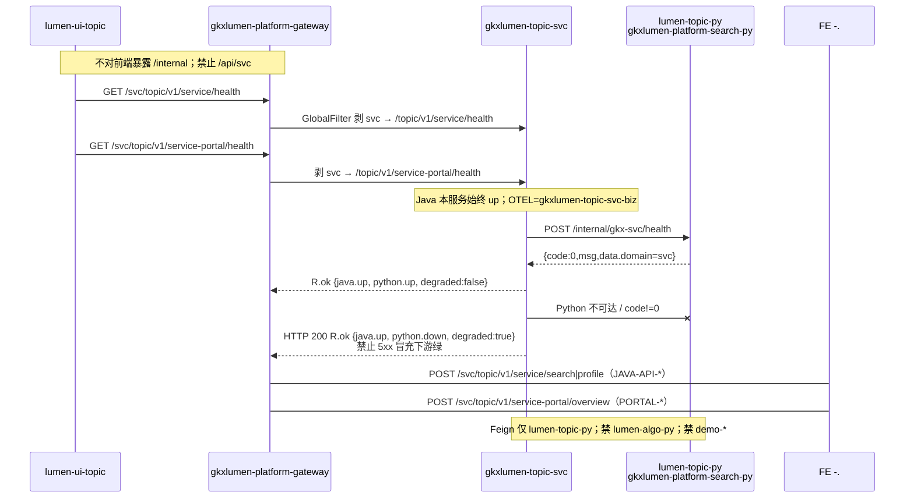

# LUMEN-SVC-P-JAVA-BOOT-L01 · 新建 gkxlumen-topic-svc + 网关 + health

> 日期：2026-08-21  
> Task：`LUMEN-SVC-P-JAVA-BOOT-L01`  
> 总控：[`LUMEN-SVC-P-长任务总控.md`](./LUMEN-SVC-P-长任务总控.md)（§7 已生效）  
> 仓：`lumen-svc-platform` · `origin/dev`

## 任务认领（必填）

| 字段 | 值 |
|------|-----|
| claimed_by | `agent:api-agent` |
| supervised_by | `human:侯佳伟` |
| claim_type | `coordinator_dispatch` |
| 说明 | 长任务 24h 锁；未自行标 `done` |

## Ponytail（coding 任务必填）

| 字段 | 值 |
|------|-----|
| ponytail | `full` |
| 说明 | 对齐 `gkxlumen-topic-chain` 最小 api+biz；ABORT 空壳复用目录后补 pom/源码。未用 YAGNI 跳过 OTel、网关、health、handoff、图即契约。业务 SEARCH/PORTAL/TASK 路径留给后续 API 叶。 |

## Headroom（可选）

| 字段 | 值 |
|------|-----|
| headroom | `skip` |
| 说明 | 本机会话未挂载 Headroom MCP。 |

## 图即契约

| 字段 | 值 |
|------|-----|
| diagram_id | `SVC-STORAGE-LINEAGE`（消费，不改工厂边）；`LUMEN-SVC-P-JAVA-BOOT-L01-SEQ`（本叶 BOOT） |
| 图 diff | LINEAGE 边未改。本叶把 PY BOOT 的 Java/网关虚线改成实线：50892 → gateway `/svc/**` → `gkxlumen-topic-svc` → `lumen-topic-py` `POST /internal/gkx-svc/health`。search/portal/profile/analysis 仍虚线至后续 JAVA-API-*。禁止事项未变：不写正式库、对拍前不写 Demo ADS/图、不对前端暴露 `/internal`、禁 Feign `lumen-algo-py` 与 `demo-*`、禁 `/api/svc`。 |
| 会签态 | `SVC-STORAGE-LINEAGE` 随 `01-data-flow.md` frontmatter：`approved`（`human:淮政玮` · 2026-08-19 流图；2026-08-20 选 B 增补 LINEAGE，**不改** §1 工厂边） |

### L2 消费（不改边）

本叶只读消费 [`storage/SVC/01-data-flow.md`](../../data/data-design/storage/SVC/01-data-flow.md) §1.1 `SVC-STORAGE-LINEAGE`：线上只读 ADS 卡面/十模型/KPI，不联 ODS。BOOT **尚未读表**；SEARCH-ORGS / PORTAL-* 叶才经 Python 读 `svc_org_card`。Java 不扫 DWD、不写 ADS、不写 nGQL。

### L4 本叶 SEQ · `LUMEN-SVC-P-JAVA-BOOT-L01-SEQ`

| 生产者 | 消费者 | 触发 | 失败语义 | 禁止事项 |
|---|---|---|---|---|
| `gkxlumen-topic-svc` health | 50892 经网关 | 在线 GET `/topic/v1/service/health` 与 `/topic/v1/service-portal/health` | Java 始终 `up`；Python 失败 → `degraded=true` 仍 HTTP 200，**不** 5xx 冒充绿 | `/api/svc`；StripPrefix 再剥一层；把 SVC 塞进薄 `gkxlumen-topic` |
| `lumen-topic-py` `POST /internal/gkx-svc/health` | 本叶 Feign | Java 探活 | 连不上 / HTTP≥400 / `code!=0` → python `down` | Feign `lumen-algo-py`；Feign `demo-svc-topic-py` / 任何 `demo-*`；对前端暴露 `/internal` |
| （虚线）SEARCH/PORTAL/TASK | 后续 `LUMEN-SVC-P-JAVA-API-*` | 用户业务操作 | 本叶无业务 Controller | 本叶写 Demo ADS/图；扫 DWD；直连 nGQL；扩 async-service 白名单 |

## 范围与实现

ABORT 后 `gkxlumen-topic-svc/` 只剩空目录。本叶按 `gkxlumen-topic-chain` 最小骨架真正建模块并接线（**不要**继续 ABORT 空壳）：

- 新建 `gkxlumen-topic-svc`（api + biz），端口 **7096**，`@EnableOpenApi("svc")`
- health：`GET /topic/v1/service/health` 与 `GET /topic/v1/service-portal/health`；Feign `POST /internal/gkx-svc/health`；失败诚实降级
- 网关：`Path=/svc/**` → `lb://gkxlumen-topic-svc-biz`；GlobalFilter 剥第一段 `svc`；**禁止再 StripPrefix**；**禁止** `/api/svc`
- `sys_route_conf` SQL + `gkxlumen-gateway-dev.yml`
- Feign **仅** `lumen-topic-py`（K8s `http://gkxlumen-platform-search-py:8080`）
- 父 POM / `ServiceNameConstants.TOPIC_SVC_SERVICE` / CI `backend:image:topic-svc` + `deploy:topic-svc` / Helm `values-lumen.yaml` `topic-svc.enabled: true`（与 chain 同策略）
- OTel：`OTEL_SERVICE_NAME=gkxlumen-topic-svc-biz`

**非范围**：SEARCH-ORGS / PROFILE / PORTAL-* / TASK-* / ECO / REC；扩展 `gkxlumen-topic-async-service`；改 Python / 前端。

## 偏离说明

- 本机 Maven 3.6.2 + JDK 8，无法本地 `mvn test`（compiler-plugin 要求更新）；契约测试已写入 `ServiceFacadeControllerTest` / `ServiceFacadeServiceImplTest`，待 CI `backend:build` 验证。
- `deploy:topic-svc` 在 Deployment 尚未被 helm 装出前会红（`kubectl get deployment` 找不到）。本叶不宣称 K8s rollout 已绿（E0 另叶）。首次需要 `helm:deploy` 或 `helm:chart` + `FORCE_NACOS_REPUBLISH=true` 灌网关/Nacos 种子。
- 不把旧 `LUMEN-SVC-JAVA-FACADE-L01` 当 `depends_on`；只对照其路径骨架。

## 产物清单

| 产物 | 路径 |
|------|------|
| 模块 | `repos/lumen-svc-platform/gkxlumen-topic-svc/**` |
| 路由 SQL | `repos/lumen-svc-platform/db/9x_gkxlumenx_sys_route_conf_topic_svc.sql` |
| 网关 / Helm | `helm/gkxlumen-platform/configs/gkxlumen-gateway-dev.yml` · `values.yaml` · `values-lumen.yaml` · `configs/gkxlumen-topic-svc-biz-dev.yml` |
| 本 handoff | `agent-handoffs/服务机构-SVC/LUMEN-SVC-P-JAVA-BOOT-L01.md` |

## 测试结果

- [x] MockMvc：`GET /topic/v1/service/health` 与 `/topic/v1/service-portal/health` 映射（standalone，对齐 chain）
- [x] 服务单测：Python `code=0` → `degraded=false`；Feign 5xx / `code!=0` → `R.code=0` 且 `degraded=true`
- [ ] 本机 `mvn test`：环境 JDK 8，未跑；待 CI

## 验收证据

- [x] 新建 `gkxlumen-topic-svc`（api+biz）并对齐 topic-chain；health 可打（契约测试）
- [x] 网关暴露 `/topic/v1/service/**` 与 `/topic/v1/service-portal/**`（`Path=/svc/**` + 剥 `svc`）；禁止 `/api/svc`
- [x] 禁 Feign `lumen-algo-py` 与 `demo-*`；仅 `lumen-topic-py` `/internal/gkx-svc/health`
- [x] `origin/dev` `db5f824`；未标 `done`

## 遗留风险

- 业务路径未实现：打 search/portal 会 404（留给 JAVA-API-*，预期）。
- `sys_route_conf` SQL 需在平台库执行；Nacos `gkxlumen-gateway-dev.yml` 需 `nacosConfigInit` 再灌才热更新现网网关。
- `deploy:topic-svc` 依赖已有 Deployment；E0 前可能红。

## CI/CD（必填）

- 分支：`origin/dev`（`lumen-svc-platform`）
- commit：`db5f824` `feat(svc): restore gkxlumen-topic-svc BOOT module [agent:api-agent]`
- pipeline URL：https://gitlab.htmisoft.net/gkx-lumen/lumen-svc-platform/-/pipelines?ref=dev
- 部署 namespace / 镜像 tag：本叶未宣称 rollout；image job `backend:image:topic-svc` 已接线
- K8s rollout：本叶未执行（E0 另叶）
- 本地：契约测试源码就位；JDK 8 无法跑 `mvn test`

## 可观测性

- OTEL_SERVICE_NAME：`gkxlumen-topic-svc-biz`（Dockerfile + Helm env）
- traceId（dev 抽样）：无（本叶未 rollout）
- Tempo / Loki：沿用平台 Java Agent；本叶新服务名 `gkxlumen-topic-svc-biz`

## 架构合规自检

| # | 铁律 | 结果 |
|---|---|---|
| 1 | 算法只在 Python | ✅ Java 不写算法 |
| 2 | 前端 → Java → `/internal/*` | ✅ Feign `POST /internal/gkx-svc/health` |
| 3 | Nebula，禁 Neo4j | ✅ 本叶不碰图 |
| 4 | 可观测 OTel | ✅ `OTEL_SERVICE_NAME=gkxlumen-topic-svc-biz` |
| 5 | CI | ✅ image+deploy+parent `-pl` 已登记；本叶不宣称绿 |
| 6 | demo2 不 merge lumen | ✅ N/A |
| 7 | 共享聚合 / 分仓 | ✅ 新建 `gkxlumen-topic-svc`，未塞进薄 `gkxlumen-topic` |
| 8 | 只读 ADS；不写库 | ✅ 探活不扫表；Nacos 数据源 `READ ONLY` |
| 9 | D8 | N/A 无 UI |
| 10 | D9 | ✅ 不造假 KPI |
| 11 | D10 | N/A |
| 12 | D12 不调 demo-* | ✅ Feign 仅 `lumen-topic-py`；禁 `demo-*` 与 `lumen-algo-py` |

## Cost

| 字段 | 值 |
|------|-----|
| actual_tokens | 160000（估 in+out；source: session_estimate） |
| model_used | `claude-sonnet-4.5`（registry enum；本会话 Cursor Grok 4.6，enum 无 grok） |
| actual_cost | 1.20（api 75/25 × Sonnet $3/$15 per M） |
| cost_warn | `green` |

## 联调确认

联调通过（代码侧）：模块/网关前缀/health 降级契约就绪，可对接已发布 `gkx_svc_service`。下一叶：`LUMEN-SVC-P-JAVA-API-SEARCH-ORGS-L01`（BOOT ≥ integration）。请 coordinator AV-0，**本叶不自行标 done**。
