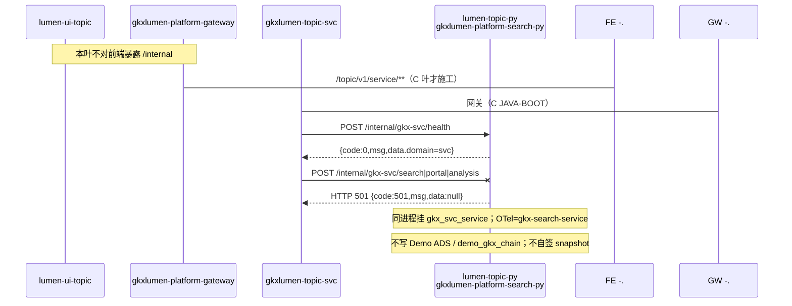

# LUMEN-SVC-P-PY-MIDDLE-BOOT-L01 · lumen-topic-py `/internal/gkx-svc` 骨架 + health

> 日期：2026-08-21  
> Task：`LUMEN-SVC-P-PY-MIDDLE-BOOT-L01`  
> 总控：[`LUMEN-SVC-P-长任务总控.md`](./LUMEN-SVC-P-长任务总控.md)（§7 已生效）  
> 仓：`lumen-topic-py` · `origin/dev`

## 任务认领（必填）

| 字段 | 值 |
|------|-----|
| claimed_by | `agent:algorithm-agent` |
| supervised_by | `human:侯佳伟` |
| claim_type | `coordinator_dispatch` |
| 说明 | 长任务 24h 锁；未自行标 `done` |

## Ponytail（coding 任务必填）

| 字段 | 值 |
|------|-----|
| ponytail | `full` |
| 说明 | 对照同仓 `gkx_search_service` 挂载方式恢复 `gkx_svc_service`；SEARCH/TASK 业务 501，不一次做完三段。未用 YAGNI 跳过 OTel / 调用链 / handoff。 |

## Headroom（可选）

| 字段 | 值 |
|------|-----|
| headroom | `skip` |
| 说明 | 本机会话未挂载 Headroom MCP。 |

## 图即契约

| 字段 | 值 |
|------|-----|
| diagram_id | `SVC-STORAGE-LINEAGE`（消费，不改工厂边）；`LUMEN-SVC-P-PY-MIDDLE-BOOT-L01-SEQ`（本叶骨架） |
| 图 diff | LINEAGE 边未改。本叶只钉 P 在线读：Java Feign → `lumen-topic-py` `/internal/gkx-svc/health`；search/portal/task 虚线至 SEARCH/TASK 叶。禁止事项未变：不写正式库、对拍前不写 Demo ADS/图、不对前端暴露 `/internal`。 |
| 会签态 | `SVC-STORAGE-LINEAGE` 随 `01-data-flow.md` frontmatter：`approved`（`human:淮政玮` · 2026-08-19 流图；2026-08-20 选 B 增补 LINEAGE，**不改** §1 工厂边） |

### L2 消费（不改边）

本叶只读消费 [`storage/SVC/01-data-flow.md`](../../data/data-design/storage/SVC/01-data-flow.md) §1.1 `SVC-STORAGE-LINEAGE`：线上只读 ADS 卡面/十模型/KPI，不联 ODS。BOOT **尚未读表**；SEARCH 叶才接 `svc_org_card`。

### L4 本叶 SEQ 骨架 · `LUMEN-SVC-P-PY-MIDDLE-BOOT-L01-SEQ`

| 生产者 | 消费者 | 触发 | 失败语义 | 禁止事项 |
|---|---|---|---|---|
| `lumen-topic-py` `gkx_svc_service` health | Java `gkxlumen-topic-svc`（C 叶） | 在线 POST `/internal/gkx-svc/health` | 进程挂则 5xx；包络仍 `{code,msg,data}` | 对前端暴露 `/internal`；第二套服务名；Feign `demo-svc-topic-py` |
| BOOT 501 桩 | SEARCH/TASK 叶替换 | 误打 search/portal/analysis | HTTP 501 + `code=501`，禁止 200 空列表冒充有数 | 本叶读/写 ADS；写 `demo_gkx_chain`；自签 `result_snapshot_id`；fixture 充数 |
| （虚线）C 网关/Java | 50892 前端 | 用户操作 | 本叶不施工 | 改 `lumen-ui-topic` / `lumen-svc-platform` / `lumen-algo-py` |

## 范围与实现

ABORT（`2e182b9`）撤掉源码后只剩 `__pycache__`。本叶按 `gkx_search_service` 同进程挂载恢复 **`gkx_svc_service` 包名**（禁止第二套）：

- `GET /healthz`（独立 app 探活）
- `POST /internal/gkx-svc/health`、`POST /internal/gkx-svc/boot/ping` → `{code,msg,data}`，`writes_ads=false`
- search/portal/profile/analysis → **HTTP 501** 诚实空（留给 `LUMEN-SVC-P-PY-MIDDLE-SEARCH-L01` / `MIDDLE-TASK-L01`）
- `gkx_search_service.main` `include_router`；`Dockerfile.search` COPY 包；K8s 仍只发 `gkxlumen-platform-search-py`
- OTel：沿用 `gkx_common.observability.TraceHeaderMiddleware` + 镜像 `opentelemetry-instrument`；挂载进程 `OTEL_SERVICE_NAME=gkx-search-service`

**非范围**：真实检索/门户 ADS、任务 create/callback、svcan、Java Feign、50892 前端。

## 偏离说明

- 旧 DEMO BOOT 曾独立 uvicorn:8088 且未挂 search-py，Feign 404。本叶一次挂上 search-py（与 ABORT 前 `85a8fd9` 同构），不另发进程。
- 旧 SEARCH 实现（`repo.py` 读 ADS）**不恢复**；对拍 50100 前不写 Demo ADS/图。
- 不把旧 `DEMO-SVC-PY-*` / `LUMEN-SVC-*` 当 `depends_on`。

## 产物清单

| 产物 | 路径 |
|------|------|
| 服务入口 | `repos/lumen-topic-py/gkx_svc_service/main.py` |
| BOOT / 501 | `gkx_svc_service/views/boot.py` · `search.py` · `task.py` |
| 挂载 | `gkx_search_service/main.py` · `docker/Dockerfile.search` |
| 测试 | `tests/test_gkx_svc_boot.py` · `tests/test_gkx_svc_mounted_on_search.py` |
| 本 handoff | `agent-handoffs/服务机构-SVC/LUMEN-SVC-P-PY-MIDDLE-BOOT-L01.md` |

## 测试结果

- [x] `py -3 -m pytest tests/test_gkx_svc_boot.py tests/test_gkx_svc_mounted_on_search.py` → **10 passed**
- [x] `GKX_MOCK_ENABLED=1 pytest tests/test_gkx_svc_boot.py` → **6 passed**（对齐 CI smoke）
- [x] `POST /internal/gkx-svc/health` → `code==0`，`data.domain==svc`
- [x] `POST /internal/gkx-svc/search/orgs` 与 `analysis/tasks/create` → HTTP 501 + `{code:501,msg,data}`
- [x] search-py 已 include `/internal/gkx-svc` 前缀（`_IncludedRouter.original_router.prefix`）

## 遗留风险

- SEARCH/TASK 未实现：Java 若提前打业务路径会 501（预期）。
- `py:smoke` 仍 `GKX_MOCK_ENABLED=1`，不跑 mounted HTTP（会触发 `AppConfig` 禁 mock）；挂载由 boot 测试的 router 前缀 + `import gkx_search_service.main` 覆盖。
- K8s deploy 本仓默认 **manual**；本叶不宣称 dev rollout 已绿。

## CI/CD（必填）

- 分支：`origin/dev`（`lumen-topic-py`）
- commit：（push 后回填 short SHA）
- pipeline URL：https://gitlab.htmisoft.net/gkx-lumen/lumen-topic-py/-/pipelines?ref=dev
- 部署 namespace / 镜像 tag：未自动 deploy（需 `FULL_PIPELINE=true` 或手动 `deploy:search`）
- K8s rollout：本叶未执行
- 本地：`pytest tests/test_gkx_svc_boot.py` 绿

## 可观测性

- OTEL_SERVICE_NAME：`gkx-search-service`（挂载在 search-py）；独立 app 日志名 `gkx-svc-service`
- TraceHeaderMiddleware：与 search 同进程，响应可带 `traceparent` / `X-Trace-Id`（OTel 已装时）
- Tempo / Loki：沿用平台 collector；本叶无新 service 名

## 架构合规自检

| # | 铁律 | 结果 |
|---|---|---|
| 1 | 算法只在 Python | ✅ 无 Java 算法；本叶无模型 |
| 2 | 前端 → Java → `/internal/*` | ✅ 前缀 `/internal/gkx-svc/**`；不对前端暴露 |
| 3 | Nebula，禁 Neo4j | ✅ 本叶不碰图 |
| 4 | 可观测 OTel | ✅ instrument 入口 + TraceHeaderMiddleware |
| 5 | CI | ✅ `py:smoke` 增加 `gkx_svc_service.main` + boot pytest |
| 6 | demo2 不 merge lumen | ✅ N/A |
| 7 | 共享聚合 / Java 不写算法 | ✅ |
| 8 | 只读 ADS 目标态；本叶不写库 | ✅ `writes_ads=false`；无 `gkxlumenx_*` |
| 9 | D8 | N/A 无 UI |
| 10 | D9 | ✅ 不造假 KPI；501 不冒充有数 |
| 11 | D10 | N/A |
| 12 | D12 不调 demo-* | ✅ 仓内 `lumen-topic-py`；禁 Feign demo-svc-topic-py |

## Cost

| 字段 | 值 |
|------|-----|
| actual_tokens | 180000（估 in+out；source: session_estimate） |
| model_used | `claude-sonnet-4.5`（registry enum；本会话 Cursor Grok 4.6，enum 无 grok） |
| actual_cost | 1.08（algorithm 75/25 × Sonnet $3/$15 per M） |
| cost_warn | `green` |

## 联调确认

health 包络可打通（本地 pytest）。下一叶：`LUMEN-SVC-P-PY-MIDDLE-SEARCH-L01`（BOOT ≥ integration 后）。请 coordinator AV-0，**本叶不自行标 done**。
