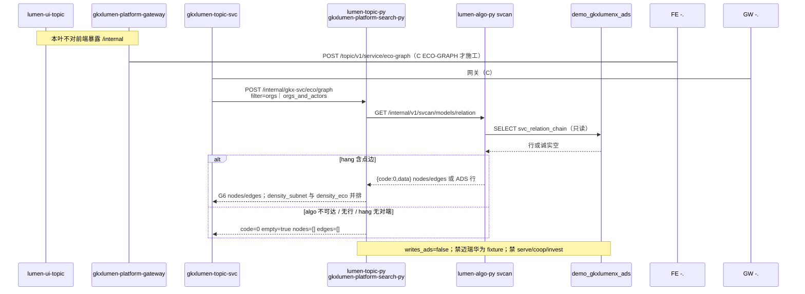

# LUMEN-SVC-P-PY-MIDDLE-ECO-L01 · lumen-topic-py 生态图谱同步读面

> 日期：2026-08-21  
> Task：`LUMEN-SVC-P-PY-MIDDLE-ECO-L01`  
> 总控：[`LUMEN-SVC-P-长任务总控.md`](./LUMEN-SVC-P-长任务总控.md)（§7 已生效）  
> 仓：`lumen-topic-py` · `origin/dev`  
> 故事：`US-SVC-ECO-01`（本叶只出内部读面，不做 Java/前端）

## 任务认领（必填）

| 字段 | 值 |
|------|-----|
| claimed_by | `agent:algorithm-agent` |
| supervised_by | `human:侯佳伟` |
| claim_type | `coordinator_dispatch` |
| 说明 | 长任务 24h 锁；未自行标 `done` |

## Ponytail（coding 任务必填）

| 字段 | 值 |
|------|-----|
| ponytail | `full` |
| 说明 | 复用 TASK 叶的 `GKX_ALGO_BASE_URL` + httpx GET svcan；只加一条 `POST /internal/gkx-svc/eco/graph`。未用 YAGNI 跳过 OTel / 空态诚实 / handoff / 图即契约 / D9 黄灯。不改 search/portal/task 契约，不改 `lumen-algo-py`。 |

## Headroom（可选）

| 字段 | 值 |
|------|-----|
| headroom | `skip` |
| 说明 | 本机会话未挂载 Headroom MCP。 |

## 图即契约

| 字段 | 值 |
|------|-----|
| diagram_id | `SVC-STORAGE-LINEAGE`（消费，不改工厂边）；`LUMEN-SVC-P-PY-MIDDLE-ECO-L01-SEQ`（本叶） |
| 图 diff | LINEAGE 边未改。本叶把 P 在线虚线中的生态图谱读面改成实线：`lumen-topic-py` GET `lumen-algo-py` `/internal/v1/svcan/models/relation`，包络出 G6 `nodes`/`edges` + `density_subnet`/`density_eco`。禁止事项未变：对拍前不写 Demo ADS/图、不 CREATE 新边类型、禁迈瑞/华为 fixture、不对前端暴露 `/internal`、Java 不直连 algo。 |
| 会签态 | `SVC-STORAGE-LINEAGE` 随 `01-data-flow.md` frontmatter：`approved`（`human:淮政玮` · 2026-08-19 流图；2026-08-20 选 B 增补 LINEAGE，**不改** §1 工厂边） |

### L2 消费（不改边）

本叶只读消费 [`storage/SVC/01-data-flow.md`](../../data/data-design/storage/SVC/01-data-flow.md) §1.1 `SVC-STORAGE-LINEAGE`：生态图经 Java → 中间层 → `lumen-algo-py` svcan **只读** `svc_relation_chain` / hang 点边。不写工厂边、不灌数、不 hang、不连 nGQL。

### L4 本叶 SEQ · `LUMEN-SVC-P-PY-MIDDLE-ECO-L01-SEQ`

| 生产者 | 消费者 | 触发 | 失败语义 | 禁止事项 |
|---|---|---|---|---|
| Java `gkxlumen-topic-svc`（C ECO-GRAPH） | `gkx_svc_service` eco | 在线 POST `/internal/gkx-svc/eco/graph` | 非法 `filter` 回落到 `orgs`；不 5xx | 对前端暴露 `/internal`；改 search/portal/task |
| `lumen-algo-py` GET `/internal/v1/svcan/models/relation` | 本叶 | HTTP（`GKX_ALGO_BASE_URL`，默认 `http://lumen-platform-algo-py:8000`） | 连不上 / HTTP≥400 / 无 hang 点边 → `code=0` `empty=true` `nodes=[]` `edges=[]` | POST `/analyze`；`/sample/shortboard` 当真源；Feign `demo-*`；Java 直连 algo |
| 切法 A hang（`demo_gkx_chain`） | G6 点边 | 同一 hang 双滤镜 | 滤镜②对端不在 hang → 不画该点、不造点 | 迈瑞/华为/华大基因 fixture；排名表冒充图谱；新边类型 `serve`/`coop`/`invest` |
| ADS `svc_relation_chain.density` | `density_subnet` 无拓扑时 | 只读 | N&lt;2 记 0 | 用 `density_eco` 覆盖子网列名；把 Q062 改绿 |

## 范围与实现

只加一条内部 POST，包络 `{code,msg,data}`：

| 路径 | 行为 |
|------|------|
| `POST /internal/gkx-svc/eco/graph` | GET svcan relation；`filter=orgs`（仅机构）或 `orgs_and_actors`（机构+已 hang 关联主体）；G6 `nodes`+`edges`；`density_subnet` 与 `density_eco` 并排（`2E/N(N-1)`，N&lt;2 记 0） |

- 下游只 HTTP 打 `GKX_ALGO_BASE_URL` `GET /internal/v1/svcan/models/relation`。本仓可以打 algo `/internal`；Java 仍不得直连。
- 同一 hang 只滤显示，不换空间。滤镜②对端不在 hang → 丢边、不造点。
- 现网 svcan relation 读面是 `relation_summary`/`relation_top`（无拓扑）时：**诚实空图**，禁止把排名表画成图谱；`density_subnet` 可回落 ADS 密度，`density_eco=0`。
- `pending_client_confirm` 原样；`gap` 含 Q062 / Q-SVCCHAIN-03，不改绿。
- 边类型只出 `belongs_to` / `participates` / `supplies` / `depends_on`（`cooperation` 等映射到 `participates`）。
- search-py 同进程 `include_router` eco；`py:smoke` 增加 `tests/test_gkx_svc_eco.py`。

**非范围**：Java `LUMEN-SVC-P-JAVA-API-ECO-GRAPH-L01`；改 svcan 公式；REC-LIST；写 ADS/Nebula；50892 前端；宣称 K8s 绿。

## 偏离说明

- SVCAN-BOOT 的 relation 读面当前无 `nodes`/`edges`（ADS 行）。本叶不改 `lumen-algo-py`；无 hang 拓扑则空图画，密度列仍并排。Java/前端须按 `empty` 展示，不能把 `relation_top` 当 G6。
- 进程内不连 nGQL。标 `ponytail:` 天花板：拓扑以 algo 包络 hang/graph/nodes 为准；升级路径是 svcan 读面补 hang 点边，而不是中间层造边。

## 产物清单

| 产物 | 路径 |
|------|------|
| 读面 | `repos/lumen-topic-py/gkx_svc_service/views/eco.py` |
| 挂载 | `gkx_svc_service/main.py` · `gkx_search_service/main.py` |
| 测试 | `tests/test_gkx_svc_eco.py`（CI smoke 已列入） |
| 本 handoff | `agent-handoffs/服务机构-SVC/LUMEN-SVC-P-PY-MIDDLE-ECO-L01.md` |

## 测试结果

- [x] `py -3 -m pytest tests/test_gkx_svc_boot.py tests/test_gkx_svc_search.py tests/test_gkx_svc_task.py tests/test_gkx_svc_eco.py tests/test_gkx_svc_mounted_on_search.py` → **38 passed**
- [x] `GKX_MOCK_ENABLED=1 pytest tests/test_gkx_svc_boot.py tests/test_gkx_svc_search.py tests/test_gkx_svc_task.py tests/test_gkx_svc_eco.py` → **34 passed**（对齐 CI smoke；mounted 不进 smoke）
- [x] 成功点边 + `orgs`/`orgs_and_actors` + `density_subnet`/`density_eco` 并排且滤镜不改密度
- [x] hang 对端不在 hang：不造点；无行 / algo 失败：`code=0` `empty=true` `nodes=[]` `edges=[]`，响应不含迈瑞/华为/华大基因
- [x] `relation_top` 不当图谱；`cooperation` → `participates`
- [x] search/orgs 与 tasks/create 契约未改（缺 `task_id` 仍 400）

## 验收证据

- [x] POST `/internal/gkx-svc/eco/graph` 只读转 GET `/internal/v1/svcan/models/relation`
- [x] 双滤镜字段进包络；双密度并排；hang 无对端不造点
- [x] 不对前端暴露 `/internal`；不改 search/portal/task；黄灯不改绿
- [x] handoff 含 ponytail: full、cost 四字段、diagram_id、SEQ、pytest 证据

## 遗留风险

- 现网 svcan relation 无 hang 点边时，50892 生态图为诚实空（预期，直到 algo 包络带 `nodes`/`edges` 或 C 叶联调有拓扑）。
- K8s 未注入 `GKX_ALGO_BASE_URL` 时默认集群 DNS `lumen-platform-algo-py:8000`；本机无该 DNS 则 `unavailable:algo` 空图。
- `py:smoke` 仍 `GKX_MOCK_ENABLED=1`，不打 mounted HTTP。
- K8s deploy 本仓默认 **manual**；本叶不宣称 dev rollout 已绿。
- Java Feign 仍待 `LUMEN-SVC-P-JAVA-API-ECO-GRAPH-L01`；契约路径必须是 `/internal/gkx-svc/eco/graph`。

## CI/CD（必填）

- 分支：`origin/dev`（`lumen-topic-py`）
- commit：`47289f9` `feat(svc): gkx-svc eco/graph 双滤镜读 svcan relation [agent:algorithm-agent]`
- pipeline URL：https://gitlab.htmisoft.net/gkx-lumen/lumen-topic-py/-/pipelines?ref=dev
- 部署 namespace / 镜像 tag：未自动 deploy（需 `FULL_PIPELINE=true` 或手动 `deploy:search`）
- K8s rollout：本叶未执行
- 本地：`pytest tests/test_gkx_svc_eco.py` 绿

## 可观测性

- OTEL_SERVICE_NAME：`gkx-search-service`（挂载在 search-py）
- TraceHeaderMiddleware：与 search 同进程
- eco：`gkx-svc-service.eco` logger（filter / url / ok）
- Tempo / Loki：沿用平台 collector；无新 service 名

## 架构合规自检

| # | 铁律 | 结果 |
|---|---|---|
| 1 | 算法只在 Python | ✅ 公式在 `lumen-algo-py` svcan；本叶只 HTTP 适配 + 滤镜/密度 |
| 2 | 前端 → Java → `/internal/*` | ✅ 前缀 `/internal/gkx-svc/**`；不对前端暴露 |
| 3 | Nebula，禁 Neo4j | ✅ 只声明 `demo_gkx_chain`；本叶不连 nGQL、不写边 |
| 4 | 可观测 OTel | ✅ 同进程 instrument + TraceHeaderMiddleware + eco 日志 |
| 5 | CI | ✅ `py:smoke` 增加 `test_gkx_svc_eco.py` |
| 6 | demo2 不 merge lumen | ✅ N/A |
| 7 | 共享聚合 / Java 不写算法 | ✅ Java 不直连 algo |
| 8 | 只读 Demo ADS；不写库 | ✅ `writes_ads=false` |
| 9 | D8 | N/A 无 UI |
| 10 | D9 | ✅ Q062 `pending_client_confirm` 原样；不改绿 |
| 11 | D10 | N/A |
| 12 | D12 不调 demo-* | ✅ 只调 `lumen-algo-py`；禁 Feign demo-svc-topic-py |

## Cost

| 字段 | 值 |
|------|-----|
| actual_tokens | 210000（估 in+out；source: session_estimate） |
| model_used | `claude-sonnet-4.5`（registry enum；本会话 Cursor Grok 4.6，enum 无 grok） |
| actual_cost | 1.26（algorithm 75/25 × Sonnet $3/$15 per M） |
| cost_warn | `green` |

## 联调确认

本地 pytest 包络可打通（mock svcan GET）。Java Feign 仍待 C `LUMEN-SVC-P-JAVA-API-ECO-GRAPH-L01`。请 coordinator AV-0，**本叶不自行标 done**。
