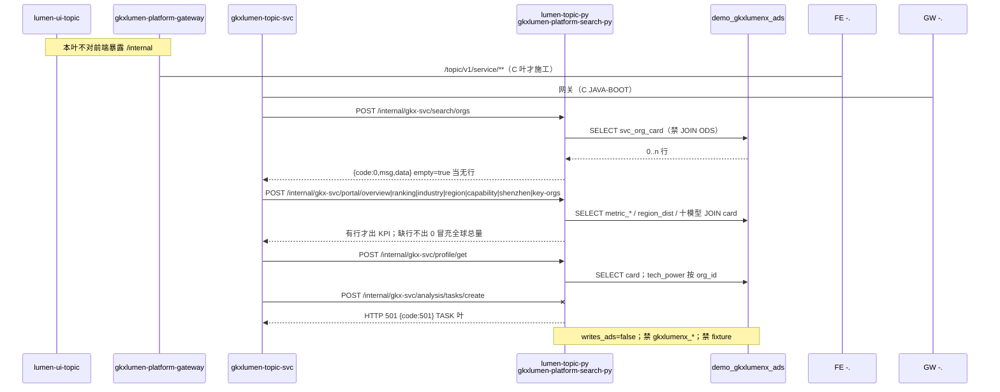

# LUMEN-SVC-P-PY-MIDDLE-SEARCH-L01 · lumen-topic-py 搜索/门户/画像只读 Demo ADS

> 日期：2026-08-21  
> Task：`LUMEN-SVC-P-PY-MIDDLE-SEARCH-L01`  
> 总控：[`LUMEN-SVC-P-长任务总控.md`](./LUMEN-SVC-P-长任务总控.md)（§7 已生效）  
> 仓：`lumen-topic-py` · `origin/dev`

## 任务认领（必填）

| 字段 | 值 |
|------|-----|
| claimed_by | `agent:algorithm-agent` |
| supervised_by | `human:侯佳伟` |
| claim_type | `coordinator_dispatch` |
| 说明 | 长任务 24h 锁；未自行标 `done` |

## Ponytail（coding 任务必填）

| 字段 | 值 |
|------|-----|
| ponytail | `full` |
| 说明 | 复用 BOOT 路由骨架 + 仓内 pymysql 读面；按 `svc_org_card` / A1–A6 / 十模型契约重写，不恢复旧 `svc_org_profile_card` 与 `_FALLBACK_ITEMS`。未用 YAGNI 跳过 OTel / 调用链 / handoff / 空态诚实。 |

## Headroom（可选）

| 字段 | 值 |
|------|-----|
| headroom | `skip` |
| 说明 | 本机会话未挂载 Headroom MCP。 |

## 图即契约

| 字段 | 值 |
|------|-----|
| diagram_id | `SVC-STORAGE-LINEAGE`（消费，不改工厂边）；`LUMEN-SVC-P-PY-MIDDLE-SEARCH-L01-SEQ`（本叶读面） |
| 图 diff | LINEAGE 边未改。本叶把 BOOT 的 search/portal/profile 虚线 501 改成实线：`lumen-topic-py` SELECT `demo_gkxlumenx_ads`（卡面/KPI/十模型），名称 JOIN `svc_org_card` 不回 ODS。TASK create 仍虚线。禁止事项未变：不写正式库、对拍前不写 Demo ADS/图、不对前端暴露 `/internal`、禁 fixture。 |
| 会签态 | `SVC-STORAGE-LINEAGE` 随 `01-data-flow.md` frontmatter：`approved`（`human:淮政玮` · 2026-08-19 流图；2026-08-20 选 B 增补 LINEAGE，**不改** §1 工厂边） |

### L2 消费（不改边）

本叶只读消费 [`storage/SVC/01-data-flow.md`](../../data/data-design/storage/SVC/01-data-flow.md) §1.1 `SVC-STORAGE-LINEAGE`：线上名单/详情读 `svc_org_card`，KPI 读 fact/series/dist/region_dist，十模型读 tech/attract/cultivate/gap；**不联 ODS**。不写工厂边、不灌数。

### L4 本叶 SEQ · `LUMEN-SVC-P-PY-MIDDLE-SEARCH-L01-SEQ`

| 生产者 | 消费者 | 触发 | 失败语义 | 禁止事项 |
|---|---|---|---|---|
| F 已写入的 Demo ADS 行 | `gkx_svc_service` 读面 | 在线 POST `/internal/gkx-svc/search\|portal\|profile` | 无 host / 连不上 / 缺表 → HTTP 200 + `empty` + `data_source=unavailable:*`，**不** 200 填 fixture | 写 ADS/图；JOIN ODS；读正式 `gkxlumenx_*`；Feign `demo-*` |
| `svc_org_card` | 搜索/画像/模型名称 | 名单与详情 | 0 行 = `items=[]` `empty=true`；profile 无卡 = `data=null` msg=not found | 平行 `svc_org_base`；旧 `svc_org_profile_card` 当契约 |
| A1–A6 四表 | 门户 overview/产业/区域/深圳 | 同上 | 缺 metric 行则省略该 KPI，不用 30999 常量填数 | 全球趋势 × 深圳比冒充 SZ trend；省名复制成国别 |
| 十模型表 JOIN card | ranking / capability / key-orgs | 同上 | 无最新 `calc_batch_id` 则空列表；黄灯 `pending.Q060/Q063` | 运行时切 Q061；把 Q-SVC-010 改绿 |
| TASK 501 桩 | MIDDLE-TASK-L01 | 误打 analysis | HTTP 501 + `code=501` | 本叶 create/callback；自签 snapshot |

## 范围与实现

替换 BOOT 的 search/portal/profile **HTTP 501**，保持 POST + `{code,msg,data}`：

| 路径 | 读 |
|------|----|
| `POST /internal/gkx-svc/search/orgs` | `svc_org_card`（keyword/org_id/city/industry/六类候选） |
| `POST /internal/gkx-svc/profile/get` | 卡面 + 最新批 `svc_tech_power_score` |
| `POST /internal/gkx-svc/portal/overview` | `M_SVC_ORG_CNT` / `M_SVC_SZ_SCALE` / `M_SVC_NEW_CNT` / `M_SVC_INVEST_Y` / layout / 省分布 |
| `POST /internal/gkx-svc/portal/ranking` | ATTRACT→`svc_attraction_recommend`；CULTIVATE→`svc_cultivation_recommend`；TECH→技术力；名称 JOIN card |
| `POST /internal/gkx-svc/portal/industry-distribution` | `M_SVC_INDUSTRY_LAYOUT` + `svc_chain_gap` 环节（有则出） |
| `POST /internal/gkx-svc/portal/region-map` | `svc_region_dist`；有 country 才出 global，否则只出 province |
| `POST /internal/gkx-svc/portal/capability-rank` | 技术力 JOIN card |
| `POST /internal/gkx-svc/portal/shenzhen` | `M_SVC_SZ_SCALE` + `M_SVC_SZ_DISTRICT`；无独立 SZ series 则不出 trend |
| `POST /internal/gkx-svc/portal/key-orgs` | 技术力按 `org_id` 去重 |

ADS 库名必须匹配 `^demo_[a-z0-9_]+_ads$`（默认 `demo_gkxlumenx_ads`）。包络带 `pending_client_confirm=1` 与 `gap: Q-SVC-010`（能力榜 Q060、名单 Q063），黄灯不改绿。

**非范围**：TASK create/callback（`LUMEN-SVC-P-PY-MIDDLE-TASK-L01`）；`lumen-algo-py`；Java Feign；50892 前端；写 ADS/Nebula；改 30999。

## 偏离说明

- 旧 ABCD SEARCH（`858af1b`）读 `svc_org_profile_card` 且空库回填华大基因 fixture。本叶 **不恢复** 该表与 `_FALLBACK_ITEMS`，对齐 F 契约 `svc_org_card`。
- 连库只认 `GKX_MYSQL_*` / `ENTAN_MYSQL_*` 环境变量（K8s 注入），不读 `conf/settings.yaml`，避免 CI `GKX_MOCK_ENABLED=1` 去打内网 MySQL。
- 增加 `/portal/key-orgs`（BOOT 原文件未挂此路径；对应后续 JAVA KEYORG / `US-SVC-PT-06`）。

## 产物清单

| 产物 | 路径 |
|------|------|
| 读面 | `repos/lumen-topic-py/gkx_svc_service/repo.py` |
| 路由 | `gkx_svc_service/views/search.py` |
| 测试 | `tests/test_gkx_svc_search.py`（CI smoke 已列入） |
| 本 handoff | `agent-handoffs/服务机构-SVC/LUMEN-SVC-P-PY-MIDDLE-SEARCH-L01.md` |

## 测试结果

- [x] `py -3 -m pytest tests/test_gkx_svc_boot.py tests/test_gkx_svc_search.py tests/test_gkx_svc_mounted_on_search.py` → **17 passed**
- [x] `GKX_MOCK_ENABLED=1 pytest tests/test_gkx_svc_boot.py tests/test_gkx_svc_search.py` → **12 passed**（对齐 CI smoke；mounted 不进 smoke）
- [x] 无 MySQL host：search/portal `empty=true` `items=[]`，响应不含 `华大基因` / `SVC-MOCK-001`
- [x] `GKX_MYSQL_ADS_DB=gkxlumenx_ads` → `ValueError refused`
- [x] `POST /internal/gkx-svc/analysis/tasks/create` 仍 HTTP 501
- [x] search-py 仍 include `/internal/gkx-svc`

## 验收证据

- [x] 搜索/门户/画像读 Demo ADS 契约稳定，空态诚实不造假
- [x] 对拍前只读不写；禁正式库；禁 demo-* Feign
- [x] handoff 含 ponytail: full、cost 四字段、diagram_id
- [x] 不对前端暴露 `/internal`；不自签 snapshot

## 遗留风险

- K8s 未注入 `GKX_MYSQL_HOST` 时读面为 `unavailable:no_mysql_host` 空态（预期，不填数）。
- Demo ADS 若尚未 F-SEED，门户 KPI 全空；Java/前端须按 `empty` 展示，不能当 5xx。
- `py:smoke` 仍 `GKX_MOCK_ENABLED=1`，不打 mounted HTTP。
- K8s deploy 本仓默认 **manual**；本叶不宣称 dev rollout 已绿。
- TASK 未实现：Java 若提前打 analysis 仍 501。

## CI/CD（必填）

- 分支：`origin/dev`（`lumen-topic-py`）
- commit：`7dfa9fa` `feat(svc): gkx-svc search/portal/profile 读 Demo ADS [agent:algorithm-agent]`
- pipeline URL：https://gitlab.htmisoft.net/gkx-lumen/lumen-topic-py/-/pipelines?ref=dev
- 部署 namespace / 镜像 tag：未自动 deploy（需 `FULL_PIPELINE=true` 或手动 `deploy:search`）
- K8s rollout：本叶未执行
- 本地：`pytest tests/test_gkx_svc_search.py` 绿

## 可观测性

- OTEL_SERVICE_NAME：`gkx-search-service`（挂载在 search-py）
- TraceHeaderMiddleware：与 search 同进程
- 读失败：`gkx-svc-service` logger warning，不抛成 5xx 冒充有数
- Tempo / Loki：沿用平台 collector；无新 service 名

## 架构合规自检

| # | 铁律 | 结果 |
|---|---|---|
| 1 | 算法只在 Python | ✅ 本叶无模型计算；只读 F 已回写 ADS |
| 2 | 前端 → Java → `/internal/*` | ✅ 前缀 `/internal/gkx-svc/**`；不对前端暴露 |
| 3 | Nebula，禁 Neo4j | ✅ 本叶不碰图 |
| 4 | 可观测 OTel | ✅ 同进程 instrument + TraceHeaderMiddleware |
| 5 | CI | ✅ `py:smoke` 增加 `test_gkx_svc_search.py` |
| 6 | demo2 不 merge lumen | ✅ N/A |
| 7 | 共享聚合 / Java 不写算法 | ✅ |
| 8 | 只读 Demo ADS；不写库 | ✅ `writes_ads=false`；拒 `gkxlumenx_ads` |
| 9 | D8 | N/A 无 UI |
| 10 | D9 | ✅ 不造假 KPI；黄灯 Q-SVC-010/Q060/Q063 带 pending |
| 11 | D10 | N/A |
| 12 | D12 不调 demo-* | ✅ 仓内 `lumen-topic-py`；禁 Feign demo-svc-topic-py |

## Cost

| 字段 | 值 |
|------|-----|
| actual_tokens | 220000（估 in+out；source: session_estimate） |
| model_used | `claude-sonnet-4.5`（registry enum；本会话 Cursor Grok 4.6，enum 无 grok） |
| actual_cost | 1.32（algorithm 75/25 × Sonnet $3/$15 per M） |
| cost_warn | `green` |

## 联调确认

本地 pytest 包络可打通。Java Feign 与 50892 仍待 C 叶。下一叶：`LUMEN-SVC-P-PY-MIDDLE-TASK-L01`（同仓串行）。请 coordinator AV-0，**本叶不自行标 done**。
