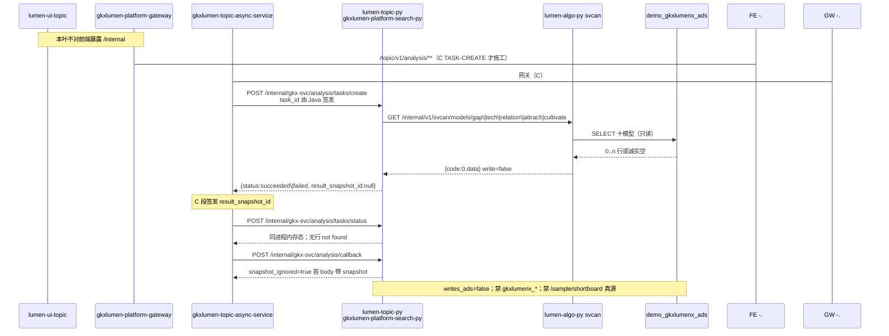

# LUMEN-SVC-P-PY-MIDDLE-TASK-L01 · lumen-topic-py 任务 create/status/callback 适配 svcan

> 日期：2026-08-21  
> Task：`LUMEN-SVC-P-PY-MIDDLE-TASK-L01`  
> 总控：[`LUMEN-SVC-P-长任务总控.md`](./LUMEN-SVC-P-长任务总控.md)（§7 已生效）  
> 仓：`lumen-topic-py` · `origin/dev`

## 任务认领（必填）

| 字段 | 值 |
|------|-----|
| claimed_by | `agent:algorithm-agent` |
| supervised_by | `human:侯佳伟` |
| claim_type | `coordinator_dispatch` |
| 说明 | 长任务 24h 锁；未自行标 `done` |

## Ponytail（coding 任务必填）

| 字段 | 值 |
|------|-----|
| ponytail | `full` |
| 说明 | 复用仓内企业评估「Java 签发 task_id + 中间层 HTTP 调 lumen-algo」模式，以及旧 TASK 的 create/status/callback 包络；改接到 SVCAN-BOOT 已有 GET `/models*`，不另起 Job 微服务、不调已废 `/analyze` 与 `/sample/shortboard` 真源。未用 YAGNI 跳过 OTel / 调用链 / handoff。 |

## Headroom（可选）

| 字段 | 值 |
|------|-----|
| headroom | `skip` |
| 说明 | 本机会话未挂载 Headroom MCP。 |

## 图即契约

| 字段 | 值 |
|------|-----|
| diagram_id | `SVC-STORAGE-LINEAGE`（消费，不改工厂边）；`LUMEN-SVC-P-PY-MIDDLE-TASK-L01-SEQ`（本叶） |
| 图 diff | LINEAGE 边未改。本叶把 SEARCH 的 analysis 虚线 501 改成实线：`lumen-topic-py` GET `lumen-algo-py` `/internal/v1/svcan/models*`（只读十模型 ADS）。禁止事项未变：不写正式库、对拍前不写 Demo ADS/图、不对前端暴露 `/internal`、不自签 `result_snapshot_id`。 |
| 会签态 | `SVC-STORAGE-LINEAGE` 随 `01-data-flow.md` frontmatter：`approved`（`human:淮政玮` · 2026-08-19 流图；2026-08-20 选 B 增补 LINEAGE，**不改** §1 工厂边） |

### L2 消费（不改边）

本叶只读消费 [`storage/SVC/01-data-flow.md`](../../data/data-design/storage/SVC/01-data-flow.md) §1.1 `SVC-STORAGE-LINEAGE`：分析任务经 Java → 中间层 → `lumen-algo-py` svcan **只读**十模型 ADS（gap/relation/tech/attract/cultivate）。不写工厂边、不灌数、不 hang `demo_gkx_chain`。

### L4 本叶 SEQ · `LUMEN-SVC-P-PY-MIDDLE-TASK-L01-SEQ`

| 生产者 | 消费者 | 触发 | 失败语义 | 禁止事项 |
|---|---|---|---|---|
| Java async-service（C 叶）`task_id` | `gkx_svc_service` create | 在线 POST `/internal/gkx-svc/analysis/tasks/create` | 缺 `task_id` → `code=400`；未知 `analysis_key` → `code=422`，不默默 shortboard | 中间层自签 `result_snapshot_id`；另起 Job 微服务 |
| `lumen-algo-py` GET `/internal/v1/svcan/models*` | 本叶 create | HTTP（`GKX_ALGO_BASE_URL`，默认 `http://lumen-platform-algo-py:8000`） | 连不上 / HTTP≥400 → `status=failed` + `error`，**仍不签发 snapshot** | POST `/sample/shortboard` 当真源；`/analyze`；Feign `demo-*` |
| F 已写入的 Demo ADS 十模型（经 svcan） | Java 成功后签发快照 | 同步 GET 读面 | svcan 诚实空 = `succeeded` + empty payload，不是 5xx | 对拍前写 Demo ADS/图；写正式 `gkxlumenx_*` |
| callback 入站 | Java 状态对齐 | POST `/internal/gkx-svc/analysis/callback` | 缺 `task_id` → 400；带 snapshot 字段则忽略 | 把 Python 当 Job 真源 |

## 范围与实现

替换 BOOT 的 analysis **HTTP 501**，保持 POST + `{code,msg,data}`：

| 路径 | 行为 |
|------|------|
| `POST /internal/gkx-svc/analysis/tasks/create` | Java 必填 `task_id`；按 `analysis_key` / `analysisType` 解析切法 A 键；**GET** svcan 十模型读面 |
| `POST /internal/gkx-svc/analysis/tasks/status` | 同进程内存表（重启丢失；Job 真源在 Java） |
| `POST /internal/gkx-svc/analysis/callback` | 落状态；`result_snapshot_id` 恒为 `null`；入站若带 snapshot 则 `snapshot_ignored=true` |

键 → svcan（不调兼容壳）：

| analysis_key / analysisType | GET |
|-----------------------------|-----|
| `svcan.shortboard.v0` / `svc:analysis:shortboard` | `/internal/v1/svcan/models/gap` |
| `svcan.tech_power.v0` | `/internal/v1/svcan/models/tech` |
| `svcan.attract.v0` | `/internal/v1/svcan/models/attract` |
| `svcan.cultivate.v0` | `/internal/v1/svcan/models/cultivate` |
| `svcan.graph.v0` | `/internal/v1/svcan/models/relation` |
| `org_coverage` / `org_trend` / `shenzhen` | 就近读面（gap/tech/`models?kind=all`），供 C 段 CREATE 白名单扩键，本叶不改 Java |

search-py K8s 注入 `GKX_ALGO_BASE_URL=http://lumen-platform-algo-py:8000`。`py:smoke` 增加 `tests/test_gkx_svc_task.py`。

**非范围**：`gkxlumen-topic-svc` / async-service 白名单扩键（C TASK-CREATE）；改 svcan 公式；SEARCH 读面再改；写 ADS/Nebula；50892 前端。

## 偏离说明

- 旧 ABCD TASK（`73492fe`）POST `/internal/v1/svcan/analyze`。P 的 SVCAN-BOOT **没有** `/analyze`；短板真源是 GET `/models/gap`（Q-SVCCHAIN-03），`/sample/shortboard` 仅兼容壳。本叶改 GET 读面，不复活 `/analyze`。
- 进程内 `_TASKS` 只服务同 Pod 轮询；重启丢失。Job 与 snapshot 仍在 Java。标 `ponytail:` 天花板。
- 不读 `conf/settings.yaml` / `AppConfig`，避免 CI `GKX_MOCK_ENABLED=1` 触发 mock 禁令。

## 产物清单

| 产物 | 路径 |
|------|------|
| 任务适配 | `repos/lumen-topic-py/gkx_svc_service/views/task.py` |
| 探活 | `gkx_svc_service/views/boot.py` · `main.py` |
| K8s algo URL | `k8s/dev-search-py.yaml` |
| 测试 | `tests/test_gkx_svc_task.py`（CI smoke 已列入） |
| 本 handoff | `agent-handoffs/服务机构-SVC/LUMEN-SVC-P-PY-MIDDLE-TASK-L01.md` |

## 测试结果

- [x] `py -3 -m pytest tests/test_gkx_svc_boot.py tests/test_gkx_svc_search.py tests/test_gkx_svc_task.py tests/test_gkx_svc_mounted_on_search.py` → **29 passed**
- [x] `GKX_MOCK_ENABLED=1 pytest tests/test_gkx_svc_boot.py tests/test_gkx_svc_search.py tests/test_gkx_svc_task.py` → **25 passed**（对齐 CI smoke；mounted 不进 smoke）
- [x] create 缺 `task_id` → `code=400`，不再 HTTP 501
- [x] shortboard → GET `/internal/v1/svcan/models/gap`，URL 不含 `/sample/shortboard` 与 `/analyze`
- [x] `result_snapshot_id` 恒 `null`；入站 snapshot 被忽略
- [x] algo 不可达 → `status=failed`，仍不签发 snapshot

## 验收证据

- [x] 任务 create/status/callback 适配 `lumen-algo-py` `/internal/v1/svcan/**`
- [x] 不自签 `result_snapshot_id`
- [x] 不对前端暴露 `/internal`；禁正式库；禁 demo-* Feign
- [x] handoff 含 ponytail: full、cost 四字段、diagram_id

## 遗留风险

- K8s 未注入 `GKX_ALGO_BASE_URL` 时默认集群 DNS `lumen-platform-algo-py:8000`；本机无该 DNS 则 create=`failed`（诚实，Java 写 errorMsg）。
- 内存任务表随 search-py 重启清空；Java 必须以自身 Job 为真源轮询/落库。
- analysisType 八键 Python 已接；**Java 白名单扩键仍待 C `LUMEN-SVC-P-JAVA-API-TASK-CREATE-L01`**。
- `py:smoke` 仍 `GKX_MOCK_ENABLED=1`，不打 mounted HTTP。
- K8s deploy 本仓默认 **manual**；本叶不宣称 dev rollout 已绿。

## CI/CD（必填）

- 分支：`origin/dev`（`lumen-topic-py`）
- commit：`de8d36a` `feat(svc): gkx-svc analysis tasks adapt svcan models [agent:algorithm-agent]`
- pipeline URL：https://gitlab.htmisoft.net/gkx-lumen/lumen-topic-py/-/pipelines?ref=dev
- 部署 namespace / 镜像 tag：未自动 deploy（需 `FULL_PIPELINE=true` 或手动 `deploy:search`）
- K8s rollout：本叶未执行
- 本地：`pytest tests/test_gkx_svc_task.py` 绿

## 可观测性

- OTEL_SERVICE_NAME：`gkx-search-service`（挂载在 search-py）
- TraceHeaderMiddleware：与 search 同进程
- create/callback：`gkx-svc-service.task` logger（task_id / leaf / url / snapshot_ignored）
- Tempo / Loki：沿用平台 collector；无新 service 名

## 架构合规自检

| # | 铁律 | 结果 |
|---|---|---|
| 1 | 算法只在 Python | ✅ 计算在 `lumen-algo-py` svcan；本叶只 HTTP 适配 |
| 2 | 前端 → Java → `/internal/*` | ✅ 前缀 `/internal/gkx-svc/**`；不对前端暴露 |
| 3 | Nebula，禁 Neo4j | ✅ 本叶不碰图 |
| 4 | 可观测 OTel | ✅ 同进程 instrument + TraceHeaderMiddleware + 任务日志 |
| 5 | CI | ✅ `py:smoke` 增加 `test_gkx_svc_task.py` |
| 6 | demo2 不 merge lumen | ✅ N/A |
| 7 | 共享聚合 / Java 不写算法 | ✅ Java 不直连 algo |
| 8 | 只读 Demo ADS；不写库 | ✅ `writes_ads=false`；svcan `write=false` |
| 9 | D8 | N/A 无 UI |
| 10 | D9 | ✅ 黄灯 gap 随包络；不造假 KPI |
| 11 | D10 | N/A |
| 12 | D12 不调 demo-* | ✅ 只调 `lumen-algo-py`；禁 Feign demo-svc-topic-py |

## Cost

| 字段 | 值 |
|------|-----|
| actual_tokens | 190000（估 in+out；source: session_estimate） |
| model_used | `claude-sonnet-4.5`（registry enum；本会话 Cursor Grok 4.6，enum 无 grok） |
| actual_cost | 1.14（algorithm 75/25 × Sonnet $3/$15 per M） |
| cost_warn | `green` |

## 联调确认

本地 pytest 包络可打通（mock svcan GET）。Java Feign 与 snapshot 签发仍待 C `LUMEN-SVC-P-JAVA-API-TASK-CREATE-L01`。请 coordinator AV-0，**本叶不自行标 done**。
