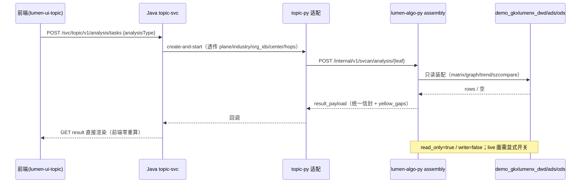

# LUMEN-SVC-P-PY-SVCAN-ASM-L01 · svcan 页面装配层（覆盖矩阵 / 图谱边集 / 年度序列 / 深圳对比 / 统一信封）

> **Task ID**：`LUMEN-SVC-P-PY-SVCAN-ASM-L01`（本任务唯一登记号；**后续所有修改都追加到本文 §9 变更记录，不再另开 task-id**）
> **日期**：2026-10-22
> **仓**：`lumen-algo-py`（`origin/dev`）· `lumen-ui-algo-apiview`（`origin/dev`）
> **上游**：`local-workspace/docs/tasks/investiage/20261022_产业链服务机构分析接口调研/产业链服务机构分析接口调研报告.md` §6.2 阶段 1
> **派单来源**：用户直接指令（唐绍祖），claim_type=pull
> **状态**：`integration`（代码已推 dev、联调通过；`live` 面待数据工厂灌数后复跑）

## 任务认领（必填）

| 字段 | 值 |
|------|-----|
| claimed_by | `agent:algorithm-agent` |
| supervised_by | `human:唐绍祖` |
| claim_type | `pull` |
| 说明 | 唐绍祖本人开 Cursor 会话，算法 lead 自认领；lock 24h |

## Ponytail（coding 任务必填）

| 字段 | 值 |
|------|-----|
| ponytail | `full` |
| 说明 | 无新增依赖（复用 pymysql/FastAPI）；装配层独立成包，不改引擎公式；未引入 ORM/缓存中间件（沿用模块级 TTL 缓存）。未用 YAGNI 跳过：`yellow_gaps` 缺口声明、只读信封 `write=false`、409 越权拒绝。 |

## Headroom（可选）

| 字段 | 值 |
|------|-----|
| headroom | `skip` |
| 说明 | 本机未挂载 Headroom MCP。 |

## 图即契约（必填）

| 字段 | 值 |
|------|-----|
| diagram_id | `SVC-STORAGE-LINEAGE`（消费，未改工厂边） |
| 图 diff | 无工厂边新增。装配层只增加 **读面**：`lumen-algo-py assembly/*` → `demo_gkxlumenx_ods/dwd/ads`；不写任何库、不写图。 |
| 会签态 | `approved`（沿用 `LUMEN-SVC-P-PY-SVCAN-BOOT-L01` 的 frontmatter 会签；本叶无新边） |
| 说明 | 新增 ODS 读句柄（`demo_gkxlumenx_ods`），是既有血缘的读侧展开，非新生产者。 |

| 生产者 | 消费者 | 触发 | 失败语义 | 禁止事项 |
|---|---|---|---|---|
| `demo_gkxlumenx_dwd/ads/ods` 既有表 | `lumen-algo-py` `/internal/v1/svcan/analysis/*` | 在线 POST/GET | 表缺/无行 → `status=empty` + `yellow_gaps`，**不 5xx、不补 0、不造假** | 写 ADS/图；读正式 `gkxlumenx_*`；前端重算；把缺口码塞进 `gap` |

## 范围与实现

### 1. 新增装配层 `lumen_common/algorithms/svcan/assembly/`（7 文件 / 1,330 行）

| 文件 | 行 | 职责 |
|---|---|---|
| `common.py` | 110 | 统一只读信封、耗时计时、缺口码声明 |
| `matrix.py` | 258 | 覆盖矩阵 `fields[] + orgs[].coverage{}` |
| `graph.py` | 393 | 图谱 `nodes/edges/paths`、自环剔除、精确密度 |
| `trend.py` | 214 | 年度序列 + `_all` 基线 + 后端热度研判 |
| `szcompare.py` | 258 | 五城对比矩阵 + 梯队卡 |
| `leaves.py` | 295 | 8 个叶子总装 + 未知叶子拒绝 |
| `__init__.py` | 22 | 出口与 `LEAVES` 白名单 |

口径要点：

- **matrix**：`dwd.enterprise_industry_chain` × `ads.svc_org_card` × `ods.dwd_org_base_info`；**缺格不写 0**，前端按缺失键判未覆盖。
- **graph**：`ods.dwd_org_invest_info` + `ods.dwd_org_shareholder_info` + `dwd.enterprise_supply_chain`，收敛在 `ads.svc_org_card` 机构全集内；边类型白名单 `belongs_to/participates/supplies`；自环剔除；`density_subnet = 2E/(N(N-1))` 现算并随包下发 `density_formula`；`density_eco` 全域密度保留 Q062 pending。
- **trend**：`_all` 优先取 `ads.svc_metric_series`（`M_SVC_NEW_CNT`/`M_SVC_ORG_NEW_COUNT`），缺数按成立年份回算；热度=近 3 年均值 vs 前 3 年均值（Q060 未定稿 → `yellow_gaps`）。
- **szcompare**：`scale`(svc_org_card) / `tech`(dwd.sz_city_benchmark) / `density`(svc_relation_chain) / `completeness`(svc_chain_gap)；**完整度单列不参与对比**；缺数给 `null`。
- **信封**：`read_only=true`、`write=false`、`data_plane`、`pending_client_confirm`、`yellow_gaps`、`trace_id`、`source_tables`。
- **键冲突处理**：`gap` 键只留前端六环节数组；未确认口径码全部进 `yellow_gaps`。

### 2. 改造

| 文件 | 变更 |
|---|---|
| `svcan/db.py` | `resolve_plane()`（入参 > `LUMEN_ALGO_SVCAN_PLANE` > `demo`）；新增 `ODS` 句柄；`live` 需 `LUMEN_ALGO_SVCAN_LIVE_ENABLED=1`；`LivePlaneDisabledError`；连接 3 次退避重试（demo 库偶发握手超时 2003） |
| `views/svcan.py` | 新增 `/analysis/{leaf}`（GET+POST）、`/coverage-matrix`、`/graph`、`/trend`、`/sz-compare`；`/health` 增 `metric_ids`、`assembly.leaves/assemblers/plane_default` |
| `main.py` | `LivePlaneDisabledError` → **HTTP 409 + error 信封**（原为 500 纯文本） |
| `svcan/metrics.py` | 6 个页面指标改为装配层真算：`M_SVC_ORG_COVERAGE_BREADTH/DEPTH`、`M_SVC_ORG_MARKET_HEAT`、`M_SVC_GRAPH_INFLUENCE`、`M_SVC_SZ_COMPARE_METRIC`、`M_SVC_SZ_TIER` |
| `lumen-ui-algo-apiview/src/catalog/svc.json` | 12 条 `svc.*.models` 端点 `unavailable → running`（后端早已可服务，catalog 误标） |

### 3. 测试

| 文件 | 内容 |
|---|---|
| `tests/test_svcan_assembly.py` | 17 条离线单测（FakeDB；含 `_CACHE` 隔离 autouse fixture） |
| `tests/test_svcan_assembly_live.py` | 5 条真实 demo 库回归 |

### 4. 接口清单（新增）

| 方法 | 路径 | 说明 |
|---|---|---|
| GET/POST | `/internal/v1/svcan/analysis/{leaf}` | 8 叶子：`org_coverage`、`org_trend`、`tech_power`、`shortboard`、`graph`、`shenzhen`、`attract`、`cultivate` |
| GET | `/internal/v1/svcan/coverage-matrix` | 结构端点（`limit`/`org_ids`/`plane`） |
| GET | `/internal/v1/svcan/graph` | 结构端点（`limit`/`center`/`hops`/`plane`） |
| GET | `/internal/v1/svcan/trend` | 结构端点（`industry`/`plane`） |
| GET | `/internal/v1/svcan/sz-compare` | 结构端点（`plane`） |

## 实测数据（demo 面，2026-10-22）

| 叶子 | status | 规模 |
|---|---|---|
| `org_coverage` | ads_ready | 11 领域 / 50 机构 / 234 格 / fill_rate 0.425 |
| `org_trend` | ads_ready | 12 序列（1 `_all` + 11 领域）/ 2010–2026 / 基线 17 点 |
| `tech_power` | ads_ready | 120–300 行 / 五维各 20 分权重 |
| `shortboard` | ads_ready | 6 环节；`stage-pilot`（中试熟化）0 机构为短板 |
| `graph` | ads_ready | 120 节点 / 207 边 / 3 路径 / density 0.0289916 |
| `shenzhen` | ads_ready | 5 城 / 4 指标行 / T2 第 3 档 gauge 70.5 |
| `attract` | ads_ready | 50 条 / 权重 35·30·20·15 |
| `cultivate` | ads_ready | 50 条 / 权重 25·30·25·20 |
| 29 指标 | — | real 23 / mock 6 / blocked 0 |

## 测试结果

- [x] `pytest tests/test_svcan_assembly.py tests/test_svcan_assembly_live.py -q` → **22 passed**（17 离线 + 5 真实库）
- [x] `node --test scripts/catalog.test.mjs`（lumen-ui-algo-apiview）→ **21 passed**
- [x] 黑盒联调 `run_svc_cases.py --profile new` → **16/16 通过**（连跑两轮）
- [x] 对照 `--profile baseline`（现网 30897）→ **1/5 通过**，5 处缺口复现
- [x] health：`metric_count=29`、`assembly.leaves` 8 项、`plane_default=demo`
- [x] `plane=live` 未授权 → **409 + error**，不静默读生产
- [x] 未知叶子 → `status=rejected` + 白名单，HTTP 200

## 偏离说明

1. **`matrix` 键与既有实现双口径并存**（用户已确认保留）：
   - 远程 `1350b75` 的 `/models/gap?org_ids=` → `matrix` = 机构 × **服务环节**（`stage_code`，源 `dwd.svc_org_circle`）
   - 本任务 `/analysis/org_coverage` → `matrix` = 机构 × **产业领域**（`chain_code`，源 `dwd.enterprise_industry_chain`），另给 `coverage_matrix` 明确命名版
   - 二者维度不同、端点不同，不会互相覆盖；**前端须按功能分开取用，禁止混读 `matrix`**。已在上游报告 §6.1 与提交信息标注。
2. **rebase 处理**：本地落后 `origin/dev` 15 个提交，`views/svcan.py` 自动合并（远程 `org_ids` 下推保留）；`metrics.py` 因远程 CRLF→LF 规整报整文件冲突，改为取远程 LF 版本后重贴本任务改的 6 个函数（171+/24−），内容逐行比对仅差远程 1 行 `LIMIT 5→ASC` 修复。
3. **新增连接重试**：联调中两次遇到 demo 库握手超时（2003），直接 500 会污染评测结论；加 3 次退避重连，属稳健性修正非口径变更。

## 遗留风险

| # | 项 | 影响 | 归属 |
|---|---|---|---|
| 1 | `live` 面真实回归未做 | 正式库 13 张 SVC 表 0 行、6 张未建，开关打开也无数据 | 数据工厂（阶段 3） |
| 2 | 城市级 `density` 口径 | 仅全局密度，城市级标 Q062 | 唐 + 图库方 |
| 3 | 6 个 `M_SVC_PT_*` 仍 mock | `GLOBAL_SCALE_DIST/GLOBAL_TOTAL/GLOBAL_TYPE_DIST/KEYORG_SCALE/SZ_FIELD_DIST/SZ_TYPE_DIST` | 唐（阶段 2.5 门户旁路收敛） |
| 4 | 甲方未签字口径 | Q060（热度星级）、Q-SVC-010（深圳基准）、Q-SVCCHAIN-03/04/05 | 甲方 / 契约冻结会 |
| 5 | 中试熟化 0 机构 | 短板必命中该环节 | 甲方确认（Q-SVCCHAIN-03） |
| 6 | 图谱 `limit=200` 全量边 6.4 s | 未缓存，建议加 5 min TTL | 唐 |
| 7 | 现网图谱端点 `token expired` | baseline 无法对拍边集 | 滕强（需联调 token） |
| 8 | K8s dev 未验证本提交 | 仅本机 uvicorn 验证；pipeline_waiver 生效中，`still_required` 已满足（code_complete/git_push/handoff_md） | devops（滚动后复跑） |

## 验收证据

- [x] 8 个 `analysisType` 全部 `status=ads_ready`（demo）
- [x] `org_coverage.coverage_matrix.fields.length = 11 > 0`，50 家机构有 coverage
- [x] `graph.nodes=120 > 0 && edges=207 > 0`，密度与 `2E/(N(N-1))` 对账
- [x] `org_trend.series[0].points.length = 17 >= 3`
- [x] `shenzhen.sz_compare.cities.length = 5 >= 2`
- [x] `pending_client_confirm` / `yellow_gaps` 全链透传未被吞
- [x] 前端解析器零改动（`svcCoverageModel/svcEcoGraphModel/svcTrendModel/svcSzCompareModel` 未动）
- [x] `data_source` 单一（全 `demo_ads`，不混面）

## 架构合规自检

| # | 铁律 | 结果 |
|---|---|---|
| 1 | 算法只在 Python | ✅ 全部在 `lumen-algo-py`；Java/前端未写算法 |
| 2 | 调用链 前端→Java→Python `/internal/*` | ✅ 路由 `/internal/v1/svcan/**`；不对外暴露 |
| 3 | 图谱 Nebula，禁 Neo4j | ✅ 本叶不连图库，边集取 MySQL 投融资/股东/供应链表 |
| 4 | 可观测 | ✅ 沿用 `TraceHeaderMiddleware`；信封带 `trace_id`/`cost_ms`/`source_tables` |
| 5 | CI push → Pipeline | ✅ 两仓已 push `origin/dev`（waiver active，still_required 三项满足） |
| 6 | demo2 不 merge lumen | ✅ 只在本仓实现，未 merge demo 仓 |
| 8 | 读 ADS/DWD | ✅ 只读，`write=false` |
| 10 | D9 黄灯 | ✅ 缺口码进 `yellow_gaps`，未擅自改绿 |
| 12 | D12 不调 demo-* | ✅ 只读本仓 MySQL demo 目标名 |

## CI/CD（必填）

- 分支：`origin/dev`（两仓）
- commit（lumen-algo-py）：`df91b3d5d27f9292e1c9ca3b0cf2dda60a7fe9e6`（`df91b3d`，2026-10-22T14:33:53+08:00）
  - rebase 基点：`7ac16f5`（已含远程 `1350b75` org_ids 下推 / `75f4b8b` 序列排序修复）
  - diffstat：13 files changed, 2331 insertions(+), 42 deletions(−)
- commit（lumen-ui-algo-apiview）：`700aebd35f0728b8a5f207279fcafdedc008c5b8`（`700aebd`，2026-10-22T14:33:59+08:00）
- pipeline：`pipeline_waiver.active=true`（2026-06-20 PM 决策），免 Pipeline/K8s；仍要求 code_complete / git_push / handoff_md，均已满足
- 部署 namespace / 镜像 tag：未触发；待 devops 滚动后按 §遗留风险 8 复跑
- 本地验证：`pytest` 22 passed + `node --test` 21 passed + 黑盒 16/16

## 产物清单

| 产物 | 路径 | 仓 |
|---|---|---|
| 装配层 | `lumen_common/algorithms/svcan/assembly/` | lumen-algo-py |
| 数据面/重试 | `lumen_common/algorithms/svcan/db.py` | lumen-algo-py |
| 指标真算 | `lumen_common/algorithms/svcan/metrics.py` | lumen-algo-py |
| 路由 | `lumen_algo_service/views/svcan.py` | lumen-algo-py |
| 409 处理器 | `lumen_algo_service/main.py` | lumen-algo-py |
| 测试 | `tests/test_svcan_assembly.py`、`tests/test_svcan_assembly_live.py` | lumen-algo-py |
| catalog | `src/catalog/svc.json` | lumen-ui-algo-apiview |
| 用例执行器 | `_work/testcases/run_svc_cases.py` | 根仓（local-workspace，无 remote） |
| 交付文档 | `唐绍祖前期准备工作完成情况.md` 等 4 份 | 根仓（local-workspace，无 remote） |
| 本 handoff | `agent-delivery/agent-handoffs/服务机构-SVC/LUMEN-SVC-P-PY-SVCAN-ASM-L01.md` | gkx-orchestration |

## Cost

| 字段 | 值 |
|------|-----|
| estimated_tokens | 260000 |
| actual_tokens | 待监管人回填 |
| model_used | `deepseek-flash` |
| actual_cost | 待回填 |
| cost_warn | green |

---

## 9. 变更记录（本 task-id 的追加日志）

> **规则**：本任务后续任何改动，**不新开 task-id**，在本表追加一行，并在下方补「变更详情」小节；同时刷新 `task-registry.yaml` 该条的 `update_time` 与 `note`。

| # | 日期 | 类型 | 摘要 | 提交 |
|---|---|---|---|---|
| 1 | 2026-10-22 | 初始递交 | 装配层 + plane 改造 + 5 端点 + 6 指标真算 + catalog 校准；rebase 至 `7ac16f5` | `df91b3d`（algo-py）· `700aebd`（apiview） |

### 1 · 2026-10-22 初始递交

- 交付内容见上文章节。
- 处理 rebase 冲突：`views/svcan.py` 自动合并；`metrics.py` 取远程 LF 版重贴 6 函数。
- 确认 `matrix` 双口径并存（服务环节 vs 产业领域），端点分离。
