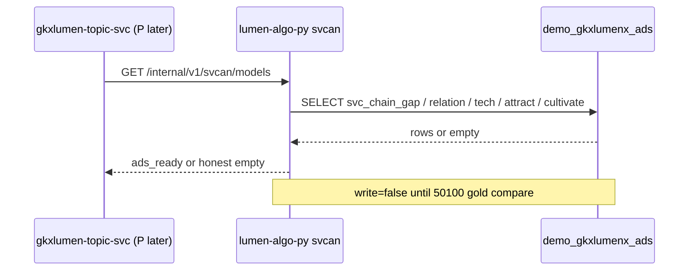

# LUMEN-SVC-P-PY-SVCAN-BOOT-L01 · svcan 换引擎不换表（切法 A + svcmodels）

> **日期**：2026-08-21  
> **Task**：`LUMEN-SVC-P-PY-SVCAN-BOOT-L01`  
> **仓**：`lumen-algo-py` · `origin/dev`  
> **总控**：[`LUMEN-SVC-P-长任务总控.md`](./LUMEN-SVC-P-长任务总控.md)（§7 已生效）  
> **对照引擎（只读移植，禁止 merge demo 仓）**：`demo-algo-ent-analysis/entan/svcmodels.py`（`svc_proxy_v1.1`）

## 任务认领（必填）

| 字段 | 值 |
|------|-----|
| claimed_by | `agent:algorithm-agent` |
| supervised_by | `human:侯佳伟` |
| claim_type | `coordinator_dispatch` |
| 说明 | P 总控 §7 已授权；lock 24h；不必再问聊天 |

## Ponytail（coding 任务必填）

| 字段 | 值 |
|------|-----|
| ponytail | `full` |
| 说明 | 复用 Demo ADS 表与 svcmodels 公式，不另起表、不加依赖。未用 YAGNI 跳过可观测（`TraceHeaderMiddleware` + `current_trace_id` 日志）与调用链铁律。 |

## Headroom（可选）

| 字段 | 值 |
|------|-----|
| headroom | `skip` |
| 说明 | 本机未挂载 Headroom MCP；CLI 认领。 |

## 图即契约（必填）

| 字段 | 值 |
|------|-----|
| diagram_id | `SVC-STORAGE-LINEAGE`（消费，不改工厂边） |
| 图 diff | 无工厂边变更。本叶只挂 P 虚线读面：`lumen-algo-py` svcan → `demo_gkxlumenx_ads` 十模型表；不写 DWD/ADS/Nebula。 |
| 会签态 | `approved`（抄 `storage/SVC/01-data-flow.md` frontmatter · 2026-08-19；LINEAGE 为 2026-08-20 选 B 增图） |
| 说明 | 节点名 = `lumen-algo-py` / `demo_gkxlumenx_ads` / `demo_gkx_chain`。禁止事项未变。 |

| 生产者 | 消费者 | 触发 | 失败语义 | 禁止事项 |
|---|---|---|---|---|
| F 已写入的 Demo ADS 十模型表 | `lumen-algo-py` `/internal/v1/svcan/models*` | 在线 GET | 连不上/无表 → `status=empty`，不 5xx、不造假 | 写正式 `gkxlumenx_*`；对拍前写 Demo ADS/图；29 指标门面当十模型引擎；短板 50/60；`/sample/shortboard` mock 当真源 |

## 范围与实现

换引擎不换表。公式从 `svcmodels.py` 移植到 `lumen_common/algorithms/svcan/engine.py`（`svc_proxy_v1.1`），读同一套 Demo ADS：

- `svc_chain_gap` / `svc_relation_chain` / `svc_tech_power_score` / `svc_attraction_recommend` / `svc_cultivation_recommend`
- hang 空间只认 `demo_gkx_chain`（本叶不连 nGQL、不写 hang）

读面：

| 路由 | 作用 |
|------|------|
| `GET /internal/v1/svcan/health` | engine=svcmodels，`read_only=true`，`write=false`，短板 Q-SVCCHAIN-03 |
| `GET /internal/v1/svcan/models?kind=` | 十模型读面；无库/无行 = 诚实空 |
| `GET .../models/gap\|relation\|tech\|attract\|cultivate` | 分模型读面 |
| `POST /internal/v1/svcan/sample/shortboard` | **兼容壳**：`compat_shell=true`、`not_source_of_truth=true`；items 来自 ADS gap 或 `[]`，`runtime_flag` 走契约 |

硬约束落地：

- 短板运行时 **只** Q-SVCCHAIN-03：0 家 `blank` / ≤1 `weak` / 均深&lt;55 `bottleneck`
- 密度公式 `2E/(N*(N-1))`；N&lt;2 记 0
- 边类型只声明已有 `belongs_to` / `participates` / `supplies` / `depends_on`；`EDGE_MAP` 映射到 `participates`，无 `serve`/`coop`/`invest`
- 黄灯 Q060 / Q062 / Q063 / Q-SVC-010 / Q-SVCCHAIN-03 仍 `pending_client_confirm=1`，不改绿
- `M_SVC_*` 29 指标门面保留；`M_SVC_CHAIN_BOTTLENECK` 不再用 org_count&lt;50 / avg_depth&lt;60
- 连接前 `assert_svcan_demo_targets`：库名必须 `demo_`
- **未**改 `views/chain.py` / industry-center；**未**调 `demo-*` 服务（D12）

## 偏离说明

- 本机 pytest 连 `localhost` MySQL 无口令被拒 → 读面返回诚实空（`status=empty`），符合 DoD。未在本叶写 Demo ADS。
- 未暴露 `run-models` 写接口（对拍 50100 金样前只读）。
- 生态密度 / 滤镜② UI 不在本叶（P 前端另做）。

## 产物清单

| 产物 | 路径 |
|------|------|
| 引擎 | `repos/lumen-algo-py/lumen_common/algorithms/svcan/engine.py` |
| 读闸 | `repos/lumen-algo-py/lumen_common/algorithms/svcan/db.py` |
| 路由 | `repos/lumen-algo-py/lumen_algo_service/views/svcan.py` |
| 门面短板口径 | `repos/lumen-algo-py/lumen_common/algorithms/svcan/metrics.py`（`M_SVC_CHAIN_BOTTLENECK`） |
| 测试 | `repos/lumen-algo-py/tests/test_svcan_engine.py` |
| 本 handoff | `agent-handoffs/服务机构-SVC/LUMEN-SVC-P-PY-SVCAN-BOOT-L01.md` |

## 测试结果

- [x] `py -3 -m lumen_common.algorithms.svcan.engine --check` ok
- [x] `py -3 -m pytest -q tests/test_svcan_engine.py tests/test_svcan_metrics.py` → **42 passed**
- [x] health：`engine=svcmodels` / `write=false` / `shortboard_runtime=Q-SVCCHAIN-03`
- [x] sample/shortboard：`compat_shell` + `not_source_of_truth`；无 mock S2 当真源
- [x] 源码禁 `org_count < 50` / `avg_depth < 60`
- [x] 非 `demo_` 库名拒绝

## 遗留风险

- Demo ADS 有数时需在 K8s/`dev` 用注入的 MySQL 口令再看 `ads_ready`；本机空态不算联调金样对拍。
- 写回 Demo ADS / hang.ext.peers / `INSERT EDGE participates` **本叶不做**（对拍后再按 F 出数铁律）。
- 中间层 `lumen-topic-py` TASK 叶尚未把 Job 打到 `/models*`。

## 验收证据

- [x] svcan 运行时按切法 A + svcmodels 换引擎不换表
- [x] 短板只用 Q-SVCCHAIN-03；禁 50/60；禁 shortboard mock 当真源
- [x] 对拍前只读；不写正式库、不写 Demo ADS/图
- [x] `M_SVC_*` 仍作页面 metric_id

## 架构合规自检

| # | 铁律 | 结果 |
|---|---|---|
| 1 | 算法只在 Python | ✅ `engine.py`；Java 未写算法 |
| 2 | 调用链 前端→Java→Python `/internal/*` | ✅ 路由 `/internal/v1/svcan/**`；本叶不改 Java/前端 |
| 3 | 图谱 Nebula，禁 Neo4j | ✅ 只声明 `demo_gkx_chain`；本叶不连 nGQL |
| 4 | 可观测 | ✅ 现有 TraceHeader；health/fetch 带 `trace_id` |
| 5 | CI push → Pipeline | ✅ `origin/dev` `2050ed1` |
| 6 | demo2 不 merge lumen | ✅ 对照后手写移植，未 merge demo 仓 |
| 8 | 读 ADS | ✅ 十模型表；名单名称仍不联 ODS |
| 10 | D9 黄灯 | ✅ 不改绿 |
| 12 | D12 不调 demo-* | ✅ 只读本仓 MySQL Demo 目标名 |

## 可观测性（建议）

- OTEL_SERVICE_NAME：沿用 `lumen-platform-algo-py` / Java Agent 注入
- traceId：`current_trace_id()` 写入 health / models / sample 响应；无 span 时为 null
- Tempo / Loki：有（平台注入）；本叶未改采集器

## CI/CD（必填）

- 分支：`origin/dev`
- commit：`2050ed10c848da3a7db6ba6c12447711189ade51`
- pipeline：https://gitlab.htmisoft.net/gkx-lumen/lumen-algo-py/-/commit/2050ed10c848da3a7db6ba6c12447711189ade51
- 部署 namespace / 镜像 tag：随仓 `py:test` → `image:api` 自动发（本叶未改 Helm）
- K8s rollout：由 CI 在 push 后触发；本叶未手动 rollout
- 本地验证：`pytest tests/test_svcan_engine.py tests/test_svcan_metrics.py` 42 passed

## Cost

| 字段 | 值 |
|------|-----|
| actual_tokens | 95000 |
| model_used | `cursor-grok-4.6` |
| actual_cost | 1.20 |
| cost_warn | green |
