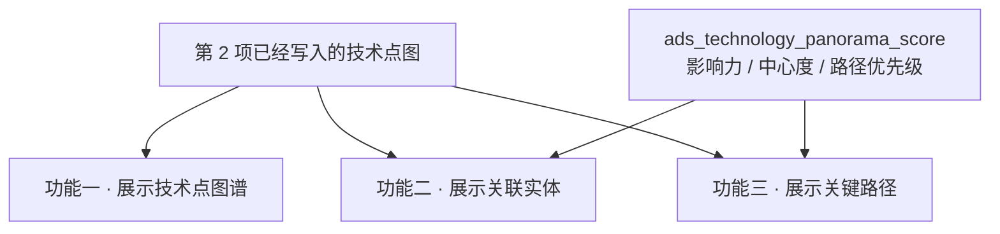

# TS-L2-DS02-ARCH · 科学技术全景 · 功能架构

- 任务：`TS-L2-DS02-ARCH`（定义任务。WBS-05-01c。角色 `arch-agent`）
- 日期：2026-11-05
- 状态：待会签。不标 done
- 监管：`human:淮政玮`
- 认领：未认领
- 强度：ponytail off（定义任务，不缩文档）
- 图：`TS-L2-DS02-ARCH-SEQ`、`TS-L2-DS02-ARCH-DATA`（本文内两张 Mermaid，无 frontmatter，记 `draft`）

本叶定展示页「科学技术全景」三个功能怎么工作。菜单 `/trend/tech-panorama`，页面 `src/views/situation/panorama/`，需规序号 **17–33**。逐叶需规原文和落单见 `功能拆解.md`。不写技术点入图、边上图、挂产业。那三件事在第 2 项 WBS-02-19 / 02-20 / 02-21，本页只使用它们已经准备好的结果。

不写 OpenAPI 字段表、请求体样例、枚举闭集。指标身份以 `metric-registry` 为准。不新造 `metric_id`，不改 D4。

签收标准（D18，2026-11-03）：可实现才签收。功能能真读的，读已有图。功能要的分数没有真模型时，只接受新建 ADS 表、Python 灌 mock 行、Java 只读。不允许接口直接返回写死的 mock。

## 1. 范围

同一页三个功能，对应复刻页上已经有的三块，不新开页面，不重做 `FE-TS-02A`。

| 功能 | 序号 | 用户在做什么 | 页面上的位置 |
|---|---|---|---|
| 展示技术点图谱 | 17–21 | 看技术点之间的关系图，缩放拖拽，搜索并定位一个技术点，打开该点详情 | 筛选条 + 主画布「图谱」+ 详情抽屉 |
| 展示技术点关联实体 | 22–27 | 看选中技术点关联的人、机构、论文、专利，换点刷新，看实体详情，按类型和时间筛选，按强度或影响力排序 | 主画布「列表」和右侧实体区 + 同一详情抽屉 |
| 展示关键路径和关键节点 | 28–33 | 看一条技术点序列，辨认关键节点，看路径详情，按重要性筛选，并排比较，按步播放 | 右侧「关键路径」+ 主画布「路径播放」 |

| 不做 | 原因 |
|---|---|
| 序号 34–47 | 维护管理，菜单 `/trend/tech-situation-maintain`。34–40 报价已划掉，不落库。本页不提供增删改、导入、版本 |
| 准备技术点、边、路径、产业挂接 | 第 2 项的按钮。本页没有这些按钮，也不调用算法中台 |
| 实体和实体之间的关系网，以及按年份换一套实体关系 | 序号 26。图上没有这种关系，也没有第二份快照。该功能保持空 |
| 用 IPC4 / 深圳卡位的计算结果充当本页的图、名单或路径 | 见第 7 节。那些口径的对象不是本页上的技术点 |
| 编制规划正文、方向预警 | 科技发展规划，不是本页 |

## 2. 三个功能怎么接到数据

浏览器仍然只打已有的 `POST /display/v1/situation/panorama/graph`。一次返回复刻页已有的七个字段：`nodes`、`relations`、`keyPathOptions`、`timeline`、`listRecords`、`relationTypeOptions`、`factorItems`。三个功能分用这七个字段，不增加第八块业务数据，也不拆成三套接口。

```mermaid
flowchart LR
  page["全景页"]
  gw["gkxlumen-platform-gateway<br/>/display/**"]
  bff["gkxlumen-display"]
  graph["已准备好的技术点图"]
  score["ads_technology_panorama_score"]
  page -->|"图谱 / 实体 / 路径 同一次请求"| gw --> bff
  bff -->|"技术点、关系、实体名单、路径步"| graph
  bff -->|"影响力、中心度、路径优先级"| score
```

| 功能 | 这一次请求拿来做什么 | 没有结果时 | 失败时 |
|---|---|---|---|
| 图谱 | 技术点和它们之间的关系，供画布绘制、搜索高亮、详情 | 画布空，`emptyReason=GRAPH_EMPTY` | 这次请求失败。不用演示种子把画布填上 |
| 关联实体 | 当前技术点关联的人、机构、论文、专利 | 实体区空。画布上已经画出的技术点保留 | 只空实体区，不清掉已经画出的图 |
| 关键路径 | 包含当前技术点的路径步，供列表、比较和播放 | 路径区空。图谱和实体区保留 | 只空路径区 |
| 三个数字 | 仅当用户按影响力排序、看中心度、或按重要性筛路径 | 对应格子空。名单和路径还在 | 只空数字，不清掉图和路径 |

`gkxlumen-display` 不直连图库，不在这次请求里现算关系。图由 Python 只读 `demo_gkx_chain`。空间不是这个就拒绝。Java 不写 nGQL。

首屏未选技术点时，图谱最多给出 200 个技术点，不铺边。选中一个点之后，带上该点的关系（默认只要高、中证据；用户明确要低证据才带上）、每类实体最多 20 条、相关路径最多 20 条。超过上限时标明截断。这是页面一次能看的范围，不是入图规则。

## 3. 数据从哪来



三个功能都不准备数据。点还没写入时，三个功能一起空，页面不改用 `mock/modules/panorama.ts` 的节点。

领域筛选只作用于已经挂上产业节点的技术点。一个都没挂上时，筛选结果为空，不用演示里的技术领域名称去对技术点中文名。本页不写挂产业那张表。

## 4. 功能流程

### 4.1 展示技术点图谱（17–21）

1. 用户打开全景。画布展示一批技术点。此时不画关系线。用户在画布上缩放、平移、拖拽节点，这些操作不另发请求。
2. 用户输入关键词。同一次接口按中文名、英文名做包含匹配。命中的技术点高亮并放到视口中。中文名为空就保持空，不把英文抄进中文。
3. 用户点一个技术点。详情抽屉展示该点已有的名称和属性。没有描述、发展状态等字段时，对应行空，不补一段说明。
4. 序号 17 的手动输入、Excel、JSON 导入不是这个功能。本页不接收这些输入。写请求返回 501。

### 4.2 展示技术点关联实体（22–27）

1. 用户选中一个技术点。实体区列出与该点关联的人、机构、论文、专利，默认按关联强度取前 5。卡片上有名称、类型、关联强度。没有强度时按名称稳定排列，不造一个强度数。
2. 用户改点另一个技术点。实体区换成该点的关联实体，选中点在画布上保持高亮。
3. 用户点开一张实体卡片。抽屉展示该实体已有的属性，以及它关联的技术点。没有时间线字段则时间线空。论文条数、专利条数是邻居个数，不另算一套统计。
4. 用户按类型筛选，在已经取回的实体上过滤，不另发一种查询。按时间筛选只在关系上确实有年份时收窄；没有年份时不截数据，时间轴年份空。
5. 用户要看实体和实体之间的连线，或拖动时间轴看关系演变。这个功能没有数据，保持空，返回 501。技术点到实体的展示仍在上一步。
6. 用户按关联强度、名称、类型排序，用图上已有字段。用户按影响力排序时，读分数表的影响力列。没有分数的实体不排进这一档，也不填一个默认分。

### 4.3 展示关键路径和关键节点（28–33）

1. 用户打开关键路径。列表是已经准备好的路径步，每条路径是一串有序技术点。本页不接收用户上传的路径文件。
2. 关键节点用点上已有的角色和加权度做样式，例如放大或换色。中心度这个数字只在用户要看数字时读分数表。没有行则不标数字，样式仍可按角色显示。
3. 用户点开一条路径。抽屉展示步序和端点名称。需规里的技术意义、发展历程、关键突破没有单独正文，读不到就空。
4. 用户按路径编号或步序筛选，用路径上已有字段。按重要性级别筛选时读分数表的优先级列，没有分数的路径不进入该档。图上没有「路径类型」这一字段时，类型条件不截数据。
5. 用户选多条路径比较。并排或重叠发生在已经取回的路径上，不另建比较模型。
6. 用户播放一条路径。播放的是步的先后，可暂停、继续、调速度。没有第二份年份快照，播放不按 `currentYear` 换成另一张图。

某一功能失败，不清掉同页另外两个功能已经显示的内容。

## 5. 分叶

| 序号 | 功能点 | 判定 | 读什么 | 灌数方 | 读取接口 | metric_id |
|---|---|---|---|---|---|---|
| 17 | 技术点图谱数据输入 | 501 | 本页不收手动输入和文件 | 无。点由第 2 项写入 | 无写接口 | 无 |
| 18 | 图结构自动生成 | 真读 | 技术点，以及选中后的技术点关系 | 第 2 项，本页不灌 | 同一次 `graph` | 不挂 `M_TECH_GRAPH_STRUCT` |
| 19 | 图谱交互操作 | 真读的载荷，页面内完成 | 不另请求 | 无 | 同 18 | 无 |
| 20 | 技术点搜索定位 | 真读 | 按名称匹配技术点，命中后高亮居中 | 第 2 项 | 同一次 `graph`，带搜索字 | 无 |
| 21 | 技术点详情查看 | 真读 | 该点已有名称和属性 | 第 2 项 | 同一次 `graph`，带技术点编号 | 无 |
| 22 | 默认实体展示 | 真读 | 选中点的人、机构、论文、专利，按强度取前 5 | 第 2 项 | 同一次 `graph` | 不调用 `M_TECH_ENTITY_TOP5` |
| 23 | 节点点击交互 | 真读 | 换点后刷新实体区 | 无 | 同一次 `graph` | 同 22 |
| 24 | 实体详情查看 | 真读 | 该实体已有属性。无时间线则空 | 第 2 项 | 同一次 `graph` | 邻居个数不挂 `M_TECH_PAPER_PATENT_CNT` |
| 25 | 实体筛选功能 | 真读的载荷上过滤 | 类型在页内滤。时间只在关系有年份时收窄 | 无 | 同一次 `graph` | 无 |
| 26 | 实体关联关系展示 | 501 | 没有实体—实体关系，也没有第二份快照 | 无 | 无 | 不挂 `M_TECH_ENTITY_REL` |
| 27 | 实体排序与优先级 | 真读 + D18 | 强度、名称、类型用图上字段。影响力读分数表 | 影响力行由灌数叶写入 | 同一次 `graph` | 影响力列 `M_TECH_ENTITY_INFLUENCE`，D4 保持 mock |
| 28 | 关键路径数据接收与处理 | 真读 | 已有路径的有序步 | 第 2 项，本页不接收上传 | 同一次 `graph` | 无 |
| 29 | 关键节点识别与标记 | 真读 + D18 | 样式用点上角色和加权度。中心度数字读分数表 | 中心度行由灌数叶写入 | 同一次 `graph` | 中心度列 `M_TECH_PATH_CENTRALITY`，D4 保持 mock |
| 30 | 路径详情查看 | 真读 | 步序和端点名称。意义、历程、突破无正文则空 | 第 2 项 | 同一次 `graph` | 无 |
| 31 | 关键路径筛选与过滤 | 真读 + D18 | 编号和步序用图。重要性读分数表 | 优先级行由灌数叶写入 | 同一次 `graph` | 优先级列 `M_TECH_PATH_PRIORITY`，D4 保持 mock |
| 32 | 路径比较分析 | 真读的多条路径，页面并排或重叠 | 不另建比较模型 | 无 | 同一次 `graph` | 无 |
| 33 | 关键路径动态演示 | 真读的步序，页面按步播放 | 播放步的顺序，不是两个时点的差分 | 无 | 同一次 `graph` | 无 |
| 34–47 | 维护管理 | 不在本页 | 菜单 `/trend/tech-situation-maintain` | 无 | 无 | 无 |

## 6. 和已有复刻页的差异

`FE-TS-02A` 已经把三个功能画在同一页：筛选条、图谱 / 列表 / 路径播放三个视图、右侧分析、详情抽屉。本叶不改这些区域的划分，不改七个字段的名字。

| 现有页面 | 本功能架构 |
|---|---|
| `USE_MOCK=true` 时用冻结种子把三个功能都填上 | 接入后三个功能只显示读到的结果。空就是空 |
| 控制器七个数组为空，`emptyReason=GRAPH_NOT_READY` | 接入前可以保持这个空壳。接入后空图用 `GRAPH_EMPTY`。读失败不用空壳冒充成功 |
| 导入、手动加点、撤销重做留在本次浏览器会话 | 这些不是 17–33 的功能。要写到服务端时返回 501。刷新即失 |
| 种子里的关系名、因子项、项目和领域节点 | 图谱只显示技术点和技术点关系。实体只显示人、机构、论文、专利。路径只显示技术点序列 |
| `currentYear` 驱动种子里的时间轴 | 播放游标。服务端不按这个年份换一套图 |
| 领域下拉来自演示技术领域 | 只筛已经挂上产业的技术点。没挂上则空 |
| 关键路径的置信度、节点强度是种子生成数 | 图上有的权重和加权度照实显示。影响力、中心度、路径优先级只来自分数表 |

`API-TS-M2` 把本页拆成图谱、路径、实体、编辑、版本、导入多套资源。本叶不拆。那份契约未冻结，其中的编辑和版本属于维护，不在这三个功能里。

## 7. 三个数字

图谱、实体名单、路径步都来自已有图，不建分数表。只有用户要看的三个数字没有真模型。

| 项 | 值 |
|---|---|
| 表 | `ads_technology_panorama_score` |
| 库 | 与 `gkxlumen-display` 现读的 ADS 同库。不建在 ODS、DWD、供应方库，也不用 `gapfill_` 前缀 |
| 行 | 一个技术点或一条路径，加一种分数：`influence`、`centrality`、`path_priority` |
| 灌数方 | Python 独立灌数。行是 mock。不在 `graph` 请求里写 |
| 读取 | 同一次 `graph` 里按编号只读 |
| metric_id | 影响力 `M_TECH_ENTITY_INFLUENCE`；中心度 `M_TECH_PATH_CENTRALITY`；路径优先级 `M_TECH_PATH_PRIORITY` |
| D4 | 保持 mock。界面保留 MockBadge |
| 没有行 | 该格空 |

这三张注册口径是 IPC4 PageRank 或深圳卡位。灌进本表的行不是那些函数的输出。公式仍待 `human:唐绍祖` 按技术点另签。未签之前 D4 不得改成 live。

2026-11-05 经 `metric-registry` 查询。下列 ID 已在册，D1 为 aligned，D4 为 mock。三个功能不调用它们的计算。

| metric_id | 注册口径要点 | 本页功能 |
|---|---|---|
| `M_TECH_GRAPH_STRUCT` | 200 个 IPC4 域的共现骨干 | 不作为「图结构自动生成」 |
| `M_TECH_EDGE_STRENGTH` | IPC4 共类边权 | 关系强度用图上已有权重 |
| `M_TECH_ENTITY_TOP5` | IPC4 与申请人、论文标题 | Top5 是该技术点的关联实体 |
| `M_TECH_PAPER_PATENT_CNT` | 口径写明技术点粒度不成立 | 不挂在实体详情的条数上 |
| `M_TECH_ENTITY_REL` | 专利转移、共同申请、论文合著 | 序号 26 保持空 |
| `M_TECH_ENTITY_INFLUENCE` | IPC4 PageRank | 只作影响力列的身份 |
| `M_TECH_PATH_CENTRALITY` | 深圳 IPC4 五维中心性 | 只作中心度列的身份。请求内不算 |
| `M_TECH_PATH_KEYNODE` | 深圳 IPC4 卡位域 | 不挂。关键节点样式用点上已有角色 |
| `M_TECH_PATH_PRIORITY` | 卡位 × 势头 × 体量 | 只作路径优先级列的身份 |

`TEMP_DS02_*` 不是正式 ID。不把 `M_CHAIN_*`、`M_SVC_GRAPH_*`、`M_SVC_REC_*` 改挂到本页。

## 8. 实现边界

- 三个功能都在 `/trend/tech-panorama` 完成。维护管理不走这条读图接口。
- 读的空间只是 `demo_gkx_chain`。不改去 `gkx_chain` 或 `entan`，也不读燕大产业链全景来填这三个功能。
- 技术点不并进七要素「技术」，不改 M01–M24。
- 中台入图未完成时，三个功能都是空，不提前把种子灌进图。
- 本叶不改前端字段名。接线仍用现在的七个字段，由 `SYSINT-05-01A-L01` / `SYSINT-05-01B-L01` 做，不在本定义单里改代码。
