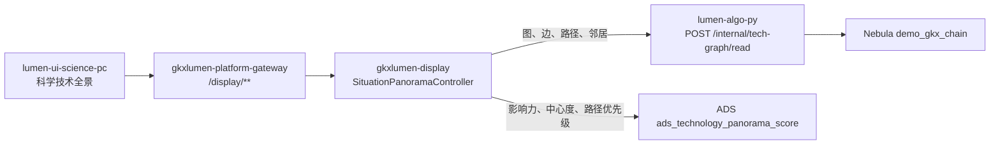
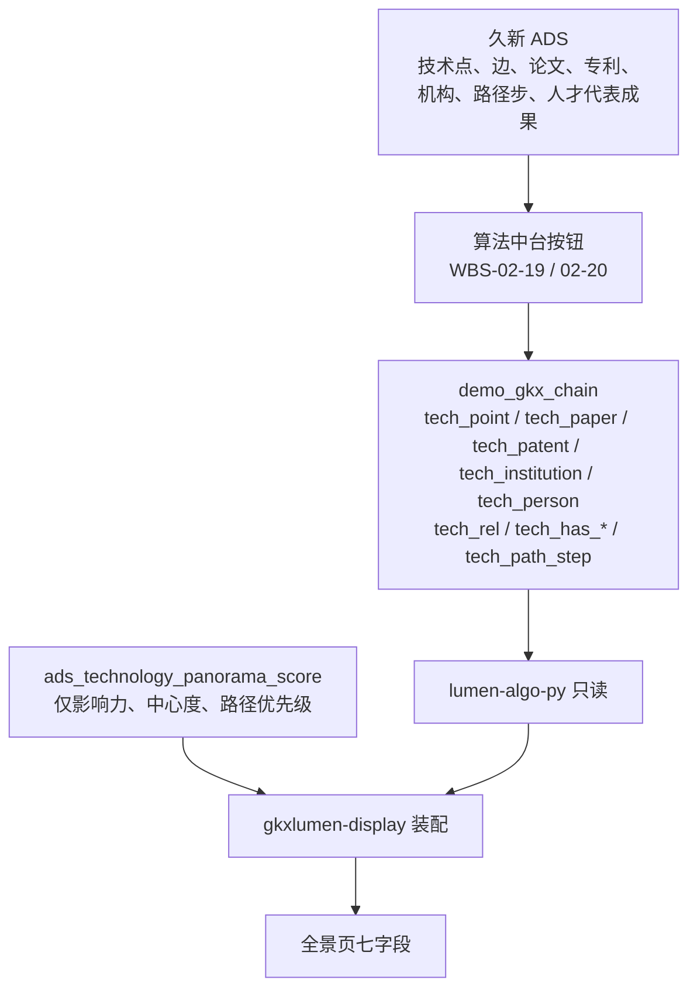

# TS-L2-DS02-ARCH · 科技发展态势 · 科学技术全景

- 任务：`TS-L2-DS02-ARCH`（定义任务。WBS-05-01c。角色 `arch-agent`）
- 日期：2026-11-05
- 状态：待 `human:淮政玮` 签收。不标 done
- 监管：`human:淮政玮`
- 认领：`agent:architect-agent`
- 强度：ponytail off（定义任务，不缩文档）
- 图：`TS-L2-DS02-ARCH-SEQ`、`TS-L2-DS02-ARCH-DATA`（本文内两张 Mermaid，无 frontmatter，记 `draft`）

本叶只定展示系统「科技发展态势 / 科学技术全景」的后台实现架构和整体流程。菜单路径是 `/trend/tech-panorama`（`menu.ts` 里 `trend/tech-panorama`，页面在 `src/views/situation/panorama/`）。需规序号 **17–33**（excel 20–36）。不写 OpenAPI 字段表、请求体样例、枚举闭集。

上游只引用，不改写：`科学技术全景.md`、`METRIC-OPEN-DS-02-科学技术全景-核对记录.md`、`科学技术全景-建图基线.md`、`方案-SYSINT-TECHGRAPH-02-L01.md`、`API-TS-M2.md`（草案，未冻结）、`FE-TS-02A.md`、`architecture-baseline.md` D18。指标身份以 `metric-registry` 为准。不新造 `metric_id`，不改 D4。

签收标准（D18，2026-11-03）：可实现才签收。真读做得到的走图。做不到真算、真查或真模型的分数，只接受新建 ADS 表、Python 灌 mock 行、Java 只读。不允许接口直接返回写死的 mock。

## 1. 范围与明确不做

本菜单只有三段：展示技术点图谱（17–21）、展示技术点关联实体（22–27）、展示关键路径和关键节点（28–33）。浏览器打开 `/trend/tech-panorama`，数据仍打已有的 `POST /display/v1/situation/panorama/graph`。

维护技术图谱（34–40）和维护关键实体及关系（41–47）不在这个菜单。它们在「维护管理」，路径 `/trend/tech-situation-maintain`，页面在 `src/views/situation/maintain/`。34–40 报价已划掉，不设计落库，也不写进本页。41–47 另按维护管理出架构，本叶不代写。

| 不做 | 原因 |
|---|---|
| lumen 调用算法中台 `demo-ui-system-test` 或 `/ops/v1/tech-graphs/**` | D12。中台按钮只负责写入 |
| 写 `gkx_chain`，或读燕大产业链全景来填本页 | 正式空间不写。燕大主键不是 `technology_node_id` |
| 把技术点并进七要素「技术」，或改 M01–M24 | 技术点是另一套点。七要素「技术」仍是论文、专利、项目 |
| 经 `gkxlumen-graph` 查这张图 | 该服务还是探活骨架，默认 space `entan`，不是 `demo_gkx_chain`。Java 也不写 nGQL |
| 调用已注册的 IPC4 / 深圳卡位计算来填本页 | 见第 8 节。那些口径的节点不是这张图上的技术点 |
| 把维护管理写进本页 | 序号 34–47 的菜单是 `/trend/tech-situation-maintain`。34–40 不落库。本页不接收导入和增删改 |
| 在图上写产业边，或让本页改 `dwd_technology_topic_industry` | 挂产业是中台另一组按钮，不在本页需规叶子里 |
| 编制规划正文，或做方向预警 | 那是科技发展规划，不是本页 |
| 一次返回约 1.9 万个点和 58 万条边 | 见第 2 节上限。超出的不在接口里截断后假装是全图，请求必须带范围 |

`API-TS-M2.md` 里的编辑批次、版本发布、导入校验、`slice_key` 五切片，本叶不实现。那份契约仍是未冻结草案，和已签收的建图方案不一致。

## 2. 调用链

| 生产者 | 消费者 | 触发 | 失败语义 | 禁止事项 |
|---|---|---|---|---|
| 中台按钮把点、边、路径写入 `demo_gkx_chain`（WBS-02-19 / 02-20）。本叶不重复写 | `lumen-algo-py` 只读该空间，`gkxlumen-display` 装配成现有七字段 | 用户打开全景、搜索、点一个技术点、看路径 | 图上没有点：七个数组空，`emptyReason=GRAPH_EMPTY`。读图失败：该次失败，不改用演示种子。分数表没有行：对应分数空，名单仍在 | 不打 demo 网关。不写 nGQL。不把 `GRAPH_NOT_READY` 的空壳当成已接入。不返回 `mock/modules/panorama.ts` 里的节点 |
| `data-agent` 按独立灌数叶把 mock 行写入 `ads_technology_panorama_score` | `gkxlumen-display` 只读分数列 | 同一条 `graph` 请求要带上影响力、中心度或路径优先级时 | 无行则该分数空。不影响图上的点和边 | 不在请求里算 PageRank。不调用 `demo-algo-science` 的 IPC4 指标函数。不把分数写进 ODS / DWD / `gapfill_` |

`gkxlumen-display` 不直连 Nebula，不直连久新 ADS 去现算这张图。图只来自 Python 对 `demo_gkx_chain` 的只读。trace 沿展示链已有的 `X-Trace-Id` 带到 algo，本叶不新设计观测点。

一次 `graph` 的图结果有上限，避免把全量边拉进浏览器：

- 未选技术点：最多 200 个 `tech_point`，不带边。
- 已选技术点：该点、它的 `tech_rel` 邻居最多 200 条、四类实体邻居各最多 20 条、包含该点的路径最多 20 条。
- 默认 `tech_rel` 只含 HIGH、MEDIUM。客户端明确要低证据时才含 LOW。
- 超过上限时结果里带截断标记。不另造第二套点来凑满。

## 3. 数据流

点的身份是 `technology_node_id`。Tag 只用建图方案里的五个：`tech_point`、`tech_paper`、`tech_patent`、`tech_institution`、`tech_person`。Edge 只用六种：`tech_rel`、`tech_has_paper`、`tech_has_patent`、`tech_has_institution`、`tech_has_person`、`tech_path_step`。路径步不写成 `tech_rel`。人边上保留来源标记（论文或 Topic）。机构 VID 超过 80 字符的点在入图时已被跳过，读的时候也不会出现。

产业过滤只在 `dwd_technology_topic_industry` 里已经挂上产业节点时生效。没挂上就返回空，不用演示里的技术领域枚举去凑。本页不写这张关系表。

## 4. 分叶

判定只有三种：真读（图上已有）、501（本页不提供）、D18 读表（分数没有真模型）。交互壳没有独立接口，跟它所消费的那一次真读走。

| 序号 | 叶子 | 判定 | 读什么 | 灌数方 | 读取接口 | metric_id |
|---|---|---|---|---|---|---|
| 17 | 技术点图谱数据输入 | 501 | 不接收手动输入、Excel、JSON | 无。点由中台「技术点入图」写入 | 无写接口 | 无。核对记录定为运营壳 |
| 18 | 图结构自动生成 | 真读 | `tech_point` + `tech_rel` | 中台入图，本叶不灌 | `POST /display/v1/situation/panorama/graph` | 不挂 `M_TECH_GRAPH_STRUCT`。该 ID 是 200 个 IPC4 域的结构复算，不是这张图 |
| 19 | 图谱交互操作 | 真读的载荷，页面内缩放、平移、拖拽 | 不另请求 | 无 | 同 18 | 无 |
| 20 | 技术点搜索定位 | 真读 | 按中文名、英文名包含匹配 `tech_point`。中文空就保持空，不把英文抄进中文 | 中台入图 | 同 18，带搜索字 | 无 |
| 21 | 技术点详情查看 | 真读 | 该点的中文名、英文名、社区角色、加权度、`graph_release_id`。没有的字段空 | 中台入图 | 同 18，带 `technology_node_id` | 无 |
| 22 | 默认实体展示 | 真读 | 选中点的论文、专利、机构、人邻居，按边上已有权重取前 5。没有权重就按点上的加权度，再没有就按编号稳定排序 | 中台边上图 | 同 18 | 名单不调用 `M_TECH_ENTITY_TOP5` 的 IPC4 函数。ⓘ 若打开该卡，卡内是注册表原文，不得把 IPC4 的数盖过名单 |
| 23 | 节点点击交互 | 真读 | 换一个点，重新取该点的邻居 | 无 | 同 18 | 同 22 |
| 24 | 实体详情查看 | 真读 | 对应 Tag 上已写入的属性。没有时间线字段就空 | 中台实体入图 | 同 18 | 论文条数、专利条数是该点邻居个数，不挂 `M_TECH_PAPER_PATENT_CNT` |
| 25 | 实体筛选功能 | 真读的载荷上按 Tag 过滤 | 时间范围只在边上确有年份时生效，否则该条件不截数据，时间轴年份空 | 无 | 同 18 | 无 |
| 26 | 实体关联关系展示 | 501 | 图上没有实体和实体之间的边，也没有第二份快照 | 无 | 无。技术点到实体的边已在 22 | 不挂 `M_TECH_ENTITY_REL`。该 ID 是专利转移、共同申请、论文合著 |
| 27 | 实体排序与优先级 | 真读 + D18 | 按关联强度、名称、类型排序用图上的字段。按影响力排序读分数表 | 影响力行由灌数叶写入分数表 | 同 18 | 影响力列 `M_TECH_ENTITY_INFLUENCE`，D4 保持 mock |
| 28 | 关键路径数据接收与处理 | 真读 | `tech_path_step` 的有序步 | 中台「路径上图」 | 同 18 | 无 |
| 29 | 关键节点识别与标记 | 真读 + D18 | 样式用点上已有的社区角色、加权度。中心度数字只读分数表 | 中心度行由灌数叶写入 | 同 18 | 中心度列 `M_TECH_PATH_CENTRALITY`，D4 保持 mock。不在请求里算五维中心性 |
| 30 | 路径详情查看 | 真读 | 一条路径的步和端点名称 | 中台路径上图 | 同 18 | 无 |
| 31 | 关键路径筛选与过滤 | 真读 + D18 | 按路径编号、步序筛选用图。按重要性级别筛选读分数表，没有分数的路径不进入这一档 | 优先级行由灌数叶写入 | 同 18 | 优先级列 `M_TECH_PATH_PRIORITY`，D4 保持 mock |
| 32 | 路径比较分析 | 真读的多条路径，页面并排或重叠 | 不另建比较模型 | 无 | 同 18 | 无 |
| 33 | 关键路径动态演示 | 真读的步序，页面按步播放 | 没有第二份时间快照，播放的是步的顺序，不是两个时点的差分 | 无 | 同 18 | 无 |
| 34 | 技术节点增加 | 501 | 不落库 | 无 | 无 | 无 |
| 35 | 技术节点删除 | 501 | 不落库 | 无 | 无 | 无 |
| 36 | 技术关系增加 | 501 | 不落库 | 无 | 无 | 无 |
| 37 | 技术关系删除 | 501 | 不落库 | 无 | 无 | 无 |
| 38 | 节点属性编辑 | 501 | 不落库 | 无 | 无 | 无 |
| 39 | 图谱修改历史 | 501 | 不落库。页面会话内的撤销重做留在浏览器，刷新即失 | 无 | 无 | 无 |
| 40 | 图谱保存与版本 | 501 | 不落库。不建版本表 | 无 | 无 | 无 |
| 34–47 | 维护管理 | 不在本菜单 | 路径 `/trend/tech-situation-maintain`。34–40 不落库 | 无 | 无 | 无 |

`M_TECH_PAPER_PATENT_CNT` 的注册口径写明：按技术点对齐不成立，只能做机构级双计数。本页的论文条数、专利条数是图上邻居个数，所以不把这个 ID 标在这两个数字上。

## 5. 整体流程

1. 用户打开全景。前端仍提交一次 `graph`。display 请 Python 读 `demo_gkx_chain`。没有选中的点时，只回最多 200 个技术点，边和路径空。图是空的则七个数组空，并写 `GRAPH_EMPTY`。
2. 用户搜索或点一个技术点。同一次接口带上编号或关键字。Python 读该点、限定条数的 `tech_rel`、四类邻居和相关路径步。display 把 Tag 映射成页面已有的 `nodes` / `relations` / `listRecords` / `keyPathOptions`，不增加第八块业务数据。
3. 用户按影响力看实体，或要看中心度、路径优先级。display 用同一批编号去读 `ads_technology_panorama_score`。有行就填进现有的强度或分数字段，并带上对应 `metric_id`。没有行就该格空。不在这次请求里调用 IPC4 复算。
4. 用户筛选低证据、按类型过滤、并排路径、按步播放。过滤和播放在已经返回的结果上完成。低证据是另一次读取，不是把 LOW 混进默认边。
5. 用户在页面上导入、增删改、保存版本。请求若打到写路径，返回 501。浏览器里已有的会话撤销不进服务端。

某一次读图失败，不把分数表里的 mock 行画成点和边。某一次分数表失败，不清空已经读到的图。

## 6. 和已有复刻页、草案契约、现控制器的差异

现网前端 `lumen-ui-science-pc` 的 `fetchPanoramaGraph` 只打 `POST /display/v1/situation/panorama/graph`。入参是技术领域、时间范围、当前年。出参是七个字段：`nodes`、`relations`、`keyPathOptions`、`timeline`、`listRecords`、`relationTypeOptions`、`factorItems`。`USE_MOCK=true` 时用冻结种子。`gkxlumen-display` 的 `SituationPanoramaController` 现在不读图，七个数组固定为空，`emptyReason=GRAPH_NOT_READY`。

本叶接上之后：

| 现有 | 本叶 |
|---|---|
| 控制器返回空壳 | 空壳只保留到读图接入之前。接入后空图用 `GRAPH_EMPTY`，读失败不用这个空壳冒充成功 |
| 种子里的类型是演示因子项，关系是演示关系名 | 点的 `type` 只用五个 Tag。关系的 `relationType` 只用六种 Edge。不回 `project`、`field`，不回草案里的合作、隶属、引用 |
| `API-TS-M2` 拆成 graph、critical-paths、entities、edits、versions、imports | 不拆。搜索、详情、邻居、路径都在这一次 `graph` 里。写接口不建 |
| 草案默认 `exclude_person=true` | 人已经按论文或 Topic 顶上。默认带回人，页面可自己藏。边上带来源 |
| 草案用 `year_start` / `year_end` 切图 | 只有边上真有年份才按年收窄。没有年份时时间轴的 `years` 空，不用种子里的年份 |
| 前端 `selectedFieldValues` 来自演示技术领域 | 只对已经挂到产业节点的技术点生效。没挂上就空，不拿演示领域名称去对中文名 |
| `currentYear` 在种子里驱动时间轴 | 页面播放游标。服务端没有第二份快照，不按这个年份换一套图 |
| 关键路径 `confidence`、节点 `strength` 在种子里是生成数 | 能从边权重、点上加权度读到的用读到的值。影响力、中心度、路径优先级只来自分数表。读不到就空，不填种子里的 91.5 这类数 |
| 导入和手动加点打在 `isImportedDemo` | 这些操作保持 501，不把演示标记写成图上的点 |

`API-TS-M2` 第 4 节建议的 `ts_kg_edit_history`、`ts_kg_version`、`ts_kg_critical_path`、`ts_kg_entity_score` 本叶不建。分数只进第 7 节这一张新 ADS 表。

## 7. D18 分数表

图上没有影响力、中心度、路径优先级的真模型。这三项不在请求里算。

| 项 | 值 |
|---|---|
| 表 | `ads_technology_panorama_score` |
| 库 | 与 `gkxlumen-display` 现读的 ADS 同库。不建在 ODS、DWD、供应方库，也不用 `gapfill_` 前缀 |
| 行 | 一个技术点或一条路径，加一种分数：`influence`、`centrality`、`path_priority` |
| 灌数方 | Python 独立灌数，不在 `graph` 请求里写。行是 mock |
| 读取 | `gkxlumen-display` 在同一次 `graph` 里按编号只读。不经 `gkxlumen-graph` |
| metric_id | `influence` → `M_TECH_ENTITY_INFLUENCE`；`centrality` → `M_TECH_PATH_CENTRALITY`；`path_priority` → `M_TECH_PATH_PRIORITY` |
| D4 | 保持 mock。界面保留 MockBadge |
| 没有行 | 该格空。不返回常量分 |

这三张注册口径本身是 IPC4 PageRank 或深圳卡位，见第 8 节。灌进本表的行不是那些函数的输出，也不能拿去冒充那些函数已经对本页技术点算过。公式仍待 `human:唐绍祖` 按 `technology_node_id` 另签。未签之前 D4 不得改成 live。

## 8. 指标

2026-11-05 经 `metric-registry` 查询。下列 ID 都已在册，D1 为 aligned，D4 为 mock。本页图、边、路径、邻居不调用它们的计算函数。

| metric_id | 注册口径要点 | 本页 |
|---|---|---|
| `M_TECH_GRAPH_STRUCT` | 200 个 IPC4 域的共现骨干。源表 `dwd_patent`。节点不是 Nebula 技术点 | 不挂在序号 18 的图上 |
| `M_TECH_EDGE_STRENGTH` | IPC4 共类网络边权。源表 `dwd_patent`、`dwd_patent_cited` | 不挂在 `tech_rel` 上。边权用图上已写入的权重 |
| `M_TECH_ENTITY_TOP5` | IPC4 与申请人、论文标题桥。人才侧无发明人×IPC | 不调用该函数生成 Top5。Top5 是图上邻居 |
| `M_TECH_PAPER_PATENT_CNT` | 口径写明技术点粒度不成立 | 不挂在邻居条数上 |
| `M_TECH_ENTITY_REL` | 专利转移、共同申请、论文合著 | 序号 26 保持 501，不把这张网画进全景 |
| `M_TECH_ENTITY_INFLUENCE` | IPC4 PageRank 加规模与增速 | 只作为分数表影响力列的身份。D4 仍 mock |
| `M_TECH_PATH_CENTRALITY` | 深圳 IPC4 五维中心性 | 只作为分数表中心度列的身份。请求内不算 |
| `M_TECH_PATH_KEYNODE` | 深圳 IPC4 卡位域 | 不挂。关键节点样式用点上的社区角色和加权度 |
| `M_TECH_PATH_PRIORITY` | 卡位 × 势头 × 体量 | 只作为分数表路径优先级列的身份。D4 仍 mock |

核对记录里的 `TEMP_DS02_*` 不是正式 ID，本叶不消费。不把 `M_CHAIN_*`、`M_SVC_GRAPH_*`、`M_SVC_REC_*` 改挂到本页。

## 9. 实现时的边界

- 读接口只读 `demo_gkx_chain`。空间不是这个就拒绝，不改去 `gkx_chain` 或 `entan`。
- Java 不写 nGQL，不在控制器里拼演示节点。
- 本页菜单是 `/trend/tech-panorama`。维护管理不走这条读图接口。
- 中台入图未完成时，本页就是空图，不提前灌种子进 Nebula。
- 本叶不改前端字段名。接入后页面仍用现在的七个字段。
