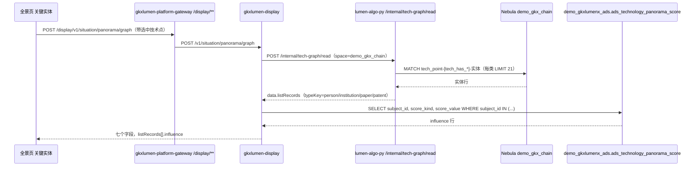

# TS-L2-DS02-ENTITY-ARCH · 科学技术全景 · 展示技术点关联实体 · 二级架构

- 任务：`TS-L2-DS02-ENTITY-ARCH`
- 日期：2026-11-07
- 监管：`human:淮政玮`
- 认领：`agent:arch-agent`
- 状态：as-built 稿已落盘；四角色已会签（`sdd/l2/会签/TS-L2-DS02-L2SET-SIGNOFF-*.md`），未签收
- 2026-11-07 复查：图上已有技术点连实体的边。样本 `tcn_000f21ac06aceb9cdd0575e82d0d85fc` 用 `technology_node_id` 直调 Python 读图：实体 61（论文 13、专利 20、机构 20 截断、人 8），实体中文名为空。正文 11-05 的现状保留作记录，以本行为准。见 `工程过程/04-系统集成/05-展示系统集成/合规演示用例/TS-L2-DS02-ENTITY-合规演示用例.md`
- 强度：ponytail off（定义任务，不缩文档）
- 上游：`sdd/科学技术全景-系统详细设计说明书.md`（§2.2、§3、§4、§6、§7）、`sdd/l2/TS-L2-DS02-ARCH.md`、`功能拆解.md` 第 2 节、SRS `科学技术全景.md` 序号 22–27
- 实现事实：`TS-L2-DS02-READ-PY-L01`（`a03c52b`，后续 `4e7f453`、`07ffa9f`）、`SYSINT-05-01B-L01`（`cbd6f10`，后续 `271109c`）、`SYSINT-05-01A-L01`（`e6fb1dd`，后续至 `5e6e96e`）、`TS-L2-DS02-SCORE-L01`（`828315a`）、`TS-L2-DS02-TEST-L01`

本分册只写需规二级「展示技术点关联实体」（序号 22–27）已经实现成什么样。说明书已定的决策不重开。不新造 `metric_id`，不新增接口，不写代码。

## 1. 范围

菜单 `/trend/tech-panorama`，页面 `lumen-ui-science-pc` `src/views/situation/panorama/`。实体区在右侧分析「关键实体」页签，详情走同页抽屉。

| 序号 | 功能 | 判定（说明书 §2.2） | as-built 落在哪 |
|---|---|---|---|
| 22 | 默认实体展示 | 真读邻居，取前 5 | 读图取每类最多 20；页面切前 5（「关键关联对象 Top5」） |
| 23 | 节点点击交互 | 换点再取 | 选中点变化即重发同一次 `graph` |
| 24 | 实体详情查看 | 真读已有属性；无时间线则空 | 同页详情抽屉；属性只有名称与类型 |
| 25 | 实体筛选功能 | 类型页内滤；时间只在关系有年份时收窄 | 页面两个下拉，在已取回结果上滤 |
| 26 | 实体关联关系展示 | 501 | Java 501；页面 live 下该块固定空 |
| 27 | 实体排序与优先级 | 强度、名称、类型用图；影响力读分数表 | 页面排序下拉；影响力由 Java 按编号读 ADS 填入 |

不在本二级：技术点图谱（17–21）、关键路径（28–33）、维护管理（34–47）、技术点连实体的边上图（`SYSINT-TECHGRAPH-02-L02`）。

## 2. 调用链



| 跳 | 规则 |
|---|---|
| 浏览器 | 只打 `graph`。不打 Python，不打算法中台，不直连图库 |
| `gkxlumen-display` | 只装配。不写 nGQL，不经 `gkxlumen-graph`，不调用 `demo-*`。分数只 SELECT |
| `lumen-algo-py` | 只读 `demo_gkx_chain`。别的空间 422。不写点、不写边 |
| 分数表 | 只读。灌数在 `TS-L2-DS02-SCORE-L01` 独立脚本，不在请求里 |

## 3. 数据流

```mermaid
flowchart TD
  l02["SYSINT-TECHGRAPH-02-L02<br/>tech_has_paper / patent / institution / person"]
  l01["SYSINT-TECHGRAPH-02-L01<br/>tech_point 与四类实体点"]
  graph["demo_gkx_chain"]
  score["ads_technology_panorama_score<br/>score_kind=influence"]
  seed["TS-L2-DS02-SCORE-L01 灌 mock 行"]
  read["/internal/tech-graph/read<br/>listRecords"]
  bff["gkxlumen-display 装配"]
  ui["关键实体页签<br/>Top5 / 筛选 / 排序 / 详情"]
  l01 --> graph
  l02 --> graph
  graph --> read --> bff --> ui
  seed --> score --> bff
```

实体名单只来自图。分数表只给影响力一个数，不进名单，不决定谁出现。

## 4. 边界

- 实体只有人、机构、论文、专利四类。项目、领域、演示关系名不进实体区。
- 实体之间没有边。序号 26 不读、不算、不落库。
- 关联强度、年份只认图上边的属性。图上没有就空，不造数。
- 影响力只认分数表 `influence` 行。没有行的实体不进「按影响力」这一档，不补默认分。
- 筛选和排序在页面上对已取回的结果做，不另发查询。
- 不调用 `M_TECH_ENTITY_TOP5`、`M_TECH_PAPER_PATENT_CNT`、`M_TECH_ENTITY_REL` 的计算。

## 5. 空态与失败态

| 情形 | 表现 |
|---|---|
| 未选技术点 | Python 与 Java 都不带实体，`listRecords=[]`。实体区空 |
| 选中点但没有关联实体 | `listRecords=[]`。实体区显示「当前筛选条件下暂无可排名对象」。画布上已画的技术点保留 |
| 读图失败 | Java 502。页面保留上一次成功结果，提示「图谱读取失败，未改用演示数据」，不画种子 |
| 分数表无行、表不在、连不上 | `influence` 为 null。名单照常返回。按影响力排序时该实体不进这一档 |
| 序号 26 | `entity-relations` 或 `entityRelations=true` 返回 501。页面 live 下显示「实体间关系暂无数据」 |

实体区为空不清画布，不清关键路径。

## 6. 上限

| 项 | 上限 | 谁截 |
|---|---|---|
| 每类实体 | 20 | Python 先取 21 判截断，留 20；Java 再按 `typeKey` 计数截 20 |
| 页面默认展示 | 5 | 前端 `scopedEntityRanking` 切前 5，「查看更多」看全部已取回 |
| 选中点的技术点关系 | 200 | Python / Java（本二级只用作对照，不画实体边） |
| 首屏技术点 | 200 | Python / Java |
| 分数查询编号 | 400 | `JdbcPanoramaScores` 一次最多 400 个编号 |

截断标记：Python 回 `truncated.person / institution / paper / patent`。Java 不透传 Python 的标记，只在自己截掉时写 `truncated.entities`。

## 7. 现状（截至 2026-11-05，另注 2026-11-06 代码变化）

| 项 | 事实 |
|---|---|
| 技术点连实体的边 | 图上还没有 `tech_has_paper`、`tech_has_patent`、`tech_has_institution`、`tech_has_person`。`SYSINT-TECHGRAPH-02-L01` 进行中；`L02`（边、路径、关联实体）仍是 backlog |
| 选中点后的实体查询 | 2026-11-05：按点属性 `technology_node_id` 的 WHERE 报 `IndexNotFound`，整次读图失败。归 `lumen-algo-py` 读图。2026-11-06 `07ffa9f` 把 `IndexNotFound` 当空，继续按边查。现状是不报错，但仍取不到实体 |
| 人物影响力 | 分数表 `influence` 人物 0 行。`tech_person` 点为 0 |
| 论文 / 专利 / 机构影响力 | 灌了 252,363 行（论文 108,337，专利 126,484，机构 17,542） |
| 线上 | 镜像与 K8s rollout 均未核。页面未在浏览器点过 |

因此当前选中任一技术点，实体区为空。这是数据未上图，不是页面故障。

## 8. as-built 与说明书的差异

不重开决策，只登记。修复归原实现单，本分册不改代码。

| # | 说明书 / 架构稿 | 代码现状 | 影响 | 归属 |
|---|---|---|---|---|
| 1 | 同一次 `graph` 带选中技术点 | 前端发 `selectedNodeId`；Java 转给 Python 用 `techPointId`；Python 只认 `technology_node_id` / `technologyNodeId` | 选中点没有传到 Python。Python 走概览，不读关系、实体、路径。边上图后实体区仍会空 | `TS-L2-DS02-SEL-FIX-L01`（ready，改 Java 一侧字段名）。原单 `SYSINT-05-01B-L01`、`TS-L2-DS02-READ-PY-L01` 已 done |
| 2 | 实体区显示选中点的关联实体 | Python / Java 把实体放 `listRecords`；前端 live 下实体区由 `nodes` + `relations` 推（`entityRowsFor`），列表视图只列技术点（`techPointListRecords`）。`listRecords` 在 live 下没有被消费 | 后端有实体，页面也不显示 | `TS-L2-DS02-FE-ENTITY-FIX-L01`（backlog，依赖 `SEL-FIX`）。原单 `SYSINT-05-01A-L01` 已 done |
| 3 | 22：按强度取前 5 | 读图对 `tech_has_*` 不取边属性，按 `name_zh`、`name_en`、编号排序。写边规格（`tech_graph.py` `_EDGES`）现定 `tech_has_paper / patent / institution` 无属性，`tech_has_person` 只有 `source_paper`、`source_topic` | 强度为空，按名称排。符合「无强度不造数」兜底，但强度来源尚不存在 | 要强度须先改写边规格，归 `SYSINT-TECHGRAPH-02-L02`；读图补取未建单 |
| 4 | 24：条数是邻居个数 | `relationCount` 写死 1；`nodeIds` 只有当前技术点 | 详情的关联技术点与条数不完整 | 原单 `TS-L2-DS02-READ-PY-L01` 已 done，返修未建单 |
| 5 | 超上限标明截断 | Java 不透传 Python 分类型截断标记；Python 已截到 20，Java 看不到超限 | 实体截断标记丢失 | `TS-L2-DS02-SEL-FIX-L01`（该单 DoD 写的是「可选同单」） |
| 6 | 读失败不用空壳冒充成功（说明书 §6） | 实体查询的属性 `WHERE` 报 `IndexNotFound` 时当空（`07ffa9f`）；选中点查点的 `id() OR 属性` 同一 `WHERE` 也会整条当空 | `SEL-FIX` 修完后实体仍可能取空且不报错 | 补索引或改按 VID 查，未建单 |

## 9. 不做

- 不新增接口，不拆第八块字段。
- 不建实体间关系的表或边。
- 不把分数表的 mock 行说成注册公式输出。
- 不改说明书、架构稿、注册表、task-registry。
