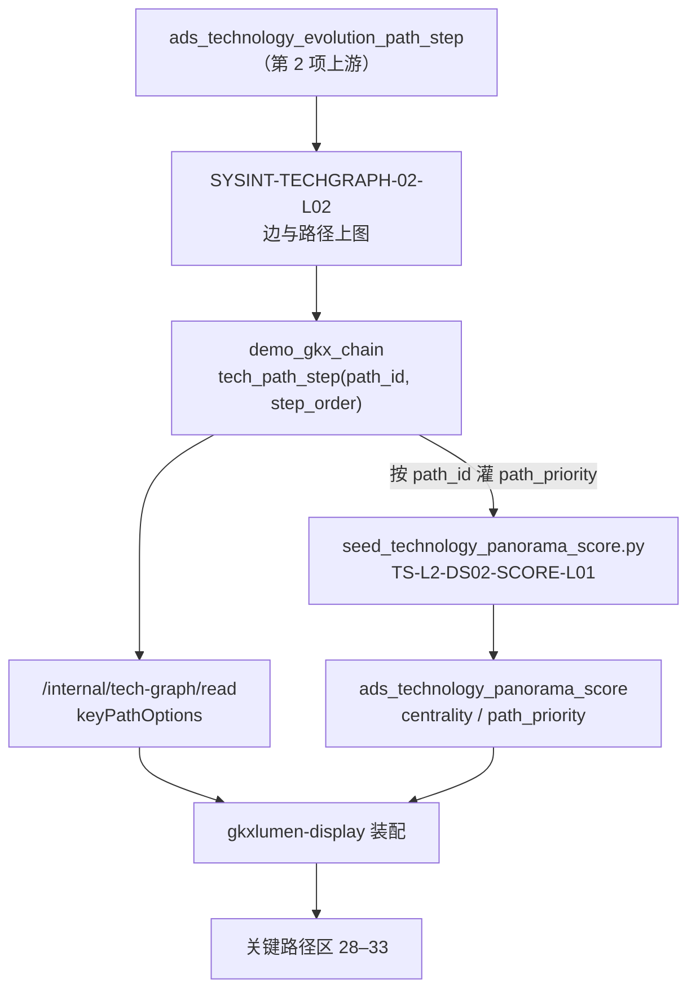

# TS-L2-DS02-PATH-ARCH · 科学技术全景 · 展示关键路径和关键节点 · 实现架构

- 任务：`TS-L2-DS02-PATH-ARCH`
- 日期：2026-11-07
- 监管：`human:淮政玮`
- 认领：`agent:arch-agent`
- 强度：ponytail off（定义任务，不缩文档）
- 状态：as-built 稿已落盘；四角色已会签（`sdd/l2/会签/TS-L2-DS02-L2SET-SIGNOFF-*.md`），未签收
- 2026-11-07 复查：图上已有路径步。样本 `tcn_000f21ac06aceb9cdd0575e82d0d85fc` 用 `technology_node_id` 直调 Python 读图：路径 2 条（三步、两步）。`path_priority` 仍 0 行，可按原灌数脚本重跑补齐。正文 11-05 的现状保留作记录，以本行为准。见 `工程过程/04-系统集成/05-展示系统集成/合规演示用例/TS-L2-DS02-PATH-合规演示用例.md`
- 上游：`sdd/科学技术全景-系统详细设计说明书.md`（`TS-L2-DS02-SDD`）第 2.3、3、4、5、6、7 节；`sdd/l2/TS-L2-DS02-ARCH.md` 第 2、3、4.3、5 节；`功能拆解.md` 序号 28–33；SRS `科学技术全景.md` 序号 28–33
- as-built 依据：`TS-L2-DS02-READ-PY-L01`、`SYSINT-05-01B-L01`、`SYSINT-05-01A-L01`、`TS-L2-DS02-SCORE-L01`、`TS-L2-DS02-TEST-L01` 的 handoff，以及三仓当前 `dev` 代码（只读核对）
- 图：`TS-L2-DS02-PATH-ARCH-SEQ`、`TS-L2-DS02-PATH-ARCH-DATA`（本文两张 Mermaid，无 frontmatter，记 `draft`）

本叶只写展示页「科学技术全景」二级「展示关键路径和关键节点」的实现架构。菜单 `/trend/tech-panorama`，页面 `lumen-ui-science-pc` `src/views/situation/panorama/`。SRS 序号 **28–33**。

按已实现的样子写。不重开说明书已定的决策，不新造 `metric_id`，不新增接口，不写 OpenAPI 字段表（见 `TS-L2-DS02-PATH-API`）。

## 1. 范围

| 序号 | 叶子 | 说明书判定 | 本二级怎么做 |
|---|---|---|---|
| 28 | 关键路径数据接收与处理 | 真读已有路径步。本页不接收上传 | 同一次 `graph` 带回 `keyPathOptions`。路径步由第 2 项写入 |
| 29 | 关键节点识别与标记 | 样式用点上角色和加权度；中心度读分数表 | 样式用 `role`、`strength`。中心度读 `centrality` 列。不挂 `M_TECH_PATH_KEYNODE` |
| 30 | 路径详情查看 | 真读步序和端点名称 | 侧栏展示步序和端点名。`summary` 为空就空 |
| 31 | 关键路径筛选与过滤 | 编号和步序用图；重要性读分数表；无类型字段不截数据 | 重要性读 `pathPriority`。无值不进档 |
| 32 | 路径比较分析 | 页面比较已取回的路径 | 页面内完成，不另发请求 |
| 33 | 关键路径动态演示 | 按步播放，不是两个年份各一张图 | 页面内完成，不另发请求 |

| 不做 | 原因 |
|---|---|
| 接收用户上传路径文件 | 序号 28 判定。写请求返回 501 |
| 请求内算中心度、关键节点、路径优先级 | 算法只在 Python，且三条注册口径不是本页对象。见 `TS-L2-DS02-PATH-METRIC` |
| 按 `currentYear` 换一张路径图 | 没有第二份快照。`currentYear` 只是播放游标 |
| 写路径步 | 第 2 项 `SYSINT-TECHGRAPH-02-L02` 的按钮，不在本页 |

## 2. 调用链

```mermaid
flowchart LR
  page["全景页 · 关键路径区<br/>lumen-ui-science-pc"]
  gw["gkxlumen-platform-gateway<br/>/display/**"]
  bff["gkxlumen-display<br/>POST /v1/situation/panorama/graph"]
  py["lumen-algo-py<br/>POST /internal/tech-graph/read"]
  graph["Nebula demo_gkx_chain<br/>tech_point + tech_path_step"]
  score["demo_gkxlumenx_ads<br/>ads_technology_panorama_score"]
  page -->|"选中技术点后同一次请求"| gw --> bff
  bff -->|"路径步、端点"| py --> graph
  bff -->|"centrality / path_priority 按 subject_id 只读"| score
```

| 跳 | 谁 | 做什么 |
|---|---|---|
| 1 | 页面 | `USE_MOCK=false` 时只打 `POST /display/v1/situation/panorama/graph`。带 `selectedNodeId`，`currentYear` 固定 `null` |
| 2 | 网关 | 只转 `/display/**` |
| 3 | `gkxlumen-display` | Feign `lumen-platform-algo-py` 调读图。空间不是 `demo_gkx_chain` 则 502。路径最多 20 条。按编号只读分数表，填 `nodes[].centrality`、`keyPathOptions[].pathPriority` |
| 4 | `lumen-algo-py` | 只读 `demo_gkx_chain`。选中点后查与它相连的 `tech_path_step`，按 `path_id` 归组、按 `step_order` 排序 |
| 5 | 分数表 | Python 灌 mock 行（D18）。Java 只 SELECT |

浏览器不打 Python，不打算法中台，不打 `/ops/v1/tech-graphs/**`。`gkxlumen-display` 不直连图库，不经 `gkxlumen-graph`，不调用任何 `demo-*`。Java 不写 nGQL，不算分。

## 3. 数据流



路径步只来自图。分数表只放两个数字：技术点 `centrality`、路径 `path_priority`。路径步本身不进分数表。

## 4. 功能流程

1. 用户选中一个技术点。页面带 `selectedNodeId` 再打一次 `graph`。关键路径区取 `keyPathOptions`。
2. 每条路径是一串技术点：`nodes[]` 带 `name`、`role`、`strength`、`stageKey`（步序下标）、`graphNodeId`。关键节点样式用 `role`（点上 `community_role`）和 `strength`（点上 `weighted_degree`）。中心度数字只在侧栏格子里显示，读 `nodes[].centrality`。
3. 用户点开一条路径。侧栏展示标题（端点名用「→」连）、步序和端点名。`summary` 读不到就空。技术意义、发展历程、关键突破没有正文，不补文字。
4. 用户筛选。重要性只看 `pathPriority`：选了档位而该路径没有值，显示「该路径没有优先级，不进入这一档」。路径上没有 `typeKey` / `pathType` 时，类型条件不截数据。阶段条件只在节点带 `stageKey` 时收窄。
5. 用户比较。`PathComparisonPanel` 在已取回的 `keyPathOptions` 里选 2–5 条，并排或重叠，算共同 / 差异节点。不另发请求，不建比较模型。
6. 用户播放。页面按 `nodes[]` 顺序逐步推进，可播放、暂停、继续、调速、重置。计时器在页面内。不按年份换图。

## 5. 空态与失败态

| 情况 | 关键路径区 | 图谱、实体区 | HTTP |
|---|---|---|---|
| 未选技术点 | 空（Java 不带路径） | 图谱最多 200 点，不带边 | 200 |
| 选中点但图上没有 `tech_path_step` | 空，「暂无关键路径」 | 保留 | 200 |
| 有路径但分数表没有 `path_priority` 行 | 路径照常显示；优先级格空；选了重要性档时该路径不进档 | 保留 | 200 |
| 技术点没有 `centrality` 行 | 中心度格空；样式仍按 `role` | 保留 | 200 |
| 分数表不在 / 连不上 / 口令空 | 两个数字格空，路径照常 | 保留 | 200 |
| 点列表为空 | 空，`emptyReason=GRAPH_EMPTY` | 画布空 | 200 |
| 读图失败或空间不对 | 页面保留上一次成功结果并提示读取失败，不画种子 | 同左 | 502 |
| 写请求（导入、手动、`action` 为写） | 不读图 | 不变 | 501 |

某一块空，不清掉另外两个功能已经显示的内容。这是说明书第 3 节的约定。

## 6. 上限

| 项 | 上限 | 在哪截 |
|---|---|---|
| 相关路径 | 20 条 | Python `_PATH_CAP=20`；Java `PATH_LIMIT=20` 再截一次 |
| 单次取回的路径步 | 168 步（`(20+1)×8`） | Python `_PATH_FETCH` |
| 分数查找编号 | 400 个 | Java `JdbcPanoramaScores` |

超限标记：Java 只把自己截掉的块写进 `truncated`。Python 已经截到 20 条，所以 Java 侧不会再截，`truncated.paths` 实际不会出现。见第 8 节。

## 7. 现状（截至 2026-11-05）

- 图上没有路径步边。`TS-L2-DS02-SCORE-L01` 灌数时核到：边类型里没有 `tech_path_step`、`tech_rel`、`tech_has_*`。
- `SYSINT-TECHGRAPH-02-L01`（点入图）in_progress；`SYSINT-TECHGRAPH-02-L02`（边、路径、关联实体）backlog。
- 分数表 `path_priority` 0 行（没有可对齐的 `path_id`）。`centrality` 19430 行。
- 因此序号 28–33 在线上是空态：路径区空，优先级格空。`TS-L2-DS02-TEST-L01` 按派单记为通过。
- 32 比较、33 播放的页面逻辑已在 `e6fb1dd`，没有路径时入口提示「请先选择路径或放宽筛选」。

## 8. 与说明书、代码不一致处（as-built 发现，2026-11-07 核）

| # | 现象 | 影响 | 建议归口 |
|---|---|---|---|
| 1 | Java 发给 Python 的选中点键是 `techPointId`；Python 只认 `technology_node_id` / `technologyNodeId` | 走完整链路时 Python 永远按「未选点」处理，不回路径、关系、实体。L02 入图后路径区仍会空。两侧单测都用假对端，没测出 | `TS-L2-DS02-SEL-FIX-L01`（ready，改 Java 一侧为 `technology_node_id`）。原单 `SYSINT-05-01B-L01`、`TS-L2-DS02-READ-PY-L01` 已 done |
| 2 | Python 只取与选中点直接相连的 `tech_path_step`（入或出），不按 `path_id` 补全整条路径 | 一条路径最多带回选中点前后各一步。序号 30 详情、33 播放只能看到局部。`_PATH_FETCH` 注释按每条 8 步预算，与查询语义不符 | 业务口径项（整条还是局部），会签不替甲方定：四角色同意 as-built，转客户决策清单（建议条目见 `会签/TS-L2-DS02-L2SET-SIGNOFF-PRODUCT.md`）。改读法未建单 |
| 3 | Java 不透传 Python 的 `truncated`，只写自己截掉的块 | 路径超 20 条时页面看不到截断标记，与说明书第 3 节「超过上限要标明截断」不符 | `TS-L2-DS02-SEL-FIX-L01`（DoD「可选同单」） |
| 4 | 页面重要性筛选只判 `pathPriority` 有没有值，不按数值分档 | 选任一档，有值的路径都进档。说明书「重要性读分数表」未定分档线 | 分档线属业务口径，转客户决策清单。前端原单 `SYSINT-05-01A-L01` 已 done，按定档改码未建单 |
| 5 | 分数只覆盖到顶层 `nodes[]`，不填 `keyPathOptions[].nodes[]` | 路径内节点的中心度要按 `graphNodeId` 回查顶层点 | 记录，不改 |
| 6 | 路径查询 `WHERE id(a) == … OR id(b) == … OR a.tech_point.technology_node_id == … OR …`，属性等值与 VID 写在同一个 `OR` 里 | 属性无索引报 `IndexNotFound` 时整条当空（`07ffa9f`），与说明书第 6 节「读失败不用空壳冒充成功」相冲。`SEL-FIX` 修完、L02 写入路径后，路径区仍可能空且不报错 | 补索引或改按 VID 查，未建单 |

本叶不改代码，只登记。
