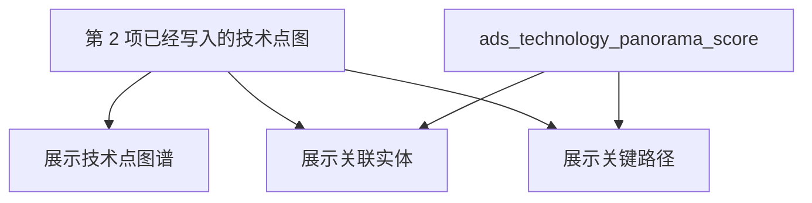

# 科学技术全景 · 系统详细设计说明书

- 任务：`TS-L2-DS02-SDD`
- 日期：2026-11-05
- 监管：`human:淮政玮`
- 状态：稿已落盘。会签未完成。本文不是 API 字段表。
- 功能架构：`sdd/l2/TS-L2-DS02-ARCH.md`
- 逐叶对照：`功能拆解.md`

正文按 `bid-reference/srs/02-科技信息展示系统/科技发展态势/科学技术全景.md` 的 31 叶拆。不另造指标、路径或页面。

## 1. 范围

需规四级「科学技术全景」有五个功能、31 叶（序号 17–47，excel 20–50）。

展示菜单 `/trend/tech-panorama`（页面 `lumen-ui-science-pc` `src/views/situation/panorama/`）只做前三个功能，序号 **17–33**：

| 功能 | 序号 | 用户在页面上做什么 |
|---|---|---|
| 展示技术点图谱 | 17–21 | 看技术点关系图，缩放拖拽，搜索定位，打开技术点详情 |
| 展示技术点关联实体 | 22–27 | 看选中技术点关联的人、机构、论文、专利，筛选和排序 |
| 展示关键路径和关键节点 | 28–33 | 看路径，标记关键节点，比较，按步播放 |

对外只走 `gkxlumen-display` 的 `POST /display/v1/situation/panorama/graph`。Java 不写算法，不写 nGQL。图由 Python `/internal/tech-graph/read` 只读 `demo_gkx_chain`。三个数字没有真模型时，只读新建 ADS 表里的 mock 行。不允许接口直接返回写死的 mock，也不许用页面 fixture 填这三个功能。

序号 34–40 是维护技术图谱。报价已划掉，工作量为 0。不设计落库，不建实现单。

序号 41–47 是维护关键实体及关系。菜单是 `/trend/tech-situation-maintain`，不在本说明书里设计写操作。已有 `FE-TS-10A` 与 `SCI-INT-A03`，本模块不重开。

入图、边上图、挂产业在第 2 项 WBS-02-19 / 02-20 / 02-21。本说明书只规定展示功能怎么读，不规定那些按钮怎么写。

签收条件（D18，2026-11-03）：可实现才签收。做不到真算、真查或真模型时，只接受新建 ADS 表、Python 灌 mock 行、Java 只读。

## 2. 逐叶

需规全文以 SRS 文件为准。下表每叶摘功能描述的要点，拆解沿 `功能拆解.md` 与 `TS-L2-DS02-ARCH`，不新编叶子。

### 2.1 展示技术点图谱（17–21）

| 序号 | 功能 | 需规要点 | 拆解 |
|---|---|---|---|
| 17 | 技术点图谱数据输入 | 手动输入或导入 Excel、JSON，填写名称、属性、层级，系统解析并建结构 | 501。本页不收输入。点由第 2 项写入 |
| 18 | 图结构自动生成 | 技术点为节点，关系为连线，不同类型可区分 | 真读已有图。不挂 `M_TECH_GRAPH_STRUCT` |
| 19 | 图谱交互操作 | 缩放、平移、旋转、拖拽、展开折叠、高亮路径 | 页面内完成，不另发请求 |
| 20 | 技术点搜索定位 | 关键词定位，模糊与精确，命中高亮并居中 | 真读。同一次 `graph` 带搜索字。中文空则保持空 |
| 21 | 技术点详情查看 | 名称、描述、属性、发展状态。弹窗或侧栏，不挡整图 | 真读该点已有属性。没有的字段空 |

### 2.2 展示技术点关联实体（22–27）

| 序号 | 功能 | 需规要点 | 拆解 |
|---|---|---|---|
| 22 | 默认实体展示 | 关联的 Top5：人、机构、论文、专利。名称、类型、关联强度 | 真读邻居，按强度取前 5。无强度不造数。不调用 `M_TECH_ENTITY_TOP5` |
| 23 | 节点点击交互 | 点技术点后实体区换成该点的关联实体，选中点高亮 | 真读。换点再取 |
| 24 | 实体详情查看 | 属性、关联技术点、时间线、相关统计 | 真读已有属性。无时间线则空。条数是邻居个数，不挂 `M_TECH_PAPER_PATENT_CNT` |
| 25 | 实体筛选功能 | 按类型、按时间范围 | 类型在已取回结果上滤。时间只在关系确有年份时收窄 |
| 26 | 实体关联关系展示 | 实体之间的连线或网络，并按时间轴看变化 | 501。没有实体之间的边，也没有第二份快照。不挂 `M_TECH_ENTITY_REL` |
| 27 | 实体排序与优先级 | 按关联强度、影响力排；也可按时间、名称、类型 | 强度、名称、类型用图上字段。影响力读分数表，D4 保持 mock |

### 2.3 展示关键路径和关键节点（28–33）

| 序号 | 功能 | 需规要点 | 拆解 |
|---|---|---|---|
| 28 | 关键路径数据接收与处理 | 接收路径上的技术点序列、关系和重要性，解析后放进图谱 | 真读已有路径步。本页不接收上传 |
| 29 | 关键节点识别与标记 | 按中心度、影响力标记，放大、变色或图标 | 样式用点上已有角色和加权度。中心度数字读分数表。不挂 `M_TECH_PATH_KEYNODE` |
| 30 | 路径详情查看 | 技术意义、发展历程、关键突破。侧栏，不挡整图 | 真读步序和端点名称。意义、历程、突破无正文则空 |
| 31 | 关键路径筛选与过滤 | 路径类型、重要性、时间范围，可组合 | 编号和步序用图上字段。重要性读分数表。无路径类型字段时，类型条件不截数据 |
| 32 | 路径比较分析 | 多条路径并排或重叠 | 页面比较已取回的路径。不另建模型 |
| 33 | 关键路径动态演示 | 按时间顺序演路径形成，可调速、暂停、继续 | 按步播放。不是两个年份各一张图 |

### 2.4 不在本菜单实现

| 序号 | 功能 | 本说明书 |
|---|---|---|
| 34–40 | 技术节点与关系的增删、属性编辑、修改历史、保存版本 | 不设计落库，不建实现单。页面上已有的导入和撤销只留在本次浏览 |
| 41–47 | 关键实体推荐、添加到全景、删除实体或关系、编辑、批量管理 | 归维护管理。不在本菜单建写接口 |

## 3. 调用链

```mermaid
flowchart LR
  page["全景页三个功能"]
  gw["gkxlumen-platform-gateway<br/>/display/**"]
  bff["gkxlumen-display"]
  py["lumen-algo-py<br/>POST /internal/tech-graph/read"]
  graph["demo_gkx_chain"]
  score["ads_technology_panorama_score"]
  page --> gw --> bff
  bff -->|"技术点、关系、实体、路径"| py --> graph
  bff -->|"影响力、中心度、路径优先级"| score
```

浏览器不打算法中台，不打 `/ops/v1/tech-graphs/**`，不直连 Python，不直连图库。`gkxlumen-display` 不直连图库，不经 `gkxlumen-graph`。空间不是 `demo_gkx_chain` 就拒绝，不改去 `gkx_chain` 或 `entan`。

一次 `graph` 返回复刻页已有的七个字段：`nodes`、`relations`、`keyPathOptions`、`timeline`、`listRecords`、`relationTypeOptions`、`factorItems`。三个功能分用这七个字段。不增加第八块，也不拆成三套资源。

| 功能 | 没有结果 | 这一次失败 |
|---|---|---|
| 图谱 | 画布空，`emptyReason=GRAPH_EMPTY` | 请求失败。不用演示种子填画布 |
| 关联实体 | 实体区空，已画出的技术点保留 | 只空实体区 |
| 关键路径 | 路径区空，图谱和实体保留 | 只空路径区 |
| 三个数字 | 对应格子空，名单和路径还在 | 只空数字 |

未选技术点时，最多 200 个技术点，不带边。选中一个点之后：该点的关系最多 200 条（默认只要高、中证据），每类实体最多 20 条，相关路径最多 20 条。超过上限要标明截断。

领域筛选只留下已经挂上产业的技术点。一个都没挂上则筛选结果为空。本页不写挂产业的表。

## 4. 数据流



点还没写入时，三个功能一起空。不把 `mock/modules/panorama.ts` 的节点灌进图，也不在接口里返回那些节点。

分数只服务序号 27、29、31 要看的三个数字。图谱、实体名单、路径步不进这张表。

| 项 | 值 |
|---|---|
| 表 | `ads_technology_panorama_score` |
| 库 | 与 `gkxlumen-display` 现读的 ADS 同库。不在 ODS、DWD、供应方库，不用 `gapfill_` |
| 行 | 一个技术点或一条路径，加 `influence`、`centrality`、`path_priority` 之一 |
| 灌数 | `TS-L2-DS02-SCORE-L01`。行是 mock。不在 `graph` 请求里写 |
| 读取 | 同一次 `graph` 按编号只读 |
| metric_id | 影响力 `M_TECH_ENTITY_INFLUENCE`；中心度 `M_TECH_PATH_CENTRALITY`；优先级 `M_TECH_PATH_PRIORITY` |
| D4 | 保持 mock，界面留 MockBadge |
| 无行 | 该格空 |

这三张注册口径是 IPC4 PageRank 或深圳卡位。表里的行不是那些函数的输出。公式未由 `human:唐绍祖` 按技术点另签之前，D4 不得改成 live。

## 5. 指标

2026-11-05 经 `metric-registry` 查询。下列 ID 已在册，D1 为 aligned，D4 为 mock。三个功能不调用它们的计算。身份继续用 `DS-02-METRIC-OPEN-L01`，不新造 `metric_id`。

| metric_id | 本页 |
|---|---|
| `M_TECH_GRAPH_STRUCT` | 不作为序号 18 的图 |
| `M_TECH_EDGE_STRENGTH` | 关系强度用图上已有权重 |
| `M_TECH_ENTITY_TOP5` | Top5 是该技术点的关联实体 |
| `M_TECH_PAPER_PATENT_CNT` | 不挂在实体条数上 |
| `M_TECH_ENTITY_REL` | 序号 26 保持空 |
| `M_TECH_ENTITY_INFLUENCE` | 只作影响力列的身份 |
| `M_TECH_PATH_CENTRALITY` | 只作中心度列的身份。请求内不算 |
| `M_TECH_PATH_KEYNODE` | 不挂。关键节点样式用点上已有角色 |
| `M_TECH_PATH_PRIORITY` | 只作路径优先级列的身份 |

`TEMP_DS02_*` 不是正式 ID。不把 `M_CHAIN_*`、`M_SVC_GRAPH_*`、`M_SVC_REC_*` 改挂到本页。

## 6. 和已有复刻页

`FE-TS-02A` 已经画出三个功能：筛选条、图谱 / 列表 / 路径播放、右侧分析、详情抽屉。本说明书不改区域划分，不改七个字段的名字。

| 现有 | 本设计 |
|---|---|
| `USE_MOCK=true` 时三个功能都用冻结种子 | 接线后只显示读到的结果。空就是空 |
| 控制器返回空数组和 `GRAPH_NOT_READY` | 接入后空图用 `GRAPH_EMPTY`。读失败不用空壳冒充成功 |
| 导入、手动加点、撤销留在本次浏览 | 不是 17–33 的功能。写到服务端返回 501 |
| 种子里的项目、领域节点和演示关系名 | 图谱只显示技术点和技术点关系。实体只显示人、机构、论文、专利 |
| `currentYear` 驱动种子时间轴 | 播放游标。服务端不按这个年份换一套图 |

`API-TS-M2` 未冻结，其中的编辑、版本、导入不属于这三个功能。本说明书不实现那份拆分。

## 7. 实现任务

不按 17 叶各开一张实现单。页面、前端接线、Java 装配、入图都已有任务号。本说明书只补调用链上还没有的三张实现单。会签完成前，这三张保持 backlog，不开工。

| 任务 | 类型 | 做什么 | 仓 | 依赖 |
|---|---|---|---|---|
| `FE-TS-02A` | 已有，integration | 三个功能的页面。不重做 | `lumen-ui-science-pc` | — |
| `SYSINT-05-01A-L01` | 已有，ready | 关掉 Mock，把三个功能接到这一次 `graph`。空态、501、MockBadge 按第 3、6 节 | `lumen-ui-science-pc` | 本说明书；`SYSINT-05-01B-L01` 可调 |
| `SYSINT-05-01B-L01` | 已有，ready | `gkxlumen-display` 装配七个字段。调 Python 读图，按编号读分数表。不再用 `GRAPH_NOT_READY` 冒充已接入 | 展示 Java | 本说明书；`TS-L2-DS02-READ-PY-L01` |
| `SYSINT-TECHGRAPH-02-L01` / `L02` / `L03` | 已有 | 把点、边、路径准备好。不代替展示功能 | 中台 / Java / Python | 与本菜单实现并行，不互相替代 |
| `TS-L2-DS02-READ-PY-L01` | 新建，backlog | `POST /internal/tech-graph/read`。只读 `demo_gkx_chain`。上限、空图、截断按第 3 节。不写图，不返回 fixture | `lumen-algo-py` | 本说明书会签 |
| `TS-L2-DS02-SCORE-L01` | 新建，backlog | 建 `ads_technology_panorama_score` 并灌 mock 行。只覆盖影响力、中心度、路径优先级 | `lumen-algo-py` | 本说明书会签。与读图同仓，读图合入后再做 |
| `TS-L2-DS02-TEST-L01` | 新建，backlog | 主路径：打开、搜索、点技术点、看实体、看路径、播放。序号 17 的写操作与序号 26 确认为 501 或空。`USE_MOCK=false` 时不得出现种子节点 | `gkx-orchestration` | `01A`、`01B`、读图、灌数 |

`DS-02-METRIC-OPEN-L01` 继续管指标身份，不另开指标实现单。`SCI-INT-A02` 已覆盖序号 17–33 的产品叶清单，不重开。

## 8. 会签

| 角色 | 状态 |
|---|---|
| 架构 | 未签 |
| 算法 | 未签 |
| 数据 | 未签 |
| 产品 | 未签 |

未会签不算本单完成。签收只由 `human:淮政玮` 做。本说明书不自标 done。
