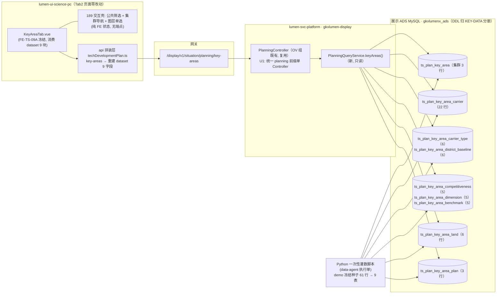
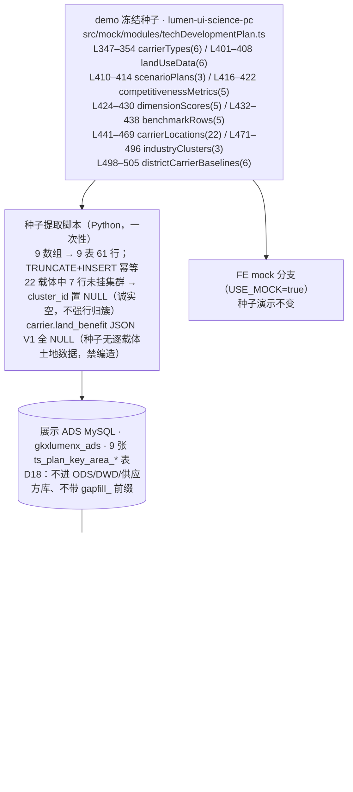

# TS-L2-DS09-KEY-ARCH · 重点领域规划 · 后台实现架构设计

> **任务**：`TS-L2-DS09-KEY-ARCH`（definition，不写业务代码）
> **日期**：2026-11-06 · **作者**：agent:zcode 会话代跑 architect-agent（沿 OV 组授权链）
> **状态**：草案，待四角色会签（architect / api / algorithm / data）
> **范围**：DS-09 `DS-09-KEY-DOMAIN` 页（重点领域规划页签 Tab2，FE-TS-09b），需规序 **185–190** 共 6 叶（185–188 + 190 五读面叶 + 189 一交互壳叶）
> **diagram_id**：`TS-DS09-KEY-CALLCHAIN-01`（§2 调用链）、`TS-DS09-KEY-DATAFLOW-01`（§3 数据流）

**输入真源**

| 用途 | 真源 |
|---|---|
| 需规 6 叶 | `bid-reference/srs/02-科技信息展示系统/科技发展态势/科技发展规划.md` seq 185–190（L110–L199；六叶 bid_desc 均空、沿用 excel_row 181 继承句） |
| 契约草案（批 4 未冻结） | `agent-handoffs/科技发展态势-TS/API-TS-M9.md` §3.7 `key-areas`（唯一契约端点：3 集群 + 22 载体 + 竞争力五维 + `land_benefit` + 3 方案）+ §4 表 #5 + §5 U8 |
| 指标赋号与差集 | `agent-handoffs/产品整体定义/METRIC-OPEN-DS-09-科技发展规划-核对记录.md` §3.3 KEY-DOMAIN（四条 TEMP→`M_INNOV_KEYD_*`、④ 不适用三条、撞号禁令）+ §赋号表 |
| 存量对照 | `工程过程/04-系统集成/05-展示系统集成/对照-科技发展规划与维护管理-存量任务与依赖.md` B.1 Tab2 行（189 无独立端点 / U8 待定已备注） |
| OV 组先例（本稿沿袭） | `sdd/l2/TS-L2-DS09-OV-ARCH.md`（U1 裁定：统一 `planning` 前缀单 Controller；拆专用表先例；§10 会签勘误口径：`metric_id` 列、文案表行携带） |
| FE 现状 | `lumen-ui-science-pc/src/views/situation/tech-development-plan/tabs/KeyAreaTab.vue`（消费 dataset 9 块，页面冻结）+ `src/mock/modules/techDevelopmentPlan.ts` L347–L505（demo 冻结种子 9 数组，行数实测） |
| 架构铁律 | `architecture-baseline.md` D18（§2 决策表）、D12、D14 |

---

## 0. 结论速览（逐叶判定）

| seq | 叶 | 判定 | D18 表（V1 灌数 · 行数实测） | 读取接口（契约 §） | metric_id（均赋号草稿·未签·pending `human:唐绍祖`） |
|---|---|---|---|---|---|
| 185 | 区域科技创新空间布局分析 | **D18 读表**（GIS 密度/集聚度读数） | `ts_plan_key_area`（集群 3 行）+ `ts_plan_key_area_carrier`（落点 22 行） | §3.7 `key-areas` | `M_INNOV_KEYD_SPATIAL`（STAT） |
| 186 | 竞争力水平与潜力评估 | **D18 读表**（指标卡 + 五维画像 + 对标） | `ts_plan_key_area_competitiveness`（5 行）+ `ts_plan_key_area_dimension`（5 行）+ `ts_plan_key_area_benchmark`（5 行） | 同上（同端点分块） | `M_INNOV_KEYD_COMPETITIVENESS` / `M_INNOV_KEYD_POTENTIAL`（MIXED · mapped 186 仅语义，禁改挂） |
| 187 | 土地用途与效益分析 | **D18 读表**（区级用地 6 行；逐载体 `land_benefit` V1 诚实空） | `ts_plan_key_area_land`（6 行） | 同上 | `M_INNOV_KEYD_LAND`（STAT） |
| 188 | 科技载体分布展示 | **D18 读表**（GIS 落点 + 详情，**非价值排名**） | `ts_plan_key_area_carrier`（22 行）+ `ts_plan_key_area_carrier_type`（6 行）+ `ts_plan_key_area_district_baseline`（6 行） | 同上 | 无（other_system：GIS 点位 + ADS 详情；N/A 依据核对记录 §3.3 ④） |
| 189 | 产业与领域筛选联动 | **交互壳**（公共筛选承载） | 无新表、**无独立端点**（消费 185/188 表行；筛选全为 FE 公共筛选态） | —（`key-areas` 一次取全，FE 本地过滤联动） | 无（n/a_ops；xlsx 98/99 技术规模/发展状态随壳展示，不另开 missing） |
| 190 | 资源配置优化建议 | **D18 读表**（3 方案 plans 行，建议壳） | `ts_plan_key_area_plan`（3 行） | 同上 | 无（n/a_ops 建议壳；模拟预测 = FE Modal 交互，**不是 501**） |

**一句话**：6 叶全部无写面、**零 501**——5 叶 D18 读表（demo 冻结种子灌 9 张 `ts_plan_key_area_*` 表共 61 行，Java 只读单端点组装，页面保留 🧪 MockBadge）+ 1 叶纯交互壳（189，公共筛选 + 集群导航 + 图层切换，后端零改动承载）。全部接口禁止返回写死 JSON / 常量 / 内存 fixture（D18）。

---

## 1. 范围与明确不做项

**范围**：重点领域规划页签后台实现架构——1 个 REST 端点（契约 §3.7 `key-areas`，响应按种子扩为 9 块，见 §5）、9 张 D18 表、Python 一次性灌数、前端 api 拼装层接线差异。落仓：Java `lumen-svc-platform/gkxlumen-display`（复用 OV 组 `PlanningController`，U1 裁定：统一 `planning` 前缀单 Controller，不按 09a/09b/09c 拆服务路由）；灌数 Python 脚本（data-agent 执行单）；FE 接线 `lumen-ui-science-pc/src/api/situation/techDevelopmentPlan.ts`（仅此文件族）。

**明确不做**（谁会签都不许扩）：

1. **本页禁 501**：catalog 501 通道只给 COMPREHENSIVE seq 184（核对记录 §5）；KEY-DOMAIN 任何叶不得进 501
2. **190 是建议壳**：投入建议/布局优化/方案模拟与效果预测均为 FE 交互（Modal），**禁 missing 模拟模型、禁借 501**；3 方案行是产品定义的演示数据，不编制规划正文/优化建议文本
3. **不编制规划正文**（同 OV 口径；190 方案 `summary`/`actions` 为 demo 种子逐字，非生成物）
4. **禁挂 `M_SYNTH_*` / 专题 Job**：对照 186 **不在本页跑专题 Job**；186 仅语义允许（同叶不同页），禁改挂 `M_SYNTH_VIT_*` / GBA/CITY 186 读面号
5. **不重做 `FE-TS-09A` 页面**（孔东锁至 2026-11-12；Tab2 页面零改动，接线只改 api 拼装层）
6. **不认领、不并进** `BE-TS-IMPL-01` / `BE-TS-DATA-01` 整包
7. **不发明 `M_*` 写入 metrics seed**：只消费核对记录 §赋号表 4 条 KEYD（均草稿、类型未签、公式 pending `human:唐绍祖`）；禁 `M_KEYDOMAIN_*` / `M_SPATIAL_*` 等自造号
8. **189 不新增后端配置面 / 筛选端点**（交互类叶，同 OV 179 性质；V1 全量 61 行一次下发，无分页/服务端过滤必要）
9. **撞号禁令**（详 §7.3）：展示 185–190 与综合 05 185–190 整段撞号，禁按号 mapped；禁改挂 `M_SYNTH_VIT_*` / `M_ENT_*` / `M_CHAIN_*`

---

## 2. 整体流程与调用链（图：`TS-DS09-KEY-CALLCHAIN-01`）

调用链铁律核对：前端 → Java REST → 只读 ADS；**无 Python 运行时依赖**（Python 只在灌数期写表）；无写面、无 501 分支、无 `demo-*` 服务依赖（D12）；不涉对象存储（D14）；不涉 NebulaGraph。**本页零新 Controller**（复用 OV 组，只加一个方法）。

---

## 3. 数据流（图：`TS-DS09-KEY-DATAFLOW-01`）

灌数幂等：按表 `TRUNCATE + INSERT`，可重跑；**唯一禁灌项** = carrier 行 `land_benefit` 与一切种子外的派生数值（集聚度/密度如后续 GIS 图层接入，由正式态换真源，V1 不补算）。

---

## 4. 逐叶架构

### 4.1 seq 185 · 区域科技创新空间布局分析 — D18 读表（GIS 密度/集聚度读数）

- **需规**：分析区域科技创新空间布局特征，查看创新资源地理分布，提供空间密度分析和集聚度评估。
- **判定依据**：核对记录 §3.3——`TEMP_DS09_KEYD_SPATIAL` STAT、差集 **other_system**、公式=GIS + ADS 图层读数，**禁伪挂 seq 191 网络密度（`M_ENT_AGGLOMERATION_INDEX` 不复用）、禁 missing**；真算密度/集聚度做不到（无 GIS 图层服务接入面）→ D18 读表。
- **表**：`ts_plan_key_area`（3 集群行：`cluster_id`(沿用 demo 键 ai/bio/energy)、`cluster_name`、`industry_category`、`technology_field`、`default_map_layer`、`carrier_ids` JSON、`metric_id` 列=SPATIAL 草稿）；`ts_plan_key_area_carrier`（22 载体行提供地图落点：id/name/carrier_type/district/lng/lat/level + `cluster_id` 可空）。GIS 渲染由 FE 既有 `TiandituMap` 承载，后端只供点位/聚类归属行，**不新建 GIS 服务**。
- **灌数方**：Python 一次性脚本（demo 冻结种子）。
- **读取接口**：`GET /v1/situation/planning/key-areas`（§3.7；185 消费 clusters + carriers 两块）。
- **metric_id**：`M_INNOV_KEYD_SPATIAL`（STAT 草稿未签；读数为集聚归属演示，非网络密度；UI ⓘ draft）。

### 4.2 seq 186 · 竞争力水平与潜力评估 — D18 读表（五维画像）

- **需规**：评估区域科技创新竞争力水平和潜力，查看指标体系与评估结果，提供与对标区域对比。
- **判定依据**：核对记录 §3.3——COMPETITIVENESS/POTENTIAL 均 MIXED、差集 **mapped 186（仅语义允许，同叶不同页）**、权重未签（Q-MO-DS09-04）；**禁改挂 `M_SYNTH_VIT_*` / GBA/CITY 186 号、禁企业 141、禁 `M_CHAIN_COMPETITIVENESS_INDEX` / `M_CHAIN_REGION_INDEX`、禁挂技术链 135** → 真算做不到 → D18。
- **表**（三块，FE 各是一张卡/一栏，形状不同不并表）：
  - `ts_plan_key_area_competitiveness`（5 指标卡行：`metric_key`(composite/innovation/industry/openness/potential 沿 demo 键)、`label`、`value`、`change_pct`、`metric_id` 列——potential 行挂 `M_INNOV_KEYD_POTENTIAL`，其余挂 COMPETITIVENESS）；
  - `ts_plan_key_area_dimension`（五维行：`dim_key`（U8 定名，§7.1）、`dim_label`（创新资源/科研产出/产业竞争力/人才支撑/开放协同）、`score`、`metric_id`=COMPETITIVENESS）；
  - `ts_plan_key_area_benchmark`（对标 5 行：region/score/rank_no/metric_id=COMPETITIVENESS）。
- **读取接口**：同端点（competitiveness_metrics / dimension_scores / benchmark_rows 三块）。
- **metric_id**：`M_INNOV_KEYD_COMPETITIVENESS` + `M_INNOV_KEYD_POTENTIAL`（MIXED 未签；维名/权重未冻 → ⚠️「待甲方确认」，文案走 KEYD-B02/B03）。

### 4.3 seq 187 · 土地用途与效益分析 — D18 读表

- **需规**：精准掌握土地用途和完成效益，查看土地利用类型、创新产出效益，提供利用效率评估和优化建议。
- **判定依据**：核对记录 §3.3——`TEMP_DS09_KEYD_LAND` STAT、差集 **other_system**、公式=GIS 用地/产出图层读数，**禁按号 mapped 综合 187、禁 missing**；土地句里的「优化建议」不改挂 seq 190 → D18。
- **表**：`ts_plan_key_area_land`（6 行：district/land_type/area_sqm/efficiency/status + `land_benefit` JSON 可空（预留 U8 定名字段，V1 NULL）+ `metric_id`=LAND）。逐载体 `land_benefit` 见 carrier 表（V1 诚实空，§7.2）。
- **读取接口**：同端点（land_use 块）。
- **metric_id**：`M_INNOV_KEYD_LAND`（STAT 草稿未签；亩均/容积率正式值待数据侧接入后由真源替换）。

### 4.4 seq 188 · 科技载体分布展示 — D18 读表（GIS 落点 + 详情，非价值排名）

- **需规**：地图展示科技载体分布，按类型查看，提供载体详细信息和创新活动分析。
- **判定依据**：核对记录 §3.3 ④——差集 **other_system**：GIS 载体点位 + ADS 详情，**不是载体价值排名；禁抢 DS-06-CARRIER missing、禁 mapped 116 / 综合 188** → 无统计核、无 metric_id，但列表/图例/计数仍须有表可读 → D18。
- **表**：`ts_plan_key_area_carrier`（22 行，4.1；详情=type/district/level）+ `ts_plan_key_area_carrier_type`（6 行含 all：type_key/type_name/carrier_count（全市口径 demo 计数 2856/128/…，🧪）/color/sort_no）+ `ts_plan_key_area_district_baseline`（6 区行：district/total_carriers/leading_type）。
- **读取接口**：同端点（carriers / carrier_types / district_baselines 三块；FE 堆叠/区县/列表三视图全由这三块派生，无派生表）。
- **metric_id**：无（other_system N/A；计数旁不显伪 8 件套）。

### 4.5 seq 189 · 产业与领域筛选联动 — 交互壳（无独立端点）

- **需规**：选择产业大门类、科技领域细分，地图呈现空间分布格局，联动技术规模、技术发展状态、领军主题。
- **判定**：核对记录 §3.3 ④——差集 **n/a_ops**：大门类/细分 + 地图联动壳；xlsx 98/99（技术规模/发展状态）随壳展示，不另开 missing；**禁 mapped 综合 189 / 技术链 133/137**。B.1 备注同口径：189 由公共筛选承载，无独立端点（交互类叶，同 OV 179 性质）。
- **实现**：零后端改动。公共筛选（产业大门类/科技领域细分/载体类型）+ 集群导航（industryClusters 行）+ 图层单选（4 值：科技载体/土地效益/资源缺口/产业热度，FE 本地常量 MAP_LAYER_OPTIONS，model L985）均为 FE 状态，对 `key-areas` 一次取全（61 行）本地过滤联动；领军主题由集群 `technology_field` + 载体 `level` 既有列承载。
- **metric_id**：无。

### 4.6 seq 190 · 资源配置优化建议 — D18 读表（3 方案 plans 行，建议壳）

- **需规**：基于空间布局和竞争力分析，提供资源配置优化建议，查看投入建议、空间布局优化方案，支持方案模拟和效果预测。
- **判定依据**：核对记录 §3.3 ④——差集 **n/a_ops 建议壳**：原文未点名生成模型；**禁 missing 模拟叶、禁借 501、禁按号综合 190、禁改挂 186 附录建议/技术链 140/`M_CHAIN_LAYOUT_*`/`M_POLICY_INDUSTRY_FIT`、不编制规划文本** → D18 种子行。
- **表**：`ts_plan_key_area_plan`（3 行：plan_id/plan_name(方案A/B/C)/title/priority/expected_effect/resource_gap/actions JSON/三个 action 文案列；`metric_id` 列 NULL——n/a_ops 建议壳，演示读数不挂 ID）。
- **读取接口**：同端点（plans 块）；「方案模拟」Modal = FE 交互，效果预测值即表行 `expected_effect`（demo 逐字），**无模拟端点、无 501**。
- **metric_id**：无（建议壳）。

---

## 5. 与契约草案 / FE 复刻页差异收口

| # | 差异 | 收口（本稿裁定） |
|---|---|---|
| 契约 §3.7 结构 | 示例把 competitiveness/carriers/plans **嵌在 cluster 内**；实测种子：22 载体仅 15 行挂集群（L001/L004/P003/P005/I003/I004/A002 共 7 行无归属）、plans 为**页级**（非集群级）、五维/指标卡/对标/土地/类型/区基线 6 块契约未覆盖 | 响应改**平铺 9 块**：clusters（含 carrier_ids 引用）/ carriers（含可空 cluster_id）/ carrier_types / district_baselines / competitiveness_metrics / dimension_scores / benchmark_rows / land_use / plans + `carrier_total` + `caliber_note` + `metric_ids`；cluster 内不再嵌套。KEY-API 分册起草新响应示例，批 4 冻结时改约 |
| 契约 §4 表 #5 | 建议 2 张（`ts_plan_key_area` / `ts_plan_key_area_carrier`，competitiveness/land_benefit 塞 JSON 列） | 沿 OV「专用表」先例按种子形状拆 **9 张**（§6）；两张建议名原样沿用（集群行/载体行）；JSON 大列拆行表（五维/对标/指标卡/土地各自可维护、可排序），仅 carrier_ids / actions / land_benefit 保 JSON |
| 契约示例五维「技术/产业/空间/人才/政策」 | 与 demo 两数组（指标卡 composite/innovation/industry/openness/potential + 维度得分五中文名）**均不符**，系草案虚构 | U8-1 裁定建议（§7.1）：弃契约示例五维，以 demo `keyAreaDimensionScores` 五维为准 + 新增英文键 |
| 契约示例 carrier 内 `land_benefit`（plot_ratio 2.8 / output_per_mu 1200） | demo 种子**无逐载体土地数据**（土地只有区级 landUseData 6 行） | 列保留、V1 全 NULL（诚实空，禁编造容积率/亩产）；187 读数由 `ts_plan_key_area_land` 区级行承载。字段定名 U8-2（§7.2） |
| B.1 备注「189 无独立端点」 | — | §4.5 落定：公共筛选承载，`key-areas` 一次取全 + FE 本地联动，无服务端过滤参数/分页（V1 全量 61 行） |
| G-B5 沿袭 | MockBadge 逐卡核对 | D18 表读数 **D4 仍 mock** → 🧪 MockBadge 保留至 D4 翻转；统计数旁 ⓘ draft 语义卡回指核对记录 §赋号表（禁点 `M_SYNTH_*`/`M_ENT_*`/`M_CHAIN_*` 伪 8 件套） |

---

## 6. D18 三要素总表（缺一不签）

| 表（`gkxlumenx_ads`） | 行数（实测） | 灌数方 | 读取接口 |
|---|---|---|---|
| `ts_plan_key_area` | 3 | Python 一次性脚本（demo 冻结种子） | §3.7 key-areas · clusters 块（185/189） |
| `ts_plan_key_area_carrier` | 22（7 行 cluster_id NULL） | 同上 | carriers 块（185/188） |
| `ts_plan_key_area_carrier_type` | 6 | 同上 | carrier_types 块（188） |
| `ts_plan_key_area_district_baseline` | 6 | 同上 | district_baselines 块（188） |
| `ts_plan_key_area_competitiveness` | 5 | 同上 | competitiveness_metrics 块（186） |
| `ts_plan_key_area_dimension` | 5 | 同上 | dimension_scores 块（186） |
| `ts_plan_key_area_benchmark` | 5 | 同上 | benchmark_rows 块（186） |
| `ts_plan_key_area_land` | 6 | 同上 | land_use 块（187） |
| `ts_plan_key_area_plan` | 3 | 同上 | plans 块（190） |

合计 9 表 61 行；每表带 `metric_id` 列（无核叶置 NULL）与 `updated_at`。库名与 DDL 由 **KEY-DATA 分册**冻结（沿 OV：展示 ADS MySQL、`gkxlumenx_ads`、`ts_plan_` 前缀；**不进 ODS/DWD/供应方库、不带 `gapfill_` 前缀**——D18 铁律）。189 无表无端点（§4.5）。

## 7. U8 裁定建议（单列，供 M0 + 数据侧拍板）与未决项

### 7.1 U8-1 · 竞争力五维 key 定名（建议）

- **建议**：五维以 demo `keyAreaDimensionScores`（`techDevelopmentPlan.ts` L424–430）的五个中文名为权威维度名——**创新资源 / 科研产出 / 产业竞争力 / 人才支撑 / 开放协同**；英文键（种子无、需新定）建议 **`innovation_resources` / `research_output` / `industry_competitiveness` / `talent_support` / `open_collaboration`**。契约示例五维「技术/产业/空间/人才/政策」与 demo 两数组均不符（草案虚构），建议**弃用**。
- **配套**：`keyAreaCompetitivenessMetrics`（composite 综合指数 + innovation/industry/openness/potential，带 value/change）是 186 的**指标卡块**，与五维画像**并存不合并**；其英文键沿用 demo 原键（composite/innovation/industry/openness/potential），仅 potential 行挂 `M_INNOV_KEYD_POTENTIAL`。
- **理由**：FE-TS-09A 已冻结，demo 中文文案即页面既显内容（定名零页面改动）；英文键为 `ts_plan_key_area_dimension.dim_key` 新列，一次定名避免后续 ALTER；五维语义与核对记录「区域对象竞争力」（KEYD-B03：vs 区域创新活力）对齐，不引「空间维」以免与 185 SPATIAL 混淆。

### 7.2 U8-2 · `land_benefit` 字段定名（建议）

- **建议**：**沿用契约示例** `plot_ratio`（容积率）/ `output_per_mu`（亩均产出）——标准园区用地效益口径（「亩均论英雄」通用指标），demo 无既有字段可沿，新定名即以契约为准。
- **配套**：V1 该 JSON 列**全 NULL**（demo 冻结种子无逐载体土地数据，诚实空态，禁编造数值）；187 叶读数由 `ts_plan_key_area_land` 区级行（area_sqm/efficiency/status）承载；正式态接入 GIS 用地图层后回填真值。

### 7.3 撞号禁令（硬边界，随稿冻结）

- 展示 seq 185–190 与综合 05 seq 185–190 **整段撞号，禁止按号 mapped**；**186 仅语义允许**（同叶不同页，演示随 186，不改挂）。
- 185：禁 mapped 191 网络密度、禁复用 `M_ENT_AGGLOMERATION_INDEX`；187：禁按号 mapped 综合 187；188：禁抢 DS-06-CARRIER missing、禁 mapped 116 / 综合 188；189：禁 mapped 综合 189 / 技术链 133/137；190：禁按号综合 190、禁改挂 186 附录建议 / 技术链 140 / `M_CHAIN_LAYOUT_*` / `M_POLICY_INDUSTRY_FIT`。
- 四条 `M_INNOV_KEYD_*` 均**赋号草稿·未签·pending `human:唐绍祖`**；**禁改挂 `M_SYNTH_VIT_*` / `M_ENT_*` / `M_CHAIN_*`** 及 B 轨 / SYNTH / CHAIN / SVC / TECH 全族；禁湾区 DS-05、深圳 DS-06-CITY/CARRIER/DOMAIN、DS-07、DS-08 混挂。

### 7.4 未决项消费与沿袭

- **本稿消费**：U8（§7.1/§7.2 给裁定建议，M0 + 数据侧拍板）；U1（OV 建议在本稿落定：复用 `PlanningController` 单 Controller，本页零新路由）。
- **不在本稿**：U2/U3/U9（RES 组，另册）。
- **语义债沿袭**：KEYD-B01..B03 保持；差集不动（SPATIAL/LAND other_system、COMPETITIVENESS/POTENTIAL mapped 186 语义、188 other_system、189/190 n/a_ops）；四条类型未签 → ⚠️「待甲方确认」+ ⓘ draft；不升 🟢、不改差集判定、不写任何 `cfg_metric-*-seed.yaml`。

## 8. 架构合规自检（architect 评审清单 11 条）

1 算法只在 Python ✅（Java 无 NLP/推理；Python 仅一次性灌数，无运行时依赖）· 2 调用链 ✅（前端→Java REST→只读 ADS；无 501 分支；D12 无 demo 依赖）· 3 图谱 N/A ✅（不涉 NebulaGraph）· 4 可观测 ✅（display 既有 OTel 全链，新方法零豁免）· 5 CI/CD（定义单 `cicd: skip`；实现单走 push→Pipeline→K8s dev）· 6 demo 未污染 lumen ✅ · 7 方案 A ✅（前端只调 Java）· 8 数据走 ADS ✅（Python 写、Java 只读）· 9 D14 N/A ✅ · 10 D8 N/A（页面零改动）· **11 D18 ✅（9 表逐张写明表名/行数/灌数方/读取接口；无接口直返 mock；禁灌项显式列出）**

## 9. 会签与签收路径

四角色会签（architect / api / algorithm / data，意见落 `sdd/l2/会签/重点领域规划-会签.md`）→ 全部同意后由 `actor=human:淮政玮` 签收 done → 以本稿为硬依赖起草 KEY-API / KEY-METRIC / KEY-DATA 三分册（并行；KEY-API 需按 §5 改约 §3.7 响应结构）→ 三分册会签签收后拆 Java 实现（`PlanningQueryService.keyAreas()` + 端点）/ 灌数 / 接线 / 主路径测试四行实现单。

## 10. 会签勘误（v2，2026-11-06）

三角色会签（architect/api/algorithm）指出：§4.5 图层全集实为 **4 值**（含「资源缺口」，`MAP_LAYER_OPTIONS`，techDevelopmentPlanModel.ts L985），已修正上文；另 K-4 caliber_note 文案定稿归属裁定为 **KEY-DATA 种子行**（本稿 §4 各处「文案表行携带」以 DATA 分册 rendered_note 列为准）。其余必改项见 KEY-API / KEY-DATA 分册 v2 修订记录。
