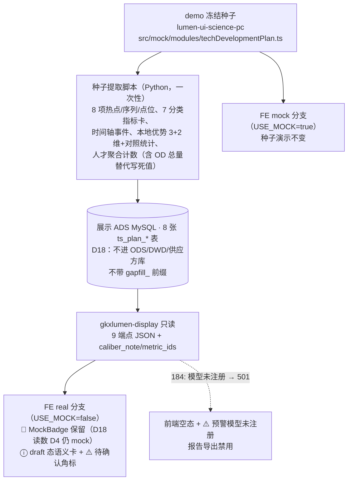

# TS-L2-DS09-OV-ARCH · 综合发展规划 · 后台实现架构设计

> **任务**：`TS-L2-DS09-OV-ARCH`（definition，不写业务代码）
> **日期**：2026-11-06 · **作者**：agent:zcode 会话代跑 architect-agent（总控授权：新人引导 §4.2，监管人 `human:王梓真` 口头授权 2026-11-06）
> **状态**：草案，待四角色会签（architect / api / algorithm / data）
> **范围**：DS-09 `DS-09-COMPREHENSIVE` 页（综合发展规划页签，FE-TS-09a），需规序 **178–184** 共 7 叶
> **diagram_id**：`TS-DS09-OV-CALLCHAIN-01`（§2 调用链）、`TS-DS09-OV-DATAFLOW-01`（§3 数据流）

**输入真源**

| 用途 | 真源 |
|---|---|
| 需规 7 叶 | `bid-reference/srs/02-科技信息展示系统/科技发展态势/科技发展规划.md` seq 178–184 |
| 契约草案（批 4 未冻结） | `agent-handoffs/科技发展态势-TS/API-TS-M9.md` §1–§5 |
| 指标赋号与差集 | `agent-handoffs/产品整体定义/METRIC-OPEN-DS-09-科技发展规划-核对记录.md`（13 TEMP→M_INNOV，类型未签；§1.2 差集判定不动） |
| 页面集成结论 | `SCI-INT-A11`（19 叶集成卡）：人才不归久新（IP-10）、推送并入订阅、久新 3 条热点 API 待确认 |
| 存量对照与缺口 | `工程过程/04-系统集成/05-展示系统集成/对照-科技发展规划与维护管理-存量任务与依赖.md` B.1–B.3（G-B1/G-B2/G-B4/G-B5/G-B6） |
| 架构铁律 | `architecture-baseline.md` D18（§2 决策表）、D12、D14 |
| FE 现状 | `lumen-ui-science-pc/src/api/situation/techDevelopmentPlan.ts`（单端点 real 分支）、`src/types/techDevelopmentPlan.ts`（dataset 8 块）、`src/mock/modules/techDevelopmentPlan.ts`（demo 冻结种子） |

---

## 0. 结论速览（逐叶判定）

| seq | 叶 | 判定 | D18 表（V1 灌数） | 读取接口（契约 §） | metric_id（均赋号草稿·未签） |
|---|---|---|---|---|---|
| 178 | 全球热点技术捕捉 | **D18 读表** | `ts_plan_hot_tech` + `ts_plan_hot_tech_series` | §3.2 `hot-technologies` | `M_INNOV_PLAN_HEAT` / `M_INNOV_PLAN_GROWTH`（MIXED） |
| 179 | 多维度指标体系展示 | **D18 读表**（n/a_ops 运营壳，无统计核） | `ts_plan_metric_system` | **新增第 9 端点** `metric-system`（G-B2 方案 A） | 无（N/A + 依据 §4.2） |
| 180 | 技术与产业热点动态跟踪 | **D18 读表** | `ts_plan_tracking_event` + `ts_plan_tracking_point` | §3.3 `tracking` | 无独立核（消费 178 两指标；空间分布 COMP-B03 语义债保持） |
| 181 | 本地特色与优势分析 | **D18 读表** | `ts_plan_local_adv`（含 FE 补的两维度 + reference_stats） | §3.4 `local-advantage` | `M_INNOV_PLAN_LOCAL_ADV`（MODEL，missing 保持） |
| 182 | 科技人才流动监控 | **D18 读表**（只聚合计数） | `ts_plan_talent_flow`（表结构级无个人明细字段） | §3.5 `talent-flow` | `M_INNOV_PLAN_TALENT_FLOW`（MODEL，missing 保持；⚠️ U6） |
| 183 | 科创资源整合与推送 | **真读+真写**（本二级唯一写面；不建 D18 表） | 无（复用 app_user 订阅家族） | §3.6 `resource-push`（GET/PUT） | 无（n/a_ops 订阅壳） |
| 184 | 潜在科技发展方向预警 | **501 通道**（模型未注册） | `ts_plan_direction_warning` **建表 V1 零行**（禁灌假预警） | §3.1 `direction-warnings` | `M_INNOV_PLAN_DIRECTION_ALERT`（501 pending；差集 missing 保持） |

**一句话**：7 叶里 1 叶真读写（订阅）、1 叶 501 空态（预警）、5 叶 D18 读表（demo 冻结种子灌 ADS，Java 只读，界面保留 🧪 MockBadge）。全部接口禁止返回写死 JSON / 常量 / 内存 fixture（D18）。

---

## 1. 范围与明确不做项

**范围**：综合发展规划页签后台实现架构——9 个 REST 端点（契约 §3.1–§3.6 共 8 + 新增 1）、8 张 D18 表、1 个订阅适配器、前端 api 拼装层接线差异。落仓：Java `lumen-svc-platform/gkxlumen-display`；灌数 Python 脚本（data-agent 执行单）；FE 接线 `lumen-ui-science-pc/src/api/situation/techDevelopmentPlan.ts`（仅此文件族）。

**明确不做**（谁会签都不许扩）：

1. **不编制规划正文**（集成口径已定；深度研判报告整页不做）
2. **不重做 `FE-TS-09A` 页面**（孔东锁至 2026-11-12；接线只改 api 拼装层，页面零改动）
3. **不认领、不并进** `BE-TS-IMPL-01` / `BE-TS-DATA-01` 整包
4. **不发明 `M_*` 写入 metrics seed**；只消费核对记录 §赋号表（13 条均为草稿、类型未签、公式 pending `human:唐绍祖`）
5. **预警不做真模型**：`M_INNOV_PLAN_DIRECTION_ALERT` 未注册，走 501 通道；空态不得用假规划正文 / 假预警行填
6. **不新增写面**（除 §3.6 订阅设置）；订阅推送不经 Python / 久新
7. **不跑专题 Job**（SYNTH / CHAIN / TOPIC-* 不进本页）；不改差集判定（7/7 库缺口 missing 保持，501 非覆盖证明）
8. **不做 179 的"自定义布局"持久化**：需规原文的运营壳交互归 FE 既有组件，不新增后端配置面

---

## 2. 整体流程与调用链（图：`TS-DS09-OV-CALLCHAIN-01`）

```mermaid
flowchart LR
  subgraph FE["lumen-ui-science-pc（页面零改动）"]
    V["techDevelopmentPlan 页面<br/>(FE-TS-09A 冻结)"]
    A["api 拼装层 techDevelopmentPlan.ts<br/>单端点 → 9 端点（接线单改）"]
  end
  subgraph GW["网关"]
    G["/display/v1/situation/planning/**"]
  end
  subgraph JAVA["lumen-svc-platform · gkxlumen-display"]
    C["PlanningController（新）"]
    S["PlanningQueryService（新，只读）"]
    SUB["既有订阅体系<br/>SubscriptionPushJob + 4 Adapter<br/>+ SubscriptionNotifyService"]
    NEW["PlanningResourceSubscriptionAdapter（新）<br/>rule_type=planning_resource"]
    REG{"模型注册检测<br/>M_INNOV_PLAN_DIRECTION_ALERT"}
  end
  subgraph STORE["展示 ADS MySQL（data 分册定库/DDL）"]
    T1[("ts_plan_hot_tech<br/>+ series")]
    T2[("ts_plan_metric_system")]
    T3[("ts_plan_tracking_event<br/>+ point")]
    T4[("ts_plan_local_adv")]
    T5[("ts_plan_talent_flow<br/>仅聚合计数行")]
    T6[("ts_plan_direction_warning<br/>V1 零行")]
    AU[("app_user 订阅家族<br/>(既有)")]
  end
  PY["Python 一次性灌数脚本<br/>(data-agent 执行单)<br/>demo 冻结种子 → D18 表"]

  V --> A --> G --> C
  C -->|§3.2/3.3/3.4/3.5 + metric-system| S
  S --> T1 & T2 & T3 & T4 & T5
  C -->|§3.1 direction-warnings| REG
  REG -->|未注册| R501["HTTP 501 + 空态信封"]
  REG -->|注册后(未来)| T6
  C -->|§3.6 GET/PUT| SUB
  SUB --- AU
  SUB --- NEW
  PY --> T1 & T2 & T3 & T4 & T5
  PY -.->|V1 不灌(禁假预警)| T6
```

调用链铁律核对：前端 → Java REST → （仅灌数期）Python 写表；**Java 不写算法、不直连 nGQL、只读 ADS**；无任何 `demo-*` 服务依赖（D12）；不涉对象存储（D14）。

---

## 3. 数据流（图：`TS-DS09-OV-DATAFLOW-01`）



灌数幂等：脚本按表 `TRUNCATE + INSERT`（或版本标记），可重跑；**`ts_plan_direction_warning` 永不灌演示行**。

---

## 4. 逐叶架构

### 4.1 seq 178 · 全球热点技术捕捉 — D18 读表

- **需规**：实时监测全球技术趋势、自动识别热门领域、热度指数与增长速度等关键指标。
- **判定依据**：久新仅 3 条热点 API 且待确认（A11）；热度/增速为 MIXED 口径与久新 MODEL 冲突（CF-A11-1，不改型）→ 真算真查做不到 → D18。
- **表**：`ts_plan_hot_tech`（8 行 demo 种子：人工智能大模型/量子计算/合成生物学/固态电池/脑机接口/6G通信/人形机器人/可控核聚变；含 category/heat/growth/hot_trend/patents/papers/description/spatial_distribution JSON）；`ts_plan_hot_tech_series`（heat_series 年度序列）。
- **灌数方**：Python 一次性脚本（demo 冻结种子提取）。
- **读取接口**：`GET /v1/situation/planning/hot-technologies`（契约 §3.2 逐字）；`caliber_note` 必返（热度 = 论文 40%/专利 30%/项目 20%/资讯 10%，**待 M0 定稿 U5**，文案由表行携带而非 Java 硬编码）。
- **metric_id**：`M_INNOV_PLAN_HEAT`、`M_INNOV_PLAN_GROWTH`（赋号草稿，MIXED 未签；UI ⓘ draft 态，不显伪 8 件套）。
- **空态**：无行 → 诚实空态（`honestEmpty` 既有模式）。

### 4.2 seq 179 · 多维度指标体系展示 — D18 读表（运营壳）

- **需规**：大屏展示技术发展、产业/机构/课题/成果/统计/人才库等指标体系，自定义布局与联动。
- **判定依据**：核对记录 §3.1 N/A（n/a_ops 运营壳，无计算模型原文）→ 无统计核、无 metric_id；但卡片内容仍须有表可读（禁止接口返回常量列表）→ D18 种子行。
- **表**：`ts_plan_metric_system`（7 分类 × 指标卡行：category_key/name/value/unit/note；值为演示种子，🧪）。
- **灌数方**：同上 Python 脚本。
- **读取接口**：**新增第 9 端点** `GET /v1/situation/planning/metric-system`（G-B2 方案 A；方案 B"并入某端点"语义不符弃用。批 4 契约冻结时由 OV-API 分册并入）。
- **metric_id**：无（N/A 依据：大屏运营壳/展示布局交互，无统计核）。
- **不做**：自定义布局持久化（FE 交互态，不新增配置面）。

### 4.3 seq 180 · 技术与产业热点动态跟踪 — D18 读表

- **需规**：按领域动态跟踪 + 时间轴 + 空间分布。
- **判定依据**：核对记录 §3.1——与捕捉同叶 134 读面，无独立统计核（消费 HEAT/GROWTH）；空间分布无 134 地理专核 → COMP-B03 语义债保持，不另开 A。
- **表**：`ts_plan_tracking_event`（研判演进时间轴事件，对齐 `techDevelopmentPlanTimeline`）；`ts_plan_tracking_point`（空间点位：result_type ∈ hotspot/space/talent/report/warning + 坐标 + score）。
- **灌数方**：同上。
- **读取接口**：`GET /v1/situation/planning/tracking`（§3.3 逐字）；`time_mode`/`space_mode` 切换由公共筛选参数承载（契约原文）。
- **metric_id**：无独立核（`metric_ids: []` 如契约示例）。

### 4.4 seq 181 · 本地特色与优势分析 — D18 读表

- **需规**：本地优势领域、创新资源分布、与全球水平对比。
- **判定依据**：`M_INNOV_PLAN_LOCAL_ADV` MODEL missing（05 无专叶，禁硬挂 186）→ D18。
- **表**：`ts_plan_local_adv`（base_region/compare_to + 维度行：field/capability/output 三维 **+ FE 补的 innovation/output 补充两维**（lumen_seed 来源标注，B.1 遗留正式化）+ `reference_stats` JSON（global hotspots/carriers/capacity + source 标注））。
- **灌数方**：同上；「示例抽样」字样保持至正式态换真源（契约 §3.4 边界）。
- **读取接口**：`GET /v1/situation/planning/local-advantage`（§3.4 逐字）。
- **metric_id**：`M_INNOV_PLAN_LOCAL_ADV`（MODEL 未签 ⚠️ Q-MO-DS09-01；draft ⓘ）。
- **差异**：契约 §4 #1 `ts_plan_record` 原拟由 §3.3/§3.4 聚合消费 → 本稿改为 179/180/181 各专用表（§5 差异表），`ts_plan_record` 取消（OV 范围内无其他消费方）。

### 4.5 seq 182 · 科技人才流动监控 — D18 读表（只聚合计数）

- **需规**：核心技术人才产业界↔学术界流动、趋势与预警。
- **判定依据**：A11 结论不归久新（IP-10）；无 scholar_id / 流动边表 → 真查做不到 → D18；**U6 合规边界在表结构级落实**：只存聚合计数行，不设个人明细字段；FE 写死的 18932/12458 不得当正式数（G-B4）→ 由表行提供。
- **表**：`ts_plan_talent_flow`（stats 汇总行 + institution_flows 机构净流入行 + records 聚合行：from/to 机构级、person_count 计数、flow_type 三枚举、risk_level；**无姓名/证件/个人 ID 列**）。
- **灌数方**：同上（demo 种子为机构级聚合，天然合规）。
- **读取接口**：`GET /v1/situation/planning/talent-flow`（§3.5 逐字；flow_type/risk_level Query）。
- **metric_id**：`M_INNOV_PLAN_TALENT_FLOW`（MODEL 未签 ⚠️ Q-MO-DS09-02 + U6 法务未决 → UI ⚠️「待甲方确认」角标）。

### 4.6 seq 183 · 科创资源整合与推送 — 真读+真写（复用既有订阅体系）

- **需规**：整合报告/项目/资讯/政策资源，按关注领域与推送条件定期推送。
- **判定依据**：A11 结论——并入订阅体系加 `rule_type=planning_resource`，不经 Python/久新。既有真源：`gkxlumen-display` 内 `SubscriptionPushJob`（XXL-Job）+ `SubscriptionAdapter` 4 适配器 + `SubscriptionNotifyService`（SITUATION-ENT-SUBSCRIPTION-PUSH-L01 已交付）→ **真实现做得到，不走 D18**。
- **改动**：新增 `PlanningResourceSubscriptionAdapter`（命中报告/项目/政策/载体四类资源池，池 = 既有 ADS 只读源，data 分册对齐表名）；订阅设置读写走 app_user 家族（既有表结构，无 DDL 变更预期）。
- **读取接口**：`GET /v1/situation/planning/resource-push`（清单，按订阅过滤 + is_read）+ `GET/PUT /v1/situation/planning/resource-push/subscriptions`（§3.6 逐字；frequency 枚举 realtime/daily/weekly 待 U7）。
- **metric_id**：无（n/a_ops 订阅壳；不编制规划文本）。
- **空态**：资源池无命中 → 诚实空态；推送发送依赖既有 Job 调度，本稿不新增调度面。

### 4.7 seq 184 · 潜在科技发展方向预警 — 501 通道

- **需规**：论文/专利/项目/人才/产业/政策六源持续监测与预警分析。
- **判定依据**：`M_INNOV_PLAN_DIRECTION_ALERT` MODEL 未注册（公式 pending，reuse=0）→ 契约/核对记录双真源允许 501；**501 非覆盖证明，差集 missing 保持**。
- **表**：`ts_plan_direction_warning`（建表，结构对齐契约 §3.1 items + sources 六源 JSON + metric_id 列）；**V1 零行，永不灌演示行**（「空态不得用假规划正文填」）。
- **灌数方**：模型注册后由 Python（`M_INNOV_PLAN_DIRECTION_ALERT` 实现方）写入；本期无灌数单覆盖此表。
- **读取接口**：`GET /v1/situation/planning/direction-warnings`（§3.1 逐字）。Java 侧按**模型注册检测**短路：未注册 → `HTTP 501` + 错误信封（沿用「Job 未注册则 501」先例，POL PC-4 模式；检测载体=配置/字典开关，OV-API 分册定信封与开关名）；注册后 → 读表返回。
- **前端空态**（G-B6）：501 → 预警区空态 + ⚠️「预警模型未注册」；`source_averages` 六源均分为空集（服务端语义，前端不自算）；报告导出走 M1 §3.8 任务中心 `content_key=planning-direction-warning`，模型未注册时导出入口禁用。
- **metric_id**：`M_INNOV_PLAN_DIRECTION_ALERT`（501 pending；UI 不显伪卡）。

---

## 5. 与 FE 复刻页 / 契约草案差异收口

| # | 差异 | 收口（本稿裁定） |
|---|---|---|
| G-B1 | FE real = 单端点 `GET /situation/v1/planning/dataset`；契约 = 8 端点 `/v1/situation/planning/**`（网关 `/display/...`），路径段序也不同 | 接线单把 `techDevelopmentPlan.ts` 拼装层改为 9 端点（8 契约 + metric-system）+ 网关前缀（外部前缀以 M1 §1 冻结约定为准）；页面与类型零改动（该文件头注释已预留此演进）；后端**不提供**聚合 dataset 端点 |
| G-B2 | 序 179 无契约端点 | 方案 A：新增第 9 端点 `metric-system`（D18 表）；OV-API 分册起草、批 4 冻结时并入契约 |
| G-B4（OV 部分） | 人才 OD 写死 18932/12458、本地优势两维度 FE 静态补 | 写死值改由 `ts_plan_talent_flow` / `ts_plan_local_adv` 行提供（lumen_seed 标注）；重叠度哈希属 RES 组不在本稿 |
| G-B5 | MockBadge 逐卡核对 | D18 表读数 **D4 仍 mock**（D18 铁律）→ 🧪 MockBadge 保留至 D4 翻转；统计数旁 ⓘ draft 语义卡（回指核对记录 §赋号表，禁点 `M_CHAIN_*`/`M_SYNTH_*` 等伪 8 件套） |
| G-B6 | 预警 501 空态 | §4.7：501 + 空态 + 导出禁用；禁假规划正文 |
| 契约 §4 表调整 | #1 `ts_plan_record` 拆为专用表 | 179/180/181 各专用表（§4.2–§4.4）；`ts_plan_record` 在 OV 范围内取消；表总数 7 → 8（含 V1 零行的 direction_warning） |

---

## 6. D18 三要素总表（缺一不签）

| 表 | 灌数方 | 读取接口 |
|---|---|---|
| `ts_plan_hot_tech` / `ts_plan_hot_tech_series` | Python 一次性脚本（demo 冻结种子） | §3.2 hot-technologies |
| `ts_plan_metric_system` | 同上 | 第 9 端点 metric-system |
| `ts_plan_tracking_event` / `ts_plan_tracking_point` | 同上 | §3.3 tracking |
| `ts_plan_local_adv` | 同上 | §3.4 local-advantage |
| `ts_plan_talent_flow`（仅聚合计数行） | 同上 | §3.5 talent-flow |
| `ts_plan_direction_warning` | **V1 无人灌**（模型注册后 Python 写入） | §3.1 direction-warnings（未注册 501） |
| （无新表）app_user 订阅家族 | 既有体系 | §3.6 resource-push + subscriptions |

库名与 DDL 由 **OV-DATA 分册**冻结（建议：展示 ADS MySQL、`gkxlumenx_ads` 库、`ts_plan_` 前缀；**不进 ODS/DWD/供应方库、不带 `gapfill_` 前缀**——D18 铁律）。

## 7. 未决项消费与沿袭

- **本稿消费**：U4（delta 保持 demo 字符串口径）、U5（caliber_note 表行携带，文案含"待 M0 定稿"）、U6（人才表结构级无个人明细）、U7（frequency 枚举照契约，待 M0 产品侧）。
- **本稿建议供 M0**：U1——不按 09a/09b/09c 拆独立服务路由，统一 `planning` 前缀单 Controller（三页签共 9+KEY/RES 端点，量级不需要拆）。
- **不在本稿**：U2/U3/U8/U9（RES/KEY 组）；KEY/RES 两组 ARCH 分册另行起草。
- **语义债沿袭**：COMP-B01..B03、Q-MO-DS09-01/02、seq 184 501 pending——全部保持，不改差集、不升 🟢。

## 8. 架构合规自检（architect 评审清单 11 条）

1 算法只在 Python ✅（Java 无 NLP/推理；Python 仅灌数与未来预警模型）· 2 调用链 ✅（前端→Java REST→只读 ADS；D12 无 demo 依赖）· 3 图谱 N/A ✅（本页不涉 NebulaGraph）· 4 可观测 ✅（display 既有 OTel 全链，新端点零豁免）· 5 CI/CD（定义单 `cicd: skip`；实现单走 push→Pipeline→K8s dev）· 6 demo 未污染 lumen ✅ · 7 方案 A ✅（前端只调 Java）· 8 数据走 ADS ✅（Python 写、Java 只读）· 9 D14 N/A ✅ · 10 D8 N/A（不新建页面）· **11 D18 ✅（逐表写明表名/灌数方/读取接口；无接口直返 mock）**

## 9. 会签与签收路径

四角色会签（architect / api / algorithm / data，意见落 `sdd/l2/会签/综合发展规划-会签.md`）→ 全部同意后由 `actor=human:淮政玮` 签收 done → 以本稿为硬依赖起草 OV-API / OV-METRIC / OV-DATA 三分册（并行）→ 三分册会签签收后拆 Java 实现 / 灌数 / 接线 / 主路径测试四行实现单。

## 10. 会签勘误（v2，2026-11-06；结构判定不变，以实测为准）

三角色会签（architect/api/algorithm）指出三处表述与代码实测不符，按 DATA 分册实测为准勘误：

1. **§4.6 订阅字段名**：`rule_type=planning_resource` → 实为既有订阅体系 `scope_type` 字段（`SubscriptionAdapter` 按 scope_type 分派），新增枚举值 `planning_resource`，零 DDL 不变。
2. **§4.5 flow_type「三枚举」**：存储只有 `学术→产业` / `产业→学术` 两值；`预警流动` 是 `risk_level=warning` 的筛选特例，不落列（契约 §3.5 边界原文语义）。
3. **§4.1 热度序列粒度**：种子为**季度**期标签（非年度），128 行；契约 `year` 字段语义=期标签，由拼装层映射。

另：推送产物落库经会签裁定为 **app_user 家族新表 `sys_user_planning_push_record`**（sys_user_notification 实测无 resource_type/field 列，过滤+分页不可维护），DDL 见 OV-DATA 分册 v2——属订阅面真实现产物，非 D18 表。三位会签人的其余必改项（talent stats 现算、caliber rendered_note、metric_id 列、列名统一等）已发回三分册修订（v2），详见会签文件。
