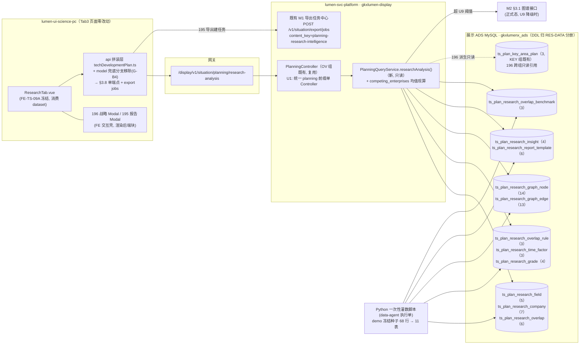
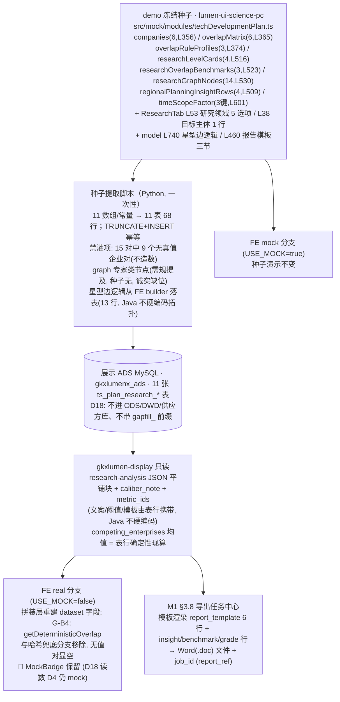

# TS-L2-DS09-RES-ARCH · 研究领域分析 · 后台实现架构设计

> **任务**：`TS-L2-DS09-RES-ARCH`（definition，不写业务代码）
> **日期**：2026-11-06 · **作者**：agent:zcode 会话代跑 architect-agent（沿 OV 组授权链，监管人 `human:王梓真`）
> **状态**：草案，待四角色会签（architect / api / algorithm / data）
> **范围**：DS-09 `DS-09-RESEARCH` 页（研究领域分析页签 Tab3，FE-TS-09c），需规序 **191–196** 共 6 叶（五读面叶 + 196 一派生建议壳叶）
> **diagram_id**：`TS-DS09-RES-CALLCHAIN-01`（§2 调用链）、`TS-DS09-RES-DATAFLOW-01`（§3 数据流）

**输入真源**

| 用途 | 真源 |
|---|---|
| 需规 6 叶 | `bid-reference/srs/02-科技信息展示系统/科技发展态势/科技发展规划.md` seq 191–196（L200–L289；六叶 bid_desc 均空、沿用 excel_row 181 继承句） |
| 契约草案（批 4 未冻结） | `agent-handoffs/科技发展态势-TS/API-TS-M9.md` §3.8 `research-analysis`（唯一契约端点：fields + graph + competing_enterprises + intelligence_report）+ §4 表 #6 + §5 U3/U9；§1 报告产物约定（Word .doc 走 M1 §3.8 任务中心） |
| 指标赋号与差集 | `agent-handoffs/产品整体定义/METRIC-OPEN-DS-09-科技发展规划-核对记录.md` §3.2 RESEARCH（四条 TEMP→`M_INNOV_RES_*`、194 mapped 116 无独立核、195/196 other_system、半成品 xlsx 107 出 `CI_LEVEL`）+ §赋号表 |
| 存量对照 | `工程过程/04-系统集成/05-展示系统集成/对照-科技发展规划与维护管理-存量任务与依赖.md` B.1 Tab3 行（G-B3 196 无独立端点 / G-B4 重叠度名称哈希 / DN-A11-03 LLM 润色待甲方） |
| OV/KEY 先例（本稿沿袭） | `sdd/l2/TS-L2-DS09-OV-ARCH.md` + `TS-L2-DS09-KEY-ARCH.md`（U1 单 Controller、专用表拆分先例、`metric_id` 列、文案表行携带、§10 勘误口径） |
| FE 现状 | `lumen-ui-science-pc/src/views/situation/tech-development-plan/tabs/ResearchTab.vue`（页面冻结）+ `models/techDevelopmentPlanModel.ts`（L322–L427 重叠度复算 / L460–L490 报告模板 / L978–L982 战略映射）+ `src/mock/modules/techDevelopmentPlan.ts`（demo 冻结种子，行数实测） |
| 架构铁律 | `architecture-baseline.md` D18（§2 决策表）、D12、D14 |

---

## 0. 结论速览（逐叶判定）

| seq | 叶 | 判定 | D18 表（V1 灌数 · 行数实测） | 读取接口（契约 §） | metric_id（均赋号草稿·未签·pending `human:唐绍祖`） |
|---|---|---|---|---|---|
| 191 | 研究领域重叠度分析 | **D18 读表**（G-B4：FE 名称哈希是演示算法，正式由表行真值替换） | `ts_plan_research_company`（7 行：目标主体 1 + 六企 6）+ `ts_plan_research_overlap`（6 行真值对，9 对诚实空）+ `ts_plan_research_overlap_rule`（3 档）+ `ts_plan_research_time_factor`（3 行）+ `ts_plan_research_overlap_benchmark`（3 行） | §3.8 `research-analysis` | `M_INNOV_RES_OVERLAP`（MODEL · missing 保持） |
| 192 | 研究领域等级划分 | **D18 读表**（四档标签 + 阈值） | `ts_plan_research_grade`（4 行）+ `ts_plan_research_field`（5 行领域字典） | 同上（同端点分块） | `M_INNOV_RES_GRADE`（MODEL · missing 保持；⚠️ Q-MO-DS09-03） |
| 193 | 多企业竞争情报比对 | **D18 读表**（六企 + 四象限演示值表行化，均值由 Java 现算） | 复用 191 `company`（6 企行，`level` 列=情报等级）+ `overlap` 真值对；象限散点值 = Java 由表行均值**确定性现算**（非 mock、非模型） | 同上（competing_enterprises 块） | `M_INNOV_RES_CI_LEVEL`（MODEL · 六企等级列）+ `M_INNOV_RES_CI_COMPARE`（MIXED · 比对块，missing 保持） |
| 194 | 研究领域知识图谱展示 | **D18 读表**（V1 = 演示骨架；**U9 降级**：超阈值走 M2 §3.1，不在本接口内嵌全量图） | `ts_plan_research_graph_node`（14 行）+ `ts_plan_research_graph_edge`（13 行星型边落表） | 同上（graph 块） | **无独立核**（mapped 116；禁 116 语义相似度顶替重叠度；禁抢 DS-21/DS-23） |
| 195 | 竞争情报分析报告 | **D18 读表**（报告列表行 + 导出走 M1 §3.8 任务中心） | `ts_plan_research_insight`（4 行）+ `ts_plan_research_report_template`（6 行：报告 3 节 + 建议 3 节模板） | 同上（intelligence_rows + report_export 块）；导出 `POST /v1/situation/export/jobs`，`content_key=planning-research-intelligence`（建议值），`report_ref` 引用 `job_id` | 无（other_system 报告读面；**禁因重叠度 missing 把报告改打 missing**） |
| 196 | 企业发展战略建议 | **并入 §3.8 响应派生**（G-B3 裁定建议，§7.1；无新表、无独立端点） | 无新表（消费 195 `insight` 行扩列 + `benchmark` 行 + KEY 组 `ts_plan_key_area_plan` 跨组引用） | 同上（strategy_advice 派生块） | 无（other_system 建议读面；禁 missing 模拟模型；禁硬挂 147/148；不编制规划文本） |

**一句话**：6 叶全部读面、**零写面、零 501**（本页禁 501，核对记录 §5）——5 叶 D18 读表（demo 冻结种子灌 11 张 `ts_plan_research_*` 表共 68 行，Java 只读单端点组装，页面保留 🧪 MockBadge）+ 1 叶（196）按 G-B3 建议并入 §3.8 响应由既有表行派生。全部接口禁止返回写死 JSON / 常量 / 内存 fixture（D18）；重叠度禁用 FE 名称哈希兜底（G-B4）。

---

## 1. 范围与明确不做项

**范围**：研究领域分析页签后台实现架构——1 个 REST 端点（契约 §3.8 `research-analysis`，响应按种子实测扩为平铺多块，见 §5）、11 张 D18 表、Python 一次性灌数、前端 api 拼装层接线差异（含 G-B4 哈希兜底移除）。落仓：Java `lumen-svc-platform/gkxlumen-display`（复用 OV 组 `PlanningController`，U1 裁定：统一 `planning` 前缀单 Controller，不按 09a/09b/09c 拆服务路由）；灌数 Python 脚本（data-agent 执行单）；FE 接线 `lumen-ui-science-pc/src/api/situation/techDevelopmentPlan.ts` + `models/techDevelopmentPlanModel.ts` 兜底分支（页面 .vue 零改动）。

**明确不做**（谁会签都不许扩）：

1. **本页禁 501**：catalog 501 通道只给 COMPREHENSIVE seq 184（核对记录 §5）；RESEARCH 任何叶不得进 501，也不得借「模型未注册」造空态话术
2. **不编制规划正文 / 战略建议文本**：196 是建议读面（other_system），V1 文案全部为 demo 种子逐字与表行模板渲染，非生成物；报告不因 LLM 未接入而缺失（V1 静态模板行）
3. **195 导出不另造下载通道**：统一走 M1 §3.8 导出任务中心（`content_key=planning-research-intelligence`（建议值），`report_ref` 引用 `job_id`）；demo 前端 Blob `downloadHtmlAsWord` 废弃，服务端产 Word（.doc）；PDF 沿浏览器打印路径（FE 现状），不算新通道
4. **不重做 `FE-TS-09A` 页面**（孔东锁至 2026-11-12；Tab3 页面零改动，接线只改 api 拼装层与 model 兜底分支）
5. **不认领、不并进** `BE-TS-IMPL-01` / `BE-TS-DATA-01` 整包
6. **不发明 `M_*` 写入 metrics seed**：只消费核对记录 §赋号表 4 条 RES（均草稿、类型未签、公式 pending `human:唐绍祖`）；禁 `M_OVERLAP_*` / `M_CI_*` 等自造号
7. **禁改挂**（详 §7.4）：`M_SYNTH_COLLAB_*` / `M_SVC_GRAPH_*` / `M_ENT_*`（141/145/146）/ seq 05-191 / 116 / `M_CHAIN_COMPETITIVENESS_INDEX` / 147/148 / 108/109 / `M_SYNTH_VIT_*`；**不抢 DS-21 / DS-23 图谱页**
8. **差集判定不动**：四条 missing 保持、194 mapped 116 保持、195/196 other_system 保持（禁 n/a_ops 也不许——两叶核对记录已判 other_system）；不升 🟢、不改差集
9. **192「自定义阈值」不新增写面**：V1 由规则三档预设下拉（strict/balanced/wide，表行下发）读面承载；逐企自定义阈值参数面待 M0，本期无 PUT
10. **194 正式图谱不在本接口内嵌全量图**：超 U9 阈值走 M2 §3.1 图谱接口，本接口 graph 块只返降级元信息
11. **LLM 报告润色（DN-A11-03）待甲方**：本稿与 RES-API 分册均不含 LLM 生成面；甲方确认后算法侧另行建单（Python），与本页读面解耦

---

## 2. 整体流程与调用链（图：`TS-DS09-RES-CALLCHAIN-01`）

调用链铁律核对：前端 → Java REST → 只读 ADS；**无 Python 运行时依赖**（Python 只在灌数期写表）；无写面、无 501 分支、无 `demo-*` 服务依赖（D12）；不涉对象存储（D14，报告文件产物归 M1 任务中心既有机制）；不涉 NebulaGraph（V1 演示骨架为 MySQL 行，正式态走 M2 图谱接口而非 Java 直连 nGQL）。**本页零新 Controller**（复用 OV 组，只加一个方法）。

---

## 3. 数据流（图：`TS-DS09-RES-DATAFLOW-01`）

灌数幂等：按表 `TRUNCATE + INSERT`，可重跑；**禁灌项显式列出**（9 个无真值对、专家类节点、种子外派生数值），V1 不补算。

---

## 4. 逐叶架构

### 4.1 seq 191 · 研究领域重叠度分析 — D18 读表（G-B4 哈希替换）

- **需规**：基于企业－专家－学术文献－研究关键词知识图谱数据，分析两家企业研究领域重叠度，可选目标企业，提供计算结果与可视化。
- **判定依据**：核对记录 §3.2——`TEMP_DS09_RES_OVERLAP` MODEL、差集 **missing**、05 无重叠度专叶（≠ 05 seq 191 区域协同；≠ 116 通用语义相似度）→ 真算做不到 → D18；B.1 备注——FE `getDeterministicOverlap`（model L322–L326）名称哈希是**演示算法**（G-B4），正式由表行真值替换。
- **表**：
  - `ts_plan_research_company`（7 行：目标主体 1 行 `深圳先进技术研究院`（role=target，level/color NULL）+ 六企 6 行（role=compare：华为技术 S / 腾讯科技 S / 阿里巴巴 A / 字节跳动 A / 百度 A / 小米集团 B）；列 company_id/name/role/color/level_tag/metric_id——level_tag 列挂 `M_INNOV_RES_CI_LEVEL`）；
  - `ts_plan_research_overlap`（6 行真值对，值域 45–72：company_a/company_b/overlap_score/level(high|medium)/related_fields JSON/metric_id=`M_INNOV_RES_OVERLAP`；**六企 C(6,2)=15 对中 9 对无种子真值，不灌行、不造数**，V1 诚实空）；
  - `ts_plan_research_overlap_rule`（3 档逐字：strict 严格规则 75/60/59 · balanced 均衡规则 70/55/54 · wide 宽松规则 65/50/49；列 rule_key/label/prompt/threshold_high/threshold_medium/threshold_low/rule_source/scope_text）；
  - `ts_plan_research_time_factor`（3 行：scope_label 近1年/近3年/近5年 + factor 0.82/1/1.12；双职责=筛选下拉选项 + 复算系数）；
  - `ts_plan_research_overlap_benchmark`（3 行：华为技术有限公司 82 / 腾讯科技（深圳）67 / 大疆创新科技 48；gauge 兜底值与条形图）。
- **G-B4 落地（写明）**：FE `getDeterministicOverlap`（名称排序 + charCode 求和取 20–95）与 `getPairOverlapCompute` 的哈希兜底分支在接线单中**移除**；无真值对显示「—（暂无重叠数据）」，接口与 FE 均不得以哈希造数。复算口径（领域匹配 ×1.08/×0.96、时间系数）保留为 FE 拼装层确定性计算，系数与阈值全部表行下发。
- **灌数方**：Python 一次性脚本（demo 冻结种子）。
- **读取接口**：`GET /v1/situation/planning/research-analysis`（§3.8；191 消费 companies/overlap_matrix/overlap_rules/time_scopes/overlap_benchmarks 五块）。
- **metric_id**：`M_INNOV_RES_OVERLAP`（MODEL 未签；UI ⓘ draft，回指核对记录 §赋号表）。
- **空态**：某对无行 → 诚实空，不回退哈希。

### 4.2 seq 192 · 研究领域等级划分 — D18 读表（四档标签 + 阈值）

- **需规**：通过量化指标对研究领域重叠度做等级划分，可查看标准与结果，支持自定义等级划分阈值。
- **判定依据**：核对记录 §3.2——`TEMP_DS09_RES_GRADE` MODEL、missing、禁 mapped 141/145/146；阈值是同一缺口的参数面，不另开 missing → D18；U3（四档逐字标签与阈值）本稿给建议值（§7.2）。
- **表**：`ts_plan_research_grade`（4 行逐字：lead 领先级 92 · advantage 优势级 76 · catching 追赶级 58 · potential 潜力级 34；列 grade_key/grade_label/description/**threshold_low（U3 建议值 80/65/45/0，未拍板前列灌建议值并标 draft）**/patent/papers/top_papers/score/metric_id=`M_INNOV_RES_GRADE`）；`ts_plan_research_field`（5 行领域字典：人工智能/量子科技/合成生物学/集成电路/新能源——ResearchTab L53 硬编码常量表行化，D18）。
- **灌数方**：同上。
- **读取接口**：同端点（level_cards + fields 两块）。
- **metric_id**：`M_INNOV_RES_GRADE`（MODEL 未签 ⚠️ Q-MO-DS09-03；阈值/标签 ⚠️「待甲方确认」）。
- **不做**：「自定义阈值」写面（§1.9）；V1 三档规则预设下拉承载自定义语义。

### 4.3 seq 193 · 多企业竞争情报比对 — D18 读表（六企 + 四象限演示值表行化）

- **需规**：比对多家企业竞争情报等级，可多选企业，提供竞争矩阵和战略定位图。
- **判定依据**：核对记录 §3.2——`TEMP_DS09_RES_CI_COMPARE` MIXED、missing、企业维 11 叶均对不上（141=深圳 vs 全国竞争力；145 对标=技术力；146 跨企业=商业力）；禁 `M_CHAIN_COMPETITIVENESS_INDEX` / `M_ENT_*`；选企壳不另开 missing → 四象限演示值表行化 = 复用 191 表行，象限散点值由 Java **均值现算**（表行真值求平均，确定性计算、非 mock 非模型）。
- **表**：复用 `ts_plan_research_company`（六企行 level_tag=CI_LEVEL 读数）+ `ts_plan_research_overlap`（6 真值对）+ `overlap_rule`；**不新建 193 专用表**（契约 §4 `ts_plan_compete_intel` 弃用，§5）。
- **读取接口**：同端点（competing_enterprises 块：每企 avg_overlap + level + 逐对 sourceTag 明细，Java 现算下发；四象限轴线标签「技术深度/商业化能力」与象限名「全面领先型/潜力发展型/市场领先型」为 FE 既有呈现，不改）。
- **metric_id**：`M_INNOV_RES_CI_LEVEL`（挂 company.level_tag 列；MODEL 未签，半成品 xlsx 107 独立主项，与 GRADE 分核不合并）+ `M_INNOV_RES_CI_COMPARE`（挂 competing_enterprises 块；MIXED = 表行真值 + 均值计算；均 missing 保持）。

### 4.4 seq 194 · 研究领域知识图谱展示 — D18 读表（V1 演示骨架 + U9 降级）

- **需规**：展示企业研究领域知识图谱（企业、专家、学术文献、研究关键词等实体及关系），支持交互式探索。
- **判定依据**：核对记录 §3.2——**mapped seq 116 实体检索/关系查询/可视化，④ 无独立统计核**（不另造 TEMP_）；禁用 116 语义相似度或网络密度/中心度顶替重叠度；禁改挂 108/109；禁 `M_SVC_GRAPH_*`；禁抢 DS-21/DS-23 → V1 演示骨架表行化。
- **表**：`ts_plan_research_graph_node`（14 行实测：企业/机构类 4（深圳先进技术研究院/华为/腾讯/大疆）+ 技术领域类 4（机器学习/自然语言处理/智能芯片/边缘智能）+ 文献类 3（NeurIPS/AAAI/ICLR 论文）+ 专利类 3（CN 专利号）；列 node_name/category_key/category_label/symbol_size/x/y——layout none 静态骨架坐标）；`ts_plan_research_graph_edge`（13 行星型边：中心=深圳先进技术研究院 → 其余 13 节点，relation=关联；**demo 在 FE builder 硬编码的星型逻辑落表**，Java 不硬编码拓扑）。
- **category 定名（以实测为准，§5 差异）**：`enterprise` 企业 / `institution` 机构 / `tech_field` 技术领域 / `literature` 文献 / `patent` 专利（demo ECharts categories 第 5 项名「专家」但实放专利节点——名实不符，正式定名取实义；**专家类实体需规有提及、种子无节点，留位不灌、诚实缺位**）。
- **U9 降级（写明）**：本接口 graph 块内嵌上限建议 **节点 ≤100 或边 ≤300**（§7.3）；超限 graph 块只返 `{ "truncated": true, "node_count": N, "edge_count": M, "follow_up": "M2 §3.1" }` 降级元信息，FE 跳转/懒加载 M2 §3.1 图谱接口，**不在本接口内嵌全量图**。
- **灌数方**：同上（专家节点禁灌）。
- **读取接口**：同端点（graph 块：nodes + edges + categories）。
- **metric_id**：无（mapped 116 无独立核；`metric_ids` 不收录；计数旁不显伪 8 件套）。

### 4.5 seq 195 · 竞争情报分析报告 — D18 读表（列表行 + 导出走任务中心）

- **需规**：基于分析结果生成竞争情报分析报告（重叠情况、竞争优势与劣势、发展建议），可查看和下载。
- **判定依据**：核对记录 §3.2——差集 **other_system** 报告读面/导出；**禁止因重叠度 missing 把报告改打 missing**；禁止 n/a_ops → 列表行 D18 表行化，导出复用 M1 §3.8；B.1 备注——报告 = A07 同款前端模板，LLM 润色 DN-A11-03 待甲方 → V1 静态模板行。
- **表**：`ts_plan_research_insight`（4 行逐字：AI大模型·领先布局·高 / 具身智能·潜力追赶·中 / 计算机视觉·优势稳固·中 / 边缘智能·潜力追赶·中；列 field/competition/evidence/regional_insight/action/priority/**plan_id**（196 映射，§4.6）/metric_id=NULL）；`ts_plan_research_report_template`（6 行：报告三节 overlap_section/advantage_section/suggestion_section + 建议三节 tech_route/resource_config/cooperation 模板槽位；列 section_key/section_label/template_text（含 {target}/{compare}/{field} 占位符）/metric_id=NULL——**模板文案表行携带，Java/Python 不硬编码**）。
- **灌数方**：同上（模板 = demo `buildResearchIntelligenceReport` L460–L490 逐字）。
- **读取接口**：同端点（intelligence_rows + report_export 块：`content_key=planning-research-intelligence`（建议值）、`default_format=doc`）；查看 = 报告 Modal 渲染表行模板（FE 现状结构）；**下载 = `POST /v1/situation/export/jobs` 建任务 → `report_ref` 引用 `job_id`**，不另造下载通道；PDF 沿浏览器打印（FE 现状）。
- **metric_id**：无（other_system；不进 `metric_ids`）。
- **不做**：LLM 润色面（DN-A11-03 待甲方）；报告不因任何模型未注册而禁用（本页禁 501 话术）。

### 4.6 seq 196 · 企业发展战略建议 — 并入 §3.8 响应派生（G-B3 裁定建议，§7.1）

- **需规**：根据研究领域分析结果提供企业发展战略建议，可查看技术路线建议、资源配置建议、合作机会分析，支持方案模拟和评估。
- **判定依据**：核对记录 §3.2——差集 **other_system** 建议读面；禁 missing 模拟模型；禁硬挂 147/148；不编制规划文本；B.1 备注——**196 无独立端点（G-B3）**；demo 实测——战略 Modal 三节文案**全部派生自既有行**（技术路线 = insight 行 action/regional_insight；资源配置 = insight.plan_id → KEY 组方案行 resourceGap/expectedEffect；合作机会 = benchmark 行运行时拼接比对主体），方案模拟 Modal 复用 KEY 组 `ts_plan_key_area_plan` → 无新增数据需求。
- **落地（按 §7.1 建议并入）**：无新表、无独立端点；`ts_plan_research_insight.plan_id` 列承载 demo `resolveStrategyPlan` 映射（高→方案A；竞争态势含「追赶」→方案B；否则→方案C，灌数时固化为 a/b/c/b）；响应 `strategy_advice` 块 = `{ "mode": "derived", "sections": ["tech_route","resource_config","cooperation"], "plan_source": "key-area plans", "rows": <insight 行引用> }` 轻量派生说明；三节文案由 FE 按 report_template 建议节模板 + 表行渲染（比对主体/重叠值为筛选态参数）。
- **读取接口**：同端点（strategy_advice 块）。
- **metric_id**：无（other_system；不进 `metric_ids`）。
- **不做**：建议文本生成（不编制）；方案模拟 = FE Modal 交互壳（同 KEY 190 性质，非 501）。

---

## 5. 与契约草案 / FE 复刻页差异收口

| # | 差异 | 收口（本稿裁定） |
|---|---|---|
| 契约 §3.8 graph「6 节点 6 边（L222–L239）」 | 实测种子 `researchGraphNodes` L530–L545 为 **14 节点**（4+4+3+3），边为 builder L740–L790 生成的 **13 条星型边**；契约引用的 `techDevelopmentPlanGraph` 数组已不存在（types 现 `ResearchGraphNode` L268） | 以实测为准：14 节点 + 13 边落表；RES-API 分册改约 §3.8 graph 边界描述（批 4 冻结时并入） |
| 契约 §3.8 `fields` 块（field_key + research_grade + overlap_score 单行混排） | 实测种子中「研究领域字典（5 选项常量）/ 四档等级卡（4 行）/ 重叠对（6 行）」是三种实体，无混排形状 | 沿 OV/KEY「专用表」先例拆表；响应平铺 `fields` / `level_cards` / `overlap_matrix` 各块，KEY 式一次取全 + FE 本地联动 |
| 契约 §4 表 #6 建议 2 张（`ts_plan_research_field` / `ts_plan_compete_intel`，字段混排 grade/overlap/intelligence_level） | 与实测形状不符 | **`ts_plan_research_field` 名沿用**但形状改为领域字典 5 行；`ts_plan_compete_intel` **弃用**（193 复用 191 表行，见 §4.3）；合计拆 **11 张**（§6） |
| 契约 §3.8 `intelligence_report` 单对象（title/generated_at/report_ref） | 实测报告读面 = 4 行情报列表（每行可下载）+ Modal 模板，非单例 | 响应改 `intelligence_rows`（4 行）+ `report_export`（content_key + default_format）；`report_ref` 语义 = 导出任务的 `job_id`，在建任务响应中回填 |
| 196 无契约端点（G-B3） | — | §7.1 裁定建议：并入 §3.8（strategy_advice 派生块 + insight.plan_id 扩列），不新增第 10 端点 |
| G-B4（RES 部分） | FE `getDeterministicOverlap` 哈希兜底（model L322–L326、L350）在 real 分支仍会触发 | 接线单移除哈希函数与兜底分支；后端只下发 6 真值对，无值对显空「—」；**model 文件属接线文件族（.vue 页面零改动）**，此点需会签确认（§9） |
| B.1 备注「195 报告 = A07 同款前端模板」 | demo Word = FE Blob 下载 | 正式态导出服务端化走 M1 §3.8（M9 §1 已约定）；模板文案从 FE 代码迁 `report_template` 表行；PDF 打印路径保留 FE 现状 |
| 双图例不一致 | ECharts legend（企业/机构/技术领域/文献/专家）与工具条图例（主体/对比主体/论文/专利/关键词/关联关系）并存且 category 4 名实不符 | category 定名取实义（§4.4），专家类留位；图例文案随 graph.categories 下发对齐，页面 DOM 零改动优先，文案对齐归 RES-API 分册微调 |
| G-B5 沿袭 | MockBadge 逐卡核对 | D18 表读数 **D4 仍 mock** → 🧪 MockBadge 保留至 D4 翻转；统计数旁 ⓘ draft 语义卡回指核对记录 §赋号表（禁点 `M_SYNTH_*`/`M_ENT_*`/`M_CHAIN_*`/`M_SVC_*` 伪 8 件套） |

---

## 6. D18 三要素总表（缺一不签）

| 表（`gkxlumenx_ads`） | 行数（实测） | 灌数方 | 读取接口（§3.8 块） |
|---|---|---|---|
| `ts_plan_research_field` | 5 | Python 一次性脚本（demo 冻结种子 + FE 常量表行化） | fields（191/192 筛选） |
| `ts_plan_research_company` | 7（目标 1 + 六企 6） | 同上 | companies（191/193） |
| `ts_plan_research_overlap` | 6（9 对诚实空不灌） | 同上 | overlap_matrix（191/193） |
| `ts_plan_research_overlap_rule` | 3 | 同上 | overlap_rules（191） |
| `ts_plan_research_time_factor` | 3 | 同上 | time_scopes（191） |
| `ts_plan_research_grade` | 4 | 同上 | level_cards（192） |
| `ts_plan_research_overlap_benchmark` | 3 | 同上 | overlap_benchmarks（191/196） |
| `ts_plan_research_graph_node` | 14 | 同上 | graph.nodes（194） |
| `ts_plan_research_graph_edge` | 13 | 同上 | graph.edges（194） |
| `ts_plan_research_insight` | 4 | 同上 | intelligence_rows（195/196） |
| `ts_plan_research_report_template` | 6 | 同上 | report_export / strategy_advice（195/196） |

合计 11 表 68 行；每表带 `metric_id` 列（无核叶置 NULL）与 `updated_at`。库名与 DDL 由 **RES-DATA 分册**冻结（沿 OV/KEY：展示 ADS MySQL、`gkxlumenx_ads`、`ts_plan_research_` 前缀；**不进 ODS/DWD/供应方库、不带 `gapfill_` 前缀**——D18 铁律）。196 无新表（§4.6）；194 U9 降级后大图数据归 M2 §3.1 图谱服务，不落本前缀。

## 7. G-B3 裁定与 U3/U9 建议（单列，供会签 + M0 拍板）

### 7.1 G-B3 · 序 196 战略建议承载方式（裁定建议：并入 §3.8 响应）

**比较**：

| 方案 | 内容 | 优点 | 缺点 |
|---|---|---|---|
| A（**建议**） | 并入 §3.8 `research-analysis` 响应（strategy_advice 派生块 + insight.plan_id 扩列） | 零新端点零新表；与 U1 单 Controller、KEY 平铺多块先例一致；FE Modal 一次取全 | 未来若建议独立演算（LLM）需再拆块 |
| B | 新增独立端点 `GET …/research-analysis/strategy-advice` | 建议面独立演进；可按企业/领域参数化 | demo 三节文案全部派生自本页既有行，独立端点只会重复下发；弹窗参数=行 id 无独立筛选态；多一次往返；196 other_system 无统计核，独立端点夸大其面 |

**建议：方案 A（并入）**。理由：demo 实测战略 Modal 是**交互壳**（`resolveStrategyPlan` 三行映射 + 三节文案拼接），数据全部来自 insight 行 / benchmark 行 / KEY 组方案行，无任何 196 专属数据；核对记录判 other_system 建议读面（无统计核、不编制文本），独立端点与其定位不符；将来 DN-A11-03 类建议生成能力落地时，响应块拆端点是纯增量演进，无迁移成本。**需四角色会签确认后冻结**。

### 7.2 U3 · 四档等级逐字标签与阈值（建议）

- **标签逐字**（demo `researchLevelCards` L516–521）：**领先级 lead / 优势级 advantage / 追赶级 catching / 潜力级 potential**，四卡带 description/patent/papers/topPapers/score（92/76/58/34）；由后端字典行下发（`ts_plan_research_grade`），Java/FE 不硬编码。
- **阈值建议值**（对 0–100 重叠度分制四档，`threshold_low`）：**领先级 ≥80 · 优势级 ≥65 · 追赶级 ≥45 · 潜力级 <45**。依据：种子吻合——benchmark 三行 82（华为）→领先、67（腾讯）→优势、48（大疆）→追赶；与 balanced 规则三档（high≥70 / medium≥55 / low<55）量级兼容；与 overlapMatrix 值域 45–72 相容（72→优势级顶部，不误入领先）。
- **配套**：规则三档阈值（strict/balanced/wide 的 75/60/59、70/55/54、65/50/49）逐字表行下发，是 191 复算参数面；四档等级阈值（U3）与三档规则阈值**并存不合并**（前者是等级划分标准、后者是重叠复算档位）；「自定义阈值」V1 = 三档预设下拉读面承载，写面待 M0。

### 7.3 U9 · 图谱降级阈值（建议，兼收口 U2 复用边界）

- **建议值**：graph 块内嵌上限 **节点 ≤100 或边 ≤300**（演示骨架 14/13 的约 7 倍与图谱域 80 节点截断惯例同量级）；超限本接口 graph 块只返降级元信息（`truncated:true` + 计数 + 指向 M2 §3.1），FE 跳转/懒加载图谱接口，**不在本接口内嵌全量图**。
- **U2 边界一并建议**：V1 演示骨架（≤100 节点）内嵌 §3.8；正式态企业-专家-文献-关键词全量图谱一律走 M2 §3.1（Java display BFF 只可选转发 `graph/view`，不直连 nGQL）；两路以 U9 阈值为唯一切换判据。

### 7.4 禁改挂清单（硬边界，随稿冻结）

- **撞号**：展示 seq 191 与 05 综合 seq 191 整段撞号（RES-B03），**禁按号 mapped**；OVERLAP ≠ 05 seq 191 区域协同（完整度/中心度/密度）。
- **四条赋号**：`M_INNOV_RES_OVERLAP`（不复用 seq 191 / 116 / `M_SYNTH_COLLAB_*`）/ `M_INNOV_RES_GRADE`（不复用 141/145/146）/ `M_INNOV_RES_CI_LEVEL`（与 GRADE 分核，不合并）/ `M_INNOV_RES_CI_COMPARE`（不复用 `M_CHAIN_COMPETITIVENESS_INDEX` / `M_ENT_*`）——均**赋号草稿·未签·pending `human:唐绍祖`**。
- **194**：禁用 116 语义相似度或网络密度/中心度顶替重叠度；禁改挂 108/109；禁 `M_SVC_GRAPH_*`；禁抢 DS-21 / DS-23 图谱页。
- **195/196**：禁硬挂 147/148；禁 `M_SYNTH_VIT_*` 及 B 轨 / SYNTH / CHAIN / SVC / TECH 全族；禁湾区 DS-05、深圳 DS-06、DS-07、DS-08 混挂；不把报告/建议打 missing 或 n/a_ops。

### 7.5 未决项消费与沿袭

- **本稿消费**：U3（§7.2 给标签+阈值建议值）、U9（§7.3 给降级阈值）、U2（§7.3 给 M2 复用边界建议）、U1（OV 建议落定：复用 `PlanningController`，本页零新路由）、G-B3（§7.1 给裁定建议）、G-B4（§4.1 落地哈希替换）。
- **语义债沿袭**：RES-B01（无四件套/TRACE，文件级闭合）/ RES-B02（重叠度/等级/比对/图谱无正式 metric_id）/ RES-B03（191 撞号）保持；差集四 missing + 194 mapped 116 + 195/196 other_system 全部不动；DN-A11-03（LLM 润色）待甲方不动；不写任何 `cfg_metric-*-seed.yaml`、不升 🟢。

## 8. 架构合规自检（architect 评审清单 11 条）

1 算法只在 Python ✅（Java 无 NLP/推理；重叠均值/等级判定为表行确定性计算非模型；Python 仅一次性灌数）· 2 调用链 ✅（前端→Java REST→只读 ADS；无 501 分支；D12 无 demo 依赖；导出走既有 M1 任务中心）· 3 图谱 ✅（V1 骨架为 MySQL 行；正式态走 M2 图谱接口，Java 不直连 nGQL、无 Neo4j）· 4 可观测 ✅（display 既有 OTel 全链，新方法零豁免）· 5 CI/CD（定义单 `cicd: skip`；实现单走 push→Pipeline→K8s dev）· 6 demo 未污染 lumen ✅ · 7 方案 A ✅（前端只调 Java）· 8 数据走 ADS ✅（Python 写、Java 只读）· 9 D14 ✅（报告文件产物归 M1 任务中心既有存储，本页不自建桶/目录）· 10 D8 N/A（页面零改动）· **11 D18 ✅（11 表逐张写明表名/行数/灌数方/读取接口；无接口直返 mock；禁灌项与哈希替换显式列出）**

## 9. 会签与签收路径

四角色会签（architect / api / algorithm / data，意见落 `sdd/l2/会签/研究领域分析-会签.md`；**重点裁定点：G-B3 方案 A（§7.1）、G-B4 哈希移除的 model 文件改动范围（§5）、表拆 11 张改约（§5/§6）、U3/U9 建议值（§7.2/§7.3）**）→ 全部同意后由 `actor=human:淮政玮` 签收 done → 以本稿为硬依赖起草 RES-API / RES-METRIC / RES-DATA 三分册（并行；RES-API 需按 §5 改约 §3.8 响应结构、graph 边界与 intelligence_report 块）→ 三分册会签签收后拆 Java 实现（`PlanningQueryService.researchAnalysis()` + 端点）/ 灌数 / 接线（含哈希移除）/ 主路径测试四行实现单。
