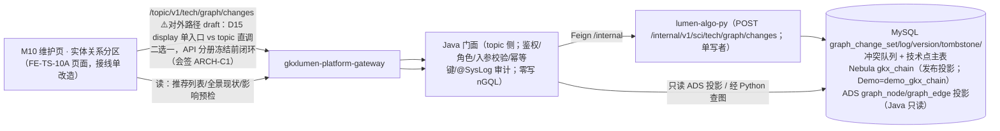
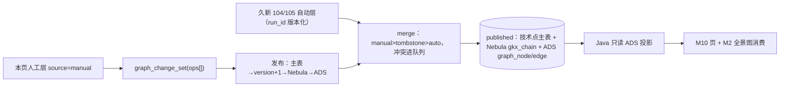

# TS-L2-M10-ENT-ARCH · 维护管理 · 关键实体与关系 · 后台实现架构设计

- 任务：`TS-L2-M10-ENT-ARCH`
- 日期：2026-11-07
- 状态：四角色已会签（2026-11-07：ARCH 有条件 5 / API 有条件 1 / ALGO 同意 / DATA 有条件 2），事实修正与可修条件已回填本稿；ARCH-C1（display vs topic 直调）等 3 项开放条件留 API 分册闭环。不标 done
- 监管：`human:刘剑锋` · 认领：`agent:arch-agent`
- 强度：ponytail off（定义任务，不缩文档）
- 图：`TS-L2-M10-ENT-ARCH-SEQ`（调用链）· `TS-L2-M10-ENT-ARCH-DATA`（数据流），均为本二级新图（draft）
- 上游输入：`SCI-INT-A03.yaml` write_back_design_draft（18 张写回卡 + 三要素卡，ready_to_sign）· [对照文档 A.3.1](../../../../工程过程/04-系统集成/05-展示系统集成/对照-科技发展规划与维护管理-存量任务与依赖.md) · `FE-TS-10A.md` as-built · `architecture-baseline.md`（D2/D3/D7/D12/D15/D18）

本叶只定维护管理（M10）二级「关键实体与关系」的实现架构。需规序号 **全景 41–47**（推荐列表 41 / 添加全景图 42 / 实体删除 43 / 关系删除 44 / 属性编辑 45 / 关系编辑 46 / 批量管理 47）。不写 OpenAPI 字段与 DTO——归 `TS-L2-M10-ENT-API`；列/表定义归 DATA；指标挂接归 METRIC。

**与分区1（LAYER）的本质区别**：LAYER 是业务库配置 CRUD（cfg_* 四表，落 cms 模块业务库）；ENT 是**图谱写回**——写目标是 Nebula `gkx_chain`（经 Python），读来自图谱/主数据。两套模式不混用。

## 0. 范围裁定

| 项 | 裁定 |
|---|---|
| 序 41 推荐列表 | **读侧**：Python 查图/主数据（Top 实体+关联强度），非种子配置。G4 排序能力进 API 分册 |
| 序 42 添加到全景图 | **写侧**：op=hang_entities（实体挂接到技术点）；G2 智能关联强度归 Python 算法层 |
| 序 43 实体删除 | **写侧**：op=unhang_entities（摘挂）；技术点本体删除 op=delete_node cascade（影响预检 impact 接口） |
| 序 44 关系删除 | **写侧**：op=delete_entity_edge（实体–技术边；34–40 的技术–技术边才叫 delete_edge，2026-11-07 会签 API-C1 更正） |
| 序 45 属性编辑 | **写侧**：技术点 op=update_node（patch）；三方实体（人/论文等）=op=update_entity_overlay（本地覆盖层不改主数据，DN-A03-04 归 §2 待拍板台账） |
| 序 46 关系编辑 | **写侧**：op=update_entity_edge（A03 草案已含强度/时间范围；原稿 update_edge 系笔误——会签 API-C1） |
| 序 47 批量管理 | **写侧**：changes 端点天然批量（ops[]）；G3 预览/统计=validate 子接口+回执 |
| 34–40 图谱编辑器 | **不在本二级**（报价划掉，演示壳保持） |
| 页面结构 | 不重做 FE-TS-10A（锁定期不动 maintain 目录；接线单只改数据源） |

## 1. 核心架构：消费 A03 写回链路，不重造

**调用链（四段，A03 已设计 draft，本叶采纳为正式架构）**：

要点（全部沿 A03 草案，本叶确认采纳）：
1. **编辑在会话**（页面撤销/重做栈），提交才落草稿——`graph_change_set(status=draft, base_version, ops[])`，不触 Nebula。
2. **发布单事务语义**（Python）：主表 upsert → version+1 → Nebula UPSERT/DELETE → ADS 投影 → 失效快照；**失败补偿**：MySQL 先提交、Nebula 失败→版本标 projection_pending+补偿重放（Nebula 无跨库事务），页面读旧版标「图谱更新中」。
3. **合并规则**：manual > auto（字段级）；tombstone > auto 复活；auto 新值撞人工覆盖 → 冲突队列（DN-A03-03）。
4. **乐观锁**：base_version 不符 → 409+差异列表。
5. **回滚** = 反向变更集再走发布（可审计），不物理覆盖。

## 2. OI-A03-01 阻塞分档（会签重点 ①，不整体停摆）

OI-A03-01（技术点主数据持有方 + technology_id 规则）**阻塞全部写回卡的终态**，但按两档拆解可先行：

| 档 | 内容 | 依赖 |
|---|---|---|
| **首版可做（P2 联调范围）** | 变更集三表（change_set/log/version）+ 草稿→发布流 + Nebula 投影，**technology_id 以草案自建主表先行**（C02 INT-C-TECH-180 形态），VID 暂 `tech:{technology_id}`（草案规则）；改名不换 ID | 仅需本叶会签确认"自建先行"，不需甲方 |
| **待甲方/PM 拍板** | 主数据持有方是否归我方、分类体系选型（OI-C02-02）、「一张 G」作用域（OI-A03-03）、审核角色（DN-A03-02）、冲突队列人工 vs 104/105 优先级（DN-A03-03）、保留期（DN-A03-06） | `客户决策清单跟踪表.md` 在册，不阻塞首版 |

> 写者归属（OI-A03-05/DN-07 双义，会签 DATA-C2 补显）：首版按推荐 **Python 单写者先行**（三表+主表 DDL 归 Python 侧）；若李伟 DN-07 裁定 Java 业务库持有审核状态，按退路迁移（沿 LAYER v1→v3 演变先例记档）。
> VID 读侧口径（会签 ARCH-C2 补）：存量 `tech:{名称}` 与增量 `tech:{technology_id}` 对同一技术点会双节点——读侧（推荐/全景现状/impact）按主表 technology_id 为准做 union，hang/update 经主表解析 VID；联调 space 落点（D6 现只重灌 demo_gkx_chain）由 DATA 分册裁定。
> VID 兼容注记（OI-A03-02）：存量 Nebula VID=`tech:{名称}`；首版投影写入用新规则 `tech:{technology_id}`，**存量边不迁移**（首版只投影本页写回产生的增量），全量切换留 C04——会签确认此边界。

## 3. G1–G5 能力表裁定（会签重点 ②）

| # | 差异 | 裁定 | 落点 |
|---|---|---|---|
| G1 | 关系编辑缺强度/时间范围（46） | **补齐**：update_edge 含 strength_manual + time_range | API 分册 |
| G2 | 添加实体未自动建联（42） | **首版不做智能关联**（Python 无此模型），hang_entities 仅挂接；自动建联留算法侧后续单 | 本叶 §5 不做 |
| G3 | 批量缺关系批量/属性批量/预览/统计（47） | 关系/属性批量**做**（ops[] 天然支持）；**预览/统计做**（changes:validate 返回影响面+计数） | API 分册 |
| G4 | 推荐列表缺排序（41） | **做**：读接口带 sortBy=strength\|time、keyword 筛选、全参数沿 A03 卡 216（会签 ARCH-C4 勿截窄） | API 分册 |
| G5 | Delete/Ctrl+Z/Y 键盘通道（43 等） | **前端交互补齐**（不涉后端），归接线单 | FE 接线单 |

## 4. 数据流

## 5. 明确不做

- 不做 G2 智能关联强度（无模型，后续算法单）
- 不碰 34–40 图谱编辑器分区；不重做 FE-TS-10A 页面结构
- Java 不写 nGQL、不直连 Nebula（铁律）；display 不直连 Python（D15，ENT 走 topic 侧 Java 门面而非 display）
- 不建 cfg_* 配置表（与 LAYER 模式区隔）；不动存量 Nebula VID（OI-A03-02 留 C04）
- 不替甲方拍板 9 条 DN/OI（在册跟踪）

## 6. 需规叶 → 实现裁定总表（D18 核查表）

本二级 `metric_id` 挂接待 METRIC 分册复核。**会签 ALGO 已收窄（2026-11-07）**：叶 41 非全 N/A——需规明写「展示」关联强度，沿 A03 卡 216 挂既有 `M_TECH_GRAPH_105_1`（已注册）；42 回执/挂接边复用同号；44/45/46 N/A（附 strength_manual 永不进指标公式保护条款）；计数类（impact/版本 stats/批量回执/validate）援引 LAYER probe 时延先例一次豁免。

| 叶 | 裁定 | 写目标 | 写者/读接口 |
|---|---|---|---|
| 41 | 真读 | —（读 ADS 投影/Python 查图） | Java `GET`（topic 侧，路径 API 冻结）。105 未交付时空态+PendingBadge（会签 ARCH-C5；不灌 mock 充数） |
| 42 | 真写 | hang_entities op | `POST /topic/v1/tech/graph/changes` |
| 43 | 真写 | unhang_entities / delete_node+cascade+impact 预检 | 同上 + `GET .../impact` |
| 44 | 真写 | delete_entity_edge op | 同上 |
| 45 | 真写 | update_node / update_entity_overlay（三方实体覆盖层） | 同上 |
| 46 | 真写 | update_entity_edge（含强度/时间） | 同上 |
| 47 | 真写+读 | ops[] 批量 + validate 预检统计 | 同上 + `changes:validate` |

## 7. 会签关注点

1. §2 阻塞分档：自建主表+technology_id 先行是否接受（OI-A03-01 首版绕行）
2. §1 采纳 A03 草案四段链为正式架构（含发布失败补偿/合并规则/乐观锁）
3. §3 G1–G5 裁定（G2 首版不做是否接受）
4. VID 增量不迁移边界（OI-A03-02）
5. Java 门面承载模块（DN-07 未定：候选 gkxlumen-topic）——本叶锁「topic 侧」，具体模块实现单定
6. METRIC 复核全 N/A/沿 A03 卡
