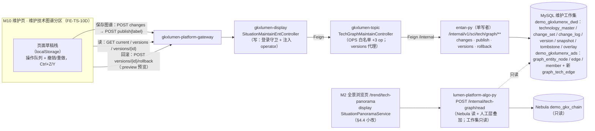
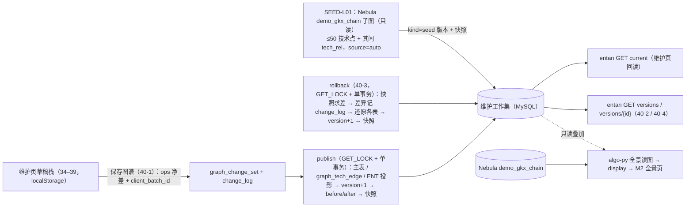

# TS-L2-M10-GRAPH-ARCH · 维护管理 · 维护技术图谱（34–40）· 后台实现架构（ENT 增量）

- 任务：`TS-L2-M10-GRAPH-ARCH`
- 日期：2026-11-13（v1 起稿；v2 同日按四身份会签改稿）
- 状态：**v2 · 四身份会签同意（2026-11-13）**：API（三轮）/ DATA（三轮）/ ALGO（两轮）/ PRODUCT（两轮），条件全部闭合，往返记录在 `会签/TS-L2-M10-GRAPH-SIGNOFF-{API,DATA,ALGO,PRODUCT}.md`。**2026-11-13 监管人 `human:刘剑锋` 签收**；§11 四项均已拍板（见 §11「拍板结果」）；全景叠加待 DS02 监管人 `human:淮政玮` 知会回执（PY-IMPL / JAVA-IMPL 动全景读图前须拿到）
- 监管：`human:刘剑锋` · 认领：`agent:arch-agent`
- 强度：ponytail off（定义任务，不缩文档）
- 图：`TS-L2-M10-GRAPH-ARCH-SEQ`（调用链）· `TS-L2-M10-GRAPH-ARCH-DATA`（数据流），均为本二级新图（draft）
- 上游输入：[需规分句闭合简报](../简报/2026-11-13-维护技术图谱-需规分句闭合.md)（27 个功能点 34-1～40-4 + 2 横切；决策卡 1B / 2A / 3A）· [TS-L2-M10-ENT-ARCH](./TS-L2-M10-ENT-ARCH.md)（已签收，本稿是它的增量）· 需规 `bid-reference/srs/02-科技信息展示系统/科技发展态势/科学技术全景.md` 序 34–40（:260–363）
- as-built 核对（2026-11-13 读码）：`lumen-algo-py/vendor/entan-py/api/tech_graph_maintain_routes.py`（**routes**）、`vendor/entan-py/scripts/mysql/tech_graph_maintain.sql`（**DDL**）、`vendor/entan-py/scripts/seed_tech_graph_maintain.py`（**seed**）、`lumen_common/algorithms/tech_graph_read.py`（**read**）、`lumen_common/db.py`；`lumen-svc-platform` topic `TechGraphMaintainController.java`、display `SituationMaintainEntController.java` / `SituationPanoramaService.java` / `TechGraphReadAdapter.java`；`lumen-ui-science-pc/src/views/situation/maintain/`

本叶只定维护管理（M10）二级「维护技术图谱」的实现架构，覆盖需规**序 34–40**：技术节点增加 34、节点删除 35、关系增加 36、关系删除 37、节点属性编辑 38、撤销重做 39、保存与版本控制 40。OpenAPI 字段与 DTO 的终稿归 `TS-L2-M10-GRAPH-API`，列、表与 DDL 归 DATA，指标复核归 METRIC。本稿写到「接口必须带什么、表必须能存什么」为止。ENT-ARCH 已定的内容（变更集、乐观锁、Python 单写者、display 代理）只引用不重写；本稿**取代** ENT-ARCH 的一处：§1-2 的 Nebula 投影段（见本稿 §1-4）。

## 0. 范围裁定

| 项 | 裁定 |
|---|---|
| 34 增加节点 | **写侧**：新 op `add_node`（名称 / 技术分类 / 描述 / 重要性 + 落点 `layout{x,y}` + 临时号 `client_node_id`）。`technology_id` 在发布时生成（34-5 唯一标识符） |
| 35 删除节点 | **写侧**：沿用已实现的 `delete_node`（主表软删 + 墓碑 routes:946–955；ADS 删点删边 routes:1034–1041），本叶把级联扩到技术点间边（§2） |
| 36 增加关系 | **写侧**：新 op `add_edge`（技术点↔技术点，有向；类型 包含 / 依赖 / 促进 + 强度 + 时间范围） |
| 37 删除关系 | **写侧**：新 op `delete_edge`（技术点↔技术点；不复用 ENT 的 `delete_entity_edge`，沿 ENT 会签 API-C1「两类边两种 op」先例） |
| 38 节点属性编辑 | **写侧**：沿用已实现的 `update_node`（routes:911–919），补改名查重（§7） |
| 39 撤销 / 重做 | **前端**：页面草稿栈（卡 2A），后端不感知。草稿存 localStorage，刷新可恢复（§1-1）；已保存的改动由 change_log 追溯 |
| 40 保存与版本 | **写侧 + 读侧**：「保存图谱」一次 = `changes` + `publish` = 一个新版本（带版本说明）；新增版本列表、版本详情、回滚预览、回滚四个端点；回滚为整图（卡 3A） |
| 编辑对象 | **维护工作集**（卡 1B）：`technology_master` + ADS 投影 + 新表 `graph_tech_edge`，与 41–47 共用同一条版本链 |
| 全景浏览页回显 | **做**（卡 1B）：全景读图出口叠加人工层（§4），Java 全景门面配合小改（§4.4） |
| 关系属性编辑 | **不做**：34–40 七叶原文没有「编辑关系」（37 只有删除，需规 :305–318）。前端现有 `updateGraphMaintainRelation` 属超需规，接线时移除（同 ENT 移除 addRelation 先例） |
| 节点拖拽 | **禁用**：需规没写拖拽。画布关闭节点拖拽（防止「拖了不存」被当成改动丢失，PROD-C14），只持久化新建节点的落点（34-4「指定位置」） |
| 41–47 | **不重审**。受三处影响，写进影响清单（§10）：① 版本链共用，回滚连带实体改动（卡 3A）；② `delete_node` 级联扩到技术点间边；③ 种子灌入后，ENT 分区的技术点选择列表会多出种子点（`/current` 节点来自同一张 ADS node 表） |
| 页面结构 | 不改 M10 页的分区结构；只把「维护技术图谱」分区的编辑器换成真画布（FE-TS-10D） |

## 1. 核心架构

ENT 链（FE → gateway → display → topic → entan-py → MySQL 工作集）原样复用，不新开链。新增两件事：版本端点挂在同一条链上；全景读图在**另一个** Python 服务 `lumen-platform-algo-py` 里只读同一个工作集。

1. **草稿与保存**（卡 2A）：
   - 编辑只进页面草稿栈。撤销、重做、Ctrl+Z / Ctrl+Y 只动草稿栈，不发请求。
   - 草稿按「用户 + 基线版本」存 localStorage（仅本机本浏览器）。同一用户多开标签页时，后打开的页只读并提示「已在其他标签页编辑」，避免两页互相覆盖草稿（PROD-N1）。刷新或重进页面时，若存在未保存草稿，提示「恢复未保存的改动？」；基线版本已变时，恢复后按 §7 的 409 流程重新校验。这样 39-4「刷新不丢」照需规字面成立（PROD-C1）。
   - 离页、切分区时有未保存改动的，弹确认（`beforeunload` + 路由守卫）。
   - 点「保存图谱」时，把草稿**净差**（不是操作流水）编成 `ops[]`，提交 `changes`，紧接 `publish`。保存成功后清空草稿栈：撤销不跨版本，要退回旧版本走回滚。
2. **同批新点、新边的引用**（API-C1）：
   - `add_node` 带临时号 `client_node_id`（同批唯一的字符串）。
   - `add_edge` 的两端写成对象，二选一：`{technology_id: int}` 或 `{client_node_id: str}`，不收裸值。
   - 发布时服务端分两遍：先处理全部 `add_node` 拿到 `technology_id`，再处理其余 op。前端不需要排序。
   - **publish 回执**带 `node_id_map: {client_node_id → technology_id}`（changes 回执里没有，号在发布时才生成）。前端据此把草稿临时号换成正式编号。
   - 临时号只在同一批内有效；跨批引用已保存的点，一律用 `technology_id`。
3. **单写者**：所有写都在 entan-py。algo-py 对工作集只读：不建表、不写行，只用查询，连接设超时（§4.1）。Java 零 nGQL、不读 DWD；版本读写在 Python，topic / display 只代理。
4. **本链不写 Nebula，发布改为单事务**（取代 ENT-ARCH §1-2 的 Nebula 段；闭合 API-C9 / C10、DATA-C3 / C4）：
   - 现状：`_project_nebula`（routes:980–1000）只在配了 `GKX_NEBULA_MAINTAIN_SPACE` 时写，helm 和 k8s 都没配，所以 ENT 上线至今没写过 Nebula；它写的 `technology` tag 和 `tech:{id}` VID 跟 `demo_gkx_chain` 的 `tech_point:*` 也不通。
   - 卡 1B 定了「全景读时叠加」，这段投影已经没有用处。**删掉 `_project_nebula` 和这个环境变量**，ENT 的 7 个 op 和本叶 3 个新 op 一起都不再写图。线上行为不变（今天本来就不写）。
   - entan 的 Nebula 客户端保留，只用于 35-3 的只读计数。entan 默认 space 是 `entan`（`entan/common/nebula.py:31–34`），计数查询必须显式 `USE demo_gkx_chain`，且只做 MATCH / 计数（API-N2）。
   - 不写 Nebula 之后，DWD 和 ADS 在同一个 MySQL 实例上，发布可以合成**一个事务**：取锁 → 比基线 → 插版本 → 主表 / overlay / 墓碑 → ADS node / edge / member / `graph_tech_edge` → change_log 的 before / after → 全量快照 → `projection_status='ok'` → 提交 → 释放锁。中间任何一步 SQL 失败就整笔回滚，不留 pending 版本，不再有不可恢复的 50301。失败语义见 §7「发布失败」。注意区分：op 影响 0 行（如「关系不存在」）**不是失败**，沿用现有 `results.failed_items` 契约（routes:866–884），发布照常成功；快照超限也不是失败（§2）。
   - `projection_status` 列保留，作历史兼容；新版本恒写 `ok`。
5. **串行锁**（DATA-C4）：publish 与 rollback 用同一把 `GET_LOCK('m10_graph_publish', 10)`，在同一连接上覆盖整个事务，`finally` 里释放。取锁超时返回 409「他人正在保存，请稍后重试」。
6. **操作人**（API-C3）：display 在 `changes`、`publish`、`rollback` 三个写请求上，用 `SecurityUtils.getUser()` 的用户名覆盖 body 里的 `operator`，不信前端传值。Python 版本行的 operator 取 change_set.operator（现写死 `"py"`，routes:844），回滚取请求 operator。publish 加请求体 `{label}`（版本说明；空则服务端给「保存 {时间}」），topic client 同步加 `@RequestBody`。
7. **change_log 逐条改动**（API-C7、DATA-C6）：
   - `_object_type` / `_object_id`（routes:885–897）补新 op：`add_node` / `update_node` / `delete_node` 记 `node`，对象号用 technology_id，add_node 发布后回填；`add_edge` / `delete_edge` 记 `tech_edge`，对象号用 `graph_tech_edge` 主键；`add_edge` 提交时主键还不存在，先记 `client_op_id`，发布后回填主键（同 add_node；ALGO-N3）。add_node / add_edge 的 `object_id` 与 `after` 都在发布事务内更新（API-C7 复核）。
   - 对**全部** op 回填：`before` 取发布前行（新增类为空），`after` 取发布后行（删除类为空）。实体类 op 记对应的 member / edge / overlay 行。
   - 版本详情按 `version_id` 过滤（change_log 在 submit 时就写入，草稿丢弃后 `version_id` 仍为空，不能按 change_set 查）。
8. **幂等**（API-C8）：现 `_dedupe` 只查 `ops[0].client_op_id`（routes:758）。改为批次级：前端每次「保存图谱」生成一个 `client_batch_id`，落在 change_set（DATA 定列和唯一键）。同一 `client_batch_id` 重试时返回旧回执；`client_op_id` 仍要求同批唯一。publish 也按批次幂等：变更集已 published 时，再次 publish 返回原回执 `{version_id, status, stats, results, node_id_map}`，不报 409。为此 `node_id_map` 要能复原：每条 add_node 的 change_log.after = 发布后的主表行 + `client_node_id`（含 `technology_id`），回执由此重建（API-C8 复核）。`results`（succeeded / failed / failed_items）随版本行持久化（DATA 定列，候选 `graph_version.publish_results` JSON），与版本行、change_log.after 在同一发布事务写入，重试时按 change_set → version 读取并原样返回；历史版本没有该列值时返回 `results: null`（DATA 补充复核、API 三次确认）。

## 2. 存储增量（输入 DATA 分册，本稿不写列定义）

| 项 | 裁定 |
|---|---|
| 技术点间边 | **新表** `demo_gkxlumenx_ads.graph_tech_edge`，不并入 `graph_entity_edge`。理由：后者 `src` 是技术点、`dst` 是实体，unhang 和快照回写都按这个方向写（routes:1067–1133），混表要给 41–47 每条 SQL 加类型过滤 |
| 写者 | entan-py。沿 ENT 先例：这条链里 ADS 既是读面也是边的真源（ENT 的人工边只落 ADS edge），不翻案 |
| 端点 | `src` / `dst` 存 `technology_master.technology_id`（内部主键）。全景叠加时再映射成全景 id（§4.2）（DATA-C1、ALGO-C2） |
| 边身份 | 服务端自增主键，作为 `delete_edge` 的参数和 change_log 对象号。业务唯一键 = `(src, dst, rel_type)`，有向：A→B 与 B→A 是两条（API-C1⑤）。唯一键不含 status，软删行仍占键，因此（DATA-N1）：① `add_edge` 命中同键的已删行时，**改为把该行重新置 active**（source 改 manual，写新强度、时间，`version_id` 改为本次版本；种子边的原强度字段保留不动，R4），不另插行；命中 active 行返回 422「关系已存在」。② 种子脚本重跑只插新行，对已有行一律不改 status 和 source：用户删掉的种子边保持 deleted，manual 行不动（照 ENT seed 的 manual 保护先例）。③ 人工边类型是三个中文枚举，种子边是英文原码，两者不会同键 |
| 列（DATA 定名） | 端点、`rel_type`、`strength_manual`、`time_from` / `time_to`、`source`（auto / manual）、`status`（active / deleted）、种子边原关系码、`version_id` |
| 关系类型 | 人工边只收 包含 / 依赖 / 促进（需规 36 原文举例的三项；是否封闭为三项，待监管人确认，§11-P2）。种子边保留 Nebula 原码，不映射成这三项 |
| 种子边显示 | 只读显示字典：`KNOWLEDGE_DEPENDENCY`→知识依赖、`PATENT_CONVERGENCE`→专利趋同、`CO_EVOLUTION`→协同演进、`WEAK_DEPENDENCY`→弱依赖。字典与 display `TrackingController.relationZh`（:185–192）同源；未知码显示「其他关系」。另加「存量」标注。字典只管显示，不进新增下拉，不进指标（PROD-C9） |
| 删除 | 节点：沿用主表软删 + `graph_tombstone(node)`。技术点间边：**一律软删**，`graph_tech_edge.status='deleted'`。全景叠加按这一行过滤 Nebula 对应边，不再往墓碑表塞拼接串（DATA-C2、ALGO-C10） |
| 级联 | `delete_node` 同时软删该点作为任一端的 `graph_tech_edge` 行。所有读、删、快照、回滚路径都要同时处理两张边表（DATA-S5） |
| 落点坐标 | `technology_master` 加 x / y 两列（可空），ADS node 同步。坐标用画布世界坐标（浮点）；现 FE 壳是 0–100 百分比（`types/maintain.ts:89`），改口径由 API 册冻结，FE-TS-10D 同步迁移 mock 种子（API-N1）。只有新建点有值，种子点为空，前端自动布局 |
| 名称唯一性 | 软删行不能占名（API-N3）。`technology_master.uk_name_cn`（DDL:19）现覆盖全表，删掉的点不能同名重建。改为**只约束 active 行**：DATA 定落法，候选是生成列 `name_cn_active = IF(status='active', name_cn, NULL)` 加唯一索引，替换 `uk_name_cn`。validate 只查 active 行。种子脚本不再依赖 `uk_name_cn` 的 ON DUPLICATE，改按 `external_ids` 或 active 同名显式查找。**这是改唯一键，按停机条件须数据平台 Owner / 监管人确认**（§11）。新建同名点得到新的 technology_id，不复活旧点（旧点可能带存量映射，复活会混淆身份） |
| 版本元数据 | `graph_version` 加 `kind`：save / rollback / seed / ent（DATA-C7、API-C6）。历史 ENT 版本由 DATA 回填为 `ent`。「改动计数」= `stats` JSON，固定键：技术点增 / 删 / 改、技术点间关系增 / 删、实体挂接增 / 删、实体关系增 / 删 / 改、实体属性改。「可回滚」= 该版本有快照。另加 `snapshot_status`（ok / skipped_oversize / none），版本列表据此显示不可回滚的原因（API-N7） |
| 快照 | `graph_snapshot` 已有表。**每次发布、回滚都在同一事务内写全量快照**（卡 3A，N=1；原 DDL 注释「每 N=50 版」作废）。内容是工作集全部表的**全部行（含 status=deleted 的软删行）**：主表、`graph_tech_edge`、`graph_entity_node` / `edge` / `member`、`graph_entity_overlay`、`graph_tombstone`。payload 带 `schema_version` |
| 快照上限 | DATA 定阈值，草案：payload > 8 MB 或主表行 > 2000 即不写快照，该版本「不可回滚」，发布照常成功。种子脚本在快照开启后禁用 `--all`（全量 1.9 万点会撑爆快照） |
| 种子 | `TS-L2-M10-GRAPH-SEED-L01`。**这是新能力**：as-built 种子只读 `tech_has_*` 实体边（seed:51–56 / :91–101），从不读 `tech_rel`（DATA-C2b）。要新写：从 `demo_gkx_chain` 取 ≤50 个技术点及其间 `tech_rel` 边，写主表（`external_ids` 沿 seed:163–170 的写法，含重名合并的 `all_*`）和 `graph_tech_edge`（source=auto，带原关系码）。 种子点的 `importance_level` 写空，不吃 DDL 默认的「中」（ALGO-C6）。 重跑保护：主表 upsert **不覆盖 `status`**，已删节点（有 node 墓碑）保持 deleted；边只插新行（INSERT IGNORE），已有行的 status / source 不动（DATA 二次复核注记）。 与现有 ENT 工作集（1 个技术点 / 61 条实体边，见 `TS-L2-M10-ENT-SEED-L01` 执行记录）并存，不软删切片外的点。 取哪片领域 DATA 定；种子完成后写一个 `kind=seed` 的版本和快照，作为第一个可回滚版本 |

## 3. 版本与回滚（40-2 ～ 40-4，卡 3A）

| 能力 | 裁定 |
|---|---|
| 创建新版本 | 「保存图谱」即发布，即生成新版本。保存弹窗带版本说明输入，落 `graph_version.label`。没有改动时按钮置灰 |
| 版本列表 | `GET …/versions?page&size`，按 version_id 倒序。每行：版本号、说明、类型（kind）、操作人、时间、改动计数（stats）、是否可回滚 + 不可回滚原因（无快照 / 超限）。历史 operator 为 `py` 的行显示「系统（历史）」。空列表返回 `items: []` |
| 版本详情 | `GET …/versions/{id}`：版本元数据 + 该版本 change_log 逐条（op、对象、before / after、操作人、时间）。ENT 发布的版本同样可看 |
| 回滚预览 | `POST …/versions/{id}/rollback:preview {base_version}`：目标版本的说明、时间、操作人，加撤回计数。计数按「技术点 / 技术点间关系 / 实体挂接 / 实体关系 / 实体属性」分组，每组拆增、删、改 |
| 回滚 | `POST …/versions/{id}/rollback {base_version, label}`，在单事务和串行锁内依次： ① 读目标快照，与当前工作集求差； ② 每条差异写一行 change_log（before = 当前，after = 目标）； ③ 按快照还原工作集各表，ADS 行的 `version_id` 改成新版本号； ④ 写新版本：`kind=rollback`，parent = 当前，label 默认「回滚到 v{n}」； ⑤ 写快照，`projection_status='ok'`； ⑥ 提交。 回滚变更集的 id 用 `rb-` 前缀 |
| 再回滚 | 回滚产生的版本也写快照，可以再回滚（即撤销回滚）；快照超限时同样标 `skipped_oversize`、不可再回滚，确认框事先提示（R2） |
| auto 边 | 快照含 `source=auto` 的种子边，所以整图回滚会把种子边一起回到目标状态，这是整图回滚的应有含义。以后如果 auto 层重新产出，按 ENT 的 manual > tombstone > auto 合并规则覆盖（DATA-C3） |
| 无快照的旧版本 | 本叶上线前的 ENT 历史版本没有快照：列表照常显示，回滚按钮置灰，提示「该版本无快照，不可回滚」。后端防御：返回 409 |
| 乐观锁 | 回滚和预览都带 `base_version`，不符返回 409，与保存同一套提示 |

> **实现说明**（偏离卡 3A 字面，请监管人知悉）：卡 3A 写的是「生成反向变更集再发布」。本稿落为「差异逐条审计 + 按快照还原」。原因：ENT 的 hang / unhang 带快照强度回写（routes:1067–1133），逐条生成反向 op 再走投影，容易回不到原状；直接按快照还原表，再把差异逐条记进 change_log，审计效果相同（每条撤回都可查），结果确定。

## 4. 全景读图叠加人工层（卡 1B）

### 4.1 落点与读库

- 落在 `lumen_common/algorithms/tech_graph_read.py` 的 `_read`（read:556–570），**两条 return 分支都要叠加**（ALGO-C4）：未选点分支（read:561–562，200 点总览）和选中分支（read:570）。
- `read_graph` 增加 `overlay_factory` 参数（对齐现有的 `session_factory`）。**`overlay_factory=None` 即关闭叠加**，不连 MySQL、不输出 `overlay` 字段，与今天逐字节一致；现有单测都不传，天然关闭。生产由 view（`lumen_algo_service/views/tech_graph_read.py`）**显式传入**按下面规则建连接的 factory（ALGO-C9 复核）。
- 读库规则（ALGO-C8、DATA-C5）：
  - 库名按 `GKX_M10_ENT_DWD_DB` / `ADS_DB` → `LUMEN_ALGO_MYSQL_DWD_DB` / `ADS_DB` 的顺序解析，结果必须以 `demo_gkxlumenx_` 开头；否则判「叠加不可用」并告警，绝不读 `gkxlumenx_*`。
  - entan-py 与 algo-py 启动时都打印解析出的库名，便于部署时人工核对两边一致。
  - 连接用独立的只读查询函数，`connect_timeout=2s`、`read_timeout=3s`，超时按 §4.3 降级。
  - 偏差记档：工作集在 `demo_*` 库，相对 D12 数据面基线（`gkxlumenx_*`）是临时偏差，沿 ENT 库边界 2026-10-19 的裁定，由 DATA 分册记档。

### 4.2 合并规则

| 规则 | 做法 |
|---|---|
| id 映射 | 全景节点 id = `technology_node_id`，为空时取 VID **原串**（如 `tech_point:tcn_…`，不去前缀；read:181）。主表行映射成全景 id 集合：把 `all_technology_node_ids` 与 `all_legacy_vids` **按同一下标配对**（无 `all_*` 时用单值 `technology_node_id` / `legacy_vid`），每对里 tnid 非空取 tnid，否则取 legacy_vid 原串，空串跳过；两列表长度不一致时按较短的长度配对，多出的 VID 单独按原串加入，多出的 tnid 单独加入并记 warning（R5）（seed 在 tnid 为空时写空串，seed:163–171）（DATA-C2 复核）。新建点（没有任何外部 id）：`tm:{technology_id}` |
| 属性覆盖 | 对上存量点：主表值**非空才覆盖**名称、描述，空则保留 Nebula 原值（ALGO-C6）。另追加 `category`、`importance` 字段，仅在非空时输出 |
| 已删存量点 | 主表 `status='deleted'` 的点：从 nodes 去掉，去掉一端是它的 relations，含它的关键路径整条去掉（路径是点序列，缺中间点就不成路径）。选中的就是已删点：nodes / relations / paths / records 全部清空，返回空图 |
| 已删存量边 | `graph_tech_edge` 中 `source=auto`、`status=deleted` 的行：两端映射成全景 id 后，按 `(端点无序对, 原关系码)` 过滤 relations。两个方向都比，因为 Nebula 读是无向 MATCH（read:271–272） |
| 新建点 | 主表 active 的新建点作为技术点追加：`id=tm:{technology_id}`、`type=技术点`；不带 `strength` 和任何分数，显示为空，不补 0 |
| 关键词 | 有关键词时，额外按主表 `name_cn` / `name_en` 匹配：命中的新建点直接追加；命中的存量点（被改过名）用 `_points_by_ids_ngql` 补读后并入，补读时传空关键词（否则 Nebula 旧名会把它再滤掉；ALGO-N4）。这样改名后按新名能搜到（ALGO-C7） |
| 200 上限 | 先合并再截断：新建点和改名命中的点排在前面，然后截到 200；有截断时置 `truncated.nodes=true`（PROD-C10） |
| 人工边 | `graph_tech_edge` 中 `source=manual`、`status=active`、选中点是其中一端的行，追加为 relation： · `id = tech_manual:{edge_id}`；`source` / `target` 仍是端点全景 id； · `relationType` 取 包含 / 依赖 / 促进； · **另加 `origin: "manual"`，不动 `source` 字段**（API-C5、ALGO-C1）； · 人工强度放 `strengthManual`，不填 `weight`； · 时间范围放 `timeRange{from,to}`，不填 `year`，所以**不进 timeline**（ALGO-C11 选②：不改已签收的时间轴口径）。 另一端的节点必须并进 nodes：存量端用 `_points_by_ids_ngql` 补读，新建端从主表构造，否则 Java 会因为端点不在 nodes 把整条边删掉（ALGO-C2） |
| 补读覆盖 VID-only 点 | 现 `_points_by_ids_ngql`（read:239–245）只按 `technology_node_id IN [...]` 匹配，没有业务号、只有 VID 的点补读不到。实现时补一个 `id(v) IN [...]` 分支（与 `_one_point_ngql` 的双条件一致，read:229–236）（ALGO-C2 复核） |
| 选中新建点 | 请求 `technology_node_id=tm:{id}`：跳过 Nebula 关系 / 实体 / 路径查询，只返回该点 + 其人工边 + 邻点 |
| 关系类型选项 | 人工边在 `_finish` 之前并入 relations，`relationTypeOptions` 由 `_finish` 从 relations 自动汇总（read:533–539），三个中文类型会自然进入图例 / 筛选（API-N6） |
| 只看已发布 | 叠加只读主表和 ADS，草稿不可见 |
| 性能 | 每次读多 2～4 条 MySQL 查询，工作集小；不做缓存，保存后全景立刻可见 |

### 4.3 叠加失败

- MySQL 不通、超时、表缺失或库名不合规时：返回 Nebula 原结果，追加 `overlay: {"status": "unavailable"}`，记 warning。**不改成 503**：全景页已签收，不能因为维护层故障整页不可用。
- 叠加正常时输出 `overlay: {"status": "ok"}`。
- 前端：`status=unavailable` 时给非阻塞提示「人工维护的改动暂未显示，请稍后刷新」（PROD-C8）。文案和提示由维护侧还是全景侧出，与 DS02 监管人 `human:淮政玮` 对齐（§11-P4）。

### 4.4 Java 全景门面要改的地方（原稿「Java 不改」作废；API-C4、ALGO-C3）

`TechGraphReadAdapter` 是透传，但 `SituationPanoramaService.assemble` 会重建出口，只保留 7 个顶层键（:210–225），还会做子域过滤和 200 截断。本叶对它做三处小改，归 `TS-L2-M10-GRAPH-JAVA-IMPL-01`：

1. 把 Python 的 `overlay` 顶层字段原样放进 result。
2. 节点、关系上新增的字段（`origin`、`strengthManual`、`timeRange`、`category`、`importance`）本来就能穿过 `maps()`，只需单测覆盖。
3. 子域过滤（`restrict`，:309–328）：新建点不在学科子域字典里，选了学科筛选时**不显示新建点**。这是已知限制，写进用例；不为人工层改子域规则。全景页在有学科筛选时加一行灰字「维护中新建的技术点不参与学科筛选」（PROD-N3）。

未选点时的 200 截断按 Python 给的顺序取前 200，新建点已排在前面（§4.2）；选中时 `keepThenCap` 会保留关系端点，人工边的端点已并进 nodes，能留下。

### 4.5 影响已签收的全景读图

受影响的是 `TS-L2-DS02-READ-PY-L01`、`TS-L2-DS02-SDD`（均 done，监管人 `human:淮政玮`）与 display 全景门面。本稿会签同时请淮政玮知会。实现单 PY-IMPL / JAVA-IMPL 动 read 和 `SituationPanoramaService` 之前，须拿到知会回执；`tests/test_tech_graph_read.py` 与全景 Java 单测保持全绿。

### 4.6 不让人工层进分数

S4 分数种子（`seed_technology_panorama_score.py`）只能从 Nebula 技术点扫描取 `subject_id`，不得改为消费叠加后的读图结果，否则 `tm:` 新点会拿到 mock 分数（ALGO-S2）。

## 5. 数据流

## 6. 需规叶 → 实现裁定总表（D18 核查表）

| 功能点 | 界面必见 | 后端落点 | 前端落点 |
|---|---|---|---|
| 34-1 右键空白创建 | 右键菜单「添加节点」 | 同 34-3 | 画布空白右键菜单 |
| 34-2 工具栏按钮 | 按钮文案「添加节点」 | — | 文案由叶名改为「添加节点」 |
| 34-3 弹窗字段 | 节点属性弹窗：名称（必填）、技术分类（必填）、描述（选填）、重要性（选填，高 / 中 / 低）。与 38 共用同一个弹窗（PROD-C3） | `add_node`；名称在工作集内查重（主表 `uk_name_cn`，DDL:19；不区分大小写），validate 阶段返回 422。分类选项来源由 API 册定（候选 `dim_tech_domain`） | 弹窗按钮「确定」 |
| 34-4 指定位置 | 右键在点击处落点；按钮落在视口中心；刷新后位置不变 | `add_node.layout{x,y}` → 主表坐标列 | 记坐标；有坐标的点固定，其余自动布局 |
| 34-5 唯一标识符 | 节点详情可见编号 | publish 回执 `node_id_map` | 草稿期显示「待保存」，保存后显示编号 |
| 35-1 单击 / 框选 | 单选 + 框选多选 | — | 复用 ENT 画布 brush-select（EntityPanoramaGraph.vue:510–530） |
| 35-2 右键 / Delete | 右键「删除节点」+ Delete 键 | — | 复用 ENT 右键 / 键盘（同文件 :389–418） |
| 35-3 确认框提示关系 | 确认框列**四项**（PROD-API-C11，2026-11-13 二级会签统一）：「将同时删除该节点的全部关系：技术点关系 N 条、实体关系 E 条、实体挂接 L 条；全景图中将隐藏存量关系 M 条」，并注明工作集与全景图是两个视图、可能重叠。M 取不到时显示「无法统计」 | `impact` 在已有 `edge_count`（实体关系）、`entity_link_count`（实体挂接）之外扩两个字段：`tech_edge_count`（工作集技术点关系），`panorama_hidden_relation_count`（Nebula 只读计数，口径与全景默认读一致：HIGH / MEDIUM；失败返回 null，不挡删除；DATA-S2、API-C12） | 确认框显示四项 |
| 35-4 节点与关系移除 | 节点与连线消失 | `delete_node` 级联软删 `graph_tech_edge` | 草稿即时移除 |
| 36-1 Ctrl 选两点 | Ctrl + 点击依次选中两个节点 | — | 替换现「先选源→点按钮→点目标」 |
| 36-2 右键「添加关系」 | 恰好选中两点时，右键菜单出现「添加关系」 | — | 先点的为起点，后点的为终点 |
| 36-3 类型 / 强度 / 时间 | 关系弹窗：类型下拉（包含 / 依赖 / 促进）、强度、时间范围（起止年） | `add_edge`：类型枚举外返回 400；强度、时间的取值域由 API 册与 ENT 46 对齐（API-C14、PROD-C13） | 下拉固定三项，不从全景的 `relationTypeOptions` 取（ALGO-S1）；现 `GRAPH_RELATION_TYPES` 里的「转化 / 关联」删掉，mock 种子同步改 |
| 36-4 显示连线 | 有向连线（箭头从起点指向终点）+ 类型标签 | 同起点、同终点、同类型重复返回 422 | 草稿即时显示 |
| 37-1 点击高亮 | 选中态 | — | 复用 |
| 37-2 右键 / Delete | 右键「删除关系」+ Delete 键 | — | 复用；种子边同样可删 |
| 37-3 确认后移除 | **确认框**（「删除该关系？两端节点保留」）→ 确认后连线消失、两端节点在（PROD-C2） | `delete_edge`：软删 | 现 ENT 画布删关系不确认（EntityPanoramaGraph.vue:406），本分区补确认框 |
| 38-1 双击 / 右键编辑 | 双击节点 + 右键「编辑属性」 | — | 补右键 |
| 38-2 四字段 | 名称 / 分类 / 描述 / 重要性 | `update_node`（已实现），补改名查重 422（API-C13） | 同 34-3 弹窗 |
| 38-3 点保存更新 | 弹窗按钮「确定」→ 画布立刻显示新值，并提示「已加入待保存改动」（禁用「已保存」字样）（PROD-C4） | 进草稿；落库在 40-1 | — |
| 39-1 自动记录修改 | 工具栏常驻「未保存改动 N 项（本批上限 50）」，N 与 §7 的 50 同一口径：按草稿净差 op 条数计（PROD-N4）；可展开逐条看；保存后在版本详情查 | 保存后 change_log | 草稿栈列表 |
| 39-2 撤销 / 重做按钮 | 两个按钮，带可用 / 不可用状态 | — | 草稿栈 |
| 39-3 Ctrl+Z / Ctrl+Y | 键盘快捷键 | — | 画布获焦时生效；弹窗和输入框内不拦截 |
| 39-4 可追溯 | 刷新后提示恢复未保存的改动；已保存的改动在版本详情可查 | 保存后 change_log | localStorage 草稿 + 离页确认（§1-1） |
| 40-1 保存 | 工具栏「保存图谱」→ 成功提示 → 刷新后仍在 | changes + publish | 保存后回读 current，清空草稿 |
| 40-2 创建新版本 | 保存弹窗里有版本说明输入；版本列表新增一行 | publish `{label}` | — |
| 40-3 回滚 | 确认框：目标版本的说明、时间、操作人 +「将撤回该版本之后的全部改动（含关键实体挂接与实体关系）共 X 项」+ 分组计数 +「回滚会生成新版本，可再回滚恢复」（按 rollback:preview 返回的 `rollbackable` 显示；快照超限时改为「本次回滚后不可再回滚」）（PROD-C11）；确认后版本列表新增一行 | rollback:preview + rollback | — |
| 40-4 修改记录与操作人 | 版本列表（操作人、时间、类型、计数）；版本详情（逐条改动、前后值） | versions / versions/{id}；operator 由 display 注入 | 版本面板 + 详情抽屉 |
| 横切：real 轨不显示种子 | 只显示服务端数据；工作集为空时显示空态 | `/current` **新增**两个字段：顶层 `tech_edges[]`（只回 status=active）、节点 `layout{x,y}`。**不并入** `node.edges`，否则 ENT 页会把技术点间边当实体关系映射（API-C11） | real 轨不再用 maintainModel.ts:252–288 写死的 4 节点；mock 轨保留演示 |
| 横切：未登录只读 | 写控件禁用 + 顶部提示 | display 写守卫 `relayWrite` 覆盖 publish 和 rollback（API-C2） | 沿用整页降级 |

### 6.1 端点挂法（API-C2；对外路径在既有前缀下，不新开平行资源）

| 能力 | display（对外） | topic | entan-py |
|---|---|---|---|
| 提交 / 校验 / 发布 | `/display/v1/situation/maintain-ent/graph/changes`、`changes:validate`、`changes/{id}/publish`（已有；publish 加 body） | `/topic/v1/tech/graph/…`（已有；OPS 白名单 +3） | `/internal/v1/sci/tech/graph/…`（已有） |
| 现状读 | `…/current`（已有，加字段） | 已有 | 已有，加字段 |
| 影响预检 | `…/nodes/{id}/impact`（已有，加字段） | 已有 | 已有，加字段 |
| 版本列表 / 详情 | `…/versions`、`…/versions/{id}`（新） | 新 | 新 |
| 回滚预览 / 回滚 | `…/versions/{id}/rollback:preview`、`…/versions/{id}/rollback`（新；走 `relayWrite`） | 新 | 新 |

每个新端点要动五处：display controller、display feign、topic controller、topic client、Python 路由。topic 现有单测 `TechGraphMaintainControllerTest` 里断言「add_node / add_edge / delete_edge 返回 400」的用例要改成正向（API-C15）。

## 7. 错误与状态（输入 API 分册冻结；码位沿用 ENT：40001 / 40401 / 40901 / 42201 / 50001 / 50302；50301 随单事务退役，`EnvelopeError` 文档串同步，R3）

| 场景 | 后端 | 页面 |
|---|---|---|
| 枚举外 op、关系类型 | 400 / 40001 | 通用错误提示（正常不会出现，前端是封闭枚举） |
| 重名（新建或改名）、重复关系、端点不存在、临时号引用不到 | 422 / 42201，逐条给出 | 对应草稿项标红，草稿保留 |
| 提交与发布之间撞唯一键（并发） | 409 / 40901，附当前版本号 | 同下一行 |
| 基线过期 | 409 / 40901，附当前版本号 | 弹窗「他人已保存了新版本 v{n}」。草稿不丢：前端拉取最新版本，把草稿逐条重放到新基线并调 validate；失效项（目标已删除、重名等）列出来。两个动作：「丢弃失效项并继续保存」/「放弃全部草稿」。画布显示新基线 + 仍有效的草稿（PROD-C6） |
| 取锁超时 | 409，提示「他人正在保存，请稍后重试」 | 同文案，草稿保留 |
| 单批 `ops[]` 超过 50 条 | 400（OPS_LIMIT=50，routes:42；按 op 条数计，一个 delete_node 可带多个点） | 与 39-1 的「未保存改动 N 项（本批上限 50）」同一个计数。到 50 时提示「本批已满，请保存图谱后继续」，并给「保存后继续」按钮；说明保存后撤销不能跨版本（PROD-C5） |
| 发布 / 回滚失败 | 工作集表或列缺失：503 / 50302（沿 ENT 缺表语义；例外：`graph_entity_member` 缺表或缺列仍按现有静默兼容处理，routes:247–266，R1）；锁等待超时或死锁：409，提示重试；其他 SQL 异常：500 / 50001。整笔回滚，草稿保留（API-N4） | 「保存失败，改动未丢失，可重试」 |
| 版本不存在 | 404 / 40401 | 「版本不存在，请刷新」 |
| 回滚无快照的版本 | 409 / 40901 | 按钮本已置灰，此为防御 |
| 工作集表未建 | `/current` 返回 `schema_ready=false`（routes:368–372） | 空态「维护工作集未初始化」，写控件禁用 |
| 工作集为空 | `nodes: []` | 空态「暂无技术点，右键或点击『添加节点』开始」 |
| 版本列表为空 | `items: []` | 「暂无版本记录」 |
| 加载中 / 保存中 | — | 骨架屏 / 保存按钮 loading，期间禁用编辑 |
| 网络超时 | — | 「网络超时，改动未保存，可重试」（区别于 409），草稿保留 |
| 35-3 计数为 null | `panorama_hidden_relation_count: null` | 「无法统计」 |
| 全景叠加不可用 | `overlay.status=unavailable` | §4.3 |

## 8. 明确不做

- 不写 Nebula：任何 op、回滚、种子都不写；删除 `_project_nebula`。不把人工改动同步进 `demo_gkx_chain` 或 `gkx_chain`
- 不做关系属性编辑、节点拖拽、技术点合并（需规没有）
- 不把种子边的英文关系码映射成 包含 / 依赖 / 促进（只做显示字典）
- 人工强度不进指标，不填全景 `weight`、`strength`，不参与 S4（§9）
- 不在全景页叠加 41–47 的实体挂接（今天全景不显示，本叶不扩）
- 不为新建点改学科子域规则（§4.4-3）
- 不做审批流（change_set 的 approved 状态继续不用）

## 9. 指标与 D9（输入 METRIC 分册；ALGO-C5）

1. 人工强度 `strengthManual` 永不进任何指标公式：不填 `weight`（`relation_confidence_score`），不加进点的 `strength`（`weighted_degree`），不参与 S4 的影响力、中心度、路径优先级。
2. 界面显示人工强度时标「人工」，不挂任何 auto 口径的 ⓘ（如 `M_TECH_GRAPH_105_1`）。如需 ⓘ，只能写「人工编辑值，非指标」。
3. 存量点的 `weight` 与 `strength` 是图属性、不是注册指标，本叶不改它们的身份。DS02 留下的「加权度身份」问题（`DS-02-METRIC-OPEN-L01`）不由本叶顺手拍板。
4. 新建点没有度、没有 S4 分数，显示为空，不补 0。
5. 操作类计数（35-3 impact 四项、39-1 未保存改动数、版本 stats、回滚预览分组计数、publish 与 rollback 的 results，共九类，见 METRIC 册 §2.2）按 ENT 先例并入 DN-A03-09「操作回执类计数豁免 D9 ⓘ」建议范围（DATA-S4）。METRIC 分册据此写「不注册 metric_id，按 DN-A03-09 豁免」，不写成无依据的 N/A。
6. 页面指标卡 `metrics/request/展示系统/pages/DS-02-MAINTAIN-GRAPH.yaml` 由 METRIC 分册核对、同步。

## 10. 影响清单（需同步；规程 §4.2.3，清单未清零不派实现；PROD-C7）

| 文档 / 资产 | 要改什么 | 归谁 | 状态 |
|---|---|---|---|
| 模块说明书 34–40 叶 | 按本稿 §6 写功能点和界面必见。`产品整体定义/科技信息展示系统-完整详细设计/04-功能-科技发展态势.md` 里没有维护管理段，说明书落点待 doc-agent 确认；确认前以简报矩阵 + 本稿 §6 为功能点真源 | product-agent / doc-agent | 待办 |
| `TS-L2-M10-ENT-ARCH.md` §1-2、§4 | Nebula 投影段标「已被 GRAPH-ARCH 2026-11-13 §1-4 取代」 | arch-agent | 待办（签收后） |
| `TS-L2-M10-ENT-API.md` / `ENT-DATA.md` 及其会签单 | **ENT 共用的发布路径变了**（API-N5）：单事务、删 Nebula 投影、publish 加 body 与批次幂等、`kind` / `snapshot_status` 列、快照 N=1、名称唯一键只约束 active、ENT 页 `/current` 新字段兼容。GRAPH-API / DATA 写增量时同步追记到 ENT 两册，并在 ENT 会签单（`TS-L2-M10-ENT-SIGNOFF-API/DATA.md`）追加由原审稿身份确认的一节；**确认前不派 PY-IMPL** | api-agent / data-agent | 待办 |
| 全景读图：`科学技术全景-DS02/TS-L2-DS02-GRAPH-ARCH.md`、`TS-L2-DS02-GRAPH-API.md` 及 DS02 SDD | 追加「人工层叠加」小节：新字段、`overlay`、`tm:` 前缀、子域限制。已签收稿只追加、不改原结论 | 淮政玮知会后由 algorithm-agent 写 | 待知会 |
| `SCI-INT-A03.yaml` 34–40 卡 | 卡状态由「不实现」改为指向本稿；写回草案中 Nebula 投影与反向变更集两处标「已被取代」 | arch-agent | 待办 |
| `scope-baseline.md`、展示集成 `WBS.md`（WBS-05-24）、对照文档 A 段、图库分工背景 B1 / §0 | 波次 ① 已改口（2026-11-13，未提交）；补一句指向本稿 | coordinator | 已改，补链接 |
| `范围明细.md`（智树）、`qa/total-set/KJXXZSXT/fp-split-run` T08 | 34–40 从「报价划掉」改为实现 | coordinator / qa-agent | 待核 |
| 合规演示用例 `TS-L2-M10-合规演示用例.md` 34–40 七行 + `科学技术全景-索引.md` | 按功能点重写；写明全景回显、子域筛选下不显示新点、叠加降级 | `TS-L2-M10-GRAPH-CASE-L01` | 待实现后 |
| 指标页卡 `DS-02-MAINTAIN-GRAPH.yaml` | §9 | METRIC 分册 | 待办 |
| 前端 leaf | `FE-TS-10A.md`（34–40「演示壳保持现状」改为指向 FE-TS-10D）、新 `FE-TS-10D`；全景前端如需显示 `overlay` 提示，另记 FE-TS-02A | frontend-agent | 待办 |
| 41–47 用例 | 回滚连带实体改动；技术点列表多出种子点 | qa-agent | 待实现后 |

## 11. 需监管人拍板

| # | 事项 | 本稿默认 |
|---|---|---|
| P2 | 36 关系类型是否封闭为 包含 / 依赖 / 促进 三项？需规写「如」，是举例 | 封闭三项先做，枚举做成可扩展；验收时说明口径 |
| P4 | 全景叠加失败的提示由哪一侧出、用什么文案，需与 DS02 监管人 `human:淮政玮` 对齐 | 全景页出非阻塞提示，文案见 §4.3 |
| — | §1-4 删除 ENT 链的 Nebula 投影、发布改单事务，取代 ENT-ARCH §1-2；影响 41–47 共用的发布路径 | 删除并改单事务。线上本就不写图，可见行为不变；ENT 两册由原审稿身份确认（§10） |
| — | §2 名称唯一键改为只约束 active 行（改唯一键，触发「数据平台 Owner 确认」停机条件） | 按生成列唯一索引改；DDL 由监管人执行前备份 |
| — | §3 回滚落为「快照还原 + 差异审计」，偏离卡 3A 字面 | 按本稿 |

> 原 P1（39-4 只承诺「已保存不丢」）已通过 localStorage 草稿化解，不再需要拍板；原 P3（存量关系码显示）已采用只读中文字典，不再需要拍板。

### 拍板结果（2026-11-13 监管人 `human:刘剑锋`）

| 项 | 结果 |
|---|---|
| ARCH 签收 | 签收，进入下一波（API / DATA / METRIC 起稿） |
| P2 关系类型 | 人工新建关系只给 包含 / 依赖 / 促进 三项，枚举做成可扩展；前端多出的「转化 / 关联」删掉 |
| 停机确认 ① | 同意：ENT 链删除 Nebula 投影，发布 / 回滚改为加锁单事务；ENT-API / ENT-DATA 由原审稿身份追认 |
| 停机确认 ② | 同意：技术点名称唯一键改为只约束有效行；DDL 由监管人执行前备份。是否另需数据平台 Owner 确认，在 DATA 分册标出 |
| P4 叠加失败提示 | 全景页出非阻塞提示「人工维护的改动暂未显示，请稍后刷新」；向 DS02 监管人 `human:淮政玮` 发知会单确认 |
