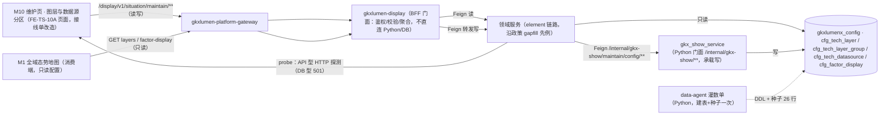
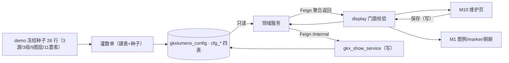

# TS-L2-M10-LAYER-ARCH · 维护管理 · 图层与数据源 · 后台实现架构设计

- 任务：`TS-L2-M10-LAYER-ARCH`
- 日期：2026-11-06
- 状态：架构稿已落盘，待架构、接口、算法、数据四角色会签。不标 done。**2026-11-06 监管人裁定后修订**：写库全归 Python（§3 退路转正），四表挪 `gkxlumenx_config`，两图与 §7 关注点同步改写
- 监管：`human:刘剑锋` · 认领：`agent:arch-agent`
- 强度：ponytail off（定义任务，不缩文档）
- 图：`TS-L2-M10-LAYER-ARCH-SEQ`（调用链）· `TS-L2-M10-LAYER-ARCH-DATA`（数据流），均为本二级新图（draft）

本叶只定维护管理（M10）二级「图层与数据源」的实现架构和整体流程。需规序号 **M1 序 5–9**（`科技全域态势.md`：图层配置 5 多对象图层管理 / 6 实时数据监控 / 7 图层分组与组织 / 8 数据源灵活配置；科创要素 9 基础信息查看功能的配置面）。不写 OpenAPI 字段、DTO、枚举、错误码——那是 `TS-L2-M10-LAYER-API`（待建）。

上游只引用，不改写：`科技全域态势.md` 序 5–9、[FE-TS-10A.md](../../FE-TS-10A.md) as-built、[对照-科技发展规划与维护管理-存量任务与依赖.md](../../../../工程过程/04-系统集成/05-展示系统集成/对照-科技发展规划与维护管理-存量任务与依赖.md) A 段、[新人引导-科技发展规划与维护管理.md](../../新人引导-科技发展规划与维护管理.md) §2/§4.1、`architecture-baseline.md`（D3/D7/D12/D15/D18）。不新造 `metric_id`，不改 D4。

签收标准（D18，可实现才签）：本叶逐项写明表名、灌数方、读取接口；配置写侧不返回内存 mock，接口读表。**写数据库全归 Python**（监管人 `human:刘剑锋` 2026-11-06 裁定，§3）：建表与种子归 data-agent 灌数单，运行时写经 `gkxlumen-display` → 领域服务 → Python `/internal/gkx-show/maintain/config/**`；读沿政策 gapfill 只读先例由领域服务直读。

## 0. 范围裁定

| 项 | 裁定 |
|---|---|
| 序 5 多对象图层管理 | **在本二级**：图层的可见性开关、启停配置的持久化与消费。M1 地图是消费端，不在本二级重做地图 |
| 序 6 实时数据监控 | **读侧归 M1**（WBS-05-18 管线，要素分布/密度地图渲染已有）；本二级只承担"数据源启停 → 影响 M1 刷新"的配置面 |
| 序 7 图层分组与组织 | **在本二级**：分组增删改、重命名、颜色标记（配置写侧） |
| 序 8 数据源灵活配置 | **在本二级**：数据源登记（API 接口 / 数据库表 / 用户填报三型）、编辑、启停、删除；测试连通见 §3 |
| 序 9 基础信息查看功能 | **读侧归 M1**（浏览/详情/筛选/收藏，WBS-05-18）；本二级只承担 FE-TS-10A 已复刻的**要素显示配置面**（11 要素显示名/颜色，现 localStorage，正式化入配置表） |
| 序 34–40 维护技术图谱 | **不在本二级**（报价划掉，不建实现单；见对照文档 A.1） |
| 序 41–47 关键实体与关系 | **不在本二级**（归 `TS-L2-M10-ENT-*`，后续二级） |

一句话：本二级 = **M10 维护页「图层与数据源配置」分区的正式化**：把 FE-TS-10A 的页面内存 + localStorage 演示态，落成服务端配置表 + CRUD REST + M1 消费链路；地图展示本体一句不动。

## 1. 存量调查（as-built，2026-11-06 核对）

| 件 | 现状 | 与正式架构的差距 |
|---|---|---|
| `lumen-ui-science-pc` maintain 分区1 | 数据源表 8 列（新增/编辑弹窗、测试连通、启停、删除确认）+ 图层组管理 + 11 要素显示名/颜色行内编辑；状态在页面 ref，刷新即失 | 无持久化；`fetchMaintainMeta` real 分支只打 `GET /situation/v1/maintain/meta`（唯一端点，未冻结） |
| 要素显示配置 | `src/stores/factorDisplay.ts` + `localStorage lumen-ui-science-pc:factor-display-v1`；M1 全域态势图例/marker 跨页消费 | 单浏览器私有，换机/换浏览器丢失；服务端不可见 |
| M2 全景入口 | `query.section=graph` 跳入本页 graph 分区（34–40 壳） | 不变，与本二级无冲突 |
| `lumen-svc-platform` | 无 `/situation/v1/maintain/**` 实现（grep 0 命中）；有 gkxlumen-display 模块与业务库先例 | 配置表与 CRUD 均为新建 |
| `BE-TS-CONTRACT-02` | 范围 M2–M9，无 M10 契约 | 本二级 API 单从零起草，对齐 as-built URL 差异见 §5 |

## 2. 需规叶 → 实现裁定总表（D18 核查表）

本二级为**配置写侧功能，无统计数字输出**，`metric_id` 全部 **N/A**（序 6 的分布/密度统计属 M1 读侧，不在本二级，D9 不适用；由 `TS-L2-M10-LAYER-METRIC` 复核本结论）。

| 叶 | 裁定 | 表 | 灌数方/写者 | 读取接口（Java REST） |
|---|---|---|---|---|
| 序 5 图层启停/可见性 | 真读写（配置 CRUD） | `cfg_tech_layer`（gkxlumenx_config，Python 侧库） | 种子：data-agent 灌数单（Python）；用户写：display→领域服务→Python internal（§3） | `/display/v1/situation/maintain/layers`（GET/PUT） |
| 序 7 图层分组与组织 | 真读写（配置 CRUD） | `cfg_tech_layer_group`（同库） | 同上 | `/display/v1/situation/maintain/layer-groups`（GET/POST/PUT/DELETE） |
| 序 8 数据源登记（API/DB 表/用户填报） | 真读写（配置 CRUD） | `cfg_tech_datasource`（同库） | 同上 | `/display/v1/situation/maintain/datasources`（GET/POST/PUT/DELETE） |
| 序 8 测试连通 | API 型：Java 端点探测（HTTP HEAD/GET + 超时）；DB 表型：**501**（Java 不直连业务库探测，Python 侧探测属后续增强，未排期）；用户填报型：无探测语义，前端禁用按钮 | —（不落表，探测结果不持久化） | — | `/display/v1/situation/maintain/datasources/{id}/probe`（POST） |
| 序 9 配置面（11 要素显示名/颜色） | 真读写（配置 CRUD，取代 localStorage） | `cfg_factor_display`（同库） | 同上 | `/display/v1/situation/maintain/factor-display`（GET/PUT） |
| 序 6 实时数据监控（读侧） | **不实现**（归 M1）；本二级仅通过 datasource 启停位影响 M1 刷新 | — | — | — |

> 表名前缀 `cfg_` 对齐 ENT-OPS data-gap-catalog 的配置表命名惯例（cfg_*）。四表字段（DDL）归 `TS-L2-M10-LAYER-DATA`；路径/DTO/错误码归 `TS-L2-M10-LAYER-API`。本叶只锁表名、写者、读接口三要素。

## 3. 关键裁定：写数据库全归 Python（监管人 2026-11-06 拍板，原「Java 直写业务库」裁定作废）

原稿曾裁定「配置 CRUD 走 `gkxlumen-display` 直写业务库配置表」。2026-11-06 监管人 `human:刘剑锋` 裁定：**写数据库的活儿全归 Python，保持原有规矩（D7/D15）**。原裁定作废（其动机——配置是运营元数据非数据域写——成立，但落点越权：D15 明文 display BFF **不直连 Python/DB**，正确链路是 Feign 经领域服务），按退路转正改写如下：

1. 四表挪出业务库，落 **Python 侧管理的库 `gkxlumenx_config`**（建议名，会签确认；不进 ODS/DWD/ADS 数仓分层，不混 `gkxlumenx_gapfill` 缺项语义；`cfg_` 前缀保留，表示配置真源而非 D16 缺项表）。
2. **建表 DDL + 种子行（26 行）一体归 data-agent 灌数单（Python）**：demo 冻结种子 3 数据源 / 3 图层组 / 9 图层枚举 / 11 要素默认显示（2026-11-06 经 DATA 分册核对修正，原稿误记「8 条数据源 / 9 组图层组」）。
3. **运行时写（C/U/D）全归 Python**：`gkxlumen-display` 只做门面（鉴权、枚举/参数校验），写请求经 Feign → 领域服务 → Feign `/internal` → `gkx_show_service`（D15 合规路径：`/internal/gkx-show/maintain/config/**`）→ 写 `gkxlumenx_config`。对外 URL 与 API 分册契约不变。
4. **运行时读沿政策 gapfill 只读先例**（POL 系领域服务直读 `gkxlumenx_gapfill`）：领域服务只读 `gkxlumenx_config`，display 经 Feign 聚合；M1 消费同链路。领域服务承载候选 gkxlumen-topic 侧 element 模块（政策同链路），实现单定。
5. probe 出网探测归**领域服务**（display 不出网）：API 型 HEAD/GET 5s 超时、结果不落库；DB 型 501；填报型 400。
6. 种子行 D4 语义不变：配置数据本身是**真配置**（非 mock 统计），界面不挂 MockBadge；种子与 demo 刻意一致处由 DATA 单标注（默认不标）。

## 4. 实现架构

### 4.1 调用链（图 `TS-L2-M10-LAYER-ARCH-SEQ`）

要点：浏览器只打 `/display/v1/situation/maintain/**`；写全归 Python（§3），display 不直连 Python/DB（D15）；M1 地图经同一 BFF 只读配置（替换 localStorage 消费）；无任何 demo 依赖（D12）。

### 4.2 数据流（图 `TS-L2-M10-LAYER-ARCH-DATA`）

要点：单一真源 = 配置表，**所有写路径终于 Python**（灌数单与 internal 写）；读由领域服务直读（gapfill 只读先例）；页面内存演示态与 localStorage 在接线单完成后**移除写路径**（factorDisplay store 改为服务端拉取 + 本地缓存回退只读）。

## 5. 与 FE-TS-10A 复刻页的接口差异（接线单输入）

| 项 | as-built（FE-TS-10A） | 正式架构（本叶） | 接线单动作 |
|---|---|---|---|
| 元数据 | `GET /situation/v1/maintain/meta` 一次取全（未冻结） | 拆为 4 组资源（layers / layer-groups / datasources / factor-display） | api 层重写拼装；`meta` 端点废弃（BE 从未实现，无兼容负担） |
| 写操作 | 页面内存（刷新即失，demo 同语义） | 4 组 CRUD REST | 分区1 全部按钮接真接口；删除仍走确认弹窗 |
| 要素显示 | localStorage + store | `GET/PUT factor-display` | store 数据源替换；localStorage 降级为离线缓存或移除（接线单定） |
| 测试连通 | 假延迟 + 假结果 | `POST probe`（API 型真探测，DB 型 501 空态文案） | 按钮 501 态文案 |
| MockBadge | 页面无 🧪 | 配置数据为真数据不挂 badge；种子行若保留演示值由 DATA 单标 | 接线单核对 |

## 6. 明确不做

- 不重做/不改 FE-TS-10A 页面结构（锁定期内不动 maintain 目录；接线单只改 api 拼装层）
- 不做地图渲染、要素浏览/详情/收藏（M1 读侧，WBS-05-18）
- 不做 DB 表型数据源的真连通探测（501，后续增强）
- 不碰序 34–40（报价划掉）与序 41–47（ENT 二级）
- 不新造指标、不写字段表、不重开 GDF；不做 ETL/调度（数据源"配置"仅元数据登记）

## 7. 会签关注点（2026-11-06 监管人裁定后更新）

1. ~~配置写侧落 Java 业务库~~ **已裁定作废**：写库全归 Python（§3 已按退路转正改写）。请复核改写后与 D7/D15/D18 的自洽性
2. 库位置：新库名 `gkxlumenx_config`（建议名）+ `cfg_` 前缀不挂 `gapfill_`（配置真源非 D16 缺项表）是否接受
3. 读侧张力：D3 字面「Java 仅读 `*_ads`」 vs 政策 gapfill 只读先例（领域服务直读 `gkxlumenx_gapfill`）——本二级沿先例读 `gkxlumenx_config`，请架构角色确认口径
4. 领域服务承载：写转发与只读的承载服务（候选 gkxlumen-topic 侧 element 模块，政策同链路）由实现单定，本叶只锁链路形态
5. probe 出网位置：领域服务出网探测（BFF 不出网）是否接受
6. 接口差异表 §5 的 `meta` 端点废弃
7. METRIC 复核 §2 的"全 N/A"结论
